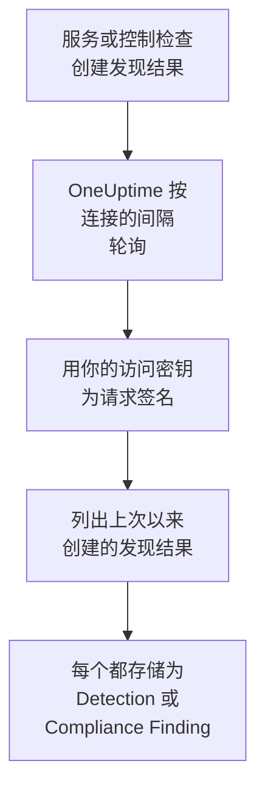

# AWS Security Hub

把 [AWS Security Hub](https://aws.amazon.com/security-hub/) 的发现结果导入 OneUptime 的安全事件：GuardDuty、Inspector、Macie 和 IAM Access Analyzer 的发现结果，Security Hub 自己的控制检查，以及合作伙伴产品的发现结果。在那里，你可以把它们与日志、跟踪和指标放在一起搜索，与其他所有来源进行关联分析，并为重要的发现结果呼叫值班人员。OneUptime 使用你创建的、只允许一个只读操作的访问密钥读取它们，不会在 AWS 中更改任何内容。无需设置代理、EventBridge 规则或 S3 导出。

:::cards
- [设置连接](#设置连接): 一个 IAM 策略、一个访问密钥，以及连接的表单。
- [导入的内容](#导入的内容): 每个发现结果如何成为一个安全事件。
- [轮询的工作方式](#轮询的工作方式): 每次轮询读取的时间窗口，以及它为何与上一个窗口重叠 30 分钟。
- [故障排除](#故障排除): 每个错误的含义，以及需要更改什么。
:::

## 工作方式



OneUptime 每分钟轮询一次已过轮询间隔的每个已启用连接。一次轮询会在你的区域中调用 Security Hub 的 `GetFindings`，并用 [Signature Version 4](https://docs.aws.amazon.com/IAM/latest/UserGuide/reference_sigv-create-signed-request.html) 签名，获取自上次轮询以来创建的发现结果。它把每个发现结果存储为一个 [OCSF](https://schema.ocsf.io/) 事件：控制检查存储为 Compliance Finding（类 `2003`），其他所有发现结果存储为 Detection Finding（类 `2004`）。之后，检测规则、监视器和仪表板会像对待其他任何来源的安全事件一样对待它。

## 开始之前

- 在 OneUptime 中拥有 Project Owner、Project Admin 或 Security Admin 角色。Security Member 和 Security Viewer 可以查看连接及其运行历史，但不能更改它们。
- 一个在你要连接的区域中启用了 Security Hub 的 AWS 账户。Security Hub 是区域性的：一个连接读取的是一个账户在一个区域中持有的发现结果。
- 要通过一个连接读取每个账户和每个区域的发现结果，需要使用 Security Hub 的委派管理员账户，在其主区域中并开启[跨区域聚合](https://docs.aws.amazon.com/securityhub/latest/userguide/finding-aggregation.html)。**Security Hub → Settings → Regions** 会显示主区域。
- 从 OneUptime 应用和工作进程到 `securityhub.<region>.amazonaws.com`（中国区域为 `securityhub.<region>.amazonaws.com.cn`）的出站 HTTPS，以及这些主机上准确的时钟：AWS 会拒绝签名时间偏差超过 5 分钟的请求。

## 设置连接

连接使用 IAM 访问密钥为它的请求签名。密钥的身份只需要一个操作 `securityhub:GetFindings`，不需要其他任何权限：连接从不更改发现结果。

:::steps
### 允许读取发现结果

在 [IAM 控制台](https://console.aws.amazon.com/iam/)中，打开 **Policies → Create policy**，选择 **JSON**，然后粘贴这个策略。为它命名，例如 `OneUptimeSecurityHubRead`：

```json
{
  "Version": "2012-10-17",
  "Statement": [
    {
      "Effect": "Allow",
      "Action": "securityhub:GetFindings",
      "Resource": "*"
    }
  ]
}
```

`GetFindings` 无法限制到某个资源，所以 `Resource` 保持为 `*`。托管策略 `AWSSecurityHubReadOnlyAccess` 也可以使用，但允许的操作更多。

### 创建访问密钥

1. 打开 **Users → Create user**，为用户命名，例如 `oneuptime-security-hub`，保持控制台访问关闭，并附加该策略。要读取其他账户的发现结果，请在委派管理员账户中执行此操作。
2. 打开该用户，然后打开 **Security credentials → Access keys → Create access key**，并选择 **Third-party service**。
3. 复制 **访问密钥 ID** 和 **秘密访问密钥**。AWS 只显示一次密钥。

### 在 OneUptime 中添加连接

打开 **产品 → Security Events → 连接**（`/dashboard/{projectId}/security-events/connections`），点击 **添加连接**，选择 **AWS Security Hub**，然后点击 **下一步**。填写下表中的设置，点击 **下一步**，然后把密钥粘贴到 **秘密访问密钥** 中。

### 保存之前先测试

点击 **保存前测试** 下的 **测试这些设置**。测试会用表单中的值为一个请求签名，不保存任何内容，所以错误的密钥或缺少的权限会在连接创建之前就暴露出来。然后点击 **下一步**，为连接设置一个 **名称** 并创建它。
:::

| 设置 | 填写什么 |
| --- | --- |
| **区域** | 区域代码，例如 `us-east-1`、`eu-central-1` 或 `us-gov-west-1`：读取其他账户的发现结果时，填写管理员账户的主区域。 |
| **访问密钥 ID** | 密钥的 ID：16 到 128 个字母或数字，通常是以 `AKIA` 开头的 20 个字符，临时凭据则以 `ASIA` 开头。 |
| **秘密访问密钥** | 密钥的秘密部分。它会被加密，API 从不返回它，也不会再次显示。要替换它，请在连接上使用 **更新凭据**。 |
| **Session token** | 仅用于需要它的临时凭据：没有它时 `ASIA` 密钥会被拒绝，有它时 `AKIA` 密钥会被拒绝。 |

来自 `aws sts assume-role` 或 `aws sts get-session-token` 的临时凭据会过期，对于代入的角色最多 12 小时，之后轮询会停止，直到你用 **更新凭据** 粘贴新的凭据。使用这个范围很窄的策略的长期密钥，按你自己的计划轮换，就能让轮询无人值守地持续进行。要从临时凭据切换到长期密钥，请在 **更新凭据** 中输入新密钥，并打开 **Remove the stored Session token**。

**轮询** 步骤还有可选的 **描述**、**轮询间隔（分钟）**（`1` 到 `1440` 之间的整数，初始为 `5`），以及初始为开启的 **已启用**。

## 导入的内容

每个发现结果都会成为一个事件，供应商为 `Amazon Web Services`，产品为 `AWS Security Hub`。带有 `Compliance` 对象的发现结果，即针对 AWS Foundational Security Best Practices 或 CIS 等标准的控制检查，会成为 Compliance Finding（OCSF 类 `2003`）。其他所有发现结果会成为 Detection Finding（OCSF 类 `2004`）。

| 发现结果字段 | OneUptime 列 |
| --- | --- |
| `Id`，对于 AWS 创建的发现结果是一个 ARN | 事件 UID，也是去重所依据的值 |
| `CreatedAt`，否则 `UpdatedAt`，否则 `FirstObservedAt` | 事件时间 |
| `Title` | 规则名称 |
| `GeneratorId`，例如 GuardDuty 发现结果类型或控制的 ID | 规则 ID |
| `Title`，否则 `Description` | 消息 |
| `Severity.Label`，否则按 `Severity.Normalized` 分档 | 严重程度 |
| `Workflow.Status`：`NEW`、`NOTIFIED`、`RESOLVED` 或 `SUPPRESSED`，否则使用较旧的 `WorkflowState` | 状态 |
| `TTPs/` 下的 `Types`：`TTPs/Initial Access/...` 变为 `TA0001` | MITRE ATT&CK 战术和技术 |
| 访问密钥或用户资源的 IAM 用户，`Network.SourceIpV4` 或 `SourceIpV6`，`Process.Name` 或 `Process.Path` | 主体的用户、IP 和进程 |
| `Process.Name` 和 `Process.Path` | 进程名称和路径。发现结果既不包含命令行，也不包含父进程。 |
| `AwsEc2Instance` 资源的实例 ID，`Network.DestinationIpV4` 或 `DestinationIpV6`，`Network.DestinationPort`，第一个 `Resources[].Id` | 目标的主机、IP、端口和资源 |
| 以上这些，以及每个 `Resources[].Id`、`AwsAccountId`、网络的域名、恶意软件名称和威胁情报值 | Observable |
| 整个发现结果，展平为点分隔的键，例如 `Compliance.Status` 和 `Remediation.Recommendation.Url` | `attributes` |

当发现结果没有 `Severity.Label` 时，由 `Severity.Normalized` 决定：`0` 为 Informational，`1` 到 `39` 为 Low，`40` 到 `69` 为 Medium，`70` 到 `89` 为 High，`90` 到 `100` 为 Critical。Security Hub 之后更新的发现结果（新的 `Workflow.Status`，或现在通过的控制）会保留它的 `Id`，所以不会被再次导入：事件保留的是导入时的发现结果。

## 轮询的工作方式

每次轮询列出在它的窗口中创建的发现结果，从最早的开始，每页 100 个，并跟随 `NextToken`，直到读完整个窗口：

```text
POST https://securityhub.{region}.amazonaws.com/findings
    {"Filters": {"CreatedAt": [{"Start": "{window start}", "End": "{window end}"}]},
     "SortCriteria": [{"Field": "CreatedAt", "SortOrder": "asc"}],
     "MaxResults": 100}
```

- **创建时间就是游标。** 发现结果按 `CreatedAt` 列出，从不按 `FirstObservedAt` 列出。GuardDuty 在观察到足够的活动后才创建发现结果，控制检查则在 Security Hub 首次检查资源时创建，可能是活动开始后几小时甚至几天。基于观察时间的游标会把它们跳过。
- **第一次轮询会回溯 24 小时**，所以新连接会立刻显示最近的发现结果。
- **之后的每次轮询都从保存的游标之前 30 分钟开始。** `CreatedAt` 由发现问题的服务设置，而发现结果到达 Security Hub 的时间更晚：GuardDuty 在五分钟内发送新的发现结果，通过 EventBridge 投递失败时最多会重试 24 小时。重叠部分会在下一次轮询中读取这类发现结果。在其 `CreatedAt` 之后超过 30 分钟才到达的发现结果可能会落在游标后面：导入它的时间范围即可找回。
- **一次轮询最多读取游标之后 24 小时。** 游标落后的连接会通过一连串 24 小时的窗口追赶，此时它的 **健康状况** 显示为 **Catching up**。
- **重复项按发现结果的 `Id` 去重**，范围是整个项目，所以重叠部分、重试的窗口和导入都不会把同一个发现结果存储两次。

### 当一个窗口包含的内容超过一次轮询能读取的量时

一次轮询最多发送 20 个请求，每个请求 100 个发现结果，也就是 2,000 个发现结果。当窗口中的发现结果更多时，这次运行为 **部分**，并带有如下警告：

```text
Stopped after 20 findings requests (the per-run request limit) before the window was fully read. The last finding read was created at 2026-09-14T08:12:44.000Z.
```

发现结果从最早的开始读取，所以 OneUptime 会把游标移到它读取的最后一个发现结果的创建时间，下一次轮询就从那里开始，不带 30 分钟的重叠，窗口长度不变。繁忙的账户每次轮询追赶大约 2,000 个发现结果，而不是重复读取同样的内容。当游标越过那个点 30 分钟之后，重叠会恢复。

当一次运行完全无法越过保存的游标时，例如仅 30 分钟的重叠部分就包含超过 2,000 个发现结果，OneUptime 会改为缩短窗口：

1. **缩小。** 下一次轮询从同一个起点读取长度减半的窗口，并不断减半，直到某个窗口能被完整读取，最短为一分钟。运行的警告会说明这一点：`This window holds more records than one poll can read; the next poll reads a {n} minute window from the same starting point.`
2. **恢复。** 一个窗口被完整读取后，下一个窗口的长度会再次加倍，最长为 24 小时。
3. **越过单独的一分钟。** 如果连一分钟内的内容都超过一次轮询能读取的量，轮询会越过这一分钟，让更新的发现结果继续到达，之后轮询的重叠部分也不会再回到这一分钟。这次运行仍为 **部分**，**最近错误** 显示 `More records were created in the one minute from {cursor} to {end} than one poll can read. Polling moved past this minute so newer records keep arriving; use Import this time range in Diagnostics on this minute to recover what one run can read.` 用 **Import this time range** 导入这一分钟，就能找回一次运行能读取的内容。

因 AWS 的错误而彻底失败的运行，会保留游标和窗口长度，下一次轮询会再次读取同一个窗口。唯一的例外是请求超时：游标保持不变，但下一个窗口的长度减半，因为重到无法及时得到响应的窗口每次尝试都会超时。更改 **轮询间隔（分钟）** 不会改变这些：它决定的是轮询多久开始一次，而不是窗口从哪里开始。

### 按需运行、预览和导入

在连接上点击 **诊断**，可以查看它最近的运行，并手动操作它。能更改该连接的人都可以启动这些操作；能查看它的人都可以阅读历史记录。

- **立即运行** 会立即开始一次轮询，使用通常的游标，即使连接未处于 **已启用** 状态也可以。
- **Preview findings** 读取最长 7 天的时间范围，不导入任何内容。
- **Import this time range** 在你确认后导入最长 7 天的范围，不会移动游标。已导入的发现结果会被跳过。
- 运行上的 **Copy diagnostics** 会复制它的报告以便提供给支持人员。报告从不包含凭据。

## 测试连接

连接所在行中的 **测试连接** 和表单中的 **测试这些设置** 在 API 进程中运行，而不是在后台工作进程中运行，所以即使工作进程出了问题，测试仍然会给出结果。它按顺序运行以下检查：

| 检查 | 检查的内容 |
| --- | --- |
| **配置** | 每项设置都存在且格式正确。此项失败时不会连接任何地方。 |
| **Authenticate with AWS** | AWS 接受一个针对过去 24 小时内创建的某个发现结果的已签名 `GetFindings` 请求。AWS 先检查签名，再检查 IAM 策略，所以即使被策略拒绝，这项检查也会通过：密钥是正确的。 |
| **Read findings** | Security Hub 响应了该请求：该身份可以调用 `securityhub:GetFindings`，并且该区域中已启用 Security Hub。 |
| **Findings available to import** | 过去 24 小时和过去 7 天内创建了多少个发现结果，各统计一页（100 个），所以 `100+` 表示更多。7 天内一个都没有是警告，而不是失败。 |
| **Background workers**、**Poll scheduler**、**Security event storage** | OneUptime 自身的一侧：有进程在处理 Worker 队列的作业，轮询作业每分钟运行一次，安全事件存储能够响应。 |
| **Scheduled polling** | 针对已保存的连接：轮询已开启，没有运行卡在等待工作进程的状态，并且轮询按时运行。 |

测试中的每个请求都有 20 秒的期限。测试从不导入任何内容，也不移动游标，每个失败的检查都会说明需要更改什么。

## 故障排除

连接的 **最近错误** 会保留完整的错误消息（凭据已隐去），前面带有一个指明失败步骤的前缀。连接出错时，在它的 **操作** 列中选择 **查看错误** 来阅读，并在对话框中用 **复制错误** 复制。每条消息都以 `AWS Security Hub findings request` 开头；请阅读后面的内容。

:::details Last Error 显示 `failed (HTTP 401)` 或 `failed (HTTP 403)`
AWS 拒绝了请求。消息会引用 AWS 的错误代码，如果 AWS 没有发送代码，则引用 AWS 自己的说法：

- `AccessDeniedException`，或 `is not authorized to perform`：密钥是正确的，但它的身份不能调用 `securityhub:GetFindings`。请附加 [设置连接](#设置连接) 中的策略。权限边界或服务控制策略也可能拒绝它。
- `InvalidAccessException`，或 `is not subscribed to AWS Security Hub`：在 **区域** 指定的区域中，此账户没有启用 Security Hub，或者此账户不是那里的管理员。
- `InvalidSignatureException` 或 `SignatureDoesNotMatch`，或 `The request signature we calculated does not match`：**秘密访问密钥** 不属于 **访问密钥 ID**。请创建一个新的访问密钥，并用 **更新凭据** 保存。
- `UnrecognizedClientException` 或 `InvalidClientTokenId`，或 `The security token included in the request is invalid`：AWS 不认识这个 **访问密钥 ID**。它输错了、已删除、已停用或来自另一个分区，或者是缺少 **Session token** 的临时密钥。
- `ExpiredTokenException`，或 `The security token included in the request is expired`：临时凭据已过期。请签发新的凭据，或者改用长期密钥。
- `RequestTimeTooSkewed` 或 `RequestExpired`，或 `Signature expired`：OneUptime 主机的时钟偏差超过 5 分钟。请修复应用和工作进程主机上的 NTP。
- 完全没有代码：AWS 没有说明是密钥还是策略拒绝了它。请先检查密钥，再检查策略。
:::

:::details Last Error 显示 `failed (HTTP ...)` 和其他状态
- `HTTP 404`：在 **区域** 指定的区域中，没有 Security Hub 端点作出响应。请与 AWS 控制台的区域菜单进行比较：应该是 `us-east-1`，而不是 `us-east1` 或 `N. Virginia`。
- `HTTP 429`：账户达到了 Security Hub 的限制，即每个区域每秒 3 个 `GetFindings` 请求。下一次轮询会重试。如果这种情况持续发生，请找找是否有其他工具或连接在读取同一个账户和区域。
- `HTTP 5xx`：Security Hub 自身出现了问题。下一次轮询会重试。
- `HTTP 400`：Security Hub 拒绝了查询，而查询是由 OneUptime 构建的，与你的设置无关。请把消息发送给 OneUptime 支持团队。
:::

:::details Last Error 显示 `returned`、`timed out` 或 `Could not reach data source`
- `returned a non-JSON body` 或 `returned an unrecognized response shape`：响应的不是 Security Hub，而是其他东西，例如代理的登录页面或会改写响应的网关。这会被报告出来，而不是当作空窗口处理，所以游标永远不会越过没人读过的发现结果。
- `timed out after 60 seconds with no response`，或 `failed: Could not reach data source`：请求没有得到响应。Security Hub 的端点是公开的，所以请检查 OneUptime 应用和工作进程与 `securityhub.<region>.amazonaws.com` 之间的 DNS、防火墙和代理。
:::

:::details Last Polled 为 Never 且 Last Error 为空
这个连接还没有完成过任何轮询。运行 **测试连接**：它的 **Background workers** 和 **Poll scheduler** 检查会指出原因。在自托管安装中，常见原因是应用上设置了 `DISABLE_QUEUE_WORKERS=true`，却没有单独的工作进程部署来处理作业：把它设为 `false`，或运行工作进程部署（Helm：`worker.enabled: true`）。
:::

:::details 运行为 Partial
- `Stopped after 20 findings requests`：窗口中的发现结果超过了一次运行能读取的 2,000 个。不会丢失任何内容：下一次轮询会从读取的最后一个发现结果之后开始。一次又一次轮询都保持 **部分** 的连接正在追赶积压的内容，它的 **最近轮询** 和 **最近导入的事件** 会不断前进。如果它始终追不上，说明该账户在每个轮询间隔内创建的发现结果超过 2,000 个：请缩短 **轮询间隔（分钟）**。
- `More records were created in the one minute from ... than one poll can read`：轮询越过了这一分钟。请在 **诊断** 中用 **Import this time range** 导入它。一次导入读取的量与一次轮询相同。
:::

:::details 测试通过，但没有导入任何内容
阅读测试报告中的 **Findings available to import**。过去 7 天为 `0` 表示 Security Hub 在这个账户和区域中没有创建任何发现结果：请检查那里是否开启了 GuardDuty、Inspector 或某个安全标准。要查看其他账户和区域的发现结果，请在管理员账户的主区域中连接该账户。
:::

:::details Security Hub 控制台中的某个发现结果始终没有到达
比较它的 `CreatedAt` 和 `ProcessedAt`（Security Hub 收到它的时间）。在其 `CreatedAt` 之后超过 30 分钟才到达的发现结果可能会落在游标后面：请用 **Import this time range** 导入它的 `CreatedAt`。
:::

## 你会得到什么

- **搜索。** 在安全事件资源管理器中，与其他所有来源放在一起，按严重程度、状态、规则、账户、资源或任何 observable 过滤发现结果。
- **关联分析。** 每个发现结果的用户、实例、IP、资源 ARN 和账户 ID 都会作为 observable 建立索引，所以一次搜索就能找到提到它们的所有内容。
- **检测规则。** 按计划对你的安全事件运行的 Sigma 规则，会打开呼叫值班人员的警报。
- **监视器。** 安全事件监视器统计匹配的事件，例如新的严重 GuardDuty 发现结果或失败的控制，并在超过阈值时打开事件或警报。

安全事件与其他遥测数据一样，按摄取的 GB 数计费。请参阅 [定价](https://oneuptime.com/pricing)。

## 后续步骤

:::cards
- [安全事件](/docs/telemetry/security-events): 搜索、关联分析你导入的内容，并据此发出警报。
- [Okta System Log](/docs/integrations/okta): 同时导入身份提供方的登录。
- [角色](/docs/permissions/reference#角色): Security 角色可以查看和更改的内容。
- [集成概述](/docs/integrations/index): 你可以连接的其他工具。
:::
