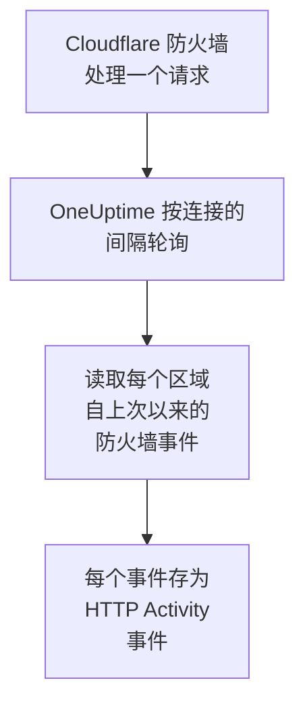

# Cloudflare

将 [Cloudflare](https://www.cloudflare.com) 防火墙在边缘所做的事情导入 OneUptime 的安全事件：其托管和自定义 WAF 规则、速率限制、IP Access Rules、机器人管理和 HTTP DDoS 防护所拦截、质询或记录的请求。每个请求都与你的应用自身的请求并排，因此案例会说明 Cloudflare 拦下了什么，以及什么仍然到达了你的应用。OneUptime 使用只能读取的 API 令牌读取它们，不会在 Cloudflare 中更改任何内容。

:::cards
- [设置连接](#设置连接): 一个带两项读取权限的 API 令牌，以及连接的表单。
- [导入的内容](#导入的内容): 导入哪些事件，以及每个事件如何成为一个安全事件。
- [轮询的工作方式](#轮询的工作方式): 每次轮询读取的时间窗口，以及它为什么重叠 10 分钟。
- [故障排除](#故障排除): 每个错误的含义，以及需要更改什么。
:::

## 工作方式

OneUptime 每分钟轮询每个已启用且轮询间隔已到的连接。一次轮询会列出账户的区域，从 GraphQL Analytics API 的 settings 节点读取每个区域的套餐允许的范围，并从 `firewallEventsAdaptive` 数据集（[Security Events](https://developers.cloudflare.com/waf/analytics/security-events/)）按从旧到新的顺序读取自上次轮询以来每个区域的防火墙事件。每个事件都存为 [OCSF](https://schema.ocsf.io/) HTTP Activity 事件。

## 开始之前

- 在 OneUptime 中拥有项目所有者、项目管理员或安全管理员角色。安全成员和安全查看者可以查看连接及其运行历史，但不能更改它们。
- 一个能为账户的区域创建 API 令牌的 Cloudflare 用户。
- 流量经过 Cloudflare 的区域：它们的 DNS 记录已开启代理。
- 从 OneUptime 应用和 worker 到 `api.cloudflare.com` 的出站 HTTPS。

## 设置连接

该连接使用 [API 令牌](https://developers.cloudflare.com/fundamentals/api/get-started/create-token/)读取，从不使用 Global API Key：令牌的范围限于账户及其区域，并且可以单独撤销。它需要两项[权限](https://developers.cloudflare.com/fundamentals/api/reference/permissions/)，都是只读的：

| 权限 | OneUptime 用它读取什么 |
| --- | --- |
| `Zone > Zone > Read` | 区域，以及它们的账户和套餐。 |
| `Zone > Analytics > Read` | 通过 GraphQL Analytics API 读取的每个区域的防火墙事件。 |

:::steps
### 创建 API 令牌

1. 在 Cloudflare 控制面板中打开 **My Profile → API Tokens**，选择 **Create Token**，然后选择 **Create Custom Token**。
2. 将它命名为 `oneuptime-security-events`。在 **Permissions** 下添加 `Zone > Zone > Read` 和 `Zone > Analytics > Read`。
3. 在 **Zone Resources** 下包含账户的所有区域，或要导入的区域。
4. 选择 **Continue to summary**，然后选择 **Create Token**，并复制令牌。Cloudflare 只显示它一次。

### 在 OneUptime 中添加连接

打开 **产品 → 安全事件 → 连接**（`/dashboard/{projectId}/security-events/connections`），点击 **添加连接**，在 **云安全** 下选择 **Cloudflare**，然后点击 **下一步**。将令牌粘贴到 **API 令牌** 中。OneUptime 随后会列出令牌能读取的账户和区域：选择 **账户**，并在 **区域** 中保留 **所有区域**，或选择要导入的区域。

### 保存之前先测试

点击 **保存前测试** 下的 **测试这些设置**。测试会用表单中的值检查每项权限，指出缺少的权限，并且不保存任何内容。然后点击 **下一步**，为连接填写 **名称** 并创建它。
:::

| 设置 | 填写什么 |
| --- | --- |
| **账户** | 要读取的 Cloudflare 账户，从你的 API 令牌能读取的账户中选择。只能读取一个账户的令牌会自动为你选好。 |
| **区域** | 可选。留空会读取账户中所有活动的区域，包括以后添加的区域。一个连接最多读取 50 个区域。 |
| **API 令牌** | 只填令牌本身，不带 `Bearer`。它会被加密，API 从不返回，也不会再次显示。可在连接上用 **更新凭据** 替换它。 |

**轮询** 步骤还有可选的 **描述**、**轮询间隔（分钟）**（一个从 `1` 到 `1440` 的整数，起始为 `5`），以及默认开启的 **已启用**。Cloudflare 的事件是请求而不是告警，因此表单不会询问 **打开案例的起始严重程度**：案例来自读取这些事件的检测规则。

### 写入权限是单独的选择

该连接从不更改 Cloudflare 中的任何内容。在那里拦截地址是单独的选择加入，需要写入权限：列表需要 `Account > Account Filter Lists > Edit`，每个要拦截的区域需要 `Zone > Zone WAF > Edit`，列表不足的套餐需要 `Account > Account Firewall Access Rules > Edit`。只有在开启拦截时才把它们加到令牌上。

## 导入的内容

每个事件的供应商为 `Cloudflare`，产品为 `Cloudflare WAF`，是 HTTP Activity（`4002`）事件。

| Cloudflare 的字段 | 在安全事件中 |
| --- | --- |
| `clientIP` | 主体 IP，以及 `client.address` |
| `clientRequestHTTPHost`, `clientRequestPath`, `clientRequestQuery` | 目标主机、目标资源（路径和查询），以及 `url.original` |
| `clientRequestHTTPMethodName`, `userAgent` | 活动、`http.request.method` 和 `user_agent.original` |
| `action` | 状态，以及 `oneuptime.edge.action` |
| `source`, `ruleId`, `description` | 规则 ID、规则名称，以及 `cloudflare.source` |
| `rayName`, `clientCountryName`, `clientAsn` | `cloudflare.ray_id`、`cloudflare.client.country` 和 `cloudflare.client.asn` |
| `sampleInterval` | `oneuptime.edge.sample_interval` |

| Cloudflare 做了什么 | 状态 | `oneuptime.edge.action` | 请求结果 | 严重程度 |
| --- | --- | --- | --- | --- |
| 拦截、关闭了连接，或质询失败 | Blocked，关闭连接时为 Dropped | `blocked` | Rejected | Low |
| 以托管、JS 或交互式质询作答 | Challenge | `challenged` | Rejected | Low |
| 通过了质询，或之前已通过质询的访问者 | Allowed | `passed-challenge` | 无 | Informational |
| 记录并放行 | Logged | `logged` | 源站的状态码 | Medium；源站失败时为 High；源站拒绝请求时为 Low |
| 按你的 skip 或 allow 规则放行 | Allowed | `let-through` | 源站的状态码 | 与已记录的请求相同 |

被你自己的 skip 或 allow 规则放行的请求，只有在携带攻击（SQL 注入、路径遍历或 Log4Shell 查找），或 Cloudflare 的 WAF attack score 将其判定为攻击时才会导入。其余的是你有意允许的流量，例如你的监控：每次运行都会计数并将其排除。

Cloudflare 会对繁忙区域的事件进行采样。每个事件都保留其采样间隔，即它所代表的同类请求数，OneUptime 由此得出的每个数字都会标注 *约*。

这些事件会出现在事件、活动（按地址划分的攻击请求）、实体风险和检测规则中。关于某个地址的案例会在其影响的 **在边缘** 下，并排显示 Cloudflare 对该地址的请求做了什么，以及什么到达了你的应用。规则库中的 Cloudflare 规则按这里导入的样子读取它们：来自一个地址的大量托管规则命中、一个通过质询后发送攻击的地址，以及一个被 Cloudflare 放行并到达你的应用的攻击。

## 套餐限制

每个套餐都能通过 API 获取防火墙事件。**测试连接** 中的 **What each zone's plan gives** 会从 Cloudflare 读取每个区域自己的限制。

| 套餐 | Free | Pro | Business | Enterprise |
| --- | --- | --- | --- | --- |
| 保留的防火墙事件 | 31 天 | 31 天 | 31 天 | 31 天 |
| 最长查询 | 30 天 | 30 天 | 30 天 | 31 天 |

Cloudflare 的 Logpush 也能发送防火墙事件，自 2026 年 9 月 30 日起在每个套餐上可用，按用量计费。该连接改为轮询，因此除了两项读取权限之外什么都不需要。

## 轮询的工作方式

- **事件按其在边缘发生的时间读取。** Cloudflare 的分析数据在请求后一两分钟即可查询。
- **第一次轮询会回溯 24 小时**，所以新连接会立刻显示最近的事件。
- **之后的每次轮询都从保存的游标之前 10 分钟开始**，因此 Cloudflare 晚些才可读取的事件会在下次轮询时读到，重复项会在项目内按每个事件的 Ray ID 去除。
- **一次轮询最多读取游标之后 24 小时。** 游标落后的连接会通过一连串 24 小时的窗口追赶。
- **区域按顺序轮流读取**，每个区域一页最多 2,000 个事件，因此繁忙的区域无法在安静的区域被读取之前耗尽一次轮询。
- **遵守 Cloudflare 的速率限制。** Cloudflare 允许五分钟内 1,200 个 REST 请求和 300 个 GraphQL 查询。要求等待 30 秒或更短的 `429` 会等过之后再次请求；更长的则会停止本次轮询，由下一次继续。
- **令牌无法读取的区域不会耽误其他区域。** 其他区域照常导入，运行为 **部分**，其警告会指出该区域。在那里为令牌授予 `Zone > Analytics > Read`，然后使用 **导入此时间范围** 补回该时间窗口。
- **失败的运行不会改变任何东西。** 发生网络错误或 Cloudflare 返回错误状态后，游标和窗口长度保持不变，下一次轮询会再次读取同一窗口。唯一的例外是超时的请求：游标不变，但下一个窗口只有一半长，因为一个重到无法及时响应的窗口每次尝试都会超时。

### 当一个窗口包含的内容超过一次轮询能读取的量时

一次轮询最多发送 120 个请求，最多读取 20,000 个事件，并在 4 分钟后停止。事件按从旧到新的顺序读取，因此当预算让轮询停止时，运行为 **部分**，下一次轮询会从未完成区域已读到的最旧事件处继续。当并非每个区域都至少读过一次时，OneUptime 会改为缩短窗口：

1. **缩小。** 下一次轮询从同一起点读取一半长度的窗口，并继续减半，直到某个窗口被完整读取，最短为一分钟。运行的警告会这样说明：`This window holds more records than one poll can read; the next poll reads a {n} minute window from the same starting point.` 已从较长窗口导入的事件会作为重复项跳过。
2. **恢复。** 一个窗口被完整读取后，游标会移到它的末尾，下一个窗口的长度会再次加倍，最长为 24 小时。
3. **越过单个分钟。** 如果连一分钟内的内容都超过一次轮询能读取的量，轮询就会越过它，让较新的事件继续到达。运行仍为 **部分**，**最近错误** 显示 `More records were created in the one minute from {cursor} to {end} than one poll can read. Polling moved past this minute so newer records keep arriving; use Import this time range in Diagnostics on this minute to recover what one run can read.` 用 **导入此时间范围** 导入这一分钟，可补回一次运行能读取的内容。

更改 **轮询间隔（分钟）** 不会改变这些：它决定的是轮询多久开始一次，而不是窗口从哪里开始。

### 按需运行、预览和导入

在连接上点击 **诊断**，可以查看它最近的运行，并手动操作它。能更改该连接的人都可以启动这些操作；能查看它的人都可以阅读历史记录。

- **立即运行** 会立即开始一次轮询，使用通常的游标，即使连接未处于 **已启用** 状态也可以。
- **预览防火墙事件** 读取最多 7 天的时间范围，不导入任何内容。
- **导入此时间范围** 在你确认后导入最多 7 天的范围，不移动游标。已导入的事件会被跳过。Cloudflare 保留 31 天的防火墙事件。
- 运行上的 **复制诊断信息** 会复制它的报告以便提供给支持人员。报告从不包含凭据。

## 测试连接

连接所在行中的 **测试连接** 和表单中的 **测试这些设置** 在 API 进程中运行，而不是在后台工作进程中运行，所以即使工作进程出了问题，测试仍然会给出结果。它按顺序运行以下检查：

| 检查 | 检查的内容 |
| --- | --- |
| **配置** | 令牌、账户和区域格式正确。如果这一项失败，不会联系任何地方。 |
| **Verify the API token** | Cloudflare 接受该令牌（用户的令牌或账户拥有的令牌），并且它处于活动状态。14 天内过期的令牌是警告。 |
| **List the zones** | 令牌具有 `Zone > Zone > Read`：它会列出账户的区域，以及每个选定的区域。 |
| **Read firewall events** | 令牌在每个区域都具有 `Zone > Analytics > Read`。失败时会指出缺少该权限的区域。 |
| **What each zone's plan gives** | 每个区域的套餐保留防火墙事件多久，以及一次查询可以多长。套餐中没有这些事件的区域是警告。 |
| **Firewall events available to import** | 过去 24 小时和过去 7 天大约有多少事件。没有事件是警告。 |
| **Background workers**、**Poll scheduler**、**Security event storage** | OneUptime 自身的一侧：有进程在处理 Worker 队列的作业，轮询作业每分钟运行一次，安全事件存储能够响应。 |
| **计划轮询** | 针对已保存的连接：轮询已开启，没有运行卡在等待工作进程的状态，并且轮询按时运行。 |

测试中的每个请求都有 20 秒的期限。测试从不导入任何内容，也不移动游标，每个失败的检查都会说明需要更改什么。

## 故障排除

连接的 **最近错误** 会保留完整的错误消息，凭据已隐去。连接出错时，在其 **操作** 列中选择 **查看错误** 阅读，并在对话框中用 **复制错误** 复制。每条消息都会指出失败的请求，并引用 Cloudflare 自己给出的原因。

:::details 最近错误显示 `Invalid API Token (1000)`
Cloudflare 不认识该令牌：它已被删除、轮换，或从未完整粘贴。Global API Key 会在发送前被拒绝。按上面的步骤创建令牌，并用 **更新凭据** 保存。
:::

:::details 最近错误显示 `Unauthorized to access requested resource (9109)`
令牌无法列出区域。为它授予 `Zone > Zone > Read`，并在 **Zone Resources** 下包含要导入的区域。
:::

:::details 最近错误显示 `cannot read the analytics of`
令牌在消息指出的区域上缺少 `Zone > Analytics > Read`。在那里添加它，然后使用 **导入此时间范围** 补回未导入的内容。
:::

:::details 最近错误显示 `rate limit`
使用同一个 Cloudflare 用户的其他东西用完了配额。五分钟过后轮询会自动继续；给 OneUptime 一个专用用户的令牌，可以把配额分开。
:::

:::details 最近错误 显示 `did not complete`
请求没有收到回应：超时、无法解析的名称或被拒绝的地址。请检查 OneUptime 应用和 worker 能否通过你使用的任何代理访问 `api.cloudflare.com`。
:::

:::details 案例显示了 Cloudflare 的处理，但你的应用中没有该地址的任何请求
在 Cloudflare 后面，除非你的应用从 `CF-Connecting-IP` 标头读取访问者的地址，否则它看到的是 Cloudflare 的地址。把该地址作为 `client.address` 写入你的日志和追踪，OneUptime 就能把你的应用的请求与 Cloudflare 处理过的地址对应起来。
:::

:::details 测试通过，但 Last Polled 为 Never
轮询作业从未运行过。阅读 **Background workers** 和 **Poll scheduler** 检查。在自托管安装中，常见原因是应用上设置了 `DISABLE_QUEUE_WORKERS=true`，却没有单独的工作进程部署来处理作业：把它设为 `false`，或运行工作进程部署（Helm：`worker.enabled: true`，默认为 `false`）。
:::

## 后续步骤

:::cards
- [安全事件](/docs/telemetry/security-events): 搜索、关联分析你导入的内容，并据此发出警报。
- [安全案例](/docs/telemetry/security-cases): 查看 Cloudflare 做了什么，以及什么到达了你的应用。
- [集成概述](/docs/integrations/index): 你可以连接的其他工具。
:::
