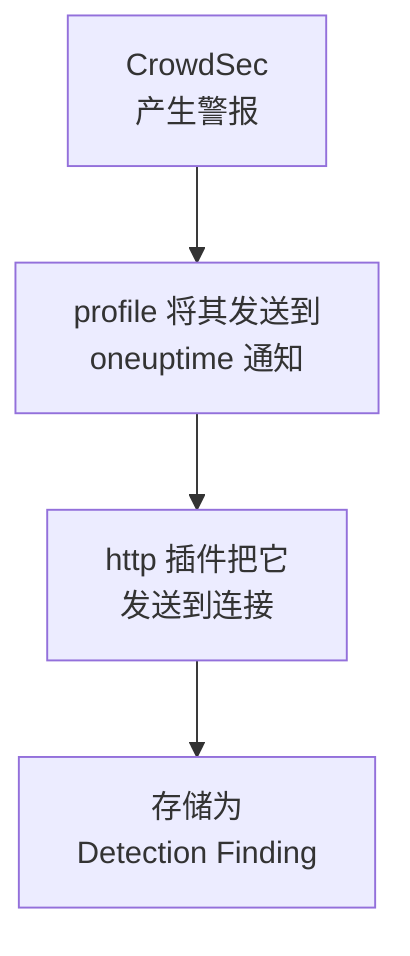

# CrowdSec

[CrowdSec](https://www.crowdsec.net/) 一产生警报，就在 OneUptime 的安全事件中接收这些警报，并用 CrowdSec 封禁你项目的封禁列表中的地址。CrowdSec 自己的通知插件会把每个警报发送到一个 CrowdSec 连接，该连接会根据 CrowdSec 的检测打开案例。开启封禁后，OneUptime 会通过 CrowdSec 的 Local API 封禁你封禁的每个地址，读取该 Local API 的每个 bouncer 都会封禁该地址。

:::cards
- [设置连接](#设置连接): 一个连接，以及把 CrowdSec 的警报发送到该连接的通知。
- [接收的内容](#接收的内容): 每个 CrowdSec 警报如何成为一个安全事件。
- [用 CrowdSec 封禁地址](#用-crowdsec-封禁地址): 在 CrowdSec 中封禁你封禁列表中的地址。
- [读取 CrowdSec 的封禁列表](#读取-crowdsec-的封禁列表): CrowdSec Console 提供的列表，作为威胁情报源。
- [故障排除](#故障排除): 每个错误的含义，以及需要更改什么。
:::

## 工作方式



CrowdSec 的 Local API 会把 profile 发送到某个通知的每个警报交给该通知的插件。连接的通知使用 CrowdSec 的 `http` 插件：它以 CrowdSec 自己的 JSON 格式，带上你的摄取密钥并指明连接，把警报发送到安全事件的摄取端点。OneUptime 将其存储为 [OCSF](https://schema.ocsf.io/) Detection Finding 事件（类别 `2004`），用你的检测规则检查它，并为 CrowdSec 自己的、达到或高于连接的 **打开案例的起始严重程度** 的每个检测打开一个案例。不进行任何轮询：警报会在 CrowdSec 产生它后几秒内到达。

## 开始之前

- 在 OneUptime 中拥有项目所有者、项目管理员或安全管理员角色。安全成员和安全查看者可以查看连接，但不能更改它们。
- CrowdSec 1.5 或更高版本，以及它的 Local API 和随附的 `http` 通知插件。本页基于 CrowdSec v1.8.2 编写。
- 从运行 CrowdSec 的 Local API 的主机到你的 OneUptime 的出站 HTTPS。
- 如果还要封禁地址：OneUptime 能够访问的 Local API，以及一台供 OneUptime 使用的机器（见 [用 CrowdSec 封禁地址](#用-crowdsec-封禁地址)）。

## 设置连接

:::steps
### 在 OneUptime 中添加连接

打开 **产品 → 安全事件 → 连接**（`/dashboard/{projectId}/security-events/connections`），点击 **添加连接**，选择 **CrowdSec**，然后点击 **下一步**。如果只接收警报，请把下表中的所有设置留空；如果还要封禁地址，请填写它们。

### 保存之前先测试

点击 **保存前测试** 下的 **测试这些设置**。未设置 Local API 时，测试会如实说明，并且不联系任何地方；设置了 Local API 时，测试会访问它并以该机器的身份登录，且不保存任何内容。然后点击 **下一步**，在 **警报** 步骤中为连接填写 **名称**，选择 **打开案例的起始严重程度**，然后创建它。

### 在 CrowdSec 主机上保存通知

创建连接会打开它的 **发送警报**，之后你也可以从连接所在行再次打开它。在 **选择一个摄取密钥** 中选好密钥，然后把它显示的通知（已填好你的密钥和连接）保存到运行 CrowdSec 的 Local API 的主机上：

```yaml title="/etc/crowdsec/notifications/oneuptime.yaml"
type: http
name: oneuptime

# info or quieter: at debug, CrowdSec logs each request's headers.
log_level: info

format: |
  {{.|toJson}}

url: https://oneuptime.com/security-events/v1/ingest?connection=YOUR_CONNECTION_ID&format=crowdsec
method: POST
headers:
  Content-Type: application/json
  x-oneuptime-token: YOUR_INGESTION_TOKEN
```

### 将你的 profile 的警报发送到该通知

在 `/etc/crowdsec/profiles.yaml` 中，把 `oneuptime` 添加到每个其警报应由 OneUptime 接收的 profile 的 `notifications` 中，然后重新加载 CrowdSec：

```yaml title="/etc/crowdsec/profiles.yaml"
notifications:
  - oneuptime
```

```bash
sudo systemctl reload crowdsec
```

### 发送测试警报

```bash
sudo cscli notifications test oneuptime
```

**发送警报** 会显示警报何时到达，**查看警报** 会在安全事件中打开它。它是一个严重程度为 Informational 的事件，不会打开案例。
:::

| 设置 | 填写什么 |
| --- | --- |
| **Local API 的 URL** | 仅用于封禁地址：OneUptime 访问 CrowdSec 的 Local API 的地址，例如 `https://crowdsec.example.com:8080`。只要跨越网络，就使用 `https`。 |
| **机器 ID** | 仅用于封禁地址：OneUptime 登录时所用的机器，在 CrowdSec 主机上用 `sudo cscli machines add oneuptime --auto -f -` 添加。 |
| **用 CrowdSec 封禁地址** | 新连接上是关闭的。开启后，它会在 CrowdSec 中封禁你封禁列表中的地址和范围，并且需要其他三项设置（见 [用 CrowdSec 封禁地址](#用-crowdsec-封禁地址)）。 |
| **机器密码** | 仅用于封禁地址：`cscli` 为该机器打印的密码。它会被加密，API 从不返回，也不会再次显示。在连接上用 **更新凭据** 替换它。 |

**警报** 步骤还有可选的 **描述**，以及默认开启的 **已启用**。未启用的连接会把收到的警报保留为事件，不会据此打开案例。

在容器中，通知放在挂载到 `/etc/crowdsec/notifications/` 的文件夹里，重启容器后会读取它。Kubernetes 安装会在其 Helm 值的 `config.notifications` 下指定它，`profiles.yaml` 则放在旁边的 `config` 下。

## 接收的内容

CrowdSec 发送的每个警报都会成为一个 Detection Finding 事件（OCSF 类别 `2004`），供应商和产品均为 `CrowdSec`：

| CrowdSec 字段 | OneUptime 列 |
| --- | --- |
| `uuid`，没有它的警报则为其哈希 | 事件 UID，也是去重所依据的值 |
| `stop_at`，或 `start_at` | 事件时间 |
| `scenario` | 规则 ID 和规则名称：场景在 CrowdSec Hub 上的标题，或其名称 |
| `source.ip`，或 `Ip` 警报的 `source.value` | 主体 IP |
| 警报或其事件的 `target_fqdn` 或 `target_host`，否则为其事件指明的 `machine` | 目标主机 |
| `target_user`、`target_uri` | 目标用户和资源 |
| 第一个决策的 `type` | 状态：封禁为 `Blocked`，验证码为 `Challenge`，没有决策或处于模拟模式时为 `Logged` |
| 场景的行为 | 严重程度，以及其 MITRE ATT&CK 战术和技术 |
| 其他所有内容，例如 `source.cn`、`source.as_name` 和 `events_count` | `attributes`：警报的字段展平为点分隔的键，其前 10 个事件完整保留，以及 `crowdsec.` 下的 OneUptime 解读 |

CrowdSec 警报没有自己的严重程度，因此 OneUptime 依据场景检测的内容来确定，按 CrowdSec Hub 的标注（`ssh:bruteforce`、`http:exploit`）：

| 行为 | 严重程度 |
| --- | --- |
| 漏洞利用，例如 CVE 或 AppSec 组件拦截的内容，或攻击者进入后所做的事 | High |
| 暴力破解、拒绝服务、欺诈、不可能的登录，或 OneUptime 无法归类的行为 | Medium |
| 扫描、探测、爬取、机器人、垃圾信息和云审计变更 | Low |
| CrowdSec 自己的测试场景 | Informational |

当 **打开案例的起始严重程度** 为 **高及以上** 时，CrowdSec 的漏洞利用会打开案例，而它对扫描器和密码猜测者的日常封禁会作为事件留给你的检测规则。只有 CrowdSec 自己的检测会打开案例。有人用 `cscli` 或在 CrowdSec Console 中添加的决策、CrowdSec 封禁列表中的地址、测试警报，以及返回的 OneUptime 自己的封禁，严重程度都是 Informational，不会打开任何案例。像 `cscli notifications reinject` 那样发送两次的警报只存储一次。

## 用 CrowdSec 封禁地址

在连接上开启 **用 CrowdSec 封禁地址**，你项目 [封禁列表](/docs/telemetry/security-cases#封禁列表) 中的地址和范围就会在 CrowdSec 中被封禁。读取其 Local API 的每个 bouncer（例如其防火墙、nginx 和 Traefik bouncer）都会在其运行的位置封禁它们，就像它执行 CrowdSec 自己的封禁一样。封禁与执行你封禁列表的其他每个地方一样，经过相同的审批、相同的自动响应限制和相同的 **解除**。

新连接上这个开关是关闭的。要开启它：

1. 在 CrowdSec 主机上为 OneUptime 添加一台机器，该命令会打印它的密码：

   ```bash
   sudo cscli machines add oneuptime --auto -f -
   ```

2. 让 OneUptime 能访问 Local API。除非另行指定，Local API 监听 `127.0.0.1:8080`：在 CrowdSec 的 `config.yaml` 中设置 `api.server.listen_uri`，通过 TLS 或在 `https` 代理之后提供 Local API，并让 OneUptime 的地址通过你的防火墙。
3. 编辑连接，填写 **Local API 的 URL** 和 **机器 ID**，把密码填入 **机器密码**，开启 **用 CrowdSec 封禁地址**，然后保存。之后 **测试连接** 会检查该机器能否登录并读取 OneUptime 的封禁，且不更改任何内容。

封禁如何创建，又如何结束：

- 每个封禁都是一个封禁决策，像 `cscli decisions add` 那样创建，场景为 `oneuptime/blocklist`。CrowdSec 把它作为手动决策保存，因此除非你共享手动决策，否则它绝不会与 CrowdSec 的 Central API 共享。OneUptime 只读取和移除自己的封禁，绝不动人或 CrowdSec 创建的封禁。
- 有结束时间的封禁会一直持续到恰好那个时间，届时无论 OneUptime 能否访问 CrowdSec，CrowdSec 都会自行解除它。直到被解除为止的封禁在 CrowdSec 中是一个 7 天的封禁，剩余 3 天或更少时会续期，因此 OneUptime 不再维持的封禁会在一周内结束。
- **解除** 会在下一轮处理时、1 分钟内移除该封禁。在 CrowdSec 中通过 `cscli decisions delete` 或清空（flush）移除的封禁，只要封禁仍然有效，就会在下一轮处理时重新创建。
- 位于 CrowdSec 某个允许列表中的地址或范围绝不会被封禁：封禁会显示它在那里未生效，并指明该允许列表；已创建的封禁会在允许列表包含该地址后被移除。
- 你项目自己的地址，例如你的 **受信任的代理**、负载均衡器和边缘网络，在任何地方都不会被封禁，包括 CrowdSec。
- CrowdSec 只做封禁：质询不会在那里应用，域名、URL 或文件也不会发送给它。

当 Local API 无法访问时，CrowdSec 中不会有任何变化：它持有的封禁仍然保留，并按期结束。**封禁列表** 上的 **生效于** 会显示 CrowdSec 最后一次持有每个封禁的时间，OneUptime 会在 1 分钟后重试，之后每次等待两倍的时间，最长 30 分钟。新的封禁会一直等到能够创建为止。

## 读取 CrowdSec 的封禁列表

CrowdSec Console 以 Raw IP List 集成的形式提供你的组织订阅的封禁列表：每行一个地址，受用户名和密码保护。[威胁情报源](/docs/telemetry/threat-intelligence) 会读取它们，并将你的事件与它们进行匹配：

1. 在 CrowdSec Console 中创建一个 Raw IP List 集成，并关闭 IP 聚合（IP aggregation）：OneUptime 匹配的是地址，而不是范围。复制它的端点、用户名和密码。
2. 在 OneUptime 中打开 **产品 → 安全事件 → 检测 → 威胁情报**，点击 **创建威胁情报源**，然后选择 **指标列表**。
3. 把端点粘贴为 **列表 URL**，在 **登录** 下选择 **用户名和密码**，并粘贴两者。在 CrowdSec 的 Community 计划上（每天只允许下载一次），把 **轮询间隔（分钟）** 设为 `1440`。

这些列表属于 CrowdSec：你可以在自己的工具中使用它们，但不能转给他人。OneUptime 不提供自己的列表。

## 测试连接

连接所在行中的 **测试连接** 和表单中的 **测试这些设置** 在 API 进程中运行，而不是在后台工作进程中运行。它们按顺序运行以下检查：

| 检查 | 检查的内容 |
| --- | --- |
| **配置** | 各项设置要么全部为空，要么全部填写，并且格式正确。如果这一项失败，不会联系任何地方。 |
| **Reach CrowdSec's Local API** | `GET /health` 有响应。未设置 Local API 时，该检查会说明连接只接收警报，后面三项不会运行。 |
| **Sign in to the Local API** | `POST /v1/watchers/login` 接受该机器及其密码。 |
| **Read CrowdSec's allowlists** | `GET /v1/allowlists` 有响应，以及允许列表中有多少地址和范围。早于 1.6.8 的 Local API 没有允许列表，会通过此检查。 |
| **Block with CrowdSec** | 仅在开启 **用 CrowdSec 封禁地址** 时：该机器能读回 OneUptime 的封禁，以及有多少个正在生效。它不更改任何内容。 |
| **Background workers**、**Security event storage** | OneUptime 自身的一侧：有进程在处理 Worker 队列的作业（这些作业存储 CrowdSec 发送的内容），安全事件存储能够响应。 |
| **Alerts received** | 针对已保存的连接：最后一个警报何时到达。尚无警报时为警告，并说明如何发送测试警报。 |

测试从不封禁或移除任何内容。**复制报告** 会把检查清单复制为 JSON，不包含密码或令牌。

## 故障排除

连接的 **健康状况** 在第一个警报到达之前显示 **等待警报**，之后无论下一个警报隔多久才来，都显示 **正在接收警报**；**案例已暂停** 表示连接未启用。CrowdSec 会把插件得到的响应写入它自己的日志 `/var/log/crowdsec.log`，内容为 `HTTP server returned non 200 status code`。

:::details 没有警报到达
- 运行 `sudo cscli notifications list`：`oneuptime` 必须在列表中，并且在某个 profile 中处于活动状态。没有任何 profile 指定的通知不会发送任何内容。
- `401`：`x-oneuptime-token` 中的摄取密钥缺失、错误或已过期；`422`：它已被关闭。在 **发送警报** 中选择一个密钥，然后重新复制通知。
- `400`：该地址没有指向本项目的任何 CrowdSec 连接。从连接的 **发送警报** 中复制地址：它以连接的 ID 结尾。
- 日志中什么都没有：CrowdSec 主机无法访问你的 OneUptime。检查从它发出的出站 HTTPS，以及它的代理。
:::

:::details 测试连接在 Reach CrowdSec's Local API 处失败
`CrowdSec Local API health check could not be completed` 表示没有任何响应：Local API 默认监听 `127.0.0.1`，因此在 `api.server.listen_uri` 和你的防火墙允许之前，OneUptime 无法访问它。提示它通过 `http` 响应的警告，表示机器密码以未加密的方式穿过网络：请通过 TLS 提供 Local API，或在它前面放一个 `https` 代理。
:::

:::details 测试连接在 Sign in to the Local API 处失败
`CrowdSec Local API login failed (HTTP 401)` 的末尾会说明该怎么做：用 `sudo cscli machines list` 检查机器 ID 和密码，用 `sudo cscli machines validate oneuptime` 验证尚未验证的机器，或添加一台用密码登录的机器。用 **更新凭据** 保存新密码。
:::

:::details 封禁未在 CrowdSec 中生效
将鼠标悬停在它的 **生效于** 上：它会指明包含该地址的允许列表、CrowdSec 不应用的质询，或 Local API 的错误。在 Local API 无法访问期间，OneUptime 会持续重试，CrowdSec 已持有的封禁仍然有效。
:::

:::details CrowdSec 发送了警报，但没有存储任何警报
CrowdSec 发送的内容由后台工作进程存储：在应用上设置了 `DISABLE_QUEUE_WORKERS=true` 且没有单独工作进程部署的自托管安装中，警报会被接收，却永远不会被存储。**测试连接** 会把它显示为失败的 **Background workers** 检查。把它设为 `false`，或运行工作进程部署（Helm：`worker.enabled: true`）。
:::

## 后续步骤

:::cards
- [安全事件](/docs/telemetry/security-events): 搜索、关联分析 CrowdSec 发送的内容，并据此发出警报。
- [安全案例](/docs/telemetry/security-cases): 处理 CrowdSec 的检测打开的案例，并从中进行封禁。
- [威胁情报](/docs/telemetry/threat-intelligence): 将你的事件与 CrowdSec 的封禁列表进行匹配。
- [集成概述](/docs/integrations/index): 你可以连接的其他工具。
:::
