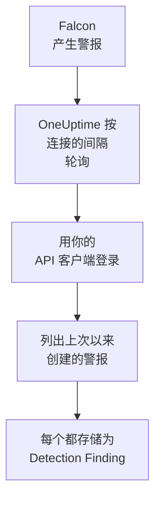

# CrowdStrike Falcon

把 [CrowdStrike Falcon](https://www.crowdstrike.com/platform/) 警报（来自终结点、身份和云检测）导入 OneUptime 的安全事件。在那里，你可以把它们与日志、跟踪和指标放在一起搜索，与其他所有来源进行关联分析，并为重要的警报呼叫值班人员。OneUptime 通过你创建的 API 客户端，经由 Falcon Alerts API 读取它们，从不向 Falcon 写入任何内容。

:::cards
- [设置连接](#设置连接): 一个只有一个范围的 API 客户端，以及连接的表单。
- [导入的内容](#导入的内容): 每个 Falcon 警报如何成为一个安全事件。
- [轮询的工作方式](#轮询的工作方式): 每次轮询读取的时间窗口，以及繁忙的 CID 对它的影响。
- [故障排除](#故障排除): 每个错误的含义，以及需要更改什么。
:::

## 工作方式



OneUptime 每分钟轮询一次已过轮询间隔的每个已启用连接。一次轮询会用 API 客户端的 ID 和密钥登录你的 Falcon 云，向 Alerts API 请求自上次轮询以来创建的警报，并把每个警报存储为一个 [OCSF](https://schema.ocsf.io/) Detection Finding 事件（类别 `2004`）。之后，检测规则、监视器和仪表板会像对待其他任何来源的安全事件一样对待它。

## 开始之前

- 在 OneUptime 中拥有 Project Owner、Project Admin 或 Security Admin 角色。Security Member 和 Security Viewer 可以查看连接及其运行历史，但不能更改它们。
- 一个 Falcon 客户 ID（CID），以及一个能管理 API 客户端的 Falcon 控制台用户：Falcon Administrator 角色，或拥有 API clients and keys 权限的自定义角色。
- 从 OneUptime 应用和工作进程到你的 Falcon 云 API 主机的出站 HTTPS，主机列在下面的 **Falcon cloud** 中。

## 设置连接

:::steps
### 创建 API 客户端

1. 在 Falcon 控制台中，打开 **Support and resources → API clients and keys**，然后选择 **Create API client**。
2. 为它命名，例如 `OneUptime security events`。在 **API scopes** 下开启 **Alerts → Read**，其他范围全部保持关闭：连接从不向 Falcon 写入任何内容。
3. 创建客户端。Falcon 只会显示一次它的客户端 ID、密钥和基础 URL。现在就把这三项都复制下来：密钥以后可以重置，但不会再次显示。

### 找到你的 Falcon 云

Falcon 显示的基础 URL 会告诉你 CID 所在的云。**API clients and keys** 页面也会在每个客户端旁边显示它。一个云的客户端会被其他云拒绝。

| Falcon 显示的基础 URL | Falcon 云 |
| --- | --- |
| `https://api.crowdstrike.com` | US-1 |
| `https://api.us-2.crowdstrike.com` | US-2 |
| `https://api.eu-1.crowdstrike.com` | EU-1 |
| `https://api.laggar.gcw.crowdstrike.com` | US-GOV-1 |

### 在 OneUptime 中添加连接

打开 **产品 → Security Events → 连接**（`/dashboard/{projectId}/security-events/connections`），点击 **添加连接**，选择 **CrowdStrike Falcon**，然后点击 **下一步**。填写下表中的设置，点击 **下一步**，并把密钥粘贴到 **客户端密钥** 中。

### 保存之前先测试

点击 **保存前测试** 下的 **测试这些设置**。测试会用表单中的值登录并读取警报，但不会存储任何内容，因此选错的云或缺失的范围会在连接存在之前暴露出来。然后点击 **下一步**，为连接填写 **名称** 并创建它。
:::

| 设置 | 填写什么 |
| --- | --- |
| **客户端 ID** | API 客户端的 ID，即你创建客户端时 Falcon 显示的那个。 |
| **Falcon cloud** | CID 所在的云：**US-1 (api.crowdstrike.com)**、**US-2 (api.us-2.crowdstrike.com)**、**EU-1 (api.eu-1.crowdstrike.com)** 或 **US-GOV-1 (api.laggar.gcw.crowdstrike.com)**。每个请求都会发往该云的 API 主机。 |
| **客户端密钥** | API 客户端的密钥。它会被加密，API 从不返回，也不会再次显示。在连接上用 **更新凭据** 替换它。 |

**轮询** 步骤还有可选的 **描述**、**轮询间隔（分钟）**（`1` 到 `1440` 之间的整数，初始为 `5`），以及初始为开启的 **已启用**。未启用的连接仍然可以被测试，也可以手动轮询。

## 导入的内容

连接读取 Falcon 的警报：即 Falcon 控制台在 **Endpoint security → Endpoint detections** 和 **Next-Gen SIEM → Alerts** 下列出的内容，来自产生它们的每个产品。每个警报都会成为一个 Detection Finding 事件（OCSF 类别 `2004`），供应商为 `CrowdStrike`，产品为 `Falcon`：

| Falcon 字段 | OneUptime 列 |
| --- | --- |
| `composite_id` | 事件 UID，也是去重所依据的值 |
| `created_timestamp` | 事件时间 |
| `display_name`，或 `name` | 规则名称 |
| `pattern_id` | 规则 ID |
| `description`，或规则名称 | 消息 |
| `severity_name`，或 0 到 100 的 `severity` | 严重程度 |
| `status`，例如 `new`、`in_progress` 或 `closed` | 状态 |
| `tactic_id`, `technique_id` | MITRE ATT&CK 战术和技术 |
| `device.hostname`、`device.local_ip`、`user_name`、`filename` 或 `cmdline` | 主体的主机、IP、用户和进程 |
| `filename`、`filepath` 和 `cmdline`；`parent_details.filename`、`parent_details.filepath` 和 `parent_details.cmdline` | 进程名称、路径和命令行；父进程名称、路径和命令行 |
| `device.hostname`、`device.local_ip`、`device.external_ip`、`user_name`、`sha256` | Observable |
| 其他所有内容，例如 `device.platform_name`、`falcon_host_link`、`product` 和 `timestamp` | `attributes`，展平为点分隔的键 |

事件的时间特意采用 Falcon 创建警报的时间：警报背后行为发生的时间 `timestamp` 保留在 `attributes.timestamp` 中。

## 轮询的工作方式

- **创建时间就是游标。** 警报按 `created_timestamp` 列出，从不按其背后行为发生的时间列出。Falcon 可能在它所描述的活动发生很久之后才产生警报，基于活动时间的游标会跳过所有这样的警报。
- **第一次轮询会回溯 24 小时**，所以新连接会立刻显示最近的警报。
- **之后的每次轮询都从保存的游标之前 1 分钟开始**，所以在两个窗口边界上创建的警报永远不会被漏掉。
- **一次轮询最多读取游标之后 24 小时。** 游标落后的连接会通过一连串 24 小时的窗口追赶。
- **重复项按 `composite_id` 去重**，范围是整个项目，所以重叠部分和重试的窗口都不会把同一个警报存储两次。
- **每个窗口的开销** 是一个令牌请求（在令牌有效期内保留），再加上每 1,000 个警报一个警报查询和一个警报获取，每个请求都有自己的超时。

### 当一个窗口包含的内容超过一次轮询能读取的量时

一次轮询最多发送 20 个请求。由于需要一个令牌请求，并且每 1,000 个警报需要两个请求，它最多读取 9,000 个警报。当窗口中的警报更多时，这次运行为 **部分**，并带有类似这样的警告：

```text
Stopped after 19 requests before reading the whole window. Alerts are read oldest first; every alert created before 2026-09-14T08:12:44.995Z was read.
```

警报查询按 `created_timestamp` 从早到晚排序，所以 OneUptime 会把游标移到它读取的最后一个警报的创建时间，下一次轮询就从那里开始，窗口长度不变，偏移量从 `0` 开始。繁忙的 CID 每次轮询大约追赶 9,000 个警报，而不是重复读取相同的警报。在同一时刻创建的警报会被读取两次，而去重检查会丢弃第二份。

Falcon 的警报查询无法翻页超过 10,000 个结果（`limit` 加 `offset`）。请求上限会让一次运行在 9,000 个警报时停下，早于这个上限。如果这个上限真的让读取停下，处理方式也相同：这次运行为 **部分**，游标移到读取的最后一个警报，下一次查询再次从偏移量 `0` 开始。

当一次运行完全无法越过保存的游标时，例如超过 9,000 个警报都落在重叠的那一分钟里，OneUptime 会改为缩短窗口：

1. **缩小。** 下一次轮询从同一个起点读取长度减半的窗口，并不断减半，直到某个窗口能被完整读取，最短为一分钟。运行的警告会说明这一点：`This window holds more records than one poll can read; the next poll reads a {n} minute window from the same starting point.`
2. **恢复。** 一个窗口被完整读取后，下一个窗口的长度会再次加倍，最长为 24 小时。
3. **越过单独的一分钟。** 如果连一分钟内的内容都超过一次轮询能读取的量，轮询会越过这一分钟，让更新的警报继续到达。这次运行仍为 **部分**，**最近错误** 显示 `More records were created in the one minute from {cursor} to {end} than one poll can read. Polling moved past this minute so newer records keep arriving; use Import this time range in Diagnostics on this minute to recover what one run can read.` 用 **Import this time range** 导入这一分钟，即可找回一次运行能读取的内容。

因 Falcon 的错误而彻底失败的运行，会保留游标和窗口长度，下一次轮询会再次读取同一个窗口。唯一的例外是请求超时：游标保持不变，但下一个窗口的长度减半，因为太重而无法及时响应的窗口每次重试都会超时。更改 **轮询间隔（分钟）** 不会改变以上任何一点：它决定轮询多久开始一次，而不是窗口从哪里开始。

### 按需运行、预览和导入

在连接上点击 **诊断**，可以查看它最近的运行，并手动操作它。能更改该连接的人都可以启动这些操作；能查看它的人都可以阅读历史记录。

- **立即运行** 会立即开始一次轮询，使用通常的游标，即使连接未处于 **已启用** 状态也可以。
- **Preview alerts** 读取最长 7 天的时间范围，不导入任何内容。
- **Import this time range** 在你确认后导入最长 7 天的范围，不会移动游标。已导入的警报会被跳过。
- 运行上的 **Copy diagnostics** 会复制它的报告以便提供给支持人员。报告从不包含凭据。

## 测试连接

连接所在行中的 **测试连接** 和表单中的 **测试这些设置** 在 API 进程中运行，而不是在后台工作进程中运行，所以即使工作进程出了问题，测试仍然会给出结果。它按顺序运行以下检查：

| 检查 | 检查的内容 |
| --- | --- |
| **配置** | **客户端 ID**、**Falcon cloud** 和 **客户端密钥** 都存在且格式正确。此项失败时不会连接任何地方。 |
| **Authenticate with CrowdStrike Falcon** | 在你所在云的主机上，用 API 客户端的 ID 和密钥调用 `POST /oauth2/token` 能返回令牌。 |
| **Read alerts from the Falcon Alerts API** | 针对过去 24 小时、只取一个警报（`limit=1`）的警报查询被接受，这证明了 **Alerts → Read** 范围。 |
| **Alerts available to import** | 过去 24 小时和过去 7 天内创建了多少警报。7 天内一个都没有是警告，而不是失败：轮询会在 Falcon 创建新警报时导入它们。 |
| **Background workers**、**Poll scheduler**、**Security event storage** | OneUptime 自身的一侧：有进程在处理 Worker 队列的作业，轮询作业每分钟运行一次，安全事件存储能够响应。 |
| **Scheduled polling** | 针对已保存的连接：轮询已开启，没有运行卡在等待工作进程的状态，并且轮询按时运行。 |

测试中的每个请求都有 20 秒的期限。测试从不导入任何内容，也不移动游标，每个失败的检查都会说明需要更改什么。**复制报告** 会把检查清单复制为 JSON，不包含凭据或令牌。

## 故障排除

连接的 **最近错误** 和每个失败的检查都会保留完整的错误消息（凭据已隐去），前面带有一个指明失败步骤的前缀。连接出错时，在它的 **操作** 列中选择 **查看错误** 来阅读，并在对话框中用 **复制错误** 复制。请先阅读前缀。

:::details Last Error 以 `CrowdStrike Falcon token request` 开头
- `CrowdStrike Falcon token request failed (HTTP 401)` 或 `(HTTP 403)`：在联系 Alerts API 之前，Falcon 就拒绝了 API 客户端的 ID 和密钥。请检查 **Falcon cloud** 是否为你的 CID 所在的云（来自其他云的客户端会在这里被拒绝），**客户端 ID** 是否属于该客户端，以及 **客户端密钥** 是否为随它一起颁发的密钥。如果密钥丢失，请在 Falcon 控制台中重置它，并用 **更新凭据** 保存。
- `CrowdStrike Falcon token request returned ...`：Falcon 返回了无法使用的内容，即不是 JSON 或没有 `access_token` 的主体。这通常是中间的代理或网关造成的，而不是凭据的问题。
:::

:::details Last Error 以 `CrowdStrike Falcon alerts` 开头
- `CrowdStrike Falcon alerts query failed (HTTP 403)`：令牌被接受了，但 API 客户端没有 **Alerts → Read** 范围。在 **API clients and keys** 下为该客户端开启它，然后保存。它会作用于下一个令牌，所以请一分钟后再测试。
- `CrowdStrike Falcon alerts query failed (HTTP 401)`：Alerts API 拒绝了令牌，这几乎总是表示 **Falcon cloud** 不是颁发该客户端的云。
- `CrowdStrike Falcon alerts query failed (HTTP 429)` 或 `CrowdStrike Falcon alerts fetch failed (HTTP 429)`：Falcon 正在对这个 API 客户端限速。OneUptime 的 HTTP 客户端在出错时不保留响应头，所以消息通常以 `the X-RateLimit-RetryAfter header was not available` 结尾，而不是引用该响应头。计划的轮询会自行重试。如果反复出现，请给 OneUptime 一个专用的 API 客户端，而不是与其他工具共用一个。
- `CrowdStrike Falcon alerts query failed (HTTP 400)`：Falcon 拒绝了查询。连接发送的是针对 `created_timestamp` 的固定 FQL 过滤器，所以请复制报告并发送给 OneUptime 支持人员。
- `CrowdStrike Falcon alerts query returned ...` 或 `CrowdStrike Falcon alerts fetch returned ...`：Falcon 返回了 `200`，但主体不是 JSON，或不是连接认识的结构。这种情况会被报告出来，而不是被当作空窗口，所以游标永远不会越过没人读过的警报。
- `CrowdStrike Falcon alerts fetch failed (HTTP ...)`：警报已列出，但获取它们失败了，原因与查询相同。这里出现 `403` 表示在两次调用之间该范围被移除了。
:::

:::details Last Error 显示请求无法完成
`CrowdStrike Falcon token request could not be completed`、`CrowdStrike Falcon alerts query could not be completed` 和 `CrowdStrike Falcon alerts fetch could not be completed` 表示没有任何响应返回：超时、DNS 失败或出站流量被阻止。检查 OneUptime 应用和工作进程到你所在云的 API 主机（例如 `api.crowdstrike.com`）的出站 HTTPS。
:::

:::details Last Error 指出了一个未知的云
`CrowdStrike Falcon cloud "..." is not one of us-1, us-2, eu-1, us-gov-1` 表示保存的云不是连接认识的云。请编辑连接，并从列表中选择一个云。
:::

:::details 运行为 Partial
- `Stopped after 19 requests before reading the whole window`：窗口中的警报超过了一次运行能读取的 9,000 个。不会丢失任何内容：下一次轮询会从读取的最后一个警报之后开始。一次又一次轮询都保持 **部分** 的连接正在追赶积压，它的 **最近轮询** 和 **最近导入的事件** 会持续前进。如果运行期间续订了令牌，这个计数可能略大于 19。
- `Falcon returned alerts out of created_timestamp order, so this run cannot name a point to resume from.`：查询忽略了从早到晚的顺序，所以这次运行无法把游标移到它的最后一个警报，下一次轮询会改为读取更短的窗口。如果反复出现，请把这次运行的报告发送给 OneUptime 支持人员。
- `More records were created in the one minute from ... than one poll can read`：轮询越过了这一分钟。请在 **诊断** 中用 **Import this time range** 导入它。一次导入读取的量与一次轮询相同。
:::

:::details Last Polled 为 Never 且 Last Error 为空
还没有任何轮询运行过，所以没有任何请求到达 Falcon。**测试连接** 会把它显示为失败的 **Background workers** 或 **Poll scheduler** 检查。在自托管安装中，常见原因是应用上设置了 `DISABLE_QUEUE_WORKERS=true`，却没有单独的工作进程部署来处理作业：把它设为 `false`，或运行工作进程部署（Helm：`worker.enabled: true`）。
:::

:::details 测试通过，但没有出现任何事件
阅读 **Alerts available to import**：那里的警告表示 Falcon 在过去 7 天内没有创建任何警报，所以暂时没有可导入的内容。否则，请打开 **诊断**，检查上一次轮询的窗口和计数，并在某次运行上使用 **View events in this time range**，打开它所导入警报的时间范围。
:::

## 你会得到什么

- **搜索。** 在安全事件资源管理器中，与该主机的日志和指标放在一起，按严重程度、状态、MITRE 战术、主机、用户或任何 observable 过滤 Falcon 警报。
- **关联分析。** 每个警报的主机名、IP、用户和文件哈希都会作为 observable 建立索引，所以一次搜索就能在所有来源中找到提到某个主机的所有内容。
- **检测规则。** 按计划对你的安全事件运行的 Sigma 规则，会打开呼叫值班人员的警报。
- **监视器。** 安全事件监视器统计匹配的事件，并在超过阈值时打开事件或警报。

安全事件与其他遥测数据一样，按摄取的 GB 数计费。请参阅 [定价](https://oneuptime.com/pricing)。

## 后续步骤

:::cards
- [安全事件](/docs/telemetry/security-events): 搜索、关联分析你导入的内容，并据此发出警报。
- [Microsoft Defender XDR](/docs/integrations/microsoft-defender-xdr): 同时导入 Microsoft Defender 工作负载的警报。
- [角色](/docs/permissions/reference#角色): Security 角色可以查看和更改的内容。
- [集成概述](/docs/integrations/index): 你可以连接的其他工具。
:::
