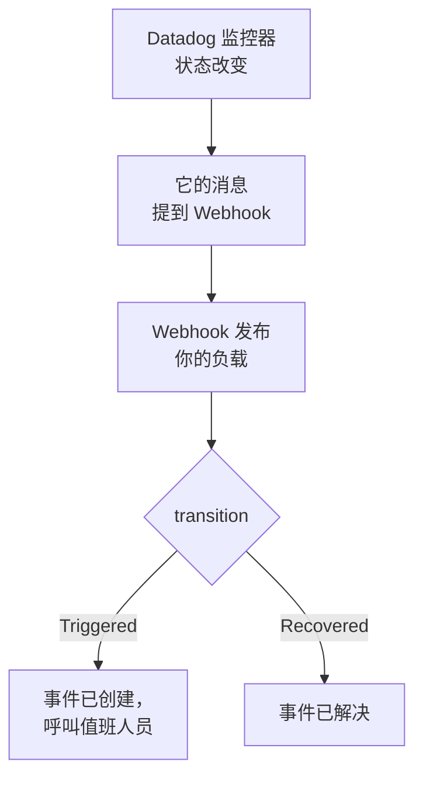

# Datadog

把 [Datadog](https://www.datadoghq.com) 监控器的告警发送到 OneUptime，让每个告警都成为一个呼叫值班团队的事件，并在 Datadog 监控器恢复时解决。Datadog 通过它的 [Webhooks 集成](https://docs.datadoghq.com/integrations/webhooks/) 发送告警，因此两边都无需安装任何东西。

:::cards
- [选择 OneUptime 接收告警的方式](#选择-oneuptime-接收告警的方式): Incoming Request 监视器，或你自己的工作流。
- [用监视器接收告警](#用监视器接收告警): 每个告警一个事件，恢复时自动解决。
- [配置 Datadog](#配置-datadog): 一个 Webhook，以及通知它的监控器。
- [故障排除](#故障排除): 告警没有到达，或事件一直未关闭时。
:::

## 工作方式



Datadog 监控器在状态改变时，也就是触发、警告、恢复或没有数据时，会通知其消息中提到的 Webhook。Webhook 的 JSON 主体由你自己用 Datadog 的 [模板变量](https://docs.datadoghq.com/integrations/webhooks/#usage) 编写，所以本指南给出一个能为每个告警命名、并说明它发生了什么的主体。

## 开始之前

- 一个可以配置集成并编辑监控器的 Datadog 账户。
- 在 OneUptime 中创建监视器的权限；如果选择工作流方式，则需要创建工作流的权限。

## 选择 OneUptime 接收告警的方式

先设置 OneUptime：它会给你 Datadog 要发送到的 URL。

| 方式 | 适用情况 |
| --- | --- |
| Incoming Request 监视器（推荐） | 你希望每个告警都成为一个呼叫值班人员的事件，并在 Datadog 监控器恢复时解决。无需构建任何东西。 |
| 带 Webhook 触发器的工作流 | 你需要自己的逻辑：先过滤告警、转换格式或调用其他系统。工作流会为收到的每个告警声明一个事件，并且不会在恢复时解决它。 |

两者从同一个 Webhook 收到相同的 JSON，所以你可以先用其中一种，之后只需修改 Datadog 中的一个 URL 就能切换。

## 用监视器接收告警

[Incoming Request 监视器](/docs/monitor/incoming-request-monitor) 会给你一个 URL，它的条件决定每个告警做什么。

:::steps
### 创建监视器

前往 **监视器**，点击 **创建监视器**。在 **监视器类型** 下选择 **Incoming Request**，将其命名为 `Datadog`，然后点击 **下一步**。

### 为每个告警声明事件

在 **标准** 步骤中，打开第一个条件，也就是把监视器标记为离线的那个。把它的过滤器设为 **请求主体**、**包含**、`"transition":"Triggered"`。这个条件在过滤器匹配时已经会声明事件。填写事件信息：

- **事件标题**：`{{requestBody.title}}`。
- **描述** 下的 **事件描述**：`{{requestBody.body}}`，然后在单独一行写上 `Datadog: {{requestBody.link}}`。
- **严重程度**：这些告警应有的事件严重程度。
- **值班** 下的 **值班策略**：要呼叫的策略。
- **更多字段** 下的 **自动解决事件**：保持开启，它默认就是开启的。关闭后会忽略恢复，事件将一直保持打开。

### 每个告警一个事件

在同一个条件中，打开 **设置** 并开启 **Group incidents and alerts by a payload field**。按下表填写，让每个告警都有自己的事件，并由它的恢复来解决：

| 字段 | 值 |
| --- | --- |
| **Open a separate incident for each…** | `requestBody.alert_key` |
| **Field that signals recovery** | `requestBody.transition` |
| **Value that means recovered** | `Recovered` |

### 让监视器恢复在线

打开第二个条件，也就是把监视器标记为在线的那个，把它的过滤器设为 **请求主体**、**包含**、`"transition":"Recovered"`。

### 复制 URL

点击 **创建监视器**。监视器的 **概览** 页面会显示它的 **Heartbeat URL**。复制它供 Datadog 使用：

```text
https://oneuptime.com/heartbeat/<secret key>
```

自托管安装使用自己的主机来代替 `oneuptime.com`。
:::

下面的负载把 `alert_key` 设为 Datadog 监控器的 ID 加上发出告警的分组的标签，因此多告警监控器的每个分组都有自己的事件，并由该分组的恢复来解决。在事件打开期间再次触发或重新通知的监控器不会再打开第二个事件。每项设置的作用请参见 [接收来自其他系统的告警](/docs/monitor/incoming-request-monitor#接收来自其他系统的告警)。

> [!NOTE]
> 使用这些过滤器时，**Warn** 或 **No Data** 通知不会打开事件。如果也想在警告时被呼叫，请点击 **添加条件**，为新条件设置过滤器 **请求主体**、**包含**、`"transition":"Warn"`，一个带有自己 **严重程度** 的事件，以及相同的分组设置，然后把它拖到第一个条件上方。条件从上往下检查，第一个匹配的条件起决定作用。

## 配置 Datadog

:::steps
### 添加 Webhook

在 Datadog 中打开 [Webhooks 集成磁贴](https://app.datadoghq.com/integrations/webhooks)，如果尚未安装，请先安装。用以下设置添加一个 Webhook，然后保存：

- **Name**：`oneuptime`。监控器用这个名称提到该 Webhook，即 `@webhook-oneuptime`。
- **URL**：你从 OneUptime 复制的 URL。
- **Payload**：

  ```json
  {
    "alert_key": "$ALERT_ID $ALERT_SCOPE",
    "transition": "$ALERT_TRANSITION",
    "title": "$EVENT_TITLE",
    "body": "$TEXT_ONLY_MSG",
    "host": "$HOSTNAME",
    "priority": "$PRIORITY",
    "link": "$LINK"
  }
  ```

### 在监控器中提到该 Webhook

在每个应通过 OneUptime 呼叫的 Datadog 监控器中，把 `@webhook-oneuptime` 添加到监控器的通知消息里，然后保存监控器。之后 Datadog 会把该监控器的告警和恢复发送到 OneUptime。
:::

| 变量 | Datadog 填入的内容 |
| --- | --- |
| `$ALERT_ID` | 发出告警的 Datadog 监控器的 ID。 |
| `$ALERT_SCOPE` | 发出告警的分组的标签，例如 `host:web-1`。 |
| `$ALERT_TRANSITION` | 发生了什么：`Triggered`、`Re-Triggered`、`Warn`、`Recovered`、`No Data` 或 `Renotify` 等。 |
| `$EVENT_TITLE` | 事件的标题，例如 `[Triggered] High CPU`。 |
| `$TEXT_ONLY_MSG` | 去掉 Markdown 的监控器消息。 |
| `$LINK` | 指向 Datadog 中该事件的链接。 |

## 测试

像 Datadog 那样，向 OneUptime 发送一个告警：

```bash
curl -X POST "https://oneuptime.com/heartbeat/<secret key>" \
  -H "Content-Type: application/json" \
  -d '{
    "alert_key": "1234 host:web-1",
    "transition": "Triggered",
    "title": "[Triggered] High CPU",
    "body": "CPU is above 90% on web-1.",
    "host": "web-1",
    "priority": "normal",
    "link": "https://app.datadoghq.com/event/event?id=1"
  }'
```

会打开一个标题为 `[Triggered] High CPU` 的事件。把 `transition` 设为 `Recovered` 后发送同样的请求，事件就会被解决。

然后从 Datadog 测试：打开一个提到该 Webhook 的监控器，点击 **Test Notifications**，并发送它的 **Alert** 通知。查看 OneUptime 监视器的时间线，确认它已到达。

## 用工作流接收告警

当你需要在 Datadog 和事件之间加入自己的步骤时，请使用 [工作流](/docs/workflows/index)。

:::steps
### 创建工作流

前往 **工作流**，点击 **创建工作流**，然后点击 **从零开始**。将其命名为 `Datadog alerts`，然后点击 **创建工作流**。

### 添加 Webhook 触发器

点击虚线的 **选择启动此工作流的方式** 块并选择 **Webhook**。点击该触发器，然后点击 **复制 URL**，把该 URL 用在 Datadog 的 Webhook 中。

### 检查监控器是否已触发

点击 **添加组件**，添加一个 **If / Else** 块，并把触发器的 **Out** 点连接到它。把 **Value to check** 设为 `{{local.components.webhook-1.returnValues.request-body.transition}}`，**Comparison** 设为 **is equal to**，**Compare with** 设为 `Triggered`。

### 声明事件

添加一个 **Create One Incident** 块，并把 **If / Else** 块的 **Yes** 一侧连接到它。在 **Incident Template** 中选择一个设置了严重程度和要呼叫的值班策略的模板（参见 [事件模板](/docs/incidents/settings#事件模板)）。在 **JSON Object** 中设置来自 Datadog 的内容：

```json
{
  "title": "{{local.components.webhook-1.returnValues.request-body.title}}",
  "description": "{{local.components.webhook-1.returnValues.request-body.body}}\nDatadog: {{local.components.webhook-1.returnValues.request-body.link}}"
}
```

如果不使用模板，**JSON Object** 中还需要 `incidentSeverityId`，即项目中某个事件严重程度的 ID。

### 启用工作流

在 **生成器** 顶部打开 **已启用**。处于关闭状态的工作流会以 `400` 回应 Datadog。
:::

每个 `Triggered` 通知都会声明一个新事件。恢复会走向 **If / Else** 块的 **No** 一侧，那里没有连接任何东西，因此运行到此结束。要让每个告警一个事件并在恢复时解决，请使用监视器。

## 故障排除

:::details OneUptime 没有收到任何内容
- 检查 Datadog 监控器的消息是否提到了 `@webhook-oneuptime`，拼写与 Webhook 的名称一致。
- 监视器会在检查任何内容之前立即回应 `200`，即使密钥错误也是如此。请查看监视器的时间线，确认告警是否到达。
- 处于关闭状态的工作流会回应 `400`。在它的 **生成器** 顶部打开 **已启用**。
:::

:::details 事件被创建但从未被解决
- Datadog 监控器也必须把恢复通知给该 Webhook。如果消息只在条件块中针对告警提到该 Webhook，就不会发送恢复。
- 条件中的事件需要开启 **更多字段** 下的 **自动解决事件**。
- **Value that means recovered** 必须恰好是 `Recovered`。比较区分大小写。
- 恢复的 `alert_key` 必须与告警的相同：保持负载中的 `$ALERT_ID $ALERT_SCOPE` 不变。
:::

:::details 字段显示的是变量名，或者什么都没有
Datadog 只会填入适用于该事件的变量。发送一个测试通知，然后查看到达的内容：在监视器的时间线中，或者对于工作流，在 **日志 → 运行记录** 中查看。
:::

:::details 监控器的所有告警合并成了一个事件
每个分组都需要自己的 `alert_key`。检查负载是否同时用 `$ALERT_ID` 和 `$ALERT_SCOPE` 来设置它，以及分组路径是否为 `requestBody.alert_key`。
:::

## 安全

- **像对待密码一样对待 URL。** 任何拥有它的人都可以创建事件。如果泄露，请重置它：在监视器的 **设置** 页面使用 **重置传入请求密钥**，或在工作流的 **Webhook** 触发器中使用 **重置 URL**。然后在 Datadog 中更新该 Webhook 的 **URL**。
- **自托管？** Datadog 从互联网发送 Webhook，所以你的 OneUptime 必须能从互联网通过 HTTPS 访问。

## 后续步骤

:::cards
- [入站请求监控](/docs/monitor/incoming-request-monitor): 接收告警的监视器的所有设置。
- [Prometheus Alertmanager](/docs/integrations/prometheus-alertmanager): 适用于 Alertmanager 的相同设置。
- [升级规则](/docs/on-call/escalation-rules): 决定值班策略呼叫谁、何时呼叫。
- [集成概述](/docs/integrations/index): 你可以连接的其他工具。
:::
