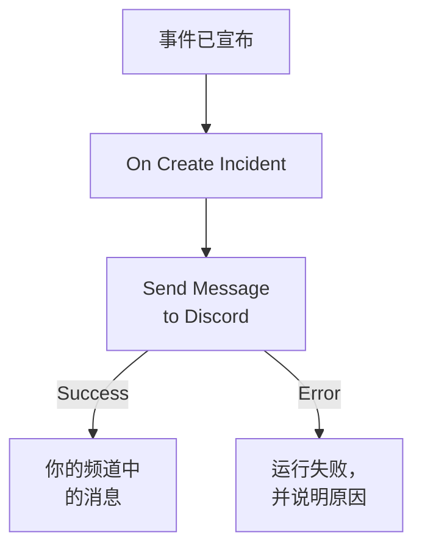

# Discord

在事件打开时向 [Discord](https://discord.com) 频道发布一条消息，让关注该频道的人立刻知道。OneUptime 的工作流步骤 **Send Message to Discord** 通过频道的 webhook 发布消息，现成的模板会为你构建整个工作流。此集成是 **出站** 的：OneUptime 只向频道发布消息，不读取频道里的内容。

:::cards
- [工作方式](#工作方式): 事件打开时工作流会做什么。
- [设置](#设置集成): Discord 中的 webhook，然后是工作流：从模板创建或从零开始。
- [提示](#提示): 格式、长消息和更多事件。
- [故障排除](#故障排除): 步骤的错误是什么意思，以及该改什么。
:::

## 工作方式



该步骤把 **Message Text** 发布到频道的 webhook。Discord 接受消息时，它走 **Success** 输出；Discord 拒绝时，它带着 Discord 给出的原因走 **Error** 输出。像模板中那样 **Error** 上没有连接任何东西时，未能发布的运行会失败，其 **步骤** 会说明原因。

## 开始之前

- 在 Discord 中，拥有该频道的 **Manage Webhooks** 权限。
- 在 OneUptime 中，拥有创建工作流和变量的权限。在 OneUptime Cloud 上，工作流需要 **Growth** 或更高的计划。

## 设置集成

:::steps
### 在 Discord 中创建 webhook

1. 在 Discord 中，通过 **Edit Channel** 打开频道设置，然后打开 **Integrations → Webhooks**，并选择 **New Webhook**。
2. 为它命名，例如 `OneUptime`，并检查它发布到的是正确的频道。
3. 选择 **Copy Webhook URL**。

任何拥有该 URL 的人都可以在频道中发布消息，所以请像保管密码一样保管它。

### 构建工作流

从模板开始，它会为你构建整个工作流，或者从零开始。

:::tabs
@tab 从模板创建
1. 打开 **工作流**，然后点击 **创建工作流**。
2. 在 **搜索模板…** 中输入 `Discord`，点击 **Tell Discord when an incident opens**，然后点击 **使用此模板**。
3. 保留名称 **Notify Discord on new incident** 或更改它，然后点击 **下一步**。
4. 把 URL 粘贴到 **Discord Webhook URL** 中，然后点击 **创建工作流**。

工作流会在 **生成器** 中打开，包含两个步骤： **On Create Incident**，以及发布事件编号、标题、严重程度和状态的 **Send Message to Discord**。URL 会保存为工作流的机密变量 `discordWebhookUrl`。
@tab 从零开始
1. 把 URL 保存为机密的全局变量：前往 **工作流 → 全局变量**，点击 **创建工作流 变量**，将其命名为 `DISCORD_WEBHOOK_URL`，然后点击 **下一步**。把 URL 粘贴到 **内容** 中，打开 **密钥**，然后点击 **创建工作流 变量**。
2. 前往 **工作流**，点击 **创建工作流**，选择 **从零开始**，为工作流命名，然后点击 **创建工作流**。
3. 在 **生成器** 中，点击 **选择启动此工作流的方式**，然后在 **热门** 下选择 **On Create Incident**。点击触发器：它的 **Fields to pass on** 已经包含 **标题**，所以点击 **添加字段**，再选择消息要显示的其他字段，例如 **Incident Number With Prefix**。
4. 点击 **添加组件**，搜索 `discord`，然后点击 **Send Message to Discord**。把触发器的 **Success** 输出连接到它。
5. 点击新步骤。在 **Discord Incoming Webhook URL** 中点击 **{ }**，然后在 **Global variables** 下选择 `DISCORD_WEBHOOK_URL`。在 **Message Text** 中写下消息，并用 **{ }** 插入事件的字段。
:::

从零开始编写的消息通过如下引用读取事件的字段：

```text
🚨 **Incident {{local.components.incident-on-create-1.returnValues.model.incidentNumberWithPrefix}} declared**
**Title:** {{local.components.incident-on-create-1.returnValues.model.title}}
```

### 开启并测试

在 **生成器** 顶部打开 **已启用**。从现在起，每个新事件都会发布到频道中。

要在不打开事件的情况下进行测试，请点击 **运行工作流**，在 **事件** 下选择一个已有的事件：列表中会列出最近的事件，输入它的编号或标题的一部分可以找到其他事件。点击 **手动运行工作流**，然后用 **运行** 确认。**工作流运行** 面板会跟踪这次运行，消息会出现在频道中。如果该步骤改走 **Error**，运行就会失败， **步骤** 中该步骤的条目会说明原因：请参阅 [故障排除](#故障排除)。
:::

## 提示

- **用 Discord 的 Markdown 设置格式。** 文本按输入的原样发送，所以 Discord 的 Markdown 可以在其中使用：用星号包围一个词会让它变成粗体，URL 会显示为链接。
- **注意 2,000 个字符的限制。** Discord 接受最多 2,000 个字符的消息。更长的消息会被截断，并以 "… (truncated — see OneUptime for the full text)" 结尾，而不是被拒绝。
- **不只发布新事件。** 用同一个步骤，基于 **On Update Incident** 构建另一个工作流来发布状态变更，或基于 **On Create Alert** 构建工作流来发布警报。要只发布部分事件，请在该步骤之前放一个 **If / Else** 块。
- **只用 Discord 自己的地址。** 该步骤发布到 `discord.com` 或 `discordapp.com` 上的 `https` URL，并且不跟随重定向，所以指向其他任何地方的 URL 都会让运行停止。

## 故障排除

当该步骤走 **Error** 时，运行会失败，运行的 **步骤** 中该步骤的条目会给出 Discord 的原因。

:::details Discord 返回 "Unknown Webhook" 或 "Invalid Webhook Token"
webhook 已被删除，或者 URL 复制错了。请创建一个新的 webhook 并替换 URL：在模板的工作流中是变量 `discordWebhookUrl`；在你自己的工作流中是 `DISCORD_WEBHOOK_URL` 的内容。
:::

:::details Discord 返回 "You are being rate limited"
Discord 会限制一个 webhook 的发布频率。集中出现的事件可能会触及这个限制：请发布更少的消息，例如只针对部分严重程度。
:::

:::details 运行停止并显示 "Discord Webhook URL must be an https URL on discord.com or discordapp.com"
**Discord Incoming Webhook URL** 中填的不是 Discord webhook，或者它读取的变量为空。请重新粘贴 **Copy Webhook URL** 中的 URL。
:::

## 后续步骤

:::cards
- [工作流组件](/docs/workflows/components#discord): 步骤的每项设置，以及各输出的含义。
- [Telegram](/docs/integrations/telegram): 同样的思路，用于 Telegram 聊天。
- [工作流运行记录](/docs/workflows/runs-and-logs): 查看工作流每次运行都做了什么。
- [集成概述](/docs/integrations/index): 出站模式，以及你可以连接的其他工具。
:::
