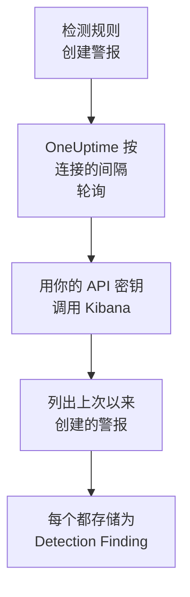

# Elastic Security

把你的 [Elastic Security](https://www.elastic.co/security) 规则产生的检测警报导入 OneUptime 的安全事件。在那里，你可以把它们与日志、跟踪和指标放在一起搜索，与其他所有来源进行关联分析，并为重要的警报呼叫值班人员。OneUptime 使用你创建的 API 密钥，通过 Kibana 的检测引擎 API 读取它们，不会在 Elastic 中更改任何内容。

:::cards
- [设置连接](#设置连接): 一个 API 密钥、它的权限，以及连接的表单。
- [导入的内容](#导入的内容): 每个检测警报如何成为一个安全事件。
- [轮询的工作方式](#轮询的工作方式): 每次轮询读取的时间窗口，以及繁忙的空间对它的影响。
- [故障排除](#故障排除): 每个错误的含义，以及需要更改什么。
:::

## 工作方式



OneUptime 每分钟轮询一次已过轮询间隔的每个已启用连接。一次轮询会向 Kibana 请求自上次轮询以来在你的空间中创建的检测警报，每次 1,000 个，并把每个警报存储为一个 [OCSF](https://schema.ocsf.io/) Detection Finding 事件（类 `2004`）。所有规则类型都包括在内：自定义查询、阈值、EQL、指标匹配、机器学习和新术语。之后，检测规则、监视器和仪表板会像对待其他任何来源的安全事件一样对待这些警报。

## 开始之前

- 在 OneUptime 中拥有 Project Owner、Project Admin 或 Security Admin 角色。Security Member 和 Security Viewer 可以查看连接及其运行历史，但不能更改它们。
- Elastic Security 8.x 或更高版本，位于 Elastic Cloud 或你自己的 Elastic 堆栈上，并且检测规则在某个 Kibana 空间中运行。
- 能查看该空间中检测警报的 Kibana 访问权限：对 `.alerts-security.alerts-<space-id>` 的索引权限 `read` 和 `view_index_metadata`，以及允许在那里读取警报的 Kibana Security 功能权限。
- 一个 OneUptime 能通过 HTTPS 访问到的 Kibana。OneUptime Cloud 从互联网连接，所以 Kibana 需要一个公网地址，就像 Elastic Cloud 部署那样：私有地址会被拒绝。自托管的 OneUptime 从它的应用和工作进程容器连接，可以访问你私有网络中的 Kibana，除非 `DATA_SOURCE_BLOCK_PRIVATE_ADDRESSES` 为 `true`。

## 设置连接

:::steps
### 创建 API 密钥

1. 在 Kibana 中，打开 **Stack Management → API keys** 并选择 **Create API key**。
2. 为它命名，例如 `oneuptime-security-events`。除非你给它更少的权限，否则密钥拥有创建它的用户的权限：它只需要上面列出的权限。
3. 选择它何时过期，或者永不过期。会过期的密钥在你替换它之前会让连接停止工作。
4. 创建密钥并复制它的 **Base64** 值，Kibana 只显示一次。不是密钥的 ID，也不是 `id:api_key` 这一对值。

### 找到你的空间 ID

警报按空间存储。打开你的规则运行所在的空间：它的 ID 是 Kibana 地址中 `/s/` 之后的部分，例如 `https://kibana.example.com/s/security/app/security` 中的 `security`。默认空间没有 `/s/` 部分，也不需要 ID。

### 在 OneUptime 中添加连接

打开 **产品 → Security Events → 连接**（`/dashboard/{projectId}/security-events/connections`），点击 **添加连接**，选择 **Elastic Security**，然后点击 **下一步**。填写下表中的设置，点击 **下一步**，然后把密钥粘贴到 **API 密钥** 中。

### 保存之前先测试

点击 **保存前测试** 下的 **测试这些设置**。测试会用表单中的值进行身份验证并读取警报，不保存任何内容，所以错误的空间或缺少的权限会在连接创建之前就暴露出来。然后点击 **下一步**，为连接设置一个 **名称** 并创建它。
:::

| 设置 | 填写什么 |
| --- | --- |
| **Kibana URL** | 提供 Kibana 的地址，例如 `https://kibana.example.com` 或 `https://<deployment>.kb.<region>.cloud.es.io`。不带路径：没有 `/app/security`，没有 `/api`，也没有 `/s/<space>` 部分。 |
| **Kibana space** | 空间的 ID，而不是它的名称：字母、数字、连字符和下划线。默认空间请留空。 |
| **API 密钥** | 密钥的 **Base64** 值本身：OneUptime 会自己加上 `ApiKey` 方案。它会被加密，API 从不返回它，也不会再次显示。要替换它，请在连接上使用 **更新凭据**。 |

**轮询** 步骤还有可选的 **描述**、**轮询间隔（分钟）**（`1` 到 `1440` 之间的整数，初始为 `5`），以及初始为开启的 **已启用**。

## 导入的内容

每个检测警报都会成为一个 Detection Finding 事件（OCSF 类 `2004`），供应商为 `Elastic`，产品为 `Elastic Security`：

| 警报字段 | OneUptime 列 |
| --- | --- |
| `_id`，即警报的 ID | 事件 UID，也是去重所依据的值 |
| `kibana.alert.original_time`，否则 `kibana.alert.start`，否则 `@timestamp` | 事件时间 |
| `kibana.alert.rule.name` | 规则名称 |
| `kibana.alert.rule.uuid`，否则 `kibana.alert.rule.rule_id` | 规则 ID |
| `kibana.alert.reason`，否则规则名称，否则 `kibana.alert.rule.description` | 消息 |
| `kibana.alert.severity`，否则按 `kibana.alert.risk_score` 分档 | 严重程度 |
| `kibana.alert.workflow_status`：`open`、`acknowledged` 或 `closed` | 状态 |
| `kibana.alert.rule.threat`，包括子技术 | MITRE ATT&CK 战术和技术 |
| `user.name`、`host.name`、`source.ip` 或 `host.ip`、`process.name` 或 `process.executable` | 主体的用户、主机、IP 和进程 |
| `user.target.name`、`destination.domain`、`destination.ip`、`destination.port`、`file.path` | 目标的用户、主机、IP、端口和资源 |
| 以上这些，以及 `related.*`、`dns.question.name`、`url.domain` 和文件哈希 | Observable |
| 整个警报，展平为点分隔的键，并带有 `_index` 和 `_id` | `attributes` |

警报的时间特意采用它所涉及的活动的时间。规则创建它时的 `@timestamp` 才是轮询读取的值，所以今天针对昨天活动创建的警报，在安全事件资源管理器中会显示在昨天。当警报没有严重程度时，由它的风险分数决定：`74` 及以上为 Critical，`48` 及以上为 High，`22` 及以上为 Medium，低于这些为 Low。

## 轮询的工作方式

每次轮询列出在它的窗口中创建的警报，从最早的开始，每页 1,000 个。在默认空间以外的空间中，路径以 `/s/{Kibana space}` 开头：

```text
POST {Kibana URL}/api/detection_engine/signals/search
    {"query": {"range": {"@timestamp": {"gte": "{window start}", "lt": "{window end}"}}},
     "size": 1000, "sort": [{"@timestamp": "asc"}]}
```

- **创建时间就是游标。** 警报按它们自己的 `@timestamp`（即规则运行创建它们的时间）列出，从不按它们所涉及的活动的时间列出。每小时运行一次的规则会为最多一小时前的活动创建警报，基于活动时间的游标会把它们全部跳过。
- **第一次轮询会回溯 24 小时**，所以新连接会立刻显示最近的警报。
- **之后的每次轮询都从保存的游标之前 1 分钟开始**，所以在两个窗口边界上创建的警报永远不会被漏掉。
- **一次轮询最多读取游标之后 24 小时。** 游标落后的连接会通过一连串 24 小时的窗口追赶，此时它的 **健康状况** 显示为 **Catching up**。
- **重复项按警报的 `_id` 去重**，范围是整个项目，所以重叠部分、重试的窗口和导入都不会把同一个警报存储两次。

Kibana 的警报搜索接受大小和排序，但不接受页面令牌。所以 OneUptime 通过把范围的起点移到每一页的最后一个警报来翻页，并按 `_id` 排除在那一刻已经读取过的警报。一次规则运行常常给许多警报打上相同的时间，这样的一组警报会一页一页地读取，既不会读两次，也不会被跳过。

### 当一个窗口包含的内容超过一次轮询能读取的量时

一次轮询最多用 20 个请求读取最多 10,000 个警报。当窗口中的警报更多时，这次运行为 **部分**，并带有如下警告：

```text
Stopped after collecting 10000 alerts; the window holds more.
```

警报从最早的开始读取，所以 OneUptime 会把游标移到它读取的最后一个警报的创建时间，下一次轮询就从那里开始，窗口长度不变。繁忙的空间每次轮询追赶 10,000 个警报，而不是重复读取同样的警报。在完全相同的时刻创建的警报会被读取两次，去重检查会丢弃第二份副本。

被排除的 ID 会随每个请求一起发送，而 Kibana 会限制请求的大小。当共享同一时刻的警报多到一个请求无法全部排除（大约 7,800 个）时，这次运行会在那里以 **部分** 停止，并带有指明该时刻的警告。

当一次运行完全无法越过保存的游标时，OneUptime 会改为缩短窗口：

1. **缩小。** 下一次轮询从同一个起点读取长度减半的窗口，并不断减半，直到某个窗口能被完整读取，最短为一分钟。运行的警告会说明这一点：`This window holds more records than one poll can read; the next poll reads a {n} minute window from the same starting point.`
2. **恢复。** 一个窗口被完整读取后，下一个窗口的长度会再次加倍，最长为 24 小时。
3. **越过单独的一分钟。** 如果连一分钟内的内容都超过一次轮询能读取的量，轮询会越过这一分钟，让更新的警报继续到达。这次运行仍为 **部分**，**最近错误** 显示 `More records were created in the one minute from {cursor} to {end} than one poll can read. Polling moved past this minute so newer records keep arriving; use Import this time range in Diagnostics on this minute to recover what one run can read.` 用 **Import this time range** 导入这一分钟，即可找回一次运行能读取的内容。

因 Kibana 的错误而彻底失败的运行，会保留游标和窗口长度，下一次轮询会再次读取同一个窗口。唯一的例外是请求超时：游标保持不变，但下一个窗口的长度减半，因为重到无法及时得到响应的窗口每次尝试都会超时。更改 **轮询间隔（分钟）** 不会改变这些：它决定的是轮询多久开始一次，而不是窗口从哪里开始。

### 按需运行、预览和导入

在连接上点击 **诊断**，可以查看它最近的运行，并手动操作它。能更改该连接的人都可以启动这些操作；能查看它的人都可以阅读历史记录。

- **立即运行** 会立即开始一次轮询，使用通常的游标，即使连接未处于 **已启用** 状态也可以。
- **Preview alerts** 读取最长 7 天的时间范围，不导入任何内容。
- **Import this time range** 在你确认后导入最长 7 天的范围，不会移动游标。已导入的警报会被跳过。
- 运行上的 **Copy diagnostics** 会复制它的报告以便提供给支持人员。报告从不包含凭据。

## 测试连接

连接所在行中的 **测试连接** 和表单中的 **测试这些设置** 在 API 进程中运行，而不是在后台工作进程中运行，所以即使工作进程出了问题，测试仍然会给出结果。它按顺序运行以下检查：

| 检查 | 检查的内容 |
| --- | --- |
| **配置** | 每项设置都存在且格式正确。此项失败时不会连接任何地方。 |
| **Authenticate with Kibana** | Kibana 的 `/api/status` 给出完整的响应。Kibana 也会以较少的内容响应它没有验证身份的调用者，所以简短的响应会使这项检查失败。 |
| **Read detection alerts** | 能读取过去 24 小时内创建的一个警报。这证明了权限和空间都没问题。 |
| **Alerts available to import** | 过去 24 小时和过去 7 天内创建了多少个警报，Elasticsearch 只统计了一部分时会带有 `+`。7 天内一个都没有是警告，而不是失败。 |
| **Background workers**、**Poll scheduler**、**Security event storage** | OneUptime 自身的一侧：有进程在处理 Worker 队列的作业，轮询作业每分钟运行一次，安全事件存储能够响应。 |
| **Scheduled polling** | 针对已保存的连接：轮询已开启，没有运行卡在等待工作进程的状态，并且轮询按时运行。 |

测试中的每个请求都有 20 秒的期限。测试从不导入任何内容，也不移动游标，每个失败的检查都会说明需要更改什么。

## 将安全事件发送到 Elastic Security

OneUptime 也可以把它发现的内容作为数据流中的 Elastic Common Schema（ECS）文档发送到 Elasticsearch，让 Elastic Security 的警报、时间线和检测规则在你自己的检测结果旁边看到 OneUptime 的检测结果。检测结果是 `event.kind` 为 `alert` 的文档，其他所有事件的 `event.kind` 为 `event`。

:::steps
### 创建可以写入的 API 密钥

在 Kibana 中打开 **Stack Management → API keys**，点击 **Create API key**，授予它下面的权限，然后复制它的 **Encoded** 值。

### 添加目标

打开 **产品 → Security Events → 连接**。在 **发送到你的 SIEM** 下点击 **添加目标**，在 **SIEM** 下选择 Elastic Security，然后点击 **下一步**。在 **Elasticsearch URL** 中填写部署的 Elasticsearch 端点，而不是 Kibana 的端点，并把密钥粘贴到 **API 密钥** 中。**数据流** 是可选的：留空时，文档会进入 `logs-oneuptime.security-default`，Elasticsearch 会在第一次写入时创建它。

### 发送测试事件并开始发送

点击 **发送测试事件**：会有一个文档到达数据流。然后在 **发送内容** 下保留 **仅检测结果** 或选择 **所有安全事件**，再点击 **开始发送**。
:::

默认数据流对应的密钥权限：

```json title="oneuptime-writer-role.json"
{
  "oneuptime-writer": {
    "indices": [
      {
        "names": [
          "logs-oneuptime.security-*"
        ],
        "privileges": [
          "create_doc",
          "auto_configure"
        ]
      }
    ]
  }
}
```

- 文档按每批最多 500 个发送，每个都带有其事件自己的 id，所以发送两次的事件只会存储一次。
- Elasticsearch 无法映射的文档会被略去并在 **查看错误** 中列出，它暂时无法接收的文档（`429`）会被重新发送。
- OneUptime 从 Elastic Security 导入的警报永远不会被发回 Elastic Security。

## 故障排除

连接的 **最近错误** 会保留完整的错误消息（凭据已隐去），前面带有一个指明失败步骤的前缀。连接出错时，在它的 **操作** 列中选择 **查看错误** 来阅读，并在对话框中用 **复制错误** 复制。请先阅读前缀。

:::details Last Error 以 `Elastic Security status request` 开头
- `Elastic Security status request failed (HTTP ...)`：Kibana 拒绝了状态请求。
  - `HTTP 401`：Kibana 没有接受 API 密钥。它不是 **Base64** 值，或者已过期或已失效。请创建一个新密钥，并用 **更新凭据** 保存。
  - `HTTP 404`：**Kibana URL** 带有路径，或者不是 Kibana。
  - `HTTP 503`：Kibana 报告自己不可用，通常是因为它无法访问 Elasticsearch。
  - `HTTP 3xx`：Kibana 重定向了请求，而重定向会被拒绝。请使用提供 Kibana 的地址。
- `Elastic Security status request returned ...`：响应的不是 Kibana，而是其他东西，例如登录页面或代理。
- 如果只有测试失败，并且提示 Kibana `answered without authenticating the request`，说明密钥没有到达 Kibana。请检查它是否为 **Base64** 值，以及 Kibana 前面的代理是否没有丢弃 `Authorization` 标头。
:::

:::details Last Error 以 `Elastic Security alerts search` 开头
- `Elastic Security alerts search failed (HTTP ...)`：Kibana 拒绝了警报搜索。
  - `HTTP 403`：密钥能登录，但无法读取该空间的警报。请授予它 [开始之前](#开始之前) 中列出的权限。
  - `HTTP 404`：没有空间使用该 **Kibana space** ID，或者该空间中没有启用 Elastic Security。
  - `HTTP 429` 或 `HTTP 5xx`：Kibana 或 Elasticsearch 正在限制请求或出现故障。下一次轮询会重试。
- `Elastic Security alerts search returned ...`：Kibana 以 `200` 作出了响应，但没有可读的警报页面，例如返回了它自己的错误。消息中会引用该内容。这会被报告出来，而不是当作空窗口处理，所以游标永远不会越过没人读过的警报。
:::

:::details Last Error 以 `did not complete` 结尾
`Elastic Security alerts search did not complete`（状态请求也一样）表示请求没有得到响应：超时、无法解析的名称、被拒绝的连接，或者被拒绝的私有地址。请检查 OneUptime 应用和工作进程能否用正确的方案和端口访问 Kibana。超时之后，下一次轮询会读取长度减半的窗口。
:::

:::details Last Polled 为 Never 且 Last Error 为空
这个连接还没有完成过任何轮询。运行 **测试连接**：它的 **Background workers** 和 **Poll scheduler** 检查会指出原因。在自托管安装中，常见原因是应用上设置了 `DISABLE_QUEUE_WORKERS=true`，却没有单独的工作进程部署来处理作业：把它设为 `false`，或运行工作进程部署（Helm：`worker.enabled: true`）。
:::

:::details 运行为 Partial
- `Stopped after collecting 10000 alerts; the window holds more`：窗口中的警报超过了一次运行能读取的 10,000 个。不会丢失任何内容：下一次轮询会从读取的最后一个警报之后开始。一次又一次轮询都保持 **部分** 的连接正在追赶积压的内容，它的 **最近轮询** 和 **最近导入的事件** 会不断前进。如果它始终追不上，说明该空间在每个轮询间隔内创建的警报超过 10,000 个：请缩短 **轮询间隔（分钟）**。
- `More records were created in the one minute from ... than one poll can read`：轮询越过了这一分钟。请在 **诊断** 中用 **Import this time range** 导入它。一次导入读取的量与一次轮询相同。
:::

:::details 测试通过，但没有导入任何内容
阅读测试报告中的 **Alerts available to import**。过去 7 天为 `0` 表示该空间中没有任何规则创建过警报：请检查那里是否启用了规则，以及 **Kibana space** 是否就是它们运行的空间。如果警报存在，请在安全事件资源管理器中扩大时间范围：警报显示在其活动的时间下，而活动可能远早于警报的创建时间。
:::

## 你会得到什么

- **搜索。** 在安全事件资源管理器中，与其他所有来源放在一起，按严重程度、状态、规则、MITRE ATT&CK 技术、用户、主机或任何 observable 过滤警报。
- **关联分析。** 每个警报的用户、主机、IP、域名和哈希都会作为 observable 建立索引，所以一次搜索就能找到提到它们的所有内容。
- **检测规则。** 按计划对你的安全事件运行的 Sigma 规则，会打开呼叫值班人员的警报。
- **监视器。** 安全事件监视器统计匹配的事件，例如新的严重警报，并在超过阈值时打开事件或警报。

安全事件与其他遥测数据一样，按摄取的 GB 数计费。请参阅 [定价](https://oneuptime.com/pricing)。

## 后续步骤

:::cards
- [安全事件](/docs/telemetry/security-events): 搜索、关联分析你导入的内容，并据此发出警报。
- [Splunk Enterprise Security](/docs/integrations/splunk): 同时导入 Splunk 搜索头的 notable event。
- [角色](/docs/permissions/reference#角色): Security 角色可以查看和更改的内容。
- [集成概述](/docs/integrations/index): 你可以连接的其他工具。
:::
