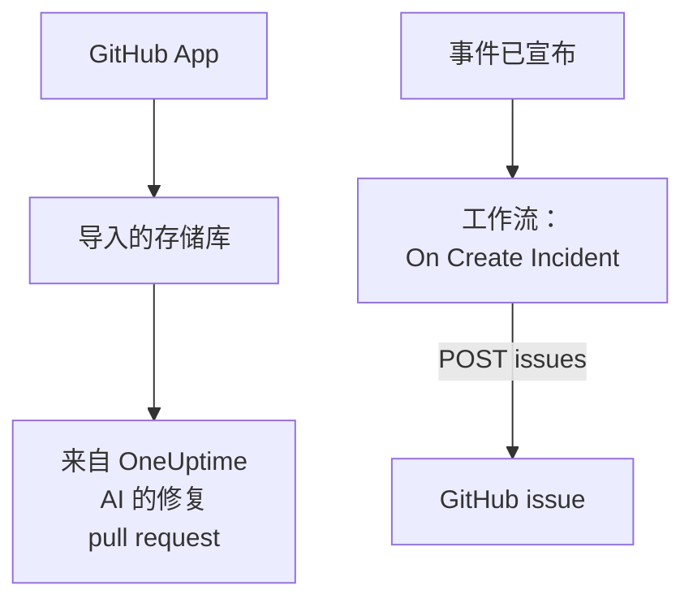

# GitHub

OneUptime 以两种方式与 [GitHub](https://github.com) 配合使用。通过 OneUptime GitHub App 连接你的存储库后，OneUptime AI 会打开修复它所发现问题的 pull request，并在你于 issue 或 pull request 中提及它时作出回应。或者，构建一个为每个事件打开 GitHub issue 的工作流，让后续工作在拥有该服务的存储库中得到跟踪。

:::cards
- [选择连接方式](#选择连接方式): GitHub App 或工作流，以及各自的作用。
- [连接你的存储库](#连接你的存储库): 用于修复 pull request 的 GitHub App。
- [为每个事件打开 issue](#为每个事件打开-github-issue): 一个工作流，两个块。
- [故障排除](#故障排除): 当 GitHub 拒绝请求时。
:::

## 工作方式



两者相互独立，你可以使用其中一种，也可以两种都用。GitHub App 在你安装它的存储库中工作。工作流只需要一个令牌，并像调用其他任何 API 一样调用 GitHub 的 [REST API](https://docs.github.com/en/rest/issues/issues#create-an-issue)。

## 选择连接方式

| 方式 | 作用 | 需要什么 |
| --- | --- | --- |
| GitHub App | 导入你的存储库。OneUptime AI 会在其中打开修复异常、慢跟踪以及其调查所发现原因的 pull request，并回应 issue 和 pull request 中的提及。 | 一个用于安装该应用的组织或账户。在 OneUptime Cloud 上需要 **Growth** 计划。 |
| 工作流 | 为每个事件在你选择的存储库中打开一个 GitHub issue。 | 一个能创建 issue 的 GitHub 令牌，以及一个由两个块组成的工作流。 |

## 连接你的存储库

打开 **产品 → 代码**，点击 **连接 GitHub**。GitHub 会询问要把应用安装到哪里，以及它可以使用哪些存储库。安装中的每个存储库都会被导入，并在你向安装中添加或移除存储库时保持同步。

如果应用已经安装在该账户上（为另一个项目安装，或直接从 GitHub 安装），请点击 **连接 GitHub** 下方的 **连接现有安装**，而不是再次安装。这需要一个管理该安装的 GitHub 账户：个人账户的所有者，或者对该安装可访问的每个存储库都有 admin 权限的人，组织的所有者就有这种权限。

自托管实例首先需要它自己的 GitHub App：[GitHub 集成](/docs/self-hosted/github-integration) 介绍了如何创建它。之后，AI 会从 [代码](/docs/ai/ai-agent) 在你的存储库中打开 pull request，[GitHub App](/docs/ai/github-app) 页面则介绍了在 issue 或 pull request 中提及该应用时它会做什么。

## 开始之前

本页其余部分将构建工作流。它需要：

- 一个能在存储库中创建 issue 的 GitHub 令牌：用于该存储库、且 **Issues** 权限设为 **Read and write** 的 fine-grained personal access token，或者带有 `repo` 范围的经典令牌。在 GitHub 的[令牌设置](https://github.com/settings/tokens)中创建一个。
- 在 OneUptime 中创建工作流和全局变量的权限。在 OneUptime Cloud 上，工作流需要 **Growth** 或更高的套餐。

## 保存令牌

:::steps
1. 前往 **工作流 → 全局变量**，点击 **创建工作流 变量**。
2. 将其命名为 `GITHUB_TOKEN`，然后点击 **下一步**。
3. 把令牌粘贴到 **内容** 中，打开 **密钥**，然后点击 **创建工作流 变量**。
:::

机密变量在运行日志中会被替换为 `[REDACTED]`，所以令牌永远不会出现在运行中。

## 为每个事件打开 GitHub issue

:::steps
### 创建工作流

前往 **工作流**，点击 **创建工作流**，然后点击 **从零开始**。将其命名为 `Incidents to GitHub`，然后点击 **创建工作流**。

### 添加触发器

点击虚线的 **选择启动此工作流的方式** 块，然后选择 **On Create Incident**。点击触发器：它的 **Fields to pass on** 已经包含 **标题**，所以点击 **添加字段** 并选择 **描述** 和 **Incident Number With Prefix**。

### 打开 issue

点击 **添加组件**，添加一个 **API Post (JSON)** 块，然后把触发器的 **Success** 点连接到它。把它的 **URL** 设为 `https://api.github.com/repos/your-org/your-repo/issues`，并换成你的存储库的所有者和名称。在 **更多字段** 下，把它的 **Request Headers** 设为：

```json
{
  "Authorization": "Bearer {{global.variables.GITHUB_TOKEN}}",
  "Accept": "application/vnd.github+json",
  "X-GitHub-Api-Version": "2022-11-28"
}
```

把 **Request Body** 设为：

```json
{
  "title": "{{local.components.incident-on-create-1.returnValues.model.title}}",
  "body": "{{local.components.incident-on-create-1.returnValues.model.description}}\n\nOpened by OneUptime for incident {{local.components.incident-on-create-1.returnValues.model.incidentNumberWithPrefix}}.",
  "labels": ["incident"]
}
```

### 测试，然后启用

点击 **运行工作流**，在 **事件** 中选择一个测试事件，然后运行它。**API Post (JSON)** 步骤会显示一个包含新 issue 的 `201` 响应，其中带有它的 `number` 和 `html_url`。然后在 **生成器** 顶部打开 **已启用**。
:::

事件解决后 issue 仍保持打开，因为后续工作通常比事件持续得更久。如需与事件双向保持同步的工单，请参阅 [Jira](/docs/integrations/jira)。

## 提示

- **GitHub Enterprise Server。** 改为把请求发送到你的服务器：`https://your-github-host/api/v3/repos/your-org/your-repo/issues`。位于私有网络地址上的服务器需要一个由管理员允许这样做的自托管 OneUptime：请参阅 [出站网络访问](/docs/workflows/configuration#出站网络访问)。
- **指派它。** 在正文中添加 `"assignees": ["octocat"]` 或 `"milestone": 3`。当令牌无法推送到存储库时，GitHub 会悄无声息地丢弃标签、指派人和里程碑。
- **只针对部分事件。** 在触发器和 API 块之间放一个 **If / Else** 块，只在它的 **Yes** 一侧打开 issue，例如只针对某一种严重程度。

## 故障排除

当 GitHub 拒绝请求时，**API Post (JSON)** 步骤会走 **Error**。运行中的 **Response Status** 和 **Response Body** 会说明原因。

:::details GitHub 返回 401
令牌错误、已过期或已被吊销。请创建一个新令牌，并替换 `GITHUB_TOKEN` 的内容。
:::

:::details GitHub 返回 403
令牌无法在那里创建 issue：一个在此存储库上没有把 **Issues** 设为 **Read and write** 的 fine-grained 令牌，一个你的组织尚未批准的令牌，或者一个未获授权用于你的组织单点登录的经典令牌。正文提到速率限制的 403 表示该令牌发送了太多请求：请等待，或者为更少的事件打开 issue。
:::

:::details GitHub 返回 404
**URL** 中的所有者或存储库错误，或者令牌看不到该存储库。对于令牌看不到的私有存储库，GitHub 返回的是 404，而不是 403。
:::

:::details GitHub 返回 410 或 422
- `410`：存储库的设置中关闭了 issues。
- `422`：GitHub 无法读取正文。请检查它是否为有效的 JSON，`title` 是否已设置，以及 `labels` 和 `assignees` 是否为列表。
:::

## 后续步骤

:::cards
- [GitHub App](/docs/ai/github-app): 直接在 GitHub 中请 OneUptime AI 进行更改、修订或审查。
- [GitLab](/docs/integrations/gitlab): 同样的工作流，用于 GitLab issue。
- [工作流组件](/docs/workflows/components#api): API 块的所有设置。
- [集成概述](/docs/integrations/index): 每个集成背后的模式。
:::
