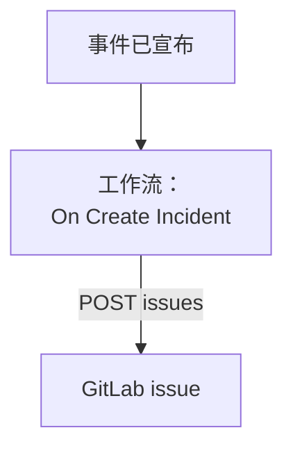

# GitLab

为每个 OneUptime 事件打开一个 [GitLab](https://gitlab.com) issue，让后续工作在拥有该服务的项目中得到跟踪。一个工作流会在 GitLab.com 或你自己的 GitLab 上调用 GitLab 的 [Issues API](https://docs.gitlab.com/api/issues/#new-issue)。

:::cards
- [保存令牌](#保存令牌): 让 GitLab 的令牌不出现在你的工作流中。
- [为每个事件打开 issue](#为每个事件打开-gitlab-issue): 一个工作流，两个块。
- [提示](#提示): 你自己的 GitLab、项目路径和指派人。
- [故障排除](#故障排除): 当 GitLab 拒绝请求时。
:::

> [!NOTE]
> OneUptime AI 也能在 GitLab 存储库中工作：用访问令牌在“代码”中连接它们，它会为每个修复创建合并请求。请参阅 [连接存储库](/docs/ai/ai-agent#连接存储库)。

## 工作方式



每个新事件都会让工作流运行一次。它的 **API Post (JSON)** 块会把事件的标题和描述发送到项目的 issues，并使用访问令牌签名。

## 开始之前

- GitLab 项目的 ID。在项目的概览页面上，选择操作菜单（竖向省略号），然后选择 **Copy project ID**。
- 一个带有 `api` 范围的 GitLab 访问令牌，属于在项目中拥有可创建 issue 角色的用户或机器人：项目、群组或个人访问令牌均可。在项目、群组或你的用户设置中的 **Settings → Access tokens** 下创建它。
- 在 OneUptime 中创建工作流和全局变量的权限。在 OneUptime Cloud 上，工作流需要 **Growth** 或更高的套餐。

## 保存令牌

:::steps
1. 前往 **工作流 → 全局变量**，点击 **创建工作流 变量**。
2. 将其命名为 `GITLAB_TOKEN`，然后点击 **下一步**。
3. 把令牌粘贴到 **内容** 中，打开 **密钥**，然后点击 **创建工作流 变量**。
:::

机密变量在运行日志中会被替换为 `[REDACTED]`，所以令牌永远不会出现在运行中。

## 为每个事件打开 GitLab issue

:::steps
### 创建工作流

前往 **工作流**，点击 **创建工作流**，然后点击 **从零开始**。将其命名为 `Incidents to GitLab`，然后点击 **创建工作流**。

### 添加触发器

点击虚线的 **Choose what starts this workflow** 块，然后选择 **On Create Incident**。点击触发器：它的 **Fields to pass on** 已经包含 **标题**，所以点击 **添加字段** 并选择 **描述** 和 **Incident Number With Prefix**。

### 打开 issue

点击 **添加组件**，添加一个 **API Post (JSON)** 块，然后把触发器的 **Success** 点连接到它。把它的 **URL** 设为 `https://gitlab.com/api/v4/projects/12345678/issues`，并用你的项目 ID 替换 `12345678`。在 **更多字段** 下，把它的 **Request Headers** 设为：

```json
{
  "PRIVATE-TOKEN": "{{global.variables.GITLAB_TOKEN}}"
}
```

把 **Request Body** 设为：

```json
{
  "title": "{{local.components.incident-on-create-1.returnValues.model.title}}",
  "description": "{{local.components.incident-on-create-1.returnValues.model.description}}\n\nOpened by OneUptime for incident {{local.components.incident-on-create-1.returnValues.model.incidentNumberWithPrefix}}.",
  "labels": "incident,oneuptime"
}
```

### 测试，然后启用

点击 **运行工作流**，在 **事件** 中选择一个测试事件，然后运行它。**API Post (JSON)** 步骤会显示一个包含新 issue 的 `201` 响应，其中带有它的 `iid` 和 `web_url`。然后在 **生成器** 顶部打开 **已启用**。
:::

该块发送的是 JSON，所以不需要 `Content-Type` 标头。GitLab 会创建它没见过的标签，所以 `incident` 和 `oneuptime` 无需事先设置。事件解决后 issue 仍保持打开，因为后续工作通常比事件持续得更久。

## 提示

- **你自己的 GitLab。** 改为把请求发送到你的服务器：`https://gitlab.example.com/api/v4/projects/12345678/issues`。位于私有网络地址上的服务器需要一个由管理员允许这样做的自托管 OneUptime：请参阅 [出站网络访问](/docs/workflows/configuration#出站网络访问)。
- **用项目路径代替 ID。** 路径可以代替 ID 使用，其中的 `/` 写作 `%2F`：`projects/your-group%2Fyour-project/issues`。URL 会完全按写法发送，所以请自己进行编码。
- **指派它。** 在正文中添加 `"assignee_ids": [42]` 或 `"due_date": "2026-12-31"`，或者添加 `"confidential": true`，只让项目成员看到它。
- **只针对部分事件。** 在触发器和 API 块之间放一个 **If / Else** 块，只在它的 **Yes** 一侧打开 issue，例如只针对某一种严重程度。

## 故障排除

当 GitLab 拒绝请求时，**API Post (JSON)** 步骤会走 **Error**。运行中的 **Response Status** 和 **Response Body** 会说明原因。

:::details GitLab 返回 401
令牌错误、已过期或已被吊销。请创建一个新令牌，并替换 `GITLAB_TOKEN` 的内容。
:::

:::details GitLab 返回 403
令牌没有 `api` 范围，或者它的用户在项目中的角色无法创建 issue。如果是范围的问题，正文中会提到 `insufficient_scope`。
:::

:::details GitLab 返回 404
**URL** 中的项目 ID 错误，或者令牌看不到该项目。对于令牌看不到的私有项目，GitLab 返回的是 404，而不是 403。
:::

:::details GitLab 返回 400
GitLab 无法读取正文：缺少 `title`，或者某个字段的类型错误。正文会指出该字段。
:::

## 后续步骤

:::cards
- [GitHub](/docs/integrations/github): 用于 GitHub 的同样工作流，以及 GitHub App。
- [工作流组件](/docs/workflows/components#api): API 块的所有设置。
- [工作流运行记录](/docs/workflows/runs-and-logs): 查看每个请求发送了什么、收到了什么。
- [集成概述](/docs/integrations/index): 每个集成背后的模式。
:::
