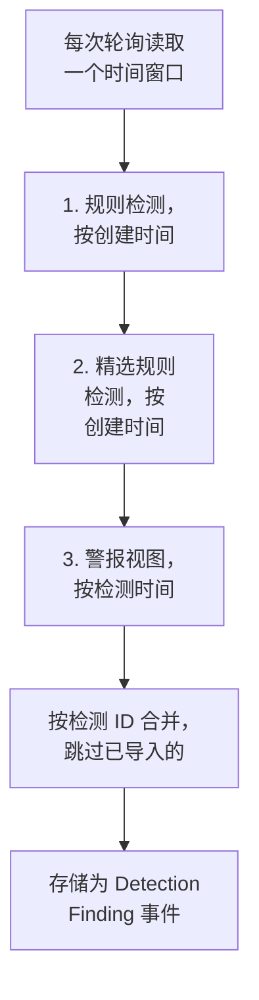

# Google SecOps

把 [Google SecOps](https://cloud.google.com/security/products/security-operations)（原 Chronicle）的警报和检测导入 OneUptime 的安全事件。在那里，你可以把它们与日志、跟踪和指标放在一起搜索，与其他所有来源进行关联分析，并为重要的内容呼叫值班人员。

:::cards
- [选择连接方式](#选择连接方式): SOAR playbook Webhook、托管连接器，或 UDM 转发。
- [设置托管连接器](#设置托管连接器): 一个服务账号密钥，以及连接的表单。
- [连接器如何轮询](#连接器如何轮询): 每个窗口的三种读取方式，以及它们的预算。
- [故障排除](#故障排除): Last Error 说了什么，以及该怎么做。
- [将安全事件发送到 Google SecOps](#将安全事件发送到-google-secops): 在 Google SecOps 中查看 OneUptime 的检测结果。
:::

## 选择连接方式

| 方式 | 到达的内容 | 适用情况 |
| --- | --- | --- |
| SOAR playbook Webhook | playbook 发布的每个警报，几秒内到达 | 你在运行 SOAR playbook，并希望不经轮询就在 OneUptime 中收到它们的警报。 |
| 托管连接器 | 警报，以及你选择的规则检测，按间隔轮询 | 你希望 OneUptime 替你获取它们，而无需在 SecOps 中配置任何东西。 |
| UDM 事件转发 | 原始 UDM 事件，用于完整的搜索和关联分析 | 你已经在导出 UDM 事件，并希望收到其中的每一个。 |

每种方式都会把到达的内容规范化为 [OCSF](https://schema.ocsf.io/)，即 OneUptime 用来存储每个安全事件的 Open Cybersecurity Schema Framework，所以无论来源是什么，检测规则和仪表板的工作方式都相同。

## 开始之前

- 对于托管连接器，在 OneUptime 中拥有 Project Owner、Project Admin 或 Security Admin 角色。Security Member 和 Security Viewer 可以读取连接，但不能创建它们。
- 对于 Webhook 和 UDM 转发，需要一个摄取密钥：打开 **项目设置 → 遥测与 APM → 摄取密钥**，然后点击 **创建摄取密钥**。
- 对于托管连接器，需要在你的 SecOps 实例所绑定的项目上创建 Google Cloud 服务账号的权限。

## 从 SOAR playbook 发送警报

Google SecOps SOAR playbook 可以把警报发布到任何 HTTP 终结点。让其中一个 playbook 指向 OneUptime 的安全事件摄取终结点。

:::steps
### 添加 HTTP 请求操作

在你的 SecOps SOAR playbook 中，添加一个在新警报上运行的 **HTTP request** 操作。

### 让它指向 OneUptime

把它的 **Method** 设为 `POST`，**URL** 设为 `https://oneuptime.com/security-events/v1/ingest`，自托管安装则设为 `https://<your-host>/security-events/v1/ingest`。添加以下请求头：

```text
Content-Type: application/json
x-oneuptime-token: <your telemetry ingestion key>
```

把警报的 JSON 作为 **Body** 发送。检测（即在 `collectionElements` 下带有匹配 UDM 事件的规则详情）会被自动识别，存储为 Detection Finding 事件，其匹配事件中的用户、主机和 IP 会作为 observable 保留。

### 检查警报是否到达

运行该 playbook。它的警报会在几秒内出现在 **产品 → Security Events** 中。
:::

## 转发 UDM 事件

要获得完整的搜索和关联分析，请转发 UDM 事件本身，例如从 BigQuery 导出管道、Cloud Function，或你已经在运行的任何转发器发送：

```bash
curl -X POST "https://oneuptime.com/security-events/v1/ingest?format=udm" \
  -H "Content-Type: application/json" \
  -H "x-oneuptime-token: <your telemetry ingestion key>" \
  -d '{
    "events": [
      {
        "metadata": {
          "event_type": "USER_LOGIN",
          "event_timestamp": "2026-08-21T10:00:00Z",
          "vendor_name": "Google",
          "product_name": "Google SecOps"
        },
        "principal": { "user": { "userid": "alice" }, "ip": ["203.0.113.7"] },
        "target": { "hostname": "vpn-gw-01" },
        "security_result": [{ "severity": "HIGH", "action": ["BLOCK"] }]
      }
    ]
  }'
```

- `format` 可以是 `udm`、`ocsf`、`google-secops-alert` 或 `generic`。省略它时，会逐个事件检测格式。
- 主体可以是一个事件、一个事件列表，或 `{ "events": [...] }`。
- `x-oneuptime-service-name` 指定事件所属的遥测服务。没有它时，事件属于以负载中的产品命名的服务。

## 设置托管连接器

OneUptime 按间隔轮询你租户的检测和警报，无需任何 SOAR 配置。Google SecOps 是 Security Event Connections 的一个提供商，所以它的创建、测试、轮询和诊断，都与其他所有托管连接器在同一个页面上、以同样的方式进行。

:::steps
### 创建服务账号密钥

在 Google Cloud 中，在你的 SecOps 实例所绑定的项目上创建一个服务账号，并授予它 **Chronicle API Viewer** 角色（`roles/chronicle.viewer`）。该角色包含连接器读取时使用的 `legacySearchDetections`、`legacySearchCuratedDetections`、`countAllCuratedRuleSetDetections` 和 `legacyFetchAlertsView` 权限。

在服务账号的 **Keys** 选项卡上，添加一个 **JSON** 类型的密钥并下载。你会把整个文件粘贴到连接中。它的 `token_uri` 必须是 Google 主机上的 `https` URL，从 Google Cloud 下载的密钥本来就是这样。

### 找到区域和实例资源名称

在 Google SecOps 中，打开 **SIEM Settings → Profile**。实例资源名称的形式为 `projects/{project}/locations/{location}/instances/{instance}`，其中 instance 部分是 SecOps 实例 ID；连接的显示名称或服务账号名称不能替代它。区域是服务于该位置的区域终结点，它必须与实例资源名称中的 locations 段匹配，否则保存时连接会被拒绝。

### 添加连接

打开 **产品 → Security Events → 连接**（`/dashboard/{projectId}/security-events/connections`），选择 **添加连接**，选择 **Google SecOps**，并用下表中的设置填写表单。

### 保存之前先测试

保存之前，选择 **保存前测试** 下的 **测试这些设置**。测试使用表单上的值运行，不存储任何内容，因此格式错误的密钥、缺失的角色或错误的实例会在连接存在之前被发现。在编辑表单上，同一个按钮会用存储的密钥测试屏幕上显示的 **区域**、**实例资源名称** 和 **Data to import**；凭据字段留空时会保留存储的密钥。当测试的任何内容与连接已保存的内容不同时（包括新输入的密钥），不会记录运行历史行，因为连接还没有这些设置。
:::

| 设置 | 在哪里找到 | 必填 |
| --- | --- | --- |
| **区域** | 与实例资源名称中的位置相匹配的 Google SecOps 区域终结点（`us`、`europe`、`asia-southeast1`……）。它没有默认值，所以美国以外的租户不会意外保存错误的终结点。 | 是 |
| **实例资源名称** | Google SecOps **SIEM Settings → Profile**：`projects/{project}/locations/{location}/instances/{instance}`。 | 是 |
| **案例关闭时关闭其警报** | 在表单的最后一步，在你打开之前一直关闭。打开后，关闭案例会关闭它的 Google SecOps 警报：参见 [案例关闭时关闭其警报](#案例关闭时关闭其警报)。 | 否 |
| **服务账户 JSON** | Google Cloud 中服务账号的 **Keys** 选项卡。粘贴整个 JSON 密钥文件。只写：静态加密存储，API 从不返回，页面上也从不回显。在连接上使用 **更新凭据** 来轮换它。 | 是 |
| **Data to import** | **警报** 总会被导入，因为 Google 的警报 API 总会返回它们。选择 **检测** 可以同时导入没有生成警报的规则匹配。这不会转发原始 UDM 事件：请按上文自行转发。 | 警报总是导入 |

表单的轮询步骤会询问 **名称**、可选的 **描述**、连接是否 **已启用**，以及 **轮询间隔（分钟）**：`1` 到 `1440` 之间的整数，默认为 `5`。超出该范围的值会在保存时被拒绝。

新的检测会作为 Detection Finding 事件导入，归属于 `Google SecOps` 遥测服务。

## 查看连接健康状况

连接列表显示 **名称**、**提供商**（下方显示连接的 Data to import 选择）、**状态**（已启用或已禁用）、**健康状况**、**间隔（分钟）**、**最近轮询**、**最近一次成功轮询** 和 **最近导入的事件**。连接出错时，它的 **操作** 列中会出现 **查看错误**，位于 **测试连接**、**立即运行**、**诊断**、**编辑** 和 **更新凭据** 旁边。已启用表示已配置自动轮询。Last Polled 记录的是一次尝试；一个成功的空窗口并不能说明某个特定的检测已被导入。

**健康状况** 只有在导入过事件之后才会显示 **Last poll succeeded**。在此之前，一个成功轮询的连接会显示 **Polling, no events imported yet**，这正是需要用测试连接来排查的状态。其他状态有 **No records returned**、**Partial import**、**Catching up**、**Last poll failed**、**Poll overdue**、**Schedule paused** 和 **等待首次轮询**；把鼠标悬停在某个状态上即可查看它的含义。

> [!NOTE]
> 连接器使用 Chronicle 的 `v1alpha` 旧版检测和警报 API，Google 将其作为正式发布前（pre-GA）的版本提供。轮询失败时，连接的 **最近错误** 字段会存储完整的错误消息（凭据已隐去），前面带有一个指明失败步骤的前缀，包括 Chronicle 返回 `200` 却在主体中给出拒绝的情况。在连接的 **操作** 列中选择 **查看错误** 来阅读消息，然后在对话框中用 **复制错误** 复制它以提供给支持人员。

## 连接器如何轮询



后台工作进程每分钟为自上次轮询以来已过间隔的每个已启用连接排入一次轮询。每次轮询都是连接历史中的一次运行，由工作进程执行。它以三种方式读取同一个时间窗口，并按检测 ID 合并结果，所以被多个读取过程返回的记录只存储一次：

1. **按创建时间读取规则检测。** 使用 `ruleId=-`（每条规则的每个修订版本）和 `listBasis=CREATED_TIME` 调用 `legacy:legacySearchDetections`，并跟随 `nextPageToken`，直到最后一页。
2. **按创建时间读取精选规则检测。** 以同样的方式调用 `legacy:legacySearchCuratedDetections`，每条精选（由 Google 编写的）规则调用一次。该终结点只接受一个精选规则 ID（`ur_...`），没有“每条规则”的通配符，所以这个读取过程会先针对从窗口之前一周到窗口结束的时间调用 `:countAllCuratedRuleSetDetections`，再逐一搜索产生了检测的每条精选规则。在那一周内没有触发过的精选规则没有可导入的内容。没有精选规则访问权限的租户会以 `400`、`403` 或 `404` 回应这个读取过程；这会被记录为运行的警告，而不是失败。
3. **按检测时间读取警报视图。** 调用 `legacy:legacyFetchAlertsView`，它除了规则警报之外，还涵盖遥测警报、SOAR 警报和机器智能警报。该终结点不支持分页，所以被 Google 限制的响应会被拆分成更小的窗口重新读取。

警报视图只能按检测时间过滤，而 Google 常常在检测时间之后很久才让警报可被读取（摄取延迟、计划规则、对迟到数据的重新运行）。因此，计划的轮询还会 **在其窗口之前的 24 小时内再扫描一遍警报视图**，只读取警报，并记录为 **Read late alerts by detection time** 检查。已导入的记录会被跳过，所以扫描中重复的记录会出现在 **Already imported** 下。扫描是尽力而为的：当 Google 限制它、它的预算用完或它失败时，运行会得到一条警告，但轮询不会变为 Partial 或 Failed，游标仍会前进，因为它回溯的那一天早已被之前的轮询读过。

按 **创建时间** 轮询是整个设计的核心。Google SecOps 规则按计划运行（每 10 分钟、每小时、每天），它创建的检测带有 `detectionTime`，即规则时间窗口的结束时间或匹配事件的时间，而 `createdTime` 是检测引擎实际生成它的时间。一个在 10:05 为截至 09:00 的窗口创建的检测，其检测时间早已落在一个几次轮询之前就越过了 09:00 的游标之后，所以按检测时间轮询的连接器永远看不到它，任何迟到的事件也是如此。按创建时间读取，让每次轮询问的是“自我上次查看以来，Google 创建了什么”，这才是有答案的问题。每次运行都会记录它的创建延迟，即获取的记录中有多少是在其检测时间之后超过一个轮询间隔（再加一分钟）才创建的，以及最大的时间差，所以这种影响在 Diagnostics 中清晰可见。

新连接的第一次轮询按创建时间回溯 **24 小时**。此后的每次轮询都从连接存储的游标处恢复，并有 **1 分钟** 的重叠；在窗口边界上创建的记录会被两次轮询都读到，但只存储一次，因为轮询会跳过已用相同来源标识符存储的事件。每次计划的轮询最多读取游标之后 **24 小时**，所以保存的游标较旧的连接会通过连续的 24 小时窗口追赶（Health 显示 **Catching up**），而不会丢弃中间的检测。对于第一个 24 小时窗口之前创建的记录，请使用 Diagnostics 中的 **Import this time range**。

### 当一个窗口包含的内容超过一次轮询能读取的量时

连接器为每次轮询设定固定的预算：规则检测读取过程有 **20** 个搜索页，精选读取过程最多 **200** 个请求（计数请求，加上过去一周内触发过的每条精选规则至少一页，最繁忙的规则优先），警报视图及其迟到警报扫描共用 **16** 个请求，整个读取在 **4 分钟** 后停止。当这段时间用掉 60% 后，精选读取过程不再开始新的精选规则，以便警报视图仍能运行。当一次轮询无法搜索每条活跃的精选规则时，它会记录一条警告，说明有多少条没有被搜索，而不是停住游标，因为即使窗口更短，这些规则也仍然都需要搜索。被预算中途停下的读取过程会被记录为一个指明该预算的警告检查（例如 `Read rule detections by created time was stopped by the request budget after 20 requests.`），而预算根本没让它开始的读取过程会成为一个被跳过的检查，相同的原因写在运行的警告中，绝不会记为成功。检测数量超过这些预算的窗口无法在一次轮询中读完，而轮询也绝不会永远重复读取同一个窗口：

1. **缩小。** Google 的搜索终结点先返回最新的检测，所以提前停下的轮询没有可以恢复的位置。这次轮询会被记录为 **部分**，游标停在原处，下一次轮询从同一个起点读取长度减半的窗口，并带有警告 `This window holds more records than one poll can read; the next poll reads a {n} minute window from the same starting point.` 窗口会不断减半，最短到一分钟，直到能够容纳。
2. **恢复。** 每次完整的轮询都会让下一个窗口加倍，最长为 24 小时，所以一次突发只会带来几次短轮询，而不会让连接永久变慢。
3. **越过单独的一分钟。** 如果连一分钟内的检测都超过一次轮询能读取的量，轮询会把游标移过这一分钟，让更新的检测继续到达。这次运行为 **部分**，并且 **最近错误** 以同样的文字开头：`More records were created in the one minute from {start} to {end} than one poll can read. Polling moved past this minute so newer records keep arriving; use Import this time range in Diagnostics on this minute to recover what one run can read.` 要找回一次运行能读取的内容，请打开 **诊断**，选择一个覆盖那一分钟的自定义范围（范围输入使用你的本地时间；消息使用 UTC），然后运行 **Import this time range**；一次导入的单次运行上限与一次轮询相同。已导入的检测会被跳过。

Partial 轮询还会把它的警告存储在 **最近错误** 中，直到一次完整的轮询将其清除。彻底失败的轮询（因为错误，而不是记录太多）会保留游标和窗口长度，并在下一个周期重试。唯一的例外是请求超时：下一次轮询会从同一个起点读取长度减半的窗口（`The source did not answer in time for this window; the next poll reads a {n} minute window from the same starting point.`），否则太重而无法及时响应的窗口每次重试都会超时。缩短轮询间隔不会改变以上任何一点：窗口由游标和上一次轮询的结果决定，而不是由轮询运行的频率决定。

## 测试连接

**测试连接**（在连接所在行或 **诊断** 中）在 API 进程中同步运行。它不需要后台工作进程，这正是它能告诉你没有工作进程在运行的原因。检查清单：

1. **配置**：每个字段都存在且格式正确：与实例位置相匹配的受支持 **区域**、形式正确的 **实例资源名称**，以及包含 `client_email`、可读的 `private_key` 和 Google `token_uri` 的 **服务账户 JSON** 密钥。此项失败时不会连接任何地方。
2. **Authenticate with Google**：在联系 Chronicle 之前，先在 Google 的 OAuth 终结点用密钥换取访问令牌。
3. **Read rule detections**、**Read curated rule detections** 和 **Read the alerts view**：对每个读取过程在过去 24 小时内做一次只取一条记录的探测。精选检查会读取过去 7 天的精选规则计数，并探测检测最多的那条精选规则；如果那一周内没有精选规则触发过，它就无需探测而直接通过。以 `400`、`403` 或 `404` 回应的精选读取是警告，因为租户可能只是没有精选规则的访问权限。
4. **Detections available to import**：在过去 24 小时和过去 7 天内，Google 在已保存的 **Data to import** 选择下以及另一种选择下（仅警报，或警报和 **检测**）各有多少内容：每个范围读取警报视图的匹配计数和一页按创建时间的搜索结果，报告为一个数字或 `1000+`。当已保存的选择下什么都没有、而另一种选择下有内容时，检查会发出警告：你的规则会创建检测，但没有为它们启用警报。请编辑连接，在 **Data to import** 下选择 **检测**，或在 Google SecOps 中为这些规则启用警报。
5. **Background workers**、**Poll scheduler** 和 **Security event storage**：是否有进程在消费 OneUptime 的 Worker 队列，每分钟一次的轮询作业是否已注册，以及安全事件存储是否能响应轮询在每次插入之前运行的同一个去重查询，这样损坏的分析数据库会在这里带着名称失败，而不是一小时后作为轮询错误出现。
6. **Scheduled polling**（仅限已保存的连接）：轮询是否已启用，排队的运行是否卡在等待工作进程的状态，以及连接是否按计划被轮询。

测试中的每个请求都有 20 秒的期限。测试不会触碰轮询游标和事件存储。用已保存的设置测试已保存的连接时，会得到一条类型为 test 的运行历史行，该行的详细信息会显示同样的检查清单。

## 按需预览、运行和导入

在连接上打开 **诊断**，可以查看最近的运行并操作连接器。Project Owner、Project Admin 和 Security Admin 可以启动操作。Security Member 和 Security Viewer 可以阅读历史记录。

- **立即运行** 会立即排入一次轮询，使用正常的游标和摄取路径，即使计划轮询已被禁用也可以。工作进程执行请求期间，排队中和运行中的状态会一直可见。如果某次运行一直处于排队状态，请检查工作进程是否在处理 Worker 队列；测试连接中的 **Background workers** 检查会告诉你是否有进程在处理。
- **Preview detections** 读取选定的时间范围，不导入也不改变游标。可以使用过去 1 小时、24 小时、7 天，或最长 7 天的自定义范围。该范围与按检测时间读取的 SecOps 警报视图一致，而两个搜索读取过程既读取在该范围内创建的检测，也读取检测时间落在该范围内的检测，所以预览昨天时，也会显示昨天创建的、关于更早事件的检测。预览会分别显示检测时间和创建时间。结果反映连接已保存的 **Data to import** 选择。
- **Import this time range** 在你确认后导入选定的范围，不会移动轮询游标。如上文所述，这也是找回轮询越过的那一分钟的方法。请先预览该范围。重复的轮询和导入会跳过项目中已用相同来源标识符存储的事件。导入可能会像计划轮询一样触发已配置的检测规则和监视器。

每次运行的详细信息会显示 **Requested window (UTC)**、连接的 **Data to import** 选择，以及五个计数：

| 计数 | 统计的内容 |
| --- | --- |
| **Returned by Google SecOps** | Google 在三个读取过程中返回的记录，按 ID 合并之后的数量。 |
| **Imported into OneUptime** | 写入事件存储的行。 |
| **Already imported** | 因为相同的来源标识符已存储在这个项目中而被跳过的记录；1 分钟的重叠和重新运行使这种情况很正常。 |
| **已拒绝** | 返回的不是 Google SecOps 检测的对象。它们会被计数并发出警告，但从不重试，也不会停住游标。 |
| **失败** | 无法规范化的记录。轮询会在更短的窗口中重试它们。 |

**Provider details** 会补充 **Time basis read**、**Returned by each pass** 的记录数（规则检测、精选规则检测和警报视图）以及 **Creation lag**。之后依次是检查（每个读取过程一个）、警告和检测样本。计划轮询的详细信息还会显示 **Window read by this poll** 和 **Next scheduled poll reads** 的内容，而 Partial 轮询会说明它是保留了起点并缩小了下一个窗口，还是越过了它所指明的单独一分钟。**成功**、**No records returned**、**部分** 和 **失败** 是不同的结果。

在某次运行上使用 **View events in this time range**，可以打开它所返回检测的事件时间范围。否则，一个今天创建、但检测时间是昨天的检测，可能会被“最近事件”过滤器隐藏。在之后的完整轮询清除 Last Error 之后，运行历史仍会保留失败记录。联系支持人员时请使用 **Copy diagnostics**；它从不包含服务账号凭据和令牌。

## 为什么我看不到事件？

请按顺序逐一检查。在 **诊断** 或 **测试连接** 中，每一项都能与下一项区分开来。

1. **Data to import。** 默认只导入 **警报**，而只有在 Google SecOps 中为规则启用了警报时，规则检测才会成为警报。如果租户的规则只创建检测而不发出警报，那么轮询结果就会一直如实地为空。运行 **测试连接**：**Detections available to import** 检查会分别统计包含和不包含 **检测** 时的数量，并在选择它会增加记录时告诉你。请编辑连接，在 **Data to import** 下选择 **检测**，或为规则启用警报。
2. **规则运行频率和检测延迟。** 检测在规则运行时创建，这可能比它所描述的事件晚一个小时甚至一天。连接器按创建时间轮询，所以它们会在 Google 创建它们之后的第一次轮询中到达，而不是在它们的检测时间到达。刚启用的规则还没有创建任何东西，而安静的租户没有什么可创建的。可用性检查会报告过去 24 小时和 7 天内创建了多少检测；包含和不包含 **检测** 时都为零，表示 Google 暂时没有可供 OneUptime 导入的内容。
3. **阅读上一次运行的计数。** 在 Diagnostics 中，如果 **Returned by Google SecOps** 有数量、**Imported into OneUptime** 为零，而 **Already imported** 的计数与之相符，说明连接器正在按设计工作：这些检测已被之前的轮询导入。**已拒绝** 记录是 Google 返回的、根本不是检测的对象。
4. **到底有没有在轮询？** Last Polled 显示 `Never` 且 Last Error 为空，表示这个连接还没有完成过任何轮询。测试连接会报告 **Background workers**（消费 Worker 队列的进程）、**Poll scheduler**（每分钟一次的调度器注册）和 **Scheduled polling**（这个连接自己的计划，包括逾期的轮询或卡在排队状态的运行）。导致这种情况的部署设置请参阅下面的故障排除条目。
5. **在正确的地方查找。** 事件按检测时间存储，这可能比它们被创建和导入的时间早几个小时甚至几天，所以安全事件中的“最近 1 小时”过滤器会隐藏一个一分钟前导入的、关于昨天的检测。请在 Diagnostics 中的某次运行上使用 **View events in this time range**：它会打开该运行所返回检测的事件时间范围。

## 严重程度如何设定

Google SecOps 会根据规则的编写者，把检测的严重程度存储在不同的地方，OneUptime 按以下顺序读取，采用第一个给出严重程度的来源：

1. **Google 自己的严重程度**（`detection[].severity`）。Google 会在精选规则上设置它，例如 Applied Threat Intelligence 和精选规则集。
2. **警报的严重程度**（Collection 的 `severity`），用于 SOAR 警报和 Webhook 主体。
3. **规则的 `meta` 严重程度。** 对于自定义 YARA-L 规则，Google 会让 `detection[].severity` 保持为空，并把规则的 `meta` 部分作为 `ruleLabels` 返回。OneUptime 读取 `severity` 标签，也就是 Google SecOps 规则仪表板上显示的值。可识别 Info、Informational、Low、Medium、High 和 Critical，不区分大小写。
4. **规则的 `$risk_score` 结果**，在规则没有设置严重程度时使用，按 [Google 推荐的范围](https://docs.cloud.google.com/chronicle/docs/yara-l/outcome-syntax) 分级：90–100 Critical，80–89 High，50–79 Medium，20–49 Low，1–19 Informational。OneUptime 只使用规则自己设置的分数。它会忽略 Google 为没有分数的规则填入的 `riskScore`（警报规则为 40，其他为 15），因为这个默认值说明不了检测有多严重。

以上都无法分级的检测会显示为 Unknown。要为自定义规则分级，请在 Google SecOps 中为它的 `meta` 部分添加严重程度，例如 `severity = "High"`，或在它的 `outcome` 部分设置 `$risk_score`。此后该规则创建的检测会以该严重程度导入。

## 案例关闭时关闭其警报

打开 **案例关闭时关闭其警报** 后，关闭一个 [安全案例](/docs/telemetry/security-cases#关闭案例) 会关闭它所来自的 Google SecOps 警报。每个警报都会按案例的结论标记为已关闭：True Positive 标为恶意，False Positive 或 Benign Positive 标为非恶意，并附上案例的关闭说明和返回案例的链接。案例的时间线会说明关闭了多少个警报。

- 服务账户需要 `chronicle.legacies.legacyUpdateAlert`，`roles/chronicle.editor` 角色具有该权限。`roles/chronicle.viewer` 角色可以读取警报但不能关闭它们，此时案例上会显示 `403`。
- Google SecOps 中已不存在的警报会被跳过。无法连接 Google SecOps 时，OneUptime 会重试大约一小时，然后在案例上写明哪些没能关闭。

## 在其他事件中监视它的指标

**来源** 为 **Google SecOps** 的 [威胁情报源](/docs/telemetry/threat-intelligence#如何读取-google-secops) 会通过此连接读取 Google SecOps 的威胁情报在其事件中发现的指标，并在你项目的其余事件中监视这些指标：那些 Google SecOps 从未见过的登录、网络流和端点事件。

## 将安全事件发送到 Google SecOps

OneUptime 也可以把发现的内容发送到 Google SecOps，让您的团队所用的 SIEM 在自身检测结果旁边看到 OneUptime 的检测结果。每个安全事件都会作为 UDM 事件导入：登录为 `USER_LOGIN`，进程启动为 `PROCESS_LAUNCH`，网络连接为 `NETWORK_CONNECTION`，其他一切为 `GENERIC_EVENT`，并带有其严重级别、MITRE ATT&CK 标签以及发现它的规则。

:::steps
### 创建可以导入事件的密钥

在 Google Cloud 中，在您的 SecOps 实例所绑定的项目里创建一个服务账号，并为其授予拥有 `chronicle.events.import` 权限的角色，例如 **Chronicle API Editor** (`roles/chronicle.editor`)。在其 **Keys** 标签页上添加一个类型为 **JSON** 的密钥并下载。

### 添加目标

打开 **产品 → Security Events → 连接**。在 **发送到你的 SIEM** 下点击 **添加目标**，在 **SIEM** 下选择 Google SecOps，然后点击 **下一步**。选择 **区域**，像上面的连接器一样填写 **实例资源名称**，并把密钥粘贴到 **服务账户 JSON** 中。

### 发送测试事件

点击 **发送测试事件**。一个来自产品 `OneUptime Security Events` 的 `GENERIC_EVENT` 会按表单中的设置发送到 Google SecOps，不会保存任何内容。它会在几分钟内出现在 Google SecOps 中。

### 选择发送的内容

在 **发送内容** 下保留 **仅检测结果**，即您的规则和威胁情报发现的内容以及已连接产品发出的告警，或选择 **所有安全事件**。点击 **开始发送**。
:::

- 目标只发送保存之后到达的事件，绝不发送项目的历史记录，并且每分钟发送一次新事件。
- OneUptime 从 Google SecOps 导入的告警绝不会被发送回去。
- 当 Google SecOps 没有响应或拒绝一批事件时，目标会保留其位置，并在下一次运行时重试。其 **状态** 显示为 **失败**，**查看错误** 会显示 Google SecOps 的答复。

## 故障排除

:::details 自定义规则的检测显示严重程度为 Unknown，而精选规则的检测已分级
该规则没有设置严重程度。在规则的 `meta` 部分添加 `severity = "Low"`、`"Medium"`、`"High"` 或 `"Critical"`，或在它的 `outcome` 部分设置 `$risk_score`（参见 [严重程度如何设定](#严重程度如何设定)）。此更改之前的版本也会忽略自定义规则的 `meta` 严重程度；升级后，会使用与每个检测一起存储的规则标签，重新为那些版本导入的检测分级。
:::

:::details 警报出现在 Google SecOps 中，却从未出现在 OneUptime 中
请升级到会逐条读取精选规则检测、并扫描警报视图以查找迟到警报的版本。早期版本把 `ruleId=-` 发送给没有通配符的 `legacySearchCuratedDetections`，所以 Google 对每次精选搜索都返回一个空的成功结果；它们还只在轮询自己那几分钟的检测时间内读取警报视图，所以 Google 之后才让其可读的警报永远不会被看到。两者看起来都像一个健康而安静的连接。升级后，请使用 Diagnostics 中的 **Import this time range** 导入过去 7 天的内容。
:::

:::details Google 返回零条记录
在 Diagnostics 中检查确切的时间窗口、时间基准和已保存的 **Data to import** 选择，并运行测试连接，读取包含和不包含 **检测** 时的可用计数。不发出警报的规则匹配需要勾选 **检测** 复选框。预览一个同时覆盖其检测时间和创建时间的时间段。第一次计划轮询按创建时间回溯 24 小时；更早的记录请使用 **Import this time range**。
:::

:::details Health 为 Partial import
在 **诊断** 中打开最新的运行并阅读它的警告；Last Error 中也有同样的警告。`This window holds more records than one poll can read; ...` 表示轮询正在从同一个起点缩小窗口，无需任何操作：轮询完整完成后，窗口会恢复。`More records were created in the one minute from ...` 表示轮询越过了那一分钟；请用 **Import this time range** 导入它，以找回被跳过的检测。如果警告说某个读取过程被请求预算或轮询时间预算停下或因此没有运行，它会指明被截断的读取过程。缩短轮询间隔不会改变窗口。仅凭 Last Error 为空，并不能说明覆盖完整。
:::

:::details Health 为 Poll overdue
计划的轮询没有按时运行。请检查工作进程队列，并运行测试连接，查看 **Background workers** 和 **Scheduled polling** 检查。
:::

:::details 状态为已禁用
计划轮询会跳过该连接。获得授权的用户仍然可以在 Diagnostics 中测试、预览、用 **立即运行** 运行一次轮询，或导入。
:::

:::details Last Polled 为 `Never` 且 Last Error 为空
这个连接还没有完成过任何轮询。打开 **诊断**：如果它的运行历史中没有轮询，或只有一个卡在排队状态的轮询，说明后台工作进程根本没有执行过轮询作业，所以从来没有任何请求到达 Chronicle。在自托管部署中，常见原因是应用容器上设置了 `DISABLE_QUEUE_WORKERS=true`，却没有单独的工作进程部署来消费队列。要么设置 `DISABLE_QUEUE_WORKERS=false`（Docker Compose 随附的 `config.example.env` 默认值），要么运行专用的工作进程部署（Helm：`worker.enabled: true`，默认为 `false`）。测试连接会把它报告为失败的 **Background workers**、**Poll scheduler** 或 **Scheduled polling** 检查。已经运行、但在到达连接之前就停下的轮询，则会作为失败的运行出现在该历史中：`Another poll or import for this source is still running in this project` 表示这个项目中另一个 Google SecOps 轮询或导入持有来源锁，连接会在下一个周期重新排队。连轮询都无法排入的调度器会在 Last Error 上写入 `Scheduler could not queue a poll:` 及原因。
:::

:::details Last Error 有内容
有一次轮询被尝试且其中某个步骤失败了，或者一次轮询无法读完它的整个窗口，或者调度器无法排入轮询。对于失败的轮询，该字段会存储完整的错误消息（凭据已隐去）。连接出错时，在它的 **操作** 列中选择 **查看错误** 打开完整消息，然后在对话框中用 **复制错误** 复制它以提供给支持人员。该字段会在下一次完整轮询时清除，**查看错误** 操作也会随之消失；运行历史会保留它。请先阅读前缀。以 `More records were created in the one minute from` 开头的消息表示被跳过的那一分钟，而不是失败；请参阅上面的 **Health 为 Partial import**。只有四个前缀带有 HTTP 状态码，所以没有状态码的消息并不能证明问题出在 OneUptime 一侧：

- `Google token exchange failed (HTTP ...)`：服务账号凭据在 Google 的 OAuth 终结点被拒绝，此时还从未联系过 Chronicle。通常是格式错误、已吊销或属于错误项目的密钥。
- `Google token exchange returned ...`：同一个 OAuth 终结点作出了回应，但内容无法使用：没有 `access_token`，或主体不是 JSON。这仍然发生在联系 Chronicle 之前，通常是中间的代理或网关造成的，而不是密钥本身的问题。
- `Google SecOps detections search failed (HTTP ...)`：Chronicle 本身拒绝了按创建时间的搜索（`legacySearchDetections` 或 `legacySearchCuratedDetections`）。`403` 通常表示服务账号在实例所绑定的项目上缺少 **Chronicle API Viewer** 角色；在精选读取过程中，`400`、`403` 或 `404` 会被降级为警告，因为租户可能只是没有精选规则的访问权限。
- `Google SecOps detections search returned ...`：Chronicle 对搜索返回了 `200`，但主体不是可读的检测页面：为空、不是 JSON，或是解析器无法识别的结构。这会被报告出来，而不是被算作一个安静的窗口，所以游标无法越过遗漏的内容。
- `Google SecOps curated rule detection counts failed (HTTP ...)`：Chronicle 拒绝了 `countAllCuratedRuleSetDetections`，也就是确定精选读取过程要搜索哪些精选规则的调用。出于与精选搜索相同的原因，`400`、`403` 或 `404` 会被降级为警告；其他任何状态都会让轮询失败。
- `Google SecOps curated rule detection counts returned ...`：Chronicle 对精选规则计数返回了 `200`，但主体为空、不是 JSON，或是解析器无法识别的结构。这会被报告出来，而不是被读作“没有精选规则触发”，所以精选检测不会被悄悄跳过。
- `Google SecOps alerts fetch failed (HTTP ...)`：Chronicle 本身拒绝了警报视图请求。`403` 通常表示服务账号在实例所绑定的项目上缺少 **Chronicle API Viewer** 角色；`404` 通常表示实例资源名称指向了另一个实例，或者区域前缀不是 Chronicle 所服务的区域。
- `Google SecOps alerts fetch returned ...`：Chronicle 返回了 `200`，但主体不是可读的检测警报流：为空、不是 JSON，或是解析器无法识别的结构。它被特意报告出来，而不是被算作空窗口：把无法读取的主体当作“没有警报”，会让游标越过遗漏的内容。
- `Google SecOps alerts query was rejected by Chronicle on an HTTP 200`：Chronicle 接受了请求并运行了它，然后在返回的主体中拒绝了查询（`validSnapshotQuery` 或 `validBaselineQuery` 为 false，或存在 `queryValidationErrors`）。这是 Google 的拒绝，其中任何地方都没有 HTTP 状态码。
- `timed out after 60 seconds with no response`：在客户端放弃之前，Google 的 OAuth 终结点和 Chronicle 都没有回应（连接测试对每个请求使用 20 秒期限，并用这个数字报告同样的措辞）。没有任何内容返回，所以消息不归咎于任何一方；请检查 OneUptime 工作进程的出站流量以及租户。
- 与以上都不匹配的消息并非来自 Google。以字段名（`Region`、`Instance resource name` 或 `Service account JSON`）开头的消息，表示保存的设置未通过验证：请编辑连接，或用 **更新凭据** 替换密钥。从早期 Google SecOps 连接器迁移过来、保存的设置已无法通过当前规则的连接，在被编辑之前都会落在这里。否则，失败发生在 OneUptime 一侧：通常是检测已经到达，而把它们写入遥测存储时失败了。
:::

:::details Last Error 引用了 `Unknown name "pageSize": Cannot bind query parameter`
消息为 `Google SecOps alerts fetch failed (HTTP 400)`，它指出警报视图上有一个不受支持的请求参数。上游 **13.0.0** 已经在该终结点上把 `pageSize` 替换为 `alertListOptions.maxReturnedAlerts`。如果这个错误仍然出现，请检查实际使用的应用和工作进程镜像，包括自定义构建和单独部署的工作进程。轮换服务账号密钥并不能修正不受支持的查询参数。成功的 OAuth 令牌交换可以确认凭据被接受；仅凭参数被拒绝，并不能说明身份验证或授权的情况。
:::

### 警报请求仍然返回 `400 INVALID_ARGUMENT`

成功的 OAuth 令牌交换可以确认 Google 接受了服务账号凭据。它不能确认 SecOps 实例资源名称，也不能确认读取该实例的权限。通用的 `Request contains an invalid argument` 响应不会指出是哪个参数出错。

上游 **13.0.0** 版本已经在警报视图上使用 `alertListOptions.maxReturnedAlerts`。如果报告该版本的部署仍在那里发送 `pageSize`，请检查每个轮询工作进程实际使用的镜像，包括单独部署的工作进程和自定义构建。

1. 检查 **正在运行的应用和工作进程镜像版本**。更新本地的连接器源文件或重新上传服务账号 JSON，都不会更新已部署的容器。请把包含连接器修正的镜像部署到每个运行轮询作业的应用或专用工作进程。如果你自己构建镜像，请用修正后的源代码重新构建，并部署一个新的、不可变的标签；用旧镜像重启 pod 是不够的。
2. 对照 [Google API 参考](https://docs.cloud.google.com/chronicle/docs/reference/rest/v1alpha/projects.locations.instances.legacy/legacyFetchAlertsView) 核实警报视图请求。它使用 `timeRange.startTime`、`timeRange.endTime`、`snapshotQuery=`（空值包括所有警报状态）、`alertListOptions.maxReturnedAlerts`，以及根据已保存的 **Data to import** 选择显式设置的 `includeNonAlertingDetections`。它不得在该终结点上发送 `pageSize` 或 `pageToken`。两个按创建时间的读取过程使用 [`legacySearchDetections`](https://docs.cloud.google.com/chronicle/docs/reference/rest/v1alpha/projects.locations.instances.legacy/legacySearchDetections) 和 `legacySearchCuratedDetections`，它们记录的参数是 `ruleId`、`listBasis`、`alertState`、`pageSize` 和 `pageToken`，它们的失败带有的是检测搜索前缀。`legacySearchCuratedDetections` 总是接收一个精选规则 ID，从不接收 `-`。不要改用排除已关闭警报的过滤器，那样会丢失检测。
3. 把完整的 `projects/{project}/locations/{location}/instances/{instance}` 资源与你的 Google SecOps 租户设置中的值进行比较。instance 部分必须是 SecOps 实例 ID；连接的显示名称或服务账号名称不能替代它。确认区域终结点与实例位置相匹配。
4. 发布完成后，等待下一个配置的轮询间隔。在一次完整轮询后，**最近轮询** 应当前进，**最近错误** 应当被清除。如果窗口中有检测，它们应当出现在 **产品 → Security Events** 下；一个安静的窗口摄取零个事件也完全正常。

如果同样的错误仍然存在，请从连接的 **操作** 列打开 **查看错误**，在对话框中使用 **复制错误**，并把该消息、镜像标签或摘要、区域和实例资源名称提供给支持人员。记录的消息中的凭据已被隐去；请不要另外发送服务账号私钥、JWT 断言或访问令牌。升级之前记录的错误可能已被截断；之后失败的轮询会记录完整的消息。失败的轮询会保留它的窗口以便重试，而部分完成的轮询会缩小下一个窗口，或越过它在 Last Error 中指明的单独一分钟。计划的追赶每次运行最多处理 24 小时。

## 从早期的 Google SecOps 连接器升级

Google SecOps 过去有自己的连接卡片、API 和轮询器。现在它是 Security Event Connections 的一个提供商，升级会替你迁移现有的连接。

- **连接会自动迁移。** 升级后的版本运行数据迁移时，每个 Google SecOps 连接都会以提供商 `google-secops` 复制到 Security Event Connections 中。它会保留自己的 ID、名称、**区域**、**实例资源名称**、服务账号密钥、**已启用** 状态、轮询间隔、**Data to import** 选择、轮询游标、Last Polled、Last Successful Poll、Last Event Imported 和 Last Error，所以轮询会从停下的地方继续。连接器保留了早期连接器导入时使用的 `Google` / `Google SecOps` 身份，所以已导入的检测会被计为 **Already imported**，而不会被存储两次。
- **最近的运行历史也会一起迁移。** 每个连接最近的 500 次运行会被复制到 **诊断** 中它的运行历史里。仍在排队或运行中的运行会以失败状态复制，并附带 `This operation was still in progress when Google SecOps moved to Security Event Connections, so its outcome was not recorded here. Check the imported security events before running it again.`
- **早期的行会被禁用，而不是删除。** 因此，在滚动部署期间仍在运行的旧工作进程无法再次轮询同一个实例。回滚到带有早期连接器的版本时，需要重新启用这些行。
- **无法迁移的连接会留在原处。** 没有存储密钥的连接，或者其密钥无法用这台服务器的 `ENCRYPTION_SECRET` 解密的连接，会被跳过，并在工作进程日志中列出名称；请在 **产品 → Security Events → 连接** 下重新添加它。保存的设置已无法通过当前验证的连接仍会被迁移，但在你编辑它之前，它的轮询会失败，并带有指明相应字段的消息。因临时数据库错误而中断的连接，会在下一次工作进程启动、迁移再次运行时被迁移，轮询会从复制过来的游标处继续。
- **API 路由已更改。** `/google-secops-connection` 和 `/google-secops-connection-run` 路由（包括 `/google-secops-connection/test` 和 `/google-secops-connection/:connectionId/run`）被提供商为 `google-secops` 的 `/security-event-connection` 和 `/security-event-connection-run` 取代；对应的操作是 `/security-event-connection/test` 和 `/security-event-connection/:connectionId/run`。早期的顶层字段移入 `config` 和 `secrets`：

  ```json
  {
    "data": {
      "name": "Google SecOps production",
      "provider": "google-secops",
      "config": {
        "region": "us",
        "instanceResourceName": "projects/{project}/locations/{location}/instances/{instance}"
      },
      "secrets": {
        "serviceAccountJson": "<the service account key file, as a JSON string>"
      },
      "alertingOnly": true,
      "pollIntervalInMinutes": 5,
      "isEnabled": true
    }
  }
  ```

  `alertingOnly` 是早期 `includeNonAlertingDetections` 的反义：把它设为 `false` 即可同时导入 **检测**。与 `serviceAccountJson` 一样，`secrets` 是只写的。

- **事件带有新的连接属性。** 迁移之前导入的检测保留属性 `oneuptime.google_secops.connection_id`。迁移之后导入的检测与每个托管连接器一样，带有 `oneuptime.security_connection.id`（并且 `oneuptime.security_connection.provider` 设为 `google-secops`）。两者保存的是同一个连接 ID，所以要跨越升级进行搜索，请同时按这两个属性过滤。迁移过来的运行上的 **View events in this time range** 会使用写入其事件时所用的属性。

## 你会得到什么

- **搜索。** 在安全事件资源管理器中，按严重程度、OCSF 类别、行为者、目标或任何 observable 过滤事件。
- **关联分析。** 每个事件的用户、主机、IP 和域名都会作为 observable 建立索引，所以一次搜索就能找到提到某个主机的所有内容，并与该主机的日志和指标并列显示。
- **检测规则。** 按计划对你的安全事件运行的 Sigma 规则，会打开呼叫值班人员的警报，并写入 Detection Finding 事件。
- **监视器。** 安全事件监视器统计匹配的事件，并在超过阈值时打开事件或警报。
- **仪表板和 AI。** 仪表板上的安全事件小组件（其中包括 Sankey 流向视图），以及用自然语言提问的 AI 工具 `search_security_events` 和 `security_event_summary`。

安全事件与其他遥测数据一样，按摄取的 GB 数计费。请参阅 [定价](https://oneuptime.com/pricing)。

## 后续步骤

:::cards
- [安全事件](/docs/telemetry/security-events): 搜索、关联分析你导入的内容，并据此发出警报。
- [Microsoft Sentinel](/docs/integrations/microsoft-sentinel): 同时导入 Sentinel 工作区的事件。
- [角色](/docs/permissions/reference#角色): Security 角色可以查看和更改的内容。
- [集成概述](/docs/integrations/index): 你可以连接的其他工具。
:::
