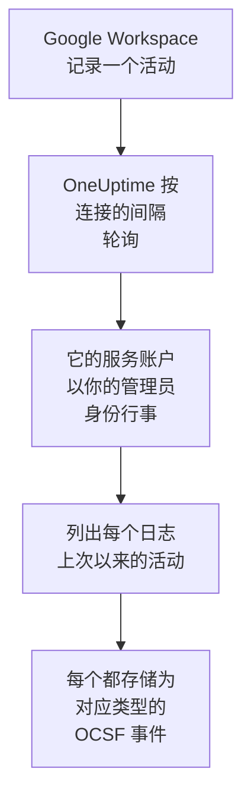

# Google Workspace

把 [Google Workspace](https://workspace.google.com) 的审计日志导入 OneUptime 的安全事件：登录以及 Google 对它们的标记、管理员的更改、获得数据访问权限的应用、单点登录、账户自身的安全设置；如果你愿意，还可以导入在组织外部共享或在 Google 云端硬盘中下载的文件。在那里，你可以把它们与日志、跟踪和指标放在一起搜索，与其他所有来源进行关联分析，并为重要的内容呼叫值班人员。OneUptime 通过一个以你的某位管理员身份行事的服务账户读取它们，不会更改 Google Workspace 中的任何内容。

:::cards
- [设置连接](#设置连接): 一个服务账户、全网域授权，以及连接的表单。
- [导入的内容](#导入的内容): 导入哪些活动，以及每个活动如何成为一个安全事件。
- [轮询的工作方式](#轮询的工作方式): 每次轮询读取的时间窗口，以及它为何重叠 2 小时。
- [故障排除](#故障排除): 每个错误的含义，以及需要更改什么。
:::

## 工作方式

OneUptime 每分钟轮询一次已过轮询间隔的每个已启用连接。一次轮询会代表你指定的管理员，以你的服务账户身份登录，并列出每个审计日志自上次轮询以来的活动（[Activities: list](https://developers.google.com/admin-sdk/reports/reference/rest/v1/activities/list)）：管理、登录、OAuth 令牌、SAML、账户安全，以及在 **云端硬盘活动** 选项开启时的云端硬盘。活动中的每个事件都存储为一个 [OCSF](https://schema.ocsf.io/) 事件：登录存为 Authentication 事件，分配的管理员角色存为 User Access Management 事件，被 Google 标记的登录存为 Detection Finding。

## 开始之前

- 在 OneUptime 中拥有 Project Owner、Project Admin 或 Security Admin 角色。Security Member 和 Security Viewer 可以查看连接及其运行历史，但不能更改它们。
- 一位用于允许全网域授权的 Google Workspace 超级管理员，以及一位供服务账户代为行事、拥有 Reports 权限的管理员。超级管理员拥有该权限。
- 一个你可以在其中创建服务账户并开启 Admin SDK API 的 Google Cloud 项目。
- 对于云端硬盘活动：带有云端硬盘审计日志的版本，例如 Business Standard、Business Plus、Enterprise 或 Education。
- 从 OneUptime 应用和工作进程到 `oauth2.googleapis.com` 和 `admin.googleapis.com` 的出站 HTTPS。

## 设置连接

连接使用服务账户的密钥和 [全网域授权](https://developers.google.com/identity/protocols/oauth2/service-account#delegatingauthority) 登录，只使用一个只读范围：`https://www.googleapis.com/auth/admin.reports.audit.readonly`。

:::steps
### 创建服务账户和密钥

1. 在 [Google Cloud 控制台](https://console.cloud.google.com) 中选择一个项目，打开 **APIs & Services → Library**，找到 **Admin SDK API**，然后选择 **Enable**。
2. 打开 **IAM & Admin → Service accounts → Create service account**，将其命名为 `oneuptime-security-events`，然后选择 **Done**。它在项目中不需要任何角色。
3. 打开该服务账户，复制它的 **Unique ID**，也就是授权中填写的客户端 ID。在 **Keys** 标签页中选择 **Add key → Create new key → JSON**，并保存好文件：它就是密钥。

### 允许全网域授权

1. 在 [Google 管理控制台](https://admin.google.com) 中，以超级管理员身份打开 **Security → Access and data control → API controls → Manage domain-wide delegation**，然后选择 **Add new**。
2. 把服务账户的 **Unique ID** 填为 **Client ID**，把 `https://www.googleapis.com/auth/admin.reports.audit.readonly` 填为 **OAuth scope**。选择 **Authorize**。Google 可能需要几分钟才能生效。
3. 要让剧本暂停、解除暂停和注销用户（参见 [遏制](/docs/telemetry/security-cases#遏制)），把 `https://www.googleapis.com/auth/admin.directory.user` 和 `https://www.googleapis.com/auth/admin.directory.user.security` 添加到同一客户端的范围中，用逗号分隔。此时，连接所代表的管理员必须是管理这些用户的管理员。

### 在 OneUptime 中添加连接

打开 **产品 → Security Events → 连接**（`/dashboard/{projectId}/security-events/connections`），点击 **添加连接**，在 **身份** 下选择 **Google Workspace**，然后点击 **下一步**。填写 **Administrator email**，点击 **下一步**，并把密钥文件的内容粘贴到 **服务账户 JSON** 中。在 **轮询** 步骤中开启 **云端硬盘活动**，即可同时读取云端硬盘。

### 保存之前先测试

点击 **保存前测试** 下的 **测试这些设置**。测试会用表单中的值登录并读取登录日志和管理日志，但不会存储任何内容，因此缺失的授权会在连接存在之前暴露出来。然后点击 **下一步**，为连接填写 **名称** 并创建它。
:::

| 设置 | 填写什么 |
| --- | --- |
| **Administrator email** | 服务账户代为行事的管理员的地址，例如 `admin@example.com`。该管理员必须拥有 Reports 权限。 |
| **云端硬盘活动** | 可选，默认关闭。开启后，每次轮询也会读取云端硬盘的共享和下载。 |
| **服务账户 JSON** | 整个密钥文件，其中包含 `client_email` 和 `private_key`。它会被加密，API 从不返回，也不会再次显示。在连接上用 **更新凭据** 替换它。 |

**轮询** 步骤还有可选的 **描述**、**轮询间隔（分钟）**（`1` 到 `1440` 之间的整数，初始为 `5`），以及初始为开启的 **已启用**。

## 导入的内容

每个事件的供应商为 `Google`，产品为 `Google Workspace`。包含多个事件的活动会为每个事件生成一个安全事件，每个事件都保留活动的字段和它自己的字段，形式为 `event.name`、`event.type` 和 `parameters.<name>`，因此规则可以按 Google 的名称读取它们。

| 日志 | 事件 | OCSF 类别 | 严重性 |
| --- | --- | --- | --- |
| 登录（`login`） | `login_success`、附带原因的 `login_failure`、`login_challenge`。退出登录会被读取但不导入。 | Authentication (`3002`) | Informational；失败为 Low；Google 标记为 `is_suspicious` 时为 Medium |
| Google 的检测（`login`） | `suspicious_login` 及其变体、`gov_attack_warning`、`account_disabled_hijacked` 以及 Google 停用的其他账户 | Detection Finding (`2004`) | Medium；政府支持的攻击、被盗用的账户或泄露的密码为 High |
| 管理（`admin`） | 授予或撤销的管理员权限和角色、全网域授权、创建、删除或暂停的用户、关闭的两步验证、群组成员、设置 | User Access Management (`3005`)、Account Change (`3001`)、Group Management (`3006`)、Entity Management (`3004`) | 授予权力为 Medium；删除用户或关闭两步验证为 Low |
| OAuth 令牌（`token`） | 获得某人数据访问权限的应用及其范围，或被撤销该访问权限的应用 | Authorize Session (`3003`) | Informational |
| SAML（`saml`） | 单点登录到某个应用 | Authentication (`3002`) | 失败为 Low |
| 账户安全（`user_accounts`） | 两步验证、密码和恢复信息的更改 | Account Change (`3001`) | 削弱账户时为 Low |
| 云端硬盘（`drive`），开启该选项时 | `change_user_access`、`change_document_visibility`、`change_document_access_scope`、`change_acl_editors`、`download` | File Hosting Activity (`6006`) | 在所有者网域外共享或对链接开放的文件为 Low |

规则库中针对 Google Workspace 的规则按这里导入的形式读取它们，例如针对被 Google 标记的登录、授予的管理员权限以及在云端硬盘中公开的文件的规则。

## 轮询的工作方式

- **活动按发生的时间读取。** Reports API 没有其他可用来列出它们的时间，而且 Google 文档说明其日志会晚几分钟到几小时到达。
- **第一次轮询会回溯 24 小时**，所以新连接会立刻显示最近的活动。
- **之后的每次轮询都从保存的游标之前 120 分钟开始**，因此 Google 最多晚 2 小时才可读取的活动会在下一次轮询中读取，重复项会在项目内按每个事件的 ID 丢弃。更晚到达的活动不会被轮询读取：请从 **诊断** 中导入它的时间范围。
- **一次轮询最多读取游标之后 24 小时。** 游标落后的连接会通过一连串 24 小时的窗口追赶。
- **云端硬盘按事件逐个读取**，因为云端硬盘会记录任何人打开的每个文件。当 Google 拒绝云端硬盘的日志时，运行会发出警告，其他日志仍会被导入。
- **失败的运行不会改变任何东西。** 在网络错误或 Google 返回错误状态之后，游标和窗口长度保持不变，下一次轮询会再次读取同一个窗口。唯一的例外是请求超时：游标保持不变，但下一个窗口的长度减半，因为重到无法及时得到响应的窗口每次尝试都会超时。

### 当一个窗口包含的内容超过一次轮询能读取的量时

每个日志都有自己的预算，以每页 1,000 个活动计：登录 10 页，管理、OAuth 令牌和 SAML 各 5 页，账户安全 3 页，云端硬盘的每个事件 4 页。一次轮询在 4 分钟后停止。当预算在窗口结束前让某个日志停止时，运行为 **部分**，其警告会指明该日志和预算。Google 先列出最新的活动，因此 OneUptime 会缩短窗口，而不是把游标移过它从未读到的活动：

1. **缩小。** 下一次轮询从同一个起点读取长度减半的窗口，并不断减半，直到某个窗口能被完整读取，最短为一分钟。运行的警告会说明这一点：`This window holds more records than one poll can read; the next poll reads a {n} minute window from the same starting point.` 已从较长窗口导入的活动会作为重复项被跳过。
2. **恢复。** 一个窗口被完整读取后，游标会移到它的末尾，下一个窗口的长度会再次加倍，最长为 24 小时。
3. **越过单独的一分钟。** 如果连一分钟内的活动都超过一次轮询能读取的量，轮询会越过这一分钟，让更新的活动继续到达。这次运行仍为 **部分**，**最近错误** 显示 `More records were created in the one minute from {cursor} to {end} than one poll can read. Polling moved past this minute so newer records keep arriving; use Import this time range in Diagnostics on this minute to recover what one run can read.` 用 **Import this time range** 导入这一分钟，即可找回一次运行能读取的内容。

更改 **轮询间隔（分钟）** 不会改变这些：它决定的是轮询多久开始一次，而不是窗口从哪里开始。

### 按需运行、预览和导入

在连接上点击 **诊断**，可以查看它最近的运行，并手动操作它。能更改该连接的人都可以启动这些操作；能查看它的人都可以阅读历史记录。

- **立即运行** 会立即开始一次轮询，使用通常的游标，即使连接未处于 **已启用** 状态也可以。
- **Preview audit events** 读取最长 7 天的时间范围，不导入任何内容。
- **Import this time range** 在你确认后导入最长 7 天的范围，不会移动游标。已导入的活动会被跳过。Google 会保留 6 个月的审计日志。
- 运行上的 **Copy diagnostics** 会复制它的报告以便提供给支持人员。报告从不包含凭据。

## 测试连接

连接所在行中的 **测试连接** 和表单中的 **测试这些设置** 在 API 进程中运行，而不是在后台工作进程中运行，所以即使工作进程出了问题，测试仍然会给出结果。它按顺序运行以下检查：

| 检查 | 检查的内容 |
| --- | --- |
| **配置** | 管理员地址和密钥格式正确。此项失败时不会连接任何地方。 |
| **Authenticate with Google** | Google 允许服务账户以管理员身份行事：全网域授权已就位。 |
| **Read the audit logs** | 可以读取过去 24 小时的登录日志和管理日志。 |
| **Read Drive activity** | 仅在开启该选项时：可以读取云端硬盘的日志。 |
| **Activities available to import** | 过去 24 小时内有多少登录活动和管理活动，每种最多数到 1,000，因此 `1000+` 表示更多。一个都没有时为警告。 |
| **Background workers**、**Poll scheduler**、**Security event storage** | OneUptime 自身的一侧：有进程在处理 Worker 队列的作业，轮询作业每分钟运行一次，安全事件存储能够响应。 |
| **Scheduled polling** | 针对已保存的连接：轮询已开启，没有运行卡在等待工作进程的状态，并且轮询按时运行。 |

测试中的每个请求都有 20 秒的期限。测试从不导入任何内容，也不移动游标，每个失败的检查都会说明需要更改什么。

## 故障排除

连接的 **最近错误** 会保留完整的错误消息（凭据已隐去）。连接出错时，在它的 **操作** 列中选择 **查看错误** 来阅读，并在对话框中用 **复制错误** 复制。每条消息都以 `Google Workspace` 开头，接着指明失败的请求，并引用 Google 自己给出的原因。

:::details 最近错误 显示 `token request failed`
- `unauthorized_client`：服务账户没有针对该范围的全网域授权。请在 **Manage domain-wide delegation** 中，用 `https://www.googleapis.com/auth/admin.reports.audit.readonly` 添加它的 **Unique ID**。
- 带有 `Invalid email or User ID` 的 `invalid_grant`：**Administrator email** 不是此 Google Workspace 的用户。
- 带有 `Invalid JWT Signature` 的 `invalid_grant`：密钥已被删除或停用。请创建一个新密钥，并用 **更新凭据** 保存。
:::

:::details 最近错误 显示 `activities request failed (HTTP 403)`
- 原因 `SERVICE_DISABLED` 或 `accessNotConfigured`：服务账户所在项目中的 Admin SDK API 已关闭。请开启它，几分钟后再测试。
- 原因 `forbidden`：管理员缺少 Reports 权限。请在 Google 管理控制台的 **Account → Admin roles** 中分配它，或指定一位超级管理员。
:::

:::details 未读取云端硬盘活动
云端硬盘的日志需要包含它的版本，以及拥有 Reports 权限的管理员。每次运行都会警告 `Drive activity was not read`，其他日志仍会被导入。如果你的版本没有云端硬盘日志，请关闭 **云端硬盘活动**。
:::

:::details 最近错误 显示 `did not complete`
请求没有得到响应：超时、名称无法解析或地址被拒绝。请检查 OneUptime 应用和工作进程能否通过你使用的任何代理访问 `oauth2.googleapis.com` 和 `admin.googleapis.com`。
:::

:::details 测试通过，但 Last Polled 为 Never
轮询作业从未运行过。阅读 **Background workers** 和 **Poll scheduler** 检查。在自托管安装中，常见原因是应用上设置了 `DISABLE_QUEUE_WORKERS=true`，却没有单独的工作进程部署来处理作业：把它设为 `false`，或运行工作进程部署（Helm：`worker.enabled: true`，默认为 `false`）。
:::

## 后续步骤

:::cards
- [安全事件](/docs/telemetry/security-events): 搜索、关联分析你导入的内容，并据此发出警报。
- [Microsoft Entra ID](/docs/integrations/microsoft-entra-id): 导入 Microsoft 的登录和目录更改。
- [Google SecOps](/docs/integrations/google-secops): 同时引入 Google SecOps 的检测。
- [集成概述](/docs/integrations/index): 你可以连接的其他工具。
:::
