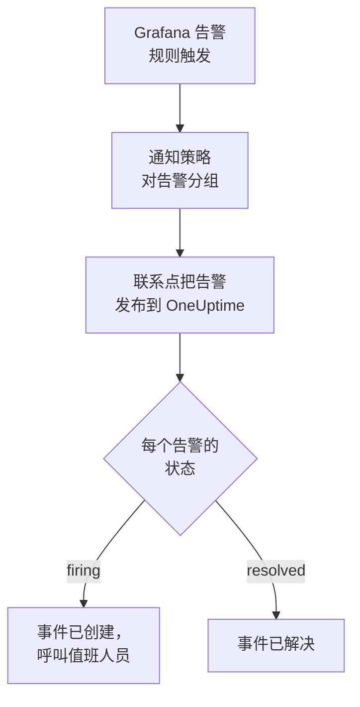

# Grafana

把 [Grafana](https://grafana.com) 告警发送到 OneUptime，让每个触发的告警都成为一个呼叫值班团队的事件，并在告警恢复时解决。Grafana 通过 Webhook 联系点发送告警，因此两边都无需安装任何东西。

:::cards
- [选择 OneUptime 接收告警的方式](#选择-oneuptime-接收告警的方式): Incoming Request 监视器，或你自己的工作流。
- [用监视器接收告警](#用监视器接收告警): 每个告警一个事件，恢复时自动解决。
- [配置 Grafana](#配置-grafana): 一个 Webhook 联系点，以及使用它的策略。
- [故障排除](#故障排除): 告警没有到达，或事件一直未关闭时。
:::

## 工作方式



Grafana 的通知策略对触发的告警分组，Webhook 联系点把每个组作为一个 JSON 通知发布出去。它的结构与 [Prometheus Alertmanager](/docs/integrations/prometheus-alertmanager) 的通知相同：一个 `status`，一个 `alerts` 列表（其中每个告警都有自己的 `status` 和 `fingerprint`），以及告警共有的 `commonLabels` 和 `commonAnnotations`。Grafana 还会加上写给人看的 `title` 和 `message`。

## 开始之前

- Grafana 9 或更高版本，并使用 Grafana Alerting（自 Grafana 9 起为默认）。它必须能够通过 HTTPS 访问你的 OneUptime。
- 在 OneUptime 中创建监视器的权限；如果选择工作流方式，则需要创建工作流的权限。

## 选择 OneUptime 接收告警的方式

先设置 OneUptime：它会给你 Grafana 要发送到的 URL。

| 方式 | 适用情况 |
| --- | --- |
| Incoming Request 监视器（推荐） | 你希望每个告警都成为一个呼叫值班人员的事件，并在告警恢复时解决。无需构建任何东西。 |
| 带 Webhook 触发器的工作流 | 你需要自己的逻辑：先过滤告警、转换格式或调用其他系统。工作流为每个通知（而不是每个告警）打开一个事件，并且不会在恢复时解决它。 |

两者从同一个联系点收到相同的 JSON，所以你可以先用其中一种，之后只需修改 Grafana 中的一个 URL 就能切换。

## 用监视器接收告警

[Incoming Request 监视器](/docs/monitor/incoming-request-monitor) 会给你一个 URL，它的条件决定每个通知做什么。

:::steps
### 创建监视器

前往 **监视器**，点击 **创建监视器**。在 **监视器类型** 下选择 **Incoming Request**，将其命名为 `Grafana`，然后点击 **下一步**。

### 为每个触发的告警声明事件

在 **标准** 步骤中，打开第一个条件，也就是把监视器标记为离线的那个。把它的过滤器设为 **请求主体**、**包含**、`"status":"firing"`。这个条件在过滤器匹配时已经会声明事件。填写事件信息：

- **事件标题**：`{{requestBody.commonLabels.alertname}}`。
- **描述** 下的 **事件描述**：`{{requestBody.message}}`，即 Grafana 为通知撰写的文本。
- **严重程度**：这些告警应有的事件严重程度。
- **值班** 下的 **值班策略**：要呼叫的策略。
- **更多字段** 下的 **自动解决事件**：保持开启，它默认就是开启的。关闭后会忽略恢复，事件将一直保持打开。

### 每个告警一个事件

在同一个条件中，打开 **设置** 并开启 **Group incidents and alerts by a payload field**。按下表填写，让每个告警都有自己的事件，并由它的恢复来解决：

| 字段 | 值 |
| --- | --- |
| **Open a separate incident for each…** | `requestBody.alerts[*].fingerprint` |
| **Field that signals recovery** | `requestBody.alerts[*].status` |
| **Value that means recovered** | `resolved` |

### 让监视器恢复在线

打开第二个条件，也就是把监视器标记为在线的那个，把它的过滤器设为 **请求主体**、**包含**、`"status":"resolved"`。

### 复制 URL

点击 **创建监视器**。监视器的 **概览** 页面会显示它的 **Heartbeat URL**。复制它供 Grafana 使用：

```text
https://oneuptime.com/heartbeat/<secret key>
```

自托管安装使用自己的主机来代替 `oneuptime.com`。
:::

通知中的每个告警都会打开自己的事件，数量最多为 **Max incidents per request**（不修改则为 `100`），每个告警自己的 `status` 决定它的事件何时被解决。Grafana 的 `fingerprint` 通过标签来标识告警，所以它正是用来分组的值。每项设置的作用请参见 [接收来自其他系统的告警](/docs/monitor/incoming-request-monitor#接收来自其他系统的告警)。

> [!WARNING]
> 不要按通知中所有告警共有的标签分组。Grafana 的默认通知策略按 `grafana_folder` 和 `alertname` 对告警分组，所以同一个通知中的每个告警都有相同的 `alertname`：按 `requestBody.alerts[*].labels.alertname` 分组会把整个通知合并成一个事件。

`{{requestBody.commonLabels.alertname}}` 和 `{{requestBody.message}}` 描述的是整个通知，在默认策略下就是一条告警规则。分组键也是一个变量 `{{fingerprint}}`，但它是一个哈希，对响应者毫无意义。可以使用的所有变量请参见 [事件与告警模板](/docs/monitor/incident-alert-templating)。

## 配置 Grafana

:::steps
### 添加 Webhook 联系点

在 Grafana 中前往 **Alerting → Contact points**，点击 **+ Add contact point**。在 Grafana 11 及更高版本中，**Alerting** 位于 **Alerts & IRM** 下，**Contact points** 是 **Notification configuration** 的一个选项卡。

把联系点命名为 `OneUptime`，在 **Integration** 下选择 **Webhook**，并把复制的 URL 粘贴到 **URL** 中。**HTTP Method** 保持为 `POST`，然后点击 **Save contact point**。

### 把告警发送到它

前往 **Alerting → Notification policies**。把默认策略的联系点设为 `OneUptime`，或者添加一个匹配 OneUptime 应收到的告警的子策略，并把 `OneUptime` 设为它的联系点。
:::

Grafana 发送 `Content-Type: application/json`，监视器需要它才能读取通知中的字段。联系点的 **Max Alerts** 设置会限制一个通知中的告警数：请保持为 `0`（不限制），或者不超过监视器的 **Max incidents per request**。

## 测试

1. 在 Grafana 中打开 `OneUptime` 联系点，点击 **Test**。Grafana 会发送一个触发中的测试告警，OneUptime 中会打开一个事件。测试告警永远不会恢复，所以请手动解决该事件。
2. 让一条真实的告警规则触发，例如暂时调低它的阈值，观察它的事件被打开，并在你恢复阈值后被解决。

## 用工作流接收告警

当你需要在 Grafana 和事件之间加入自己的步骤时，请使用 [工作流](/docs/workflows/index)。

:::steps
### 创建工作流

前往 **工作流**，点击 **创建工作流**，然后点击 **从零开始**。将其命名为 `Grafana alerts`，然后点击 **创建工作流**。

### 添加 Webhook 触发器

点击虚线的 **选择启动此工作流的方式** 块并选择 **Webhook**。点击该触发器，然后点击 **复制 URL**，把该 URL 用在 Grafana 的联系点中。

### 检查通知是否为触发状态

点击 **添加组件**，添加一个 **If / Else** 块，并把触发器的 **Out** 点连接到它。把 **Value to check** 设为 `{{local.components.webhook-1.returnValues.request-body.status}}`，**Comparison** 设为 **is equal to**，**Compare with** 设为 `firing`。

### 声明事件

添加一个 **Create One Incident** 块，并把 **If / Else** 块的 **Yes** 一侧连接到它。在 **Incident Template** 中选择一个设置了严重程度和要呼叫的值班策略的模板（参见 [事件模板](/docs/incidents/settings#事件模板)）。在 **JSON Object** 中设置来自 Grafana 的内容：

```json
{
  "title": "{{local.components.webhook-1.returnValues.request-body.title}}",
  "description": "{{local.components.webhook-1.returnValues.request-body.message}}"
}
```

如果不使用模板，**JSON Object** 中还需要 `incidentSeverityId`，即项目中某个事件严重程度的 ID。

### 启用工作流

在 **生成器** 顶部打开 **已启用**。处于关闭状态的工作流会以 `400` 回应 Grafana。
:::

一次运行处理一个通知，所以无论通知包含多少个告警，它都只声明一个事件。`resolved` 的通知会走向 **If / Else** 块的 **No** 一侧，那里没有连接任何东西，因此运行到此结束。要让每个告警一个事件并在恢复时解决，请使用监视器。

## 故障排除

:::details OneUptime 没有收到任何内容
- 在联系点上点击 **Test**：Grafana 无法访问该 URL 时会显示错误。详细信息在 Grafana 的服务器日志中。
- 监视器会在检查任何内容之前立即回应 `200`，即使密钥错误也是如此。请查看监视器的时间线，确认通知是否到达。
- 处于关闭状态的工作流会回应 `400`。在它的 **生成器** 顶部打开 **已启用**。
:::

:::details 事件被创建但从未被解决
- 条件中的事件需要开启 **更多字段** 下的 **自动解决事件**。
- **Field that signals recovery** 必须是 `requestBody.alerts[*].status`，**Value that means recovered** 必须恰好是 `resolved`。比较区分大小写。
- 分组路径必须以 `requestBody.` 开头，并且路径中只有第一个 `[*]` 会读取列表。违反任一规则的路径不会匹配任何内容，也不会报错。
:::

:::details 一个装满告警的通知只得到一个事件
你按一个在通知内所有告警中都相同的标签分组了，例如默认策略下的 `alertname`。请改为按 `requestBody.alerts[*].fingerprint` 分组。
:::

:::details 事件显示的是引用而不是值
引用了通知中不存在的字段时，该引用会连同花括号按原样保留。请把字段名与 Grafana 发送的内容进行比较：对于工作流，请在 **日志 → 运行记录** 中打开这次运行，并与触发器收到的内容进行比较。
:::

[Prometheus Alertmanager](/docs/integrations/prometheus-alertmanager#故障排除) 指南涵盖了更多情况，它们同样适用于 Grafana 的通知。

## 安全

- **像对待密码一样对待 URL。** 任何拥有它的人都可以创建事件。如果泄露，请重置它：在监视器的 **设置** 页面使用 **重置传入请求密钥**，或在工作流的 **Webhook** 触发器中使用 **重置 URL**。然后在 Grafana 中更新联系点的 **URL**。
- **自托管？** 让 Grafana 能够穿过防火墙，通过 HTTPS 访问你的 OneUptime。

## 后续步骤

:::cards
- [入站请求监控](/docs/monitor/incoming-request-monitor): 接收告警的监视器的所有设置。
- [Prometheus Alertmanager](/docs/integrations/prometheus-alertmanager): 相同的设置，外加一个监控告警系统本身的失效开关。
- [指标监控](/docs/monitor/metrics-monitor): 直接在 OneUptime 中对相同的指标发出告警。
- [集成概述](/docs/integrations/index): 你可以连接的其他工具。
:::
