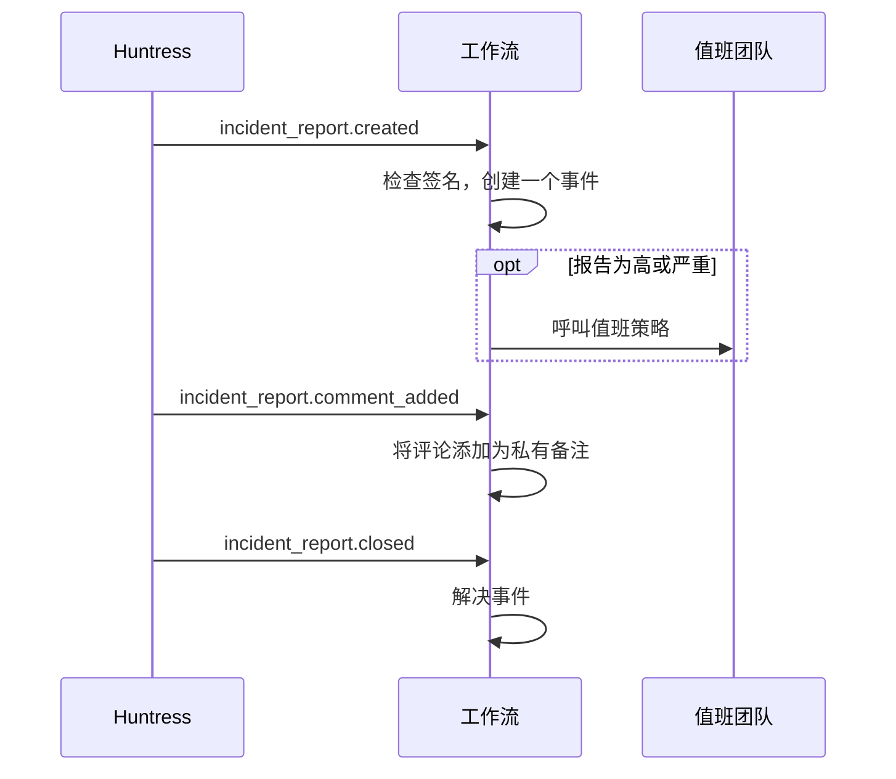

# Huntress 集成

用工作流为 Huntress 事件报告呼叫你的值班团队。当 Huntress SOC 针对某个终端或身份发送事件报告时，工作流会为它创建一个事件，呼叫你选择的值班策略，把在 Huntress 中添加的评论加为私有备注，并在 Huntress 中关闭该报告时解决事件。

此集成是**入站**的：Huntress 会把事件报告的每个事件发送到工作流自己的 URL，并用端点的签名密钥签名。OneUptime 从不调用 Huntress，因此不需要 Huntress API 密钥。

:::cards
- [工作原理](#工作原理)：工作流如何处理报告的每个事件。
- [设置步骤](#设置集成)：创建工作流，在 Huntress 中添加端点，保存其签名密钥，发送测试。
- [触发器](#huntress-incident-report-触发器)：报告交给工作流的值，以及触发器的设置。
- [故障排除](#故障排除)：触发器的错误是什么意思，以及该改什么。
:::

## 工作原理

Huntress 会在报告发出时、有人评论时以及报告关闭时发送事件报告的事件。**Huntress Incident Report** 触发器会为每个事件启动一次工作流，它的 **Event** 说明是哪种事件：`created`、`comment-added` 或 `closed`。

1. **检查。** 请求必须用端点的签名密钥签名，且签名时间不早于到达前五分钟。其他请求都会被拒绝，触发器的设置会说明原因。
2. **启动工作流。** 每个事件启动一次运行，报告的字段成为触发器的值。Huntress 重新发送的事件不会再启动任何内容。
3. **创建一个事件。** 对于 `created`，工作流会创建一个以报告命名的事件，例如 `Huntress: Incident on DESKTOP-01 (Acme Corp)`。事件描述包含报告摘要、在 Huntress 中的严重性、组织、受影响的主机或身份、Huntress 发现的指标，以及指向 Huntress 中该报告的链接。事件会带上报告所属组织的标签，当报告为高或严重时，会呼叫你选择的值班策略。
4. **跟进报告。** 对于 `comment-added`，评论会成为事件上的私有备注。对于 `closed`，事件会被解决，原因记录在它的时间线上。

事件会把报告编号保存在自定义字段中，名为 `huntressReportId`：当 Huntress 评论或关闭该报告时，工作流就靠它重新找到事件。这样创建的事件永远不会显示在状态页上，你的事件规则（值班、负责人、标签和隐私规则）会像对待其他事件一样适用于它们。

## 开始之前

- 在 OneUptime 中具有能创建和编辑工作流的角色，例如 **项目所有者**、**项目管理员** 或 **工作流管理员**。
- 在 Huntress 中具有 **Account Admin** 角色：只有账户管理员可以添加 Webhook。
- 一个要呼叫的值班策略。
- 在 OneUptime Cloud 上，需要包含工作流的套餐：Growth 或更高。Huntress 发送的每个事件是一次工作流运行。
- 自托管安装需要 Huntress 能从互联网通过 HTTPS 访问的 OneUptime：Huntress 只向 `https://` URL 发送 Webhook。

## 设置集成

:::steps
### 创建工作流

打开**工作流**，点击**创建工作流**。在**或者从模板开始**中选择 **Huntress** 分类，选择 **Open an incident for each Huntress incident report**，点击**使用此模板**，然后创建工作流。工作流会在**生成器**中打开，处于关闭状态。

### 选择呼叫谁

点击 **Page an On-Call Policy** 步骤，选择要呼叫的**值班策略**，然后保存该步骤。

### 在 Huntress 中添加 Webhook 端点

点击 **Huntress Incident Report** 触发器，在**在 Huntress 中添加 Webhook 端点**下点击**复制 URL**。URL 形如 `https://oneuptime.com/workflow/huntress/<key>`；自托管安装的 URL 以你自己的主机开头。

在 Huntress 中打开右上角的菜单，选择 **Integrations**。点击 **Add an Integration**，选择 **Webhooks**，然后点击 **Add Endpoint**。粘贴 URL，开启 **Incident Reports**，然后保存。让 **Escalations**、**Platform Actions** 和 **Account Notices** 保持关闭：触发器会接收这些事件，但不会为它们启动任何内容。

### 保存端点的签名密钥

在 Huntress 中打开端点的菜单 (⋯)，选择 **View Signing Secret**。完整复制它：它以 `whsec_` 开头。在触发器中点击**保存签名密钥**，粘贴后点击**保存签名密钥**。密钥会被加密，且不会再次显示。

在保存密钥之前，触发器会拒绝所有请求。Huntress 稍后会重新发送被拒绝的事件，所以现在被拒绝的事件之后仍会到达。

### 开启工作流并发送测试

在**生成器**顶部开启**已启用**。在 Huntress 中打开端点的菜单 (⋯)，选择 **Send Test**。几秒钟内，触发器会显示**正在接收报告**。

> [!NOTE]
> 无论测试包含什么，触发器都会显示它已到达。包含事件报告的测试会像其他报告一样启动工作流。
:::

## 工作流做什么

模板在触发器之后用一个 **Switch / Case**，为每种 **Event** 走一条路径：

| Event | 工作流做什么 |
| --- | --- |
| `created` | 以触发器的 **Incident Severity ID** 创建事件，并带上其 **Organization Label ID** 标签。对于高或严重的报告，**Page an On-Call Policy** 会呼叫你的策略；低报告不呼叫任何人。已有事件的报告不会再创建另一个事件。 |
| `comment-added` | 找到报告的事件，把评论作为私有备注添加到事件上。 |
| `closed` | 找到报告的事件并解决它，除非它已经解决。原因记录在它的时间线上：Huntress 关闭了该报告。 |

它和其他工作流一样，所以你可以修改它做的事：修改 **Create One Incident** 之后的 **If / Else** 比较的内容，只为严重报告呼叫；用 Slack 或 Microsoft Teams 步骤把每份报告发到聊天频道；或用基于 **Organization** 的 **Switch / Case** 把每个组织发给它自己的值班策略。每次运行都会列在工作流的运行记录中，并显示每个步骤做了什么。

### 严重性

Huntress 会给每份事件报告三种严重性之一。触发器的 **Incident Severity ID** 是报告创建事件时使用的事件严重性：由对应设置选择，否则按**事件 → 设置 → 事件严重性**中列出的事件严重性顺序决定：

| Huntress 严重性 | Huntress 的含义 | 设置 | 设置为空时的事件严重性 |
| --- | --- | --- | --- |
| Critical | 攻击者正在直接操作、危险的恶意软件或正在进行的入侵，需要立即遏制。 | **严重报告的严重性** | 最高的 |
| High | 需要紧急处置的已确认恶意软件，或需要采取行动的身份泄露。 | **高报告的严重性** | 第二 |
| Low | 潜在有害程序、恶意软件残留以及较早的身份相关发现。 | **低报告的严重性** | 第三 |

严重性较少的项目会对其余的使用最低的严重性。没有严重性的报告按高处理。如果你选择的严重性被删除，则重新按顺序决定。

### 组织

触发器的 **Organization Label ID** 是一个以报告所属 Huntress 组织命名的标签，例如 _Acme Corp_，该组织的第一份报告到达时会创建它。一个工作流会接收你 Huntress 账户中所有组织的报告，触发器的**仅限这些组织**可以缩小范围：每行一个组织名称或 ID，名称不区分大小写。

> [!TIP]
> 要呼叫每个客户自己的团队，请为每个组织添加一条事件值班规则，例如“如果**事件标签**包含任一 _Acme Corp_”，执行该客户的策略。参见[事件值班规则](/docs/incidents/settings#事件值班规则)。

## Huntress Incident Report 触发器

触发器打开时显示 Huntress 的信息：它的 URL、每个已完成设置步骤旁的勾选标记，以及 Huntress 最后发送的内容。它的设置都是可选的，折叠在**更多字段**中：**仅限这些组织**、**严重报告的严重性**、**高报告的严重性**和**低报告的严重性**。

| 值 | 内容 |
| --- | --- |
| **Event** | `created`、`comment-added` 或 `closed`。已经关闭或驳回的报告，无论由哪个事件带来，都是 `closed`。 |
| **Report ID** | 报告在 Huntress 中的编号。 |
| **Severity** | `critical`、`high` 或 `low`。 |
| **Status** | 报告在 Huntress 中的状态，例如 `sent`、`closed` 或 `dismissed`。 |
| **Subject** | 报告的主题，即 Huntress 所写的原文。 |
| **Summary** | SOC 分析师写的内容。 |
| **Organization**、**Organization ID** | 报告涉及的 Huntress 组织。 |
| **Affected** | 报告涉及的主机或身份。 |
| **Platform**、**Indicators** | Huntress 在哪里发现，以及发现了什么。 |
| **Comment** | 对于 `comment-added`，某人添加的评论。 |
| **Report URL** | 报告在 Huntress 中打开的位置。 |
| **Incident Title**、**Incident Description** | 关于该报告的事件的标题和 Markdown 描述。 |
| **Note** | 关于该事件的备注 Markdown：评论内容，或 Huntress 关闭了该报告。 |
| **Incident Severity ID**、**Organization Label ID** | 上文所述的事件严重性和标签。 |
| **Received At** | OneUptime 收到该事件的时间。 |

**Summary** 和 **Comment** 是 Huntress 分析师写的文本。要把它们放进事件或备注，请使用 **Incident Description** 和 **Note**：它们会保留格式，而且其中的内容不会加载图片，也不会提及任何人。

要在没有 Huntress 的情况下试用工作流，请在**生成器**中点击**运行工作流**，输入 **Event**、**Report ID** 和你需要的字段。使用同一个 **Report ID** 可以把一份报告从 `created` 跟到 `closed`。

## 之前创建的 Huntress 连接

Huntress 以前在**事件 → 集成 → Huntress**中设置。每个 Huntress 连接都变成了一个同名、已开启的工作流，继续做连接原来做的事：为同样的报告呼叫同样的值班策略，添加同样的标签，并以同样的方式解决（或只添加备注）。它的 URL 仍是连接的 URL，即 `https://oneuptime.com/api/huntress/webhook/<connection-id>`，签名密钥也相同，因此 Huntress 中无需任何修改。连接创建的事件保留了各自报告的编号，所以当 Huntress 评论或关闭这些报告时，工作流能找到它们。

## 安全

- **只接受签名的请求。** 触发器会将 Huntress 发送的 `svix-id`、`svix-timestamp` 和 `svix-signature` 请求头与原样到达的请求正文进行校验。未用已保存密钥签名，或签名时间前后相差超过五分钟的请求都会被拒绝。
- **密钥始终保密。** 它被加密存储，API 从不返回它，也不会再次显示。触发器中的**替换签名密钥**可以保存另一个密钥，例如新端点的密钥。
- **URL 是地址，不是密码。** 它以工作流的密钥结尾；只有用端点密钥签名的请求才会启动工作流。
- **每个工作流一个端点。** 每个工作流都有自己的 URL 和密钥。要接收第二个 Huntress 账户的报告，请再创建一个工作流。

## 改用邮件

Huntress 也会通过邮件发送事件报告，[入站邮件监控](/docs/monitor/incoming-email-monitor)可以根据这些邮件创建事件，例如当主题包含 `Critical Incident Report` 时。但它把邮件当作一个监控的状态：在它的事件处于打开状态时，下一份报告不会再创建事件，而且事件是按监控的条件解决，而不是在 Huntress 关闭报告时解决。工作流为每份报告创建一个事件，并随报告一起解决每个事件，因此更推荐使用它。工作流开始接收报告后，请停止把邮件发送到监控，否则每份报告都会呼叫两次。

## 故障排除

当触发器拒绝请求时，它的设置会在**上一个请求被拒绝**下显示原因。在 Huntress 中，端点菜单 (⋯) 里的 **View Delivery Attempts** 会列出每次投递以及 OneUptime 的响应。

:::details "A request arrived but was refused, because no signing secret is saved for this workflow yet"
保存端点的签名密钥：参见[设置集成](#设置集成)。Huntress 会重新发送被拒绝的请求。
:::

:::details "The request's signature does not match the signing secret"
保存的密钥不是这个端点的。每个端点都有自己的密钥：在 Huntress 中打开端点的菜单 (⋯)，选择 **View Signing Secret**，完整复制后用**替换签名密钥**保存。
:::

:::details "The request was signed more than five minutes from now"
Huntress 与你的 OneUptime 服务器的时钟相差超过五分钟，或者该请求是重放的旧请求。如果是自托管安装，请检查服务器的时钟是否准确。
:::

:::details "A request arrived while this workflow is off"
在**生成器**顶部开启**已启用**。Huntress 会重新发送被拒绝的请求，届时它会启动工作流。
:::

:::details "No Huntress workflow has this address."
工作流已被删除或归档，它的触发器不再是 **Huntress Incident Report**，或者 Huntress 中端点的 URL 不是该工作流的 URL。从触发器复制 URL，然后把它重新粘贴到 Huntress 的端点中。
:::

:::details 没有创建事件
打开工作流的运行记录，以及该报告的那次运行。如果 **Create One Incident** 因事件严重性为空而失败，说明项目没有事件严重性：在**事件 → 设置 → 事件严重性**中添加一个。
:::

:::details 没有呼叫任何人
低报告会创建事件但不呼叫。其他情况下，该报告的运行会显示 **Page an On-Call Policy** 做了什么，事件的**值班执行**页面会显示每个策略做了什么。
:::

## 后续步骤

:::cards
- [工作流触发器](/docs/workflows/triggers)：启动工作流的其他方式。
- [事件值班规则](/docs/incidents/settings#事件值班规则)：按标签呼叫每个组织自己的团队。
- [事件状态与严重级别](/docs/incidents/states-and-severities)：排列 Huntress 报告使用的严重性顺序。
- [集成概述](/docs/integrations/index)：你可以连接的其他工具。
:::
