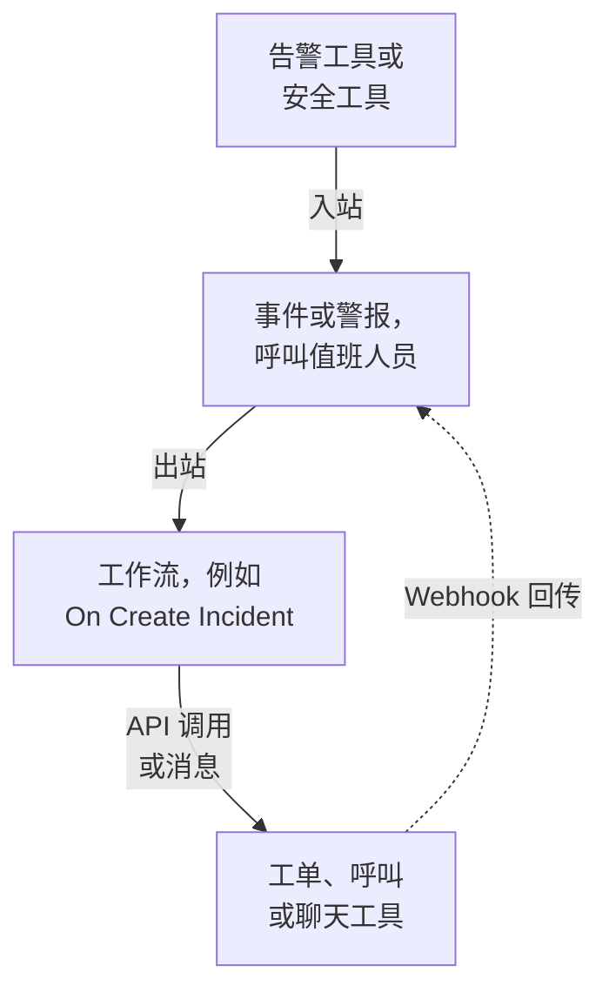

# 集成概述

OneUptime 可以与你的团队已经在用的工具配合使用。告警工具在 OneUptime 中创建事件，OneUptime 则在其他工具中创建工单、呼叫值班人员并发送聊天消息。有些工具通过表单连接，有些通过现成的工作流模板连接。其他任何带有 Webhook 或 API 的工具，都可以通过你自己构建的工作流连接。

:::cards
- [选择连接方式](#选择连接方式): 四种连接方式，以及各自的适用场景。
- [目录](#目录): 所有有指南的工具，按用途分组。
- [构建你自己的集成](#构建你自己的集成): 适用于任何其他工具的入站和出站模式。
- [妥善保管凭据](#妥善保管凭据): 密钥变量，以及每个工具需要的请求头。
:::

## 集成的工作方式

每个集成都在一个方向或两个方向上传递数据。**入站** 时，另一个工具告诉 OneUptime 出了问题，OneUptime 创建事件或警报并呼叫值班团队。**出站** 时，OneUptime 中发生了某件事，工作流把它告诉另一个工具：创建工单、呼叫某人或发布消息。



像 Jira 或 Dynamics 365 这样的双向集成会同时使用两个方向：一个工作流把事件发送出去，另一个由对方工具的 Webhook 启动的工作流把变更带回来。

## 选择连接方式

| 方式 | 最适合 | 示例 |
| --- | --- | --- |
| 内置连接 | OneUptime 自己连接的工具。只需填写表单，无需构建任何东西。 | [Slack](/docs/workspace-connections/slack)、[Microsoft Teams](/docs/workspace-connections/microsoft-teams)、[安全事件](/docs/telemetry/security-events) 连接 |
| 工作流模板 | 双向保持同步的工单工具、监控问题、安全事件报告，以及聊天消息。选择一个模板并填写几项设置即可。 | [Jira](/docs/integrations/jira)、[Microsoft Dynamics 365](/docs/integrations/microsoft-dynamics-365)、[Huntress](/docs/integrations/huntress)、[Zabbix](/docs/integrations/zabbix) |
| Incoming Request 监视器 | 发送 Webhook 的告警工具。无需工作流，每条告警对应一个事件，通知值班人员，并在告警恢复时解决。 | [Zabbix](/docs/integrations/zabbix)、[Prometheus Alertmanager](/docs/integrations/prometheus-alertmanager)、[Grafana](/docs/integrations/grafana) |
| 你自己构建的工作流 | 任何带有 Webhook 或 REST API 的工具，以及你自己的任何逻辑。 | [PagerDuty](/docs/integrations/pagerduty)、[Opsgenie](/docs/integrations/opsgenie)、[ServiceNow](/docs/integrations/servicenow) |

从表格顶部开始看：越靠上的方式，需要维护的东西越少。

## 目录

### 监控与告警工具

| 工具 | 方向 | 作用 |
| --- | --- | --- |
| [Zabbix](/docs/integrations/zabbix) | 双向 | 把 Zabbix 问题转为事件或警报，在恢复时解决它们，并从 OneUptime 确认或关闭这些问题。 |
| [Prometheus Alertmanager](/docs/integrations/prometheus-alertmanager) | 入站 | 把 Alertmanager 通知转为事件。 |
| [Grafana](/docs/integrations/grafana) | 入站 | 把 Grafana 告警转为事件。 |
| [Datadog](/docs/integrations/datadog) | 入站 | 把 Datadog 监控告警转为事件。 |

### 安全工具

| 工具 | 方向 | 作用 |
| --- | --- | --- |
| [Huntress](/docs/integrations/huntress) | 入站 | 针对 Huntress 事件报告呼叫值班人员，并在报告关闭时解决事件。 |
| [Google SecOps](/docs/integrations/google-secops) | 双向 | 把 Google SecOps 检测结果和指标导入安全事件，并把 OneUptime 的发现发送给 Google SecOps。 |
| [Microsoft Sentinel](/docs/integrations/microsoft-sentinel) | 双向 | 把 Microsoft Sentinel 事件导入安全事件，并把 OneUptime 的发现发送给 Microsoft Sentinel。 |
| [Microsoft Defender XDR](/docs/integrations/microsoft-defender-xdr) | 入站 | 把 Microsoft Defender XDR 警报导入安全事件。 |
| [CrowdStrike Falcon](/docs/integrations/crowdstrike-falcon) | 入站 | 把 CrowdStrike Falcon 警报导入安全事件。 |
| [Splunk Enterprise Security](/docs/integrations/splunk) | 双向 | 把 Splunk 重要事件（notable event）导入安全事件，并把 OneUptime 的发现发送给 Splunk。 |
| [Elastic Security](/docs/integrations/elastic-security) | 双向 | 把 Elastic Security 检测警报导入安全事件，并把 OneUptime 的发现发送给 Elastic Security。 |
| [AWS Security Hub](/docs/integrations/aws-security-hub) | 入站 | 把 AWS Security Hub 发现结果导入安全事件。 |
| [Okta System Log](/docs/integrations/okta) | 入站 | 把 Okta 登录、账户变更和威胁检测导入安全事件。 |
| [Microsoft Entra ID](/docs/integrations/microsoft-entra-id) | 入站 | 把 Microsoft Entra ID 登录和目录变更以及 Microsoft 365 审计日志导入安全事件。 |
| [Google Workspace](/docs/integrations/google-workspace) | 入站 | 把 Google Workspace 登录、管理员变更和 Google 自身的检测导入安全事件。 |

### 工单与 IT 服务管理

| 工具 | 方向 | 作用 |
| --- | --- | --- |
| [Jira](/docs/integrations/jira) | 双向 | 为每个事件或警报创建一个 Jira 问题，并把状态变更和评论同步回来。 |
| [Microsoft Dynamics 365](/docs/integrations/microsoft-dynamics-365) | 双向 | 为每个事件或警报创建一个 Dynamics 365 案例，并把状态变更和备注同步回来。 |
| [ServiceNow](/docs/integrations/servicenow) | 出站 | 为每个 OneUptime 事件创建一个 ServiceNow 事件，并随该事件一起解决。 |
| [GitHub](/docs/integrations/github) | 出站 | 为事件创建一个 GitHub issue。 |
| [GitLab](/docs/integrations/gitlab) | 出站 | 为事件创建一个 GitLab issue。 |

### 呼叫工具

| 工具 | 方向 | 作用 |
| --- | --- | --- |
| [PagerDuty](/docs/integrations/pagerduty) | 出站 | 为每个 OneUptime 事件触发一个 PagerDuty 事件，并随该事件一起解决。 |
| [Opsgenie](/docs/integrations/opsgenie) | 出站 | 为每个 OneUptime 事件创建一个 Opsgenie 告警，并随该事件一起关闭。 |

### 聊天工具

| 工具 | 方向 | 作用 |
| --- | --- | --- |
| [Slack](/docs/workspace-connections/slack) | 双向 | 内置连接：事件频道、从 Slack 执行操作，以及值班。 |
| [Microsoft Teams](/docs/workspace-connections/microsoft-teams) | 双向 | 内置连接：事件频道、从 Teams 执行操作，以及值班。 |
| [Mattermost](/docs/workflows/components#mattermost) | 出站 | 把事件更新发布到 Mattermost 频道。 |
| [Discord](/docs/integrations/discord) | 出站 | 把事件更新发布到 Discord 频道。 |
| [Telegram](/docs/integrations/telegram) | 出站 | 在警报触发时，向 Telegram 聊天发送一条消息。 |
| [IRC](/docs/integrations/irc) | 出站 | 把事件更新发布到 IRC 频道。 |

> [!TIP]
> Slack 和 Microsoft Teams 也有工作流步骤。事件频道和值班请使用内置连接；如果只需要在频道里发一条消息，请使用工作流步骤。

### 托管平台

| 工具 | 方向 | 作用 |
| --- | --- | --- |
| [Vercel](/docs/integrations/vercel) | 入站 | 从 Vercel Marketplace 添加 OneUptime：为你的 Vercel 项目提供链路追踪、日志、可用性监控和状态页。 |

## 从其他工具迁移

如果要离开其他值班、正常运行时间监控或状态页工具，请把团队迁移过来，而不是把两者连接起来。**项目设置 → 高级 → 从其他工具导入** 会用 API 密钥读取你的账户，显示它找到的内容，并创建你勾选的项目。每个工具都有一份指南：

- 值班和事件工具：[Opsgenie](/docs/moving-to-oneuptime/opsgenie)、[PagerDuty](/docs/moving-to-oneuptime/pagerduty)、[incident.io](/docs/moving-to-oneuptime/incident-io)、[Splunk On-Call](/docs/moving-to-oneuptime/splunk-on-call) 和 [Grafana OnCall](/docs/moving-to-oneuptime/grafana-oncall)。
- 正常运行时间和状态页工具：[UptimeRobot](/docs/moving-to-oneuptime/uptimerobot)、[Atlassian Statuspage](/docs/moving-to-oneuptime/atlassian-statuspage)、[Better Stack](/docs/moving-to-oneuptime/better-stack)、[Pingdom](/docs/moving-to-oneuptime/pingdom)、[StatusCake](/docs/moving-to-oneuptime/statuscake) 和 [Uptime Kuma](/docs/moving-to-oneuptime/uptime-kuma)。

## 构建你自己的集成

没有指南的工具也符合两种模式之一。如果它能发送 Webhook，就使用入站模式；如果它有 REST API，就使用出站模式。两者都是工作流：参见 [工作流概览](/docs/workflows/index) 开始使用。

### 入站：另一个工具把数据发送到 OneUptime

对于告警工具，先从 [Incoming Request 监视器](/docs/monitor/incoming-request-monitor#接收来自其他系统的告警) 开始：它为每条告警创建一个事件，并在恢复时解决，无需构建任何东西。需要自己的逻辑时，再构建工作流：

:::steps
1. 打开 **工作流**，点击 **创建工作流**，然后点击 **从零开始**。为工作流命名，然后点击 **创建工作流**。
2. 点击虚线的 **选择启动此工作流的方式** 块，选择 **Webhook**。点击该触发器，然后点击 **复制 URL**。
3. 在另一个工具中，把它的 Webhook 以 `POST` 请求发送到该 URL，并带上 `Content-Type: application/json`。
4. 添加处理它的块。这些块通过 `{{local.components.webhook-1.returnValues.request-body.status}}` 这样的引用读取请求：用 **If / Else** 块检查某个字段，再用 **Create One Incident** 声明事件。
5. 在 **生成器** 顶部打开 **已启用**，从另一个工具发送一次测试，然后打开 **日志 → 运行记录** 查看收到了什么。
:::

URL 是唯一的凭据，所以要像对待密码一样对待它。参见 [Webhook](/docs/workflows/triggers#webhook)。

### 出站：OneUptime 把数据发送到另一个工具

:::steps
1. 按照[下文](#妥善保管凭据)所示，把该工具的 API 密钥保存为一个密钥全局变量。
2. 创建一个工作流，点击虚线块并选择一个事件触发器，例如 **On Create Incident**。点击该触发器：它的 **Fields to pass on** 已经包含 **标题**，所以点击 **添加字段**，再选择要发送的其他字段，例如 **描述**。
3. 点击 **添加组件**，添加一个 **API Post (JSON)** 块。把触发器的 **Success** 点连接到它。
4. 填写它的 **URL**，在 **Request Headers** 中填入 `Authorization` 请求头，在 **Request Body** 中填入事件的字段，例如 `{{local.components.incident-on-create-1.returnValues.model.title}}`。
5. 点击 **运行工作流**，在 **事件** 中选择一个事件，然后运行。测试运行会真的发送请求。然后打开 **已启用**。
:::

如果工具需要先转换数据格式，就在两者之间添加一个 [Run Custom JavaScript](/docs/workflows/components#custom-code) 块。Zendesk、New Relic、AWS（通过 SNS）、StatusCake 以及其他各种工具都是同样的做法：只有 URL 和请求主体不同。

## 妥善保管凭据

永远不要把 API 密钥或令牌粘贴到块中。把它保存一次，作为密钥全局变量：

:::steps
1. 前往 **工作流 → 全局变量**，点击 **创建工作流 变量**。
2. 为它命名，例如 `JIRA_AUTH`，然后点击 **下一步**。
3. 把密钥粘贴到 **内容** 中，打开 **密钥**，然后点击 **创建工作流 变量**。
:::

任何块都可以用 `{{global.variables.JIRA_AUTH}}` 读取它。变量的内容保存后就无法再读回，密钥变量在运行日志中会被替换为 `[REDACTED]`。对于会过期的令牌，例如 Microsoft Entra ID 的令牌，[OAuth 2.0 变量](/docs/workflows/variables#oauth-20-变量会自动刷新的令牌) 会自行获取新令牌。参见 [工作流变量](/docs/workflows/variables#全局变量)。

### 身份验证速查表

大多数出站集成把密钥放在请求头中。常见形式如下：

| 方案 | 要发送的内容 | 使用者 |
| --- | --- | --- |
| Bearer 令牌 | `Authorization: Bearer {{global.variables.TOKEN}}` | GitHub，以及大多数现代 API |
| Basic 身份验证 | `Authorization: Basic {{global.variables.BASE64_USER_PASS}}` | Jira Cloud、ServiceNow |
| API 密钥请求头 | `Authorization: GenieKey {{global.variables.OPSGENIE_KEY}}` | Opsgenie |
| 私有令牌请求头 | `PRIVATE-TOKEN: {{global.variables.GITLAB_TOKEN}}` | GitLab |
| 请求主体中的密钥 | JSON 请求主体中的 `routing_key` | PagerDuty Events API |
| OAuth 2.0 客户端凭据 | 来自 OAuth 2.0 变量的 `Authorization: Bearer {{local.variables.dynamicsAccessToken}}` | Microsoft Dynamics 365 |

对于 Basic 身份验证，把 `username:password` 或 `email:api_token` 编码一次，然后把结果保存为密钥。在 macOS 或 Linux 上：

```bash
printf '%s' 'you@example.com:your_api_token' | base64 | tr -d '\n'
```

请使用 `printf`，不要用 `echo`：`echo` 会添加一个换行符，它会和其余内容一起被编码，从而破坏凭据。`tr` 让较长的结果保持在一行。

## 自托管安装

自托管的 OneUptime 从你的网络调用其他工具，其他工具则从它们的网络调用它：

- **出站：** 除非管理员允许，否则发往私有网络地址的工作流请求会被拒绝。参见 [出站网络访问](/docs/workflows/configuration#出站网络访问)。
- **入站：** 工具的 Webhook 必须能通过 HTTPS 访问你的 OneUptime，因此云端工具需要一个可以调用的公网地址。
- **内置集成** 各有一份设置指南：[Slack](/docs/self-hosted/slack-integration)、[Microsoft Teams](/docs/self-hosted/microsoft-teams-integration)、[GitHub](/docs/self-hosted/github-integration)、[Twilio](/docs/self-hosted/twilio-integration)、[SendGrid 入站邮件](/docs/self-hosted/sendgrid-inbound-email) 和 [推送通知](/docs/self-hosted/push-notifications)。

## 后续步骤

:::cards
- [工作流概览](/docs/workflows/index): 工作流如何运行，以及如何构建你的第一个工作流。
- [入站请求监控](/docs/monitor/incoming-request-monitor): 无需工作流即可接收任何工具的告警。
- [Jira](/docs/integrations/jira): 一个完整的双向集成，从模板开始。
- [工作流变量](/docs/workflows/variables): 在块之间传递数据，并让密钥不出现在块中。
:::
