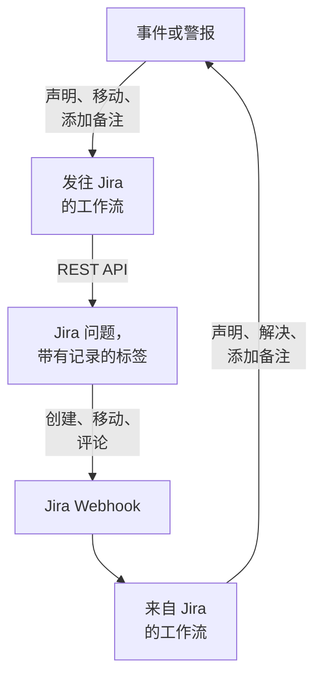

# Jira

让 [Jira](https://www.atlassian.com/software/jira) 问题与你的 OneUptime 事件和警报双向保持同步。现成的工作流模板会为每个事件或警报创建一个问题，随记录的进展移动该问题，并把备注作为评论复制过去。另一些模板会根据新问题声明事件，并把状态变更、评论和编辑同步回来。无需安装插件：工作流调用 Jira 的 REST API，Jira 调用工作流的 Webhook URL。

:::cards
- [从模板开始](#从模板开始): 17 个模板、它们需要的设置，以及如何设置。
- [模板的工作方式](#模板的工作方式): 问题和记录如何保持关联，而不会形成循环。
- [自己构建](#自己构建): 模板不适用时，手动构建每个方向。
- [故障排除](#故障排除): Jira 的各种回应是什么意思。
:::

> [!NOTE]
> Atlassian 正在为 Jira Cloud 中的概念改名：在界面的很多地方，**项目** 现在叫 **空间**，**问题** 现在叫 **工作项**。各站点两种叫法都在用，所以在措辞很重要的地方，本页会同时给出两种。

## 工作方式



每个模板都是一个小工作流，所以你可以只选用需要的方向，用于事件、警报或两者。OneUptime → Jira 模板从 OneUptime 中的事件启动，调用 Jira 的 REST API。Jira → OneUptime 模板从 Jira Webhook 启动。它们都通过问题上的两个标签找到彼此的记录。

本页的所有内容都是针对 **Jira Cloud** 编写的。自管理 Jira 上有哪些不同，请参见 [Jira Data Center](#jira-data-center)。

## 开始之前

- 一个 Jira Cloud 站点，例如 `https://your-domain.atlassian.net`，以及一个用来创建问题的项目。
- 一个用于集成的 Jira 用户及其 API 令牌。在项目中为该用户授予 **Browse Projects**、**Create Issues**、**Edit Issues**、**Add Comments** 和 **Transition Issues** 权限。
- 一位 Jira 管理员，用来注册 Jira → OneUptime 模板所需的 Webhook。
- 在 OneUptime 中创建工作流的权限。在 OneUptime Cloud 上，工作流需要 **Growth** 或更高的套餐。

## 从模板开始

**创建工作流** 对话框的类别列表中，**Jira** 下有 17 个 Jira 模板：先是 9 个事件模板，然后是 8 个警报模板，每组都在自己的标题下。它们遵循同一个约定，即 Jira 问题上的标签，因此任意组合都能一起工作。

### 事件模板

| 模板 | 作用 | 需要的设置 |
| --- | --- | --- |
| **OneUptime → Jira** | | |
| Create a Jira issue when an incident is declared | 为每个新事件创建一个问题，并用事件的 ID 为它加标签。从 Jira 声明的事件和私密事件会被跳过。 | API URL、API 令牌、项目键、问题类型、OneUptime URL |
| Move the Jira issue when the incident is acknowledged or resolved | 把关联的问题向前推进：事件被确认时移到 In Progress 状态，被解决时移到 Done 状态。从不向后移动。 | API URL、API 令牌 |
| Copy incident private notes to the Jira issue | 把每条新的私密备注作为评论发布到关联的问题上——在 Jira Service Management 中是内部评论。 | API URL、API 令牌 |
| Copy incident public notes to the Jira issue | 把每条新的公开备注作为评论发布到关联的问题上。 | API URL、API 令牌 |
| Comment on the Jira issue when the incident is edited | 当事件的标题、严重程度、描述、根本原因或修复说明发生变化时，发布事件的当前情况——在 Jira Service Management 中是内部评论。 | API URL、API 令牌 |
| **Jira → OneUptime** | | |
| Declare an incident when a Jira issue is created | 为每个新问题声明一个不显示在状态页上的事件，严重程度根据问题的优先级选择，然后为问题加标签，把两者关联起来。 | 站点 URL、API URL、API 令牌，以及用于 **Issue created** 的 Jira Webhook |
| Acknowledge or resolve the incident when its Jira issue moves | 关联的问题移到 In Progress 状态时确认事件，移到 Done 状态时解决事件。 | 用于 **Issue updated** 的 Jira Webhook |
| Add Jira comments to the incident as private notes | 把关联问题上的每条评论作为私密备注复制到事件中。 | 站点 URL、API URL、API 令牌，以及用于 **Comment created** 的 Jira Webhook |
| Add Jira issue changes to the incident as private notes | 把对关联问题的每次编辑（优先级、经办人、摘要等）作为私密备注记录到事件中。状态变更交给上面的模板处理。 | 站点 URL，以及用于 **Issue updated** 的 Jira Webhook |

### 警报模板

警报模板为警报完成同样的工作。它们少一个，因为警报没有公开备注。其余差异列在 [警报有何不同](#警报有何不同) 中。

| 模板 | 作用 | 需要的设置 |
| --- | --- | --- |
| **OneUptime → Jira** | | |
| Create a Jira issue when an alert is created | 为每个新警报创建一个问题，包括监视器产生的每一条警报，并用警报的 ID 为它加标签。从 Jira 创建的警报和私密警报会被跳过。 | API URL、API 令牌、项目键、问题类型、OneUptime URL |
| Move the Jira issue when the alert is acknowledged or resolved | 把关联的问题向前推进：警报被确认时移到 In Progress 状态，被解决时移到 Done 状态。从不向后移动。 | API URL、API 令牌 |
| Copy alert private notes to the Jira issue | 把每条新的私密备注作为评论发布到关联的问题上——在 Jira Service Management 中是内部评论。 | API URL、API 令牌 |
| Comment on the Jira issue when the alert is edited | 当警报的标题、严重程度、描述、根本原因或修复说明发生变化时，发布警报的当前情况——在 Jira Service Management 中是内部评论。 | API URL、API 令牌 |
| **Jira → OneUptime** | | |
| Create an alert when a Jira issue is created | 为每个新问题创建一个警报，严重程度根据问题的优先级选择，然后为问题加标签，把两者关联起来。 | 站点 URL、API URL、API 令牌，以及用于 **Issue created** 的 Jira Webhook |
| Acknowledge or resolve the alert when its Jira issue moves | 关联的问题移到 In Progress 状态时确认警报，移到 Done 状态时解决警报。 | 用于 **Issue updated** 的 Jira Webhook |
| Add Jira comments to the alert as private notes | 把关联问题上的每条评论作为私密备注复制到警报中。 | 站点 URL、API URL、API 令牌，以及用于 **Comment created** 的 Jira Webhook |
| Add Jira issue changes to the alert as private notes | 把对关联问题的每次编辑（优先级、经办人、摘要等）作为私密备注记录到警报中。状态变更交给上面的模板处理。 | 站点 URL，以及用于 **Issue updated** 的 Jira Webhook |

除非你打开相应开关，否则 OneUptime → Jira 模板都不会把标记为 [**私密事件**](/docs/incidents/declaring-incidents#第-1-步事件详情) 的事件或标记为 **私密警报** 的警报发送到 Jira：记录本身、它的状态、备注和编辑都不会发送。参见 [限制](#限制)。

### 警报有何不同

每个警报模板都与对应的事件模板逐步对应。警报与事件不同的地方，模板也不同：

- **没有公开备注。** 警报只有私密备注，因此警报模板发布的每条评论在 Jira Service Management 中都是内部评论。
- **没有状态页。** 警报永远不会出现在状态页上，因此 **Create an alert when a Jira issue is created** 只写入严重程度、标题、描述和 `customFields.jiraIssueKey`，不写入其他内容。
- **只有两种严重程度，所以 Medium 会变成 Low。** 新项目有三种事件严重程度，但只有 High 和 Low 两种警报严重程度。创建模板把 Jira 的优先级分配到项目已有的严重程度上。在默认的两种严重程度下，Highest、High、Critical 和 Blocker 会变成 High，其他所有优先级（包括 Medium 和 Major）都会变成 Low。要把 Medium 发送为 High，请在 `prepare-alert-1` 脚本的 `PRIORITY_RANK` 中把 `medium: 1` 改为 `medium: 0`。
- **警报的链接和标签。** 问题链接到 `/dashboard/<project id>/alerts/<alert id>`，并带有标签 `oneuptime-alert-<alert id>`。
- **编号会说明它是什么的编号。** 在默认的 `#` 前缀下，警报和事件可能都是 `#12`，因此模板会写成 `Alert #12` 或 `Incident #12`。带有自己前缀的编号（例如 `ALT-12`）按原样写入。
- **私密警报。** 被手动或被警报隐私规则标记为 **私密警报** 的警报不会进入 Jira，除非你把 `SYNC_PRIVATE_ALERTS` 设为 `true`。

**监视器会自行产生警报，而且可能产生很多。** **Create a Jira issue when an alert is created** 会为每一条警报创建问题。除非每条警报都值得一张工单，否则请在 Jira 步骤前面加一个条件。只为 High 警报创建问题：

1. 打开工作流的 **生成器**，添加一个 **If / Else** 块。
2. 把 **Value to check** 设为 `{{local.components.alert-on-create-1.returnValues.model.alertSeverity.name}}`，**Comparison** 设为 **is equal to**，**Compare with** 设为 `High`。
3. 把从 `alert-on-create-1` 到 `prepare-issue-1` 的连线末端从点上拖开，删除这条线（参见 [整理画布](/docs/workflows/authoring#整理)）。把触发器的 **Success** 连接到 **If / Else** 块，再把它的 **Yes** 连接到 `prepare-issue-1`。

走 **No** 一侧的警报会在那里结束运行，不会为它创建问题。

### 模板需要的设置

创建向导的 **配置** 步骤最多询问五个值。上面的表格列出了每个模板需要哪些值。

- **Jira Site URL** — 你打开 Jira 的地址，例如 `https://your-domain.atlassian.net`。在 Jira Data Center 上，是它的基础 URL，例如 `https://jira.example.com:8443` 或 `https://example.com/jira`。把 Jira 带入 OneUptime 的模板会在它们写入的描述或备注中链接问题，而且无论事件内容如何，这个链接总是指向这个站点。因此该字段只接受站点地址：协议、主机、端口（如果有），以及在 Data Center 上 Jira 运行的路径。它会拒绝站点中某个页面的地址、查询或用户名，并告诉你应改为输入什么。末尾带斜杠没关系。如果之后清空了该变量，问题会以不带链接的方式给出。
- **Jira API URL** — 工作流发送 Jira 请求的地址：你的站点，例如 `https://your-domain.atlassian.net`，末尾不带斜杠。使用带作用域的 API 令牌（包括所有服务账户令牌）时，请改用 `https://api.atlassian.com/ex/jira/<cloudId>`。你的 `cloudId` 位于 `https://your-domain.atlassian.net/_edge/tenant_info` 返回的 JSON 中。使用经典令牌时，它与 **Jira Site URL** 是同一个地址，因此在同时询问两者的模板中，在你自己输入之前，向导会用 **Jira Site URL** 填充它。
- **Jira API Token (base64 of email:token)** — 不是令牌本身，而是把账户的电子邮件和令牌编码在一起的值，这是 Jira Cloud 接受 Basic 身份验证的方式。具体做法见 [创建 API 令牌](#创建-api-令牌)。令牌会过期，默认在创建一年后过期，所以请把日期记下来。
- **Jira Project Key** — 创建新问题的项目（空间）：`OPS-123` 中的 `OPS`。
- **Jira Issue Type** — 要创建的问题类型，拼写与该项目中的完全一致，例如 `Task`、`Bug` 或 `Incident`。
- **OneUptime URL** — 你打开 OneUptime 的地址：`https://oneuptime.com` 或你自己的主机。问题的描述用它链接回事件或警报。

### 创建 API 令牌

:::steps
1. 为一个专用的 Jira 用户创建令牌，即只供集成使用的普通 Atlassian 账户，而不是为某个人创建：问题和评论会记在令牌所有者名下。以该用户身份登录，在 [id.atlassian.com/manage-profile/security/api-tokens](https://id.atlassian.com/manage-profile/security/api-tokens) 创建令牌。经典令牌（**Create API token**）适用于你的站点 URL。带作用域的令牌（**Create API token with scopes**）只适用于上面的 `api.atlassian.com` 地址。经典作用域 `read:jira-work` 和 `write:jira-work` 涵盖模板发出的所有调用。
2. 对该账户的电子邮件和令牌进行编码：

   ```bash
   printf '%s' 'jira-bot@example.com:your_api_token' | base64 | tr -d '\n'
   ```

   请使用 `printf`，不要用 `echo`：`echo` 会添加一个换行符，它会和其余内容一起被编码，Jira 就不再接受这些凭据。在你的站点 URL 上，这种情况很少表现为 `401`（参见 [限制](#限制)）。`tr` 让输出保持在一行：Linux 上的 GNU `base64` 每 76 个字符换一次行，而现在的令牌长到足以被换行。

3. 把输出粘贴到 **Jira API Token (base64 of email:token)** 中。
:::

也可以使用 Atlassian **服务账户**。由组织管理员在 [admin.atlassian.com](https://admin.atlassian.com) 的 **Directory → Service accounts** 下创建服务账户及其令牌。这种令牌总是带作用域的，因此 **Jira API URL** 必须是 `https://api.atlassian.com/ex/jira/<cloudId>` 地址（**Jira Site URL** 仍是你的站点），而你编码的电子邮件是服务账户自己的。像对待任何用户一样，为服务账户授予上面列出的项目权限。

### 创建工作流

:::steps
1. 打开 **工作流 → 创建工作流**。在 **或者从模板开始** 下，从类别列表中选择 **Jira**，或者在 **搜索模板…** 中输入 `Jira`，然后点击你想要的模板。模板打开后会显示它的作用以及将要询问的设置。点击 **使用此模板**。
2. **名称** 会根据模板自动填写。如果愿意，可以修改它。
3. **配置** 会询问上面的这些值。它们保存为工作流自己的变量，位于工作流菜单的 **工作流变量** 下。API 令牌保存为密钥：它在 **日志 → 运行记录** 中会被隐藏，并且只会放进 Jira 调用的 `Authorization` 请求头。
4. 点击 **创建工作流**。每个工作流创建时都处于关闭状态：在它的 **生成器** 顶部打开 **已启用**。
:::

先从 **Create a Jira issue when an incident is declared** 开始，警报则从 **Create a Jira issue when an alert is created** 开始：同类的其他 OneUptime → Jira 模板都通过这个模板添加的标签找到问题。启用它，声明一个测试事件或创建一个测试警报，然后打开工作流的 **日志 → 运行记录**。这次运行的最后一步应显示 `✅ Created Jira issue` 并给出新问题。

每个工作流都保存这些值的独立副本。更换令牌时，请在每个询问过它的 Jira 工作流的 **工作流变量** 下更新 `jiraBasicAuthToken`。如果 Jira 换了地址，请用同样的方式更新 `jiraSiteUrl` 和 `jiraBaseUrl`。

### 连接 Webhook 模板

Jira → OneUptime 模板（4 个事件模板和 4 个警报模板）从 [Webhook 触发器](/docs/workflows/triggers#webhook) 启动，因此必须告诉 Jira 把事件发送到哪里。请按以下顺序操作：

1. 创建工作流，并且 **先启用它**。处于关闭状态的工作流会以 `400` 回应 Jira，而 Jira 不会重试以 `4xx` 被拒绝的投递。在启用之前发送的事件会丢失，不会排队。
2. 打开工作流的 **生成器**，点击 **Webhook** 触发器块（`webhook-1`），然后点击其设置顶部的 **复制 URL**。URL 的样子如下：

   ```text
   https://<your OneUptime host>/workflow/trigger/<webhook secret key>
   ```

3. 在 Jira 中前往 **Settings → System → WebHooks**（位于 **Advanced** 下），点击 **Create a WebHook**。粘贴 URL，在 **Issue related events** 下勾选下表中的事件，并输入一个 JQL 过滤器，使只有你项目中的问题会触发它。不要勾选 **Exclude body**：工作流从请求主体中读取所有内容。

| 模板 | Jira 事件 | JQL 过滤器 |
| --- | --- | --- |
| **事件** | | |
| Declare an incident when a Jira issue is created | **Issue created** | `project = OPS AND (labels is EMPTY OR labels != oneuptime)` |
| Acknowledge or resolve the incident when its Jira issue moves | **Issue updated** | `project = OPS` |
| Add Jira comments to the incident as private notes | **Comment created** | `project = OPS` |
| Add Jira issue changes to the incident as private notes | **Issue updated** | `project = OPS` |
| **警报** | | |
| Create an alert when a Jira issue is created | **Issue created** | `project = OPS AND (labels is EMPTY OR labels != oneuptime)` |
| Acknowledge or resolve the alert when its Jira issue moves | **Issue updated** | `project = OPS` |
| Add Jira comments to the alert as private notes | **Comment created** | `project = OPS` |
| Add Jira issue changes to the alert as private notes | **Issue updated** | `project = OPS` |

把 `OPS` 替换为你的项目键。两个创建记录的模板上的过滤器，让 OneUptime 创建的问题根本不会到达它们：即使到达，它们也会跳过，但从未到达的事件不占用运行次数。只用 `labels != oneuptime` 会把所有没有标签的问题也排除掉，所以才加上 `labels is EMPTY`。其他模板只处理已关联的问题，因此对它们来说，`project = OPS AND labels = oneuptime` 是更严格的过滤器。

每个工作流都有自己的 URL，因此每个工作流都需要自己的 Jira Webhook。两个使用 **Issue updated** 的模板就需要两个 Webhook，如果也使用警报版本，就需要四个。

**同时使用两个创建记录的模板？** **Declare an incident when a Jira issue is created** 和 **Create an alert when a Jira issue is created** 都监听 **Issue created**。它们在创建任何内容之前都会向 Jira 检查问题的标签，但两次投递会同时到达，因此一个新问题可能同时得到一个事件和一个警报。请按项目或问题类型，把这两个模板注册到不同的问题上：

```text
project = OPS AND issuetype = Incident AND (labels is EMPTY OR labels != oneuptime)
project = OPS AND issuetype = Alert AND (labels is EMPTY OR labels != oneuptime)
```

请使用你的项目中存在的问题类型，拼写与 Jira 中的一致。

在依赖它之前：

- **Jira 只通过 HTTPS 调用，并且只使用允许的端口。** OneUptime Cloud 没有问题。自托管安装必须能从互联网通过 HTTPS、在 Jira 列表中的某个端口上访问。
- **任何拥有该 URL 的人都可以触发工作流。** Jira 的 Webhook 不带任何工作流可以验证的内容，因此 URL 是唯一的秘密。拥有它的人可以声明事件或创建警报（创建记录的模板会向 Jira 确认所指的问题存在且尚未关联，但标题、描述和优先级取自请求），还可以移动他们知道 ID 或 Jira 问题键的事件和警报，或向其添加备注。这类请求的内容都会作为文本写入（参见 [限制](#限制)），而问题的链接无论请求怎么写，都指向你的 **Jira Site URL** 所指的站点。只把 URL 保存在 Jira 中。如果泄露，请在工作流的 **生成器** 中点击 **Webhook** 触发器，点击 **重置 URL**，然后把新 URL 粘贴到 Jira Webhook 中。旧 URL 会立即失效。
- **每个事件都是一次运行。** 在 OneUptime Cloud 上，每次投递都计入你套餐的工作流运行次数，包括模板跳过的那些。JQL 过滤器可以减少这个数量。参见 [套餐限制](/docs/workflows/configuration#套餐限制)。

### 检查是否正常工作

每个模板都以一个说明发生了什么的 **Log** 步骤结束，因此请查看 **日志 → 运行记录** 中这次运行的最后一步：

- `✅` — 完成了它的工作，并给出问题、事件或警报。
- `ℹ️` — 有意跳过了该事件，并说明原因：问题没有关联到这类记录、备注来自 Jira、记录是私密的，或者新状态没有映射到任何 Jira 状态。
- `❌` — 某个调用失败了。对于 Jira 调用，这一行包含 Jira 的回应。
- `⚠️` — 根据 Jira 问题创建记录的模板已经创建了记录，但 Jira 没有接受关联标签，因此其他模板暂时还找不到它。请手动添加这些标签。

被跳过的运行仍以 **已执行** 结束。跳过是正常的：大多数 Jira 事件都不是某个特定模板要处理的。参见 [工作流运行记录](/docs/workflows/runs-and-logs)。

## 模板的工作方式

### 两边如何保持关联

关联保存在 Jira 中。属于某个事件或警报的问题带有两个标签：

- `oneuptime`，标记该问题已关联。
- 事件用 `oneuptime-incident-<incident id>`，警报用 `oneuptime-alert-<alert id>`，用来指明记录。ID 是记录在仪表板中地址的最后一部分：`/dashboard/<project id>/incidents/<incident id>`。

两个创建问题的模板在创建问题时添加这两个标签，两个根据 Jira 问题创建记录的模板在记录创建后立即添加这两个标签。其他所有模板都通过它们找到对方：OneUptime → Jira 模板在 Jira 中搜索记录的标签，Jira → OneUptime 模板从问题的标签中读取记录的 ID。所以不要重命名或删除它们。要关联一个手动创建的问题，请自己添加这两个标签，但前提是该记录还没有问题。

**一个问题只关联到一个事件或一个警报，不会同时关联两者。** 创建记录的模板会跳过任何带有 `oneuptime`、或带有以 `oneuptime-incident-` 或 `oneuptime-alert-` 开头的标签的问题；一类模板会忽略关联到另一类记录的问题。手动关联问题时，只给它一个记录标签，不要两种各给一个。

**一条记录只有一个问题。** 向问题发布内容或移动问题的模板，只在恰好有一个问题带有该记录的标签时才会动作。在 Jira 中克隆问题会复制它的标签，因此已关联问题的克隆会声称属于同一条记录。从那以后这些模板会停止工作，每次运行都以一个给出两个问题的跳过结束：

```text
More than one Jira issue is labelled oneuptime-incident-<id> (OPS-17, OPS-30). A cloned issue copies the label: remove it from every issue except the one filed for the incident.
```

另一个方向没有这种检查：克隆上的状态变更、评论和编辑会像在原问题上做的一样到达记录。所以克隆已关联的问题时，请从克隆中删除这两个标签。

从 Jira 创建的事件和警报还会把问题键保存在创建时写入的 `customFields.jiraIssueKey` 中。创建问题的模板正是靠它得知记录已经有问题了。

### 模板如何避免循环

一个方向上的每次写入，在另一个方向上都是一个事件：在 Jira 中发布的评论会以 **Comment created** Webhook 的形式回来，在 OneUptime 中添加的备注会触发备注触发器。有三样东西阻止这种回声：

- **文本中的标记。** 模板在 Jira 中发布的每条评论都以 `Synced from OneUptime` 开头。从 Jira 写入的每条备注，以及从 Jira 发起的每次状态变更的根本原因，都以 `Synced from Jira` 开头。每个方向都会跳过带有对方标记的文本，即使是有人引用了标记的评论也一样。
- **新问题上的标签。** OneUptime 创建的问题带有 `oneuptime` 标签，创建记录的模板会跳过它们。这些模板在创建任何内容之前都会向 Jira 查询问题的标签，而不是信任事件本身。从 Jira 创建的记录带有 `customFields.jiraIssueKey`，创建问题的模板会跳过它们。
- **两边的状态都只向前移动。** 状态模板像 **解决** 按钮一样，在记录的状态时间线上写入新的一行，而且只会写入更靠后的状态。转换模板也从不把问题往回移动。所以一边解决之后，另一边会发现自己已经完成，什么也不改变。

编辑模板时请保留这些标记。它们是每个脚本顶部辅助代码块中的 `FROM_ONEUPTIME` 和 `FROM_JIRA` 常量。没有标记的评论或备注会被直接复制回去。

### 转换模板如何选择状态

Jira 没有"移到 Done"这样的调用。问题通过转换来移动，而它有哪些转换取决于它的工作流和状态。所以 **Move the Jira issue when the incident is acknowledged or resolved** 和它对应的警报模板会读取问题可用的转换，并根据转换通向的状态选择一个：

- **只向前。** Jira 把状态分为三个类别：To Do、In Progress 和 Done。模板从不选择通向比问题当前类别更早的类别的转换，即使是 `STATE_TO_JIRA_STATUS` 中指定的状态也不例外。确认一个其问题已经是 Done 的事件时，会以 `Jira issue OPS-17 is already Done, so it was not moved back to an In Progress status.` 结束。
- **先用常见的名称。** 对于已解决的记录，名为 Done、Resolved、Closed、Complete、Completed 或 Fixed 的状态优先。对于已确认的记录，In Progress 或 Work in Progress 优先。正确类别中其他名称的状态，只有在它是唯一合适的状态时才会被使用。
- **绝不做会丢掉工作的猜测。** 名称看起来像 Canceled、Declined、Rejected、Won't Do、Duplicate、Obsolete、Waiting、Pending、Escalated、On Hold 或 Blocked 的状态永远不会被选中，除非 `STATE_TO_JIRA_STATUS` 指定了它。所以一个既可以转到 Resolved 也可以转到 Canceled 的 Jira Service Management 请求会转到 Resolved。
- **通向同一状态的两条路。** 当两个转换通向同一个状态时，选择没有界面的那个。

如果这样仍然无法确定，它就什么也不移动，并说明原因：两个状态同样合适，或者没有一个转换是它可以自行选择的。

```text
Jira issue OPS-17 could move to Released or Deployed for a Done status. Name the one to use in STATE_TO_JIRA_STATUS.
Jira issue OPS-17 has no transition from In Review to a Done status that can be chosen without naming it in STATE_TO_JIRA_STATUS.
```

这时请在 `plan-transition-1` 脚本顶部的 `STATE_TO_JIRA_STATUS` 中，按你的 OneUptime 状态名称指定状态。列在这里的状态会按名称把问题移到那个状态，无论它属于哪个类别，只要不是往回移动：

```javascript
const STATE_TO_JIRA_STATUS = {
  Resolved: "Resolved",
  Acknowledged: "In Progress",
};
```

### 更改模板的行为

打开工作流的 **生成器**，点击你想更改的块。你最可能想改的设置是脚本顶部附近的常量，位于 **Run Custom JavaScript** 块的 **JavaScript Code** 中，就在共享的辅助代码块下面。模板的事件版本和警报版本在相同的块中有相同的常量：

| 常量 | 模板和块 | 控制的内容 |
| --- | --- | --- |
| `STATE_TO_JIRA_STATUS` | Move the Jira issue when the incident (or alert) is acknowledged or resolved — `plan-transition-1` | 把 OneUptime 状态名称映射到 Jira 状态名称，例如 `{ Resolved: 'Resolved', Acknowledged: 'In Progress' }`。未列出的状态按含义处理：已确认会把问题移到 In Progress 状态，已解决移到 Done 状态，其他任何状态都会被跳过。当运行日志要求你这样做时，在这里指定状态——参见 [转换模板如何选择状态](#转换模板如何选择状态)。 |
| `PREFERRED_STATUS`, `NEVER_GUESS` | Move the Jira issue when the incident (or alert) is acknowledged or resolved — `plan-transition-1` | 模板按含义选择时优先使用的状态名称，以及除非 `STATE_TO_JIRA_STATUS` 指定、否则永不选择的状态名称。两者都是不区分大小写、与状态名称进行匹配的正则表达式。 |
| `SYNC_PRIVATE_INCIDENTS` | 每个事件用的 OneUptime → Jira 模板 — `prepare-issue-1`、`plan-transition-1` 或 `build-comment-1` | `false` 让标记为 **私密事件** 的事件不进入 Jira：不为它创建问题，不移动它的问题，也不发布它的备注和编辑。设为 `true` 则照样发送。每个模板都有自己的副本，所以请在每个应发送它们的模板中设置。 |
| `SYNC_PRIVATE_ALERTS` | 每个警报用的 OneUptime → Jira 模板 — `prepare-issue-1`、`plan-transition-1` 或 `build-comment-1` | 对标记为 **私密警报** 的警报作用相同：`false` 以同样的方式让它们不进入 Jira，`true` 则照样发送。请在每个应发送它们的警报模板中设置。 |
| `JIRA_STATUS_TO_STATE` | Acknowledge or resolve the incident (or alert) when its Jira issue moves — `decide-state-1` | 把 Jira 状态名称映射到 OneUptime 状态名称，例如 `{ 'In Review': 'Monitoring' }`。未列出的状态按 Jira 的状态类别处理：In Progress 确认事件或警报，Done 解决它，To Do 不映射到任何状态。 |
| `PRIORITY_RANK` | Declare an incident when a Jira issue is created — `prepare-incident-1`；Create an alert when a Jira issue is created — `prepare-alert-1` | 把用小写书写的 Jira 优先级映射到 `0`（最高的严重程度）、`1` 或 `2`（最低的严重程度），介于两者之间的严重程度在这个范围内分配。未列出的优先级落在中间。对于新项目的两种警报严重程度，`0` 是 High，`1` 和 `2` 都是 Low，所以除非你把它改为 `medium: 0`，否则 Medium 会变成 Low。 |
| `EVENTS` | Add Jira comments to the incident (or alert) as private notes — `read-comment-1` | 会变成备注的评论事件。添加 `'comment_updated'` 可以同时复制编辑（每次编辑都会成为一条新备注），同时还要在 Jira Webhook 上勾选 **Comment updated**。 |
| `IGNORED_FIELDS` | Add Jira issue changes to the incident (or alert) as private notes — `read-changes-1` | 变更不值得记成备注的 Jira 字段（小写）。只要字段 ID 或名称之一在列表中，该变更就会被忽略，`'rank'` 正是这样捕获到 Rank 的——它是一个以 `customfield_10019` 这样的 ID 到达的自定义字段。状态在列表中，因为状态由状态模板处理。 |

用作键的状态名称必须与其名称拼写完全一致，包括大小写。不要在代码中使用 `{{`：脚本在运行前会像其他设置一样被填充，因此连续两个左花括号会被当作引用读取。

要在新问题上发送更多字段，请编辑创建问题模板中 `create-issue-1` 块的 **Request Body**。它包含问题的项目、问题类型、摘要、标签和描述，你可以在 `fields` 中按 [填写更多字段](#填写更多字段) 中描述的格式添加优先级、组件、经办人或自定义字段。请保留这两个标签。摘要和描述的措辞在 `prepare-issue-1` 脚本中。描述会给出记录的严重程度、状态和描述，然后是它的根本原因和修复说明（如果有）：监视器在产生事件或警报时会填写这些内容，它们通常能解释发生了什么。

私密备注和编辑评论由其 `post-comment-1` 块的 **Request Body** 中的 `properties` 条目 `sd.public.comment` 标记为内部评论。只有 Jira Service Management 会读取它。只有当客户应该看到这些评论时才删除它。

### 限制

- **仅限 Jira Cloud。** 模板使用 Basic 身份验证调用 Jira Cloud REST API v3。Data Center 没有 v3，并且以 `Bearer` 方式接受个人访问令牌，因此每个 API 块都需要 [Jira Data Center](#jira-data-center) 中的修改：`/rest/api/2/...` 路径、用纯字符串代替 Atlassian Document Format 主体，以及请求头。`find-issue-1` 块改动最大：Data Center 没有 `/search/jql`，因此它们必须改为向 `/rest/api/2/search` 发送 `POST`。
- **从 Jira 声明的事件是安静的。** 它们创建时对状态页隐藏，也不通知状态页订阅者，因为问题的文本不是为客户写的。要显示某个事件，请在事件的 **设置** 页面打开 **在状态页面上可见**（参见 [不在状态页上显示事件](/docs/incidents/states-and-severities#让事件不出现在状态页上)），或者修改模板的 `create-incident-1` 块中的 `isVisibleOnStatusPage` 和 `shouldStatusPageSubscribersBeNotifiedOnIncidentCreated`。
- **私密事件和警报留在 OneUptime 中。** OneUptime → Jira 模板会跳过它们，每次跳过都会在 **日志 → 运行记录** 中注明。要照样发送，请把 `SYNC_PRIVATE_INCIDENTS` 或 `SYNC_PRIVATE_ALERTS` 设为 `true`。之后再把记录设为私密，会从那时起停止同步，但不会收回 Jira 已有的内容。Jira → OneUptime 模板不做检查，因此已关联问题上的评论、编辑和状态变更仍会到达私密记录。
- **一切都不会往回走。** 重新打开 Jira 问题不会改变 OneUptime 中的任何内容，To Do 类别中的状态不映射到任何状态。参见 [顺序是真正的约束](/docs/incidents/states-and-severities#顺序是真正的约束而不是显示偏好)。转换模板也从不把问题移到更早的状态类别。
- **每个警报都会得到一个问题。** 除私密警报外，警报的创建问题模板会为每个警报创建问题，包括监视器产生的每一个。[警报有何不同](#警报有何不同) 介绍了如何添加条件。
- **最初几秒可能找不到问题。** Jira 的搜索会在问题变化后稍过片刻才跟上，因此在记录创建后最初几秒内发生的备注、状态变更或编辑，可能找不到新问题，并以 `No Jira issue is labelled …` 跳过结束。这样的运行不会重试。记录刚从 Jira 创建、标签尚未添加时也是如此。
- **私密和公开在 Jira 中的含义不同。** 在 Jira Service Management 项目中，带有根本原因和修复内容的私密备注和编辑评论会成为内部评论，而事件的公开备注会成为客户可以看到的评论。在其他任何类型的项目中，它们都是能看到该问题的任何人都能读到的普通评论。
- **编辑评论跟随保存，而不是跟随变更。** 事件和警报的详细信息表单每次保存时都会发送标题和严重程度，因此只改了标签或私密设置后保存，也会发布一条评论，内容与上一条相同。触发器交给工作流的是记录的当前状态，而不是变更的内容。
- **格式不会跨系统保留。** 备注以纯文本形式发布到 Jira，因此 Markdown 会以原始字符到达。Jira 的富文本以 Jira Webhook 发送的维基标记（例如 `*bold*`）到达 OneUptime，并按原样读取：在问题、评论、状态或名称中输入的图片、链接、HTML、图表或聊天提及（例如 `<!channel>`）只会显示为字符，不起任何作用，因为在本会触发它的字符之后会插入一个不可见的 word joiner。复制这段文本时 word joiner 也会被保留。问题的链接指向工作流的 **Jira Site URL** 所指的站点。工作流会保留它创建时的脚本，因此用旧版本模板创建的工作流会按那个版本的方式写入文本：要获得这种行为，请从模板重新创建它。
- **在有 Jira Site URL 之前创建的工作流会把问题链接到事件所指的站点。** 工作流会保留它创建时的脚本和设置，因此在其模板询问 **Jira Site URL** 之前创建的根据问题创建记录、评论或问题变更工作流，仍会从事件中问题的地址获取链接的站点。要链接到你自己的站点，请从会询问 **Jira Site URL** 的模板重新创建该工作流。启用新工作流，把它的 Webhook URL 粘贴到 Jira Webhook 中替换旧的 URL（每个工作流都有自己的 URL），然后删除旧工作流。
- **错误或过期的令牌很少直接说明问题。** 在你的站点 URL 上，Jira 对无法验证身份的调用会像对待匿名访问者一样回应，而不是返回 `401`。因此错误或过期的令牌会表现为创建模板的 `The target project doesn't exist or you don't have permission to create issues in it`（一个 `400`）、`Issue does not exist or you do not have permission to see it`（一个 `404`），或者跳过信息 `No Jira issue is labelled oneuptime-incident-<id>, or the Jira credentials cannot see it.`。单纯的 `401` 主要是 `api.atlassian.com` 地址返回的。要测试这个值，请把它发送到 `/rest/api/3/myself`：值有效时，它会返回账户的名称和电子邮件；无效时返回 `401`。

  ```bash
  curl -H 'Authorization: Basic <the encoded value>' https://your-domain.atlassian.net/rest/api/3/myself
  ```

- **同一个事件可能到达两次。** Jira 会重试因服务器错误或超时而失败的投递。如果 OneUptime 已经开始了这次运行，评论模板和问题变更模板会添加第二条备注。创建记录的模板不会创建第二条记录：它们会先向 Jira 查询问题的标签，而在重试到达时，第一次运行已经为问题加上了标签。但如果第一次运行创建了记录而 Jira 拒绝了标签，这就帮不上忙了：那次运行会以 `⚠️` 行结束，你应该手动添加标签。

## 自己构建

模板涵盖了常见情况。要自己构建某个方向，或者做超出常量范围的修改，本节会针对事件手动构建两个方向。[对警报做同样的事](#对警报做同样的事) 说明了如何把它套用到警报上。

### 保存 Jira 凭据

Jira Cloud 接受由账户的电子邮件和 API 令牌编码在一起构成的 Basic 身份验证，与 [模板需要的设置](#模板需要的设置) 中的相同。

1. 前往 **工作流 → 全局变量**，点击 **创建工作流 变量**。将其命名为 `JIRA_AUTH`，把编码后的值粘贴到 **内容** 中，打开 **密钥**，然后创建它。
2. 再创建一个变量 `JIRA_URL`，值为不带末尾斜杠的 `https://your-domain.atlassian.net`，并保持 **密钥** 关闭。

之后任何块都可以把 `Basic {{global.variables.JIRA_AUTH}}` 作为它的 `Authorization` 请求头发送，令牌永远不会出现在工作流或其运行中。使用带作用域的令牌时，`JIRA_URL` 改为 `https://api.atlassian.com/ex/jira/<cloudId>`，下面的每个路径都原样接在它后面。

令牌默认在一年后过期，并且不会自动刷新。为了避免手动更换，使用 Atlassian 集中用户管理的组织可以为服务账户提供 [OAuth 2.0 凭据](https://support.atlassian.com/user-management/docs/create-oauth-2-0-credential-for-service-accounts/)：工作流用客户端 ID 和密钥换取短期令牌，做法与 [Microsoft Dynamics 365](/docs/integrations/microsoft-dynamics-365) 页面相同。

### 为每个事件创建 Jira 问题

:::steps
1. 从零开始创建一个名为 `Incidents to Jira` 的工作流。点击虚线块，添加 **On Create Incident** 触发器。它的 **Fields to pass on** 已经包含 **标题**：点击 **添加字段** 并选择 **描述** 和 **事件编号**。ID 总会被传递。它的 **Identifier** 保持为 `incident-on-create-1`。
2. 点击 **添加组件**，添加一个 **API Post (JSON)** 块，并把触发器的 **Success** 点连接到它。把它的 **Identifier** 设为 `create-issue`，**URL** 设为 `{{global.variables.JIRA_URL}}/rest/api/3/issue`，并在 **更多字段** 下把 **Request Headers** 设为 `{"Authorization": "Basic {{global.variables.JIRA_AUTH}}", "Accept": "application/json"}`。
3. 把它的 **Request Body** 设为问题内容，并把 `OPS` 和 `Bug` 替换为你的项目键和该项目中的一个问题类型：

   ```json
   {
     "fields": {
       "project": { "key": "OPS" },
       "issuetype": { "name": "Bug" },
       "summary": "OneUptime #{{local.components.incident-on-create-1.returnValues.model.incidentNumber}}: {{local.components.incident-on-create-1.returnValues.model.title}}",
       "labels": ["oneuptime"],
       "description": {
         "type": "doc",
         "version": 1,
         "content": [
           {
             "type": "paragraph",
             "content": [
               {
                 "type": "text",
                 "text": "{{local.components.incident-on-create-1.returnValues.model.description}}"
               }
             ]
           }
         ]
       }
     }
   }
   ```

4. 打开 **已启用**，声明一个测试事件，然后打开 **日志 → 运行记录**。`create-issue` 步骤会显示 `201`，以及包含新问题的 `id`、`key` 和 `self` 的响应主体。
:::

描述看起来很繁琐，是因为 Jira Cloud 的 v3 API 以 **Atlassian Document Format** 接受富文本，这是一棵文档树，而不是字符串。上面的主体包含最小的有效文档：一个只含一个文本节点的段落。`environment` 和多行文本自定义字段也是如此。后面的块用 `{{local.components.create-issue.returnValues.response-body.key}}` 读取新的问题键。

### 填写更多字段

在 `fields` 中可以添加：

- **优先级**：`"priority": { "id": "20000" }`，使用你站点中的优先级 ID。
- **经办人**：`"assignee": { "id": "<accountId>" }`。Jira Cloud 用 Atlassian 账户 ID 指代人员。
- **标签**：`"labels": ["oneuptime", "sev1"]`，一个不含空格的字符串列表。
- **组件**：`"components": [{ "id": "10000" }]`。
- **自定义字段**：`"customfield_10034": "..."`，按字段自己的 ID 指定。单选字段接受 `{"value": "red"}`，多行文本字段接受像描述那样的文档。

与其猜测，不如直接问 Jira 一个项目需要什么。第一个调用列出项目的问题类型，第二个调用列出其中一个类型的字段、哪些是必填的，以及它们的 `customfield_NNNNN` ID：

```bash
curl -u 'you@example.com:your_api_token' \
  'https://your-domain.atlassian.net/rest/api/3/issue/createmeta/OPS/issuetypes'

curl -u 'you@example.com:your_api_token' \
  'https://your-domain.atlassian.net/rest/api/3/issue/createmeta/OPS/issuetypes/10001'
```

### 把事件 ID 带进 Jira

双向同步的每一半都需要一个系统保存另一个系统的 ID。把事件的 ID 保存在问题上：这样 Jira 会在每个事件中把它发回来，入站工作流从请求中读取它。把它放进与 [模板](#两边如何保持关联) 使用的相同的标签中，这样你的工作流和模板就能找到彼此的问题：

```json
"labels": ["oneuptime", "oneuptime-incident-{{local.components.incident-on-create-1.returnValues.model._id}}"]
```

Jira 管理员也可以改为添加一个短文本自定义字段，例如命名为 OneUptime Incident ID，然后你用 `"customfield_10050": "{{local.components.incident-on-create-1.returnValues.model._id}}"` 设置它。读回它比读回标签更简单。

要让 Jira 中的每个人都能跳回来，请在 `create-issue` 之后添加一个 **API Post (JSON)** 块，向 `{{global.variables.JIRA_URL}}/rest/api/3/issue/{{local.components.create-issue.returnValues.response-body.key}}/remotelink` 发布一个远程链接：

```json
{
  "globalId": "system=https://oneuptime.com&id={{local.components.incident-on-create-1.returnValues.model._id}}",
  "object": {
    "url": "https://oneuptime.com/dashboard/{{local.components.incident-on-create-1.returnValues.model.projectId.value}}/incidents/{{local.components.incident-on-create-1.returnValues.model._id}}",
    "title": "OneUptime incident #{{local.components.incident-on-create-1.returnValues.model.incidentNumber}}"
  }
}
```

为此请在触发器的 **Fields to pass on** 中点击 **添加字段** 并选择 **项目 ID**，并保留 `.value`：保存另一条记录 ID 的列会以 `{"_type": "ObjectID", "value": "..."}` 的形式到达。`globalId` 让这个调用可以安全地重复执行：Jira 会更新带有它的链接，而不是再添加一个。

### 随事件进展发表评论并转换

把这部分构建为第二个工作流，这样这里的失败永远不会妨碍创建问题。

:::steps
1. 创建一个名为 `Incident updates to Jira` 的工作流，使用 **On Update Incident** 触发器。在 **Fields to watch** 中点击 **添加字段** 并选择 **Current Incident State**。在 **Fields to pass on** 中点击 **添加字段**，展开 **Current Incident State** 并选择 **名称**。
2. 添加一个 **If / Else** 块：**Value to check** 为 `{{local.components.incident-on-update-1.returnValues.model.currentIncidentState.name}}`，**Comparison** 为 **is equal to**，**Compare with** 为 `Resolved` 或你的已解决状态的名称。
3. 在它的 **Yes** 一侧之后，用一个 **Identifier** 为 `find-issue` 的 **API Post (JSON)** 块查找问题，发布到 `{{global.variables.JIRA_URL}}/rest/api/3/search/jql`：

   ```json
   {
     "jql": "project = OPS AND labels = \"oneuptime-incident-{{local.components.incident-on-update-1.returnValues.model._id}}\"",
     "fields": ["key"],
     "maxResults": 1
   }
   ```

4. 用 `{{local.components.find-issue.returnValues.response-body.issues[0].id}}` 读取问题的 ID，并在下面的调用中使用它。
:::

请以请求主体发布 JQL，而不是把它放进 URL：URL 会按原样发送，不会替你编码，而 JQL 中满是空格、引号和 `=` 号。查询必须有范围限制，所以才有 `project =` 子句。在 Cloud 上，端点是 `/rest/api/3/search/jql`；旧的 `/rest/api/3/search` 已经不存在了。

- **评论**：一个发往 `{{global.variables.JIRA_URL}}/rest/api/3/issue/<id>/comment` 的 **API Post (JSON)** 块，以文档作为 `body`：`{"body": {"type": "doc", "version": 1, "content": [{"type": "paragraph", "content": [{"type": "text", "text": "Resolved in OneUptime."}]}]}}`。
- **转换**：一个针对 `{{global.variables.JIRA_URL}}/rest/api/3/issue/<id>/transitions` 的 **API Get (JSON)** 块会列出问题当前状态可用的转换，每个转换都有 `id`、`name` 以及它通向的状态 `to`。向同一个 URL 发送 `{"transition": {"id": "31"}}` 的 **API Post (JSON)** 块会执行一个转换，并返回 `204`。

转换 ID 属于问题的 Jira 工作流，因此 Jira 管理员编辑该工作流时，可能会使硬编码的 ID 失效。像模板那样在运行时读取列表，就能避免这个问题。

### 接收来自 Jira 的变更

先构建接收工作流：

1. 创建一个名为 `Jira to OneUptime` 的工作流，使用 **Webhook** 触发器。
2. 打开工作流的 **生成器**，点击 **Webhook** 触发器，然后点击其设置顶部的 **复制 URL**。URL 的样子如下：

   ```text
   https://oneuptime.com/workflow/trigger/<webhook secret key>
   ```

   自托管安装使用自己的主机。像对待密码一样对待这个 URL：任何拥有它的人都可以启动工作流。如果泄露，请在同一位置点击 **重置 URL**，旧 URL 会立即失效。

3. 从触发器添加一个 **Update One Incident** 块。把它的 **Query** 设为 `{"_id": "{{local.components.webhook-1.returnValues.request-body.oneuptimeIncidentId}}"}`，**Data (JSON Object)** 设为要做的变更，例如新的 `currentIncidentStateId`。一个查询为 `{"name": "Resolved"}` 的 **Find One Incident State** 块会以 `{{local.components.incident-state-find-one-1.returnValues.model._id}}` 给出那个 ID。

启用它，然后让 Jira 通过自动化规则或 Webhook 调用它：

:::tabs
@tab Automation rule
1. 在 Jira 中打开项目的自动化：**Space settings → Automation**，旧站点上为 **Project settings → Automation**。如果涉及多个项目，请使用 **Settings → System → Global automation**。
2. 用 **Work item transitioned** 触发器（旧站点上为 **Issue transitioned**）创建一条规则，设置为在状态变为 **Done** 时运行。**Work item updated** 触发器不包括状态变更。
3. 添加 **Send web request** 操作：**Web request URL** 为工作流的 URL，**HTTP method** 为 `POST`，一个 `Content-Type: application/json` 请求头，以及一个 **Custom data** 主体：

   ```json
   {
     "oneuptimeIncidentId": "{{issue.customfield_10050}}",
     "issueKey": "{{issue.key}}",
     "status": "{{issue.status.name}}"
   }
   ```

   如果用标签而不是自定义字段，请发送 `"labels": "{{issue.labels}}"`，并用一个 **Run Custom JavaScript** 块把 ID 取出来。

4. 启用规则，并把一个测试问题移到 Done。在 Jira 中查看规则的审计日志，在 OneUptime 中查看 **日志 → 运行记录**。

为确保请求来自你的规则，请添加第二个请求头 `X-OneUptime-Secret`，值由你自己设定，并对它使用该操作的 **Hide** 选项。在工作流中，在更新之前放一个 **If / Else** 块：**Value to check** 为 `{{local.components.webhook-1.returnValues.request-headers.x-oneuptime-secret}}`，**Comparison** 为 **is equal to**，**Compare with** 为同一个值，保存在一个密钥全局变量中。

Send web request 只调用端口 80、8080、443、6017、8443、8444、7990、8090、8085、8060、8900 和 9900。Jira Cloud 会把规则运行次数计入取决于你套餐的每月额度，因此对一个繁忙项目的每次转换都运行的规则，次数会累积得很快。
@tab Jira webhook
1. 以 Jira 管理员身份前往 **Settings → System → WebHooks**（位于 **Advanced** 下），点击 **Create a WebHook**。
2. 粘贴工作流的 URL，勾选 **Issue updated**，并输入一个 JQL 过滤器，例如 `project = OPS AND labels = oneuptime`。
3. 在工作流中读取 Jira 自己的负载：`issue` 包含问题，`changelog.items` 包含每个已变更字段变更前后的值。对于状态变更，取 `field` 为 `status` 的那一项。读取它最简单的方式是用 **Run Custom JavaScript** 块。

Webhook 可以带一个密钥，这时 Jira 会在 `X-Hub-Signature` 请求头中对主体签名。工作流无法验证它，因为 Webhook 触发器交出的是已经按 JSON 读取过的主体。Jira 对失败的投递最多重试五次，因此工作流必须能应对同一个事件到达两次。
:::

无论哪种方式，工作流的 URL 都是凭据：只把它保存在 Jira 中，泄露时就重置它。

### 对警报做同样的事

先从 [从模板开始](#从模板开始) 中的警报模板入手。要手动构建警报工作流，请按上面的步骤操作，并使用每个块和字段的警报版本：

| 事件 | 警报 |
| --- | --- |
| **On Create Incident** (`incident-on-create-1`) | **On Create Alert** (`alert-on-create-1`) |
| **On Update Incident** (`incident-on-update-1`) | **On Update Alert** (`alert-on-update-1`) |
| **On Create Incident Internal Note** | **On Create Alert Internal Note** |
| **On Create Incident Public Note** | 无：警报没有公开备注 |
| `incidentNumber`, `currentIncidentState`, `incidentSeverity` | `alertNumber`, `currentAlertState`, `alertSeverity` |
| **Find One Incident State** | **Find One Alert State** |
| **Update One Incident** | **Update One Alert** |
| 标签 `oneuptime-incident-<incident id>` | 标签 `oneuptime-alert-<alert id>` |
| `/dashboard/<project id>/incidents/<incident id>` | `/dashboard/<project id>/alerts/<alert id>` |

一个工作流恰好只有一个触发器，因此事件和警报各需要一个工作流。要为两者做同样的 Jira 工作，请在一个使用 **Manual** 触发器的工作流中构建一次，然后在两边都用一个 **Execute Workflow** 块启动它。

## Jira Data Center

自管理的 Jira 也以相同的方式工作，只需替换几处。Jira Server 已于 2024 年 2 月结束支持，因此自管理的目标是 Data Center。

| Cloud | Data Center |
| --- | --- |
| `/rest/api/3/...` | `/rest/api/2/...`：Data Center 上没有 v3 |
| 用 `POST /rest/api/3/search/jql` 按 JQL 搜索 | `POST /rest/api/2/search`：Data Center 上没有 `/search/jql`。请求主体保留 `jql`、`fields` 和 `maxResults`；`expand` 以列表 `["transitions"]` 发送 |
| `description` 为 Atlassian Document Format 文档 | `description` 为维基标记格式的纯字符串 |
| `Authorization: Basic base64(email:api_token)` | `Authorization: Bearer <personal access token>` |
| 来自 id.atlassian.com 的 API 令牌 | 你自己的 Jira 账户中的 **Profile → Personal access tokens → Create token** |
| 自动化操作 **Send web request** | 自动化操作 **Send outgoing web request** |

因此创建问题的块会变成向 `/rest/api/2/issue` 发送的 `POST`，描述为纯文本：

```json
{
  "fields": {
    "project": { "key": "OPS" },
    "issuetype": { "name": "Bug" },
    "summary": "OneUptime #123: Checkout is down",
    "description": "Plain text goes straight in here."
  }
}
```

其他需要考虑的差异：

- **Jira Site URL 就是你的基础 URL**，即 **Administration → System → General configuration** 中显示的那个，包括端口和 Jira 运行的路径：`https://jira.example.com:8443` 或 `https://example.com/jira`。模板以 `<base URL>/browse/<key>` 链接问题。该字段接受只有一段的路径（例如 `/jira`），拒绝更长的路径，因为那是 Jira 中某个页面的地址，而不是它的基础 URL。
- **个人访问令牌** 从 Jira Core 和 Jira Software 8.14 以及 Jira Service Management 4.15 开始提供。它们会过期，默认 365 天后过期。使用密码的 Basic 身份验证仍然可用，但几次登录失败后就会出现 CAPTCHA，在有人通过浏览器解除之前，该账户会被锁定在 REST API 之外。请优先使用令牌。
- **自动化是内置的**，从 Jira Data Center 10.0 开始。在此之前，它是需要单独安装的 Automation for Jira 应用。
- **Webhook 投递是异步的**，从 Data Center 10.0 开始，因此事件可能乱序到达。请让接收工作流能够应对这种情况。

## 故障排除

先在 **日志 → 运行记录** 中打开失败的步骤。Jira 会以 JSON 主体回应，说明它拒绝了什么，API 块把它保存在 `response-body` 中。

:::details 401 Unauthorized
用 `printf`（不要用 `echo`）重新编码 `email:api_token` 并更新令牌：末尾的换行符是常见原因。然后检查令牌所属的账户能否在该项目中创建问题。在 Data Center 上，请检查你发送的是 `Bearer` 而不是 `Basic`。在 Cloud 站点 URL 上，错误的凭据更常表现为下一条中的情况。
:::

:::details Jira 说一个存在的项目或问题不存在，或者搜索什么也找不到
在 Cloud 站点 URL 上，这通常是凭据的问题，而不是数据的问题：Jira 对无法验证身份的调用会像对待匿名访问者一样回应。按 [限制](#限制) 中所示，把编码后的值发送到 `/rest/api/3/myself`。如果返回 `401`，请重新编码或更换令牌。如果返回的是正确的账户，说明该账户在项目中缺少某个权限：查看问题需要 **Browse Projects**，创建问题需要 **Create Issues**。
:::

:::details 指出某个字段的 400 Bad Request
项目中不存在该问题类型，或者项目有一个你没有发送的必填字段。针对该项目和问题类型运行 [填写更多字段](#填写更多字段) 中的 `createmeta` 调用并进行比较。关于 `description` 的 `400` 意味着 Cloud 的 v3 API 收到的是字符串，而不是 Atlassian Document Format 文档。
:::

:::details 404 Not Found
检查基础 URL 和 API 版本：Cloud 上为 `/rest/api/3/...`，Data Center 上为 `/rest/api/2/...`。
:::

:::details 429 Too Many Requests
Jira 正在限制你的调用速度。响应中带有以秒为单位的 `Retry-After`。对单个问题的写入限制得很严，因此快速连续评论和转换的工作流可能会触发它。请在调用之间放一个 **Sleep** 块，或者把批量工作移到计划工作流中。
:::

:::details 转换调用返回 400
该转换 ID 在问题当前的状态下不可用。获取该问题的 `/transitions`，并使用响应中的 ID。
:::

:::details Jira 显示规则或 Webhook 已运行，但 OneUptime 什么也没收到
先检查端口：Jira 只调用允许的端口。然后用 `curl` 自己向工作流的 URL 发送一个请求，并在 **日志 → 运行记录** 中查找它。如果你的请求到达了而 Jira 的没有，问题出在 Jira 一侧。如果运行存在但被拒绝，请检查工作流是否已启用。
:::

:::details 工作流运行了，但事件没有变化
当查询没有匹配到任何内容时，**Update One Incident** 块会报告 `Items Updated: 0`，这是成功，而不是错误。请检查请求中的 ID 确实是 OneUptime 事件的 ID，并且你查询的是 `_id`。
:::

:::details Jira 问题中按原样显示了引用
无法解析的引用会连同花括号按原样发送，而不会被清空。在运行的 **步骤** 选项卡上，它所在的设置会被标记为 **Did not resolve**：通常是块标识符拼写错误或变量被重命名了。
:::

## 后续步骤

:::cards
- [Microsoft Dynamics 365](/docs/integrations/microsoft-dynamics-365): 适用于 Dynamics 365 案例的同样双向同步。
- [工作流变量](/docs/workflows/variables): 密钥，以及如何在下一个块中读取上一个块的值。
- [工作流配置与安全](/docs/workflows/configuration): Webhook 安全、出站网络访问和套餐限制。
- [集成概述](/docs/integrations/index): 你可以连接的其他工具。
:::
