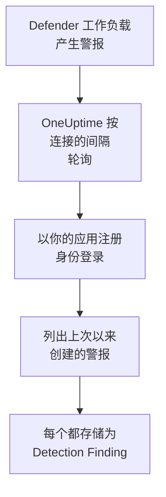

# Microsoft Defender XDR

把每个 [Microsoft Defender XDR](https://learn.microsoft.com/en-us/defender-xdr/) 工作负载（终结点、身份、电子邮件和云应用）的警报导入 OneUptime 的安全事件。在那里，你可以把它们与日志、跟踪和指标放在一起搜索，与其他所有来源进行关联分析，并为重要的警报呼叫值班人员。OneUptime 通过你创建的应用注册，经由 Microsoft Graph 安全 API 读取它们：不需要代理、playbook 或 Sentinel 工作区。

:::cards
- [设置连接](#设置连接): 一个应用注册、一项权限，以及连接的表单。
- [导入的内容](#导入的内容): 每个 Defender 警报如何成为一个安全事件。
- [轮询的工作方式](#轮询的工作方式): 每次轮询读取的时间窗口，以及繁忙的租户对它的影响。
- [故障排除](#故障排除): 每个错误的含义，以及需要更改什么。
:::

## 工作方式



OneUptime 每分钟轮询一次已过轮询间隔的每个已启用连接。一次轮询会以你的应用注册身份登录 Microsoft Entra ID，向 Microsoft Graph 请求自上次轮询以来创建的警报（[List alerts_v2](https://learn.microsoft.com/en-us/graph/api/security-list-alerts_v2)），并把每个警报存储为一个 [OCSF](https://schema.ocsf.io/) Detection Finding 事件（类别 `2004`）。之后，检测规则、监视器和仪表板会像对待其他任何来源的安全事件一样对待它。

## 开始之前

- 在 OneUptime 中拥有 Project Owner、Project Admin 或 Security Admin 角色。Security Member 和 Security Viewer 可以查看连接及其运行历史，但不能更改它们。
- 一个拥有 Microsoft Defender XDR 许可证的 Microsoft Entra 租户：任何已加入 Microsoft Defender 门户的 Defender 工作负载都可以，例如 Defender for Endpoint、for Identity、for Office 365 或 for Cloud Apps。
- 一个可以注册应用程序的 Entra 角色，例如 Application Administrator，以及一位能授予管理员同意的 Global Administrator 或 Privileged Role Administrator。
- 从 OneUptime 应用和工作进程到 `login.microsoftonline.com` 和 `graph.microsoft.com` 的出站 HTTPS；对于 Azure Government，则是到 `login.microsoftonline.us` 和 `graph.microsoft.us`。

## 设置连接

连接使用 [OAuth 2.0 客户端凭据流](https://learn.microsoft.com/en-us/entra/identity-platform/v2-oauth2-client-creds-grant-flow) 登录：始终作为应用程序，而不是作为某个人，并且只使用一项应用程序权限。

:::steps
### 注册应用程序

1. 登录 [Azure portal](https://portal.azure.com) 并打开 **Microsoft Entra ID**。
2. 前往 **App registrations → New registration**。将其命名为 `OneUptime Security Events`，**Supported account types** 保持为 **Accounts in this organizational directory only**，重定向 URI 留空，然后选择 **Register**。
3. 在应用的 **Overview** 页面上，复制 **应用程序（客户端）ID** 和 **目录（租户）ID**。

### 允许它读取警报

1. 前往 **API permissions → Add a permission → Microsoft Graph → Application permissions**，选择 `SecurityAlert.Read.All`，然后选择 **Add permissions**。这是 [List alerts_v2](https://learn.microsoft.com/en-us/graph/api/security-list-alerts_v2#permissions) 调用接受的应用程序最低权限：不要添加 `SecurityAlert.ReadWrite.All`。
2. 为你的租户选择 **Grant admin consent for**，并确认。该权限的状态必须显示为 **Granted**：没有同意时，每次读取都会以 `403` 被拒绝。

### 创建客户端密码

前往 **Certificates & secrets → Client secrets → New client secret**，选择过期时间，然后选择 **Add**。离开页面之前，复制密码的 **Value**，而不是它的 **Secret ID**：它不会再次显示。

记下密码何时过期。到了那一天，轮询会以 `Microsoft Defender XDR token request failed (HTTP 401)` 停止，直到你用 **更新凭据** 替换它。

### 在 OneUptime 中添加连接

打开 **产品 → Security Events → 连接**（`/dashboard/{projectId}/security-events/connections`），点击 **添加连接**，在 **EDR / XDR** 下选择 **Microsoft Defender XDR**，然后点击 **下一步**。填写下表中的设置，点击 **下一步**，并把密码的值粘贴到 **客户端密钥** 中。

### 保存之前先测试

点击 **保存前测试** 下的 **测试这些设置**。测试会用表单中的值登录并读取警报，但不会存储任何内容，因此错误的密码或缺失的同意会在连接存在之前暴露出来。然后点击 **下一步**，为连接填写 **名称** 并创建它。
:::

| 设置 | 在哪里找到 |
| --- | --- |
| **目录（租户）ID** | 应用的 **Overview** 页面。租户的 GUID，或已验证的域名，例如 `contoso.onmicrosoft.com`。 |
| **应用程序（客户端）ID** | 应用的 **Overview** 页面。拥有 `SecurityAlert.Read.All` 的应用的 GUID。 |
| **云** | **Azure 公有云**（也服务于 Microsoft 365 GCC），或用于 GCC High 的 **Azure Government（美国）** （`login.microsoftonline.us` 和 `graph.microsoft.us`）。不支持 Microsoft 365 DoD 和中国的 21Vianet 云。 |
| **客户端密钥** | 密码的 **Value**。它会被加密，API 从不返回，也不会再次显示。在连接上用 **更新凭据** 替换它。 |

**轮询** 步骤还有可选的 **描述**、**轮询间隔（分钟）**（`1` 到 `1440` 之间的整数，初始为 `5`），以及初始为开启的 **已启用**。

## 导入的内容

每个 Defender XDR [警报](https://learn.microsoft.com/en-us/graph/api/resources/security-alert) 都会成为一个 Detection Finding 事件（OCSF 类别 `2004`），供应商为 `Microsoft`，产品为 `Microsoft Defender XDR`，归属于 `Microsoft Defender XDR` 遥测服务：

| OCSF 列 | 警报字段 |
| --- | --- |
| `eventUid` | `id`，即 Graph 警报 ID，也是去重所依据的值 |
| `time` | `firstActivityDateTime`，没有时用 `createdDateTime` |
| `message`, `ruleName` | `title` |
| `ruleId` | `detectorId`，没有时用 `alertPolicyId` |
| `severityName` | `severity`：`informational`、`low`、`medium` 或 `high`，`unknown` 保持为 Unknown |
| `statusName` | `status`：`new` 变为 New，`inProgress` 变为 In Progress，`resolved` 变为 Resolved |
| `mitreTechniques` | `mitreTechniques` |
| `mitreTactics` | `categories` 或 `category`（当它是 ATT&CK 战术时）：`CredentialAccess` 变为 `TA0006`。其他类别保留在 `attributes` 中。 |
| `principalHost`, `principalUser`, `principalIp`, `principalProcess` | 具有 `source`、`attacker` 或 `compromised` 角色的 `evidence`，否则取每种类型的第一个 |
| `targetHost`, `targetUser`, `targetIp`, `targetResource` | 具有目标角色（例如 `destination` 或 `attacked`）的 `evidence`。URL、邮箱和云资源填入 `targetResource`。 |
| `observables` | `evidence` 中的每个主机名、IP、用户、文件名、SHA-1 和 SHA-256、URL、域名、邮箱和资源 ID |
| `attributes` | 整个警报，展平为点分隔的键，例如 `evidence.0.hostName`、`serviceSource` 和 `incidentId` |

来自每个 `serviceSource` 的警报都会被导入，一旦 Sentinel 连接到 Defender 门户，Microsoft Sentinel 的警报也会被导入。事件（incident）不会被导入，但每个警报都会在 `attributes` 中保留它的 `incidentId` 和 `incidentWebUrl`。

## 轮询的工作方式

每次轮询都会列出在其时间窗口内创建的警报，每页 100 个，并跟随 Graph 的 `@odata.nextLink`，直到读完整个窗口：

```text
GET https://graph.microsoft.com/v1.0/security/alerts_v2?$filter=createdDateTime ge {start} and createdDateTime lt {end}&$top=100
```

- **创建时间就是游标。** Defender 经常在 `firstActivityDateTime` 之后几个小时才创建警报，基于活动时间的游标会跳过所有这样的警报。
- **第一次轮询会回溯 24 小时**，所以新连接会立刻显示最近的警报。
- **之后的每次轮询都从保存的游标之前 1 分钟开始**，所以在两个窗口边界上创建的警报会被读取两次，但只导入一次。
- **一次轮询最多读取游标之后 24 小时。** 在工作进程停机或租户被限流期间游标落后的连接，会通过一连串 24 小时的窗口追赶。
- **重复项按警报的 `id` 去重**，范围是项目中来自 `Microsoft` / `Microsoft Defender XDR` 的事件，所以重叠部分、重试的窗口和导入都不会把同一个警报存储两次。
- **失败的运行不会改变任何东西。** 发生网络错误或 Graph 返回错误状态后，游标和窗口长度保持不变，下一次轮询会再次读取同一个窗口。唯一的例外是请求超时：游标保持不变，但下一个窗口的长度减半，因为太重而无法及时响应的窗口每次重试都会超时。

### 当一个窗口包含的内容超过一次轮询能读取的量时

一次轮询最多读取 20 页、每页 100 个警报：共 2,000 个警报。当这个上限让它在窗口结束之前停下时，这次运行为 **部分**，并带有以下警告：

```text
Stopped after 20 alerts requests (the per-run request limit) before reading the whole window. Microsoft Graph lists alerts newest first and documents no way to sort them oldest first, so this run cannot name a point to resume from.
```

[List alerts_v2](https://learn.microsoft.com/en-us/graph/api/security-list-alerts_v2) 记录了 `$filter`、`$top`、`$skip` 和 `$count`，但没有记录 `$orderby`，并且它先返回最新的警报。停下的运行读取的 2,000 个警报是其窗口中最新的那些，所以把游标移过它们会跳过它没读到的较早警报。因此 OneUptime 会改为缩短窗口：

1. **缩小。** 下一次轮询从同一个起点读取长度减半的窗口，并不断减半，直到某个窗口能被完整读取，最短为一分钟。运行的警告会说明这一点：`This window holds more records than one poll can read; the next poll reads a {n} minute window from the same starting point.` 已从较长窗口导入的警报会作为重复项被跳过。
2. **恢复。** 一个窗口被完整读取后，游标会移到它的末尾，下一个窗口的长度会再次加倍，最长为 24 小时。
3. **越过单独的一分钟。** 如果连一分钟内都有超过 2,000 个警报，轮询会越过这一分钟，让更新的警报继续到达。这次运行仍为 **部分**，**最近错误** 显示 `More records were created in the one minute from {cursor} to {end} than one poll can read. Polling moved past this minute so newer records keep arriving; use Import this time range in Diagnostics on this minute to recover what one run can read.` 用 **Import this time range** 导入这一分钟，即可找回一次运行能读取的内容。

因其他原因而为 **部分** 的运行，例如某个警报无法被读取为安全事件，也会以同样的方式从同一个起点重试。更改 **轮询间隔（分钟）** 不会改变以上任何一点：它决定轮询多久开始一次，而不是窗口从哪里开始。

### 按需运行、预览和导入

在连接上点击 **诊断**，可以查看它最近的运行，并手动操作它。能更改该连接的人都可以启动这些操作；能查看它的人都可以阅读历史记录。

- **立即运行** 会立即开始一次轮询，使用通常的游标，即使连接未处于 **已启用** 状态也可以。
- **Preview alerts** 读取最长 7 天的时间范围，不导入任何内容。
- **Import this time range** 在你确认后导入最长 7 天的范围，不会移动游标。已导入的警报会被跳过。
- 运行上的 **Copy diagnostics** 会复制它的报告以便提供给支持人员。报告从不包含凭据。

## 测试连接

连接所在行中的 **测试连接** 和表单中的 **测试这些设置** 在 API 进程中运行，而不是在后台工作进程中运行，所以即使工作进程出了问题，测试仍然会给出结果。它按顺序运行以下检查：

| 检查 | 检查的内容 |
| --- | --- |
| **配置** | 四项设置都存在且格式正确。此项失败时不会连接任何地方。 |
| **Authenticate with Microsoft Entra** | Microsoft Entra ID 在你选择的云中颁发用于 Microsoft Graph 的令牌。密码错误或已过期、租户或客户端 ID 错误，或者云选错时，此项失败。 |
| **Read alerts from Microsoft Graph** | 可以读取过去 24 小时内创建的一个警报（`$top=1`）。这里出现 `403` 表示缺少 `SecurityAlert.Read.All` 权限、缺少管理员同意，或者租户没有 Defender XDR。 |
| **Alerts available to import** | 过去 24 小时和过去 7 天内创建了多少警报，各读取一页 100 个，所以 `100+` 表示更多。7 天内一个都没有是警告，而不是失败。 |
| **Background workers**、**Poll scheduler**、**Security event storage** | OneUptime 自身的一侧：有进程在处理 Worker 队列的作业，轮询作业每分钟运行一次，安全事件存储能够响应。 |
| **Scheduled polling** | 针对已保存的连接：轮询已开启，没有运行卡在等待工作进程的状态，并且轮询按时运行。 |

测试中的每个请求都有 20 秒的期限。测试从不导入任何内容，也不移动游标，每个失败的检查都会说明需要更改什么。

## 故障排除

连接的 **最近错误** 会保留完整的错误消息（凭据已隐去），前面带有一个指明失败步骤的前缀。连接出错时，在它的 **操作** 列中选择 **查看错误** 来阅读，并在对话框中用 **复制错误** 复制。请先阅读前缀。

:::details Last Error 以 `Microsoft Defender XDR token request` 开头
- `Microsoft Defender XDR token request failed (HTTP ...)`：Microsoft Entra ID 拒绝颁发令牌，所以根本没有连接 Graph。消息末尾会有一条根据 Entra 的 `error` 代码给出的提示：
  - `invalid_client` (`AADSTS7000215`)：密码错误、已过期，或属于另一个应用。在 **Certificates & secrets** 下创建一个新密码，并用 **更新凭据** 保存。
  - `unauthorized_client` (`AADSTS700016`)：**应用程序（客户端）ID** 不在该 **目录（租户）ID** 中，或者 **云** 选错了。
  - `AADSTS90002`：没有这样的租户。
  - `invalid_scope`：你选择的云中不存在该 Graph 范围。请检查 **云**。
- `Microsoft Defender XDR token request returned ...`：Microsoft Entra ID 返回了无法使用的内容，即不是 JSON 或没有 `access_token` 的主体。这通常是中间的代理或网关造成的，而不是凭据的问题。
- `Microsoft Defender XDR token request did not complete: ...`：无法访问令牌终结点，或者它没有及时响应。检查 OneUptime 应用和工作进程到 `login.microsoftonline.com` 或 `login.microsoftonline.us` 的出站 HTTPS。
:::

:::details Last Error 以 `Microsoft Defender XDR alerts request` 开头
- `Microsoft Defender XDR alerts request failed (HTTP ...)`：Graph 拒绝列出警报。消息会指出 Graph 的错误代码，并给出一条提示：
  - `403` (`Authorization_RequestDenied`)：缺少 `SecurityAlert.Read.All` 或它的管理员同意，或者租户没有 Defender XDR 许可证。同意需要几分钟才能生效。
  - 令牌颁发后出现 `401` (`InvalidAuthenticationToken`)：通常是 **云** 与租户不匹配。
  - `429` (`TooManyRequests`)：Graph 正在对应用限流，下一次轮询会再次读取同一个窗口。消息无法引用 Graph 的 `Retry-After`，因为 OneUptime 的 HTTP 客户端在出错时不保留响应头。如果反复出现，请调大 **轮询间隔（分钟）**。
  - `5xx`：Graph 一侧的问题。下一次轮询会重试。
  - `400`：Graph 不肯运行查询，而查询是由 OneUptime 构建的，与你的设置无关。请复制消息提供给 OneUptime 支持人员。
- `Microsoft Defender XDR alerts request returned ...`：Graph 返回了 `200`，但连接器无法使用其内容：主体不是 JSON、没有 `value` 列表，或者 `@odata.nextLink` 不是指向你所在云的 Graph 主机的 `https://` 链接。这样的链接会被拒绝，所以令牌永远不会被发送到其他地方。这种情况会被报告出来，而不是被当作空窗口，所以游标永远不会越过没人读过的警报。
- `Microsoft Defender XDR alerts request did not complete: ...`：无法访问 Graph，或者它没有及时响应：轮询为 60 秒，测试为 20 秒。检查到 `graph.microsoft.com` 或 `graph.microsoft.us` 的出站 HTTPS。
:::

:::details 测试通过，但 Last Polled 为 Never
轮询作业从未运行过。阅读 **Background workers** 和 **Poll scheduler** 检查。在自托管安装中，常见原因是应用上设置了 `DISABLE_QUEUE_WORKERS=true`，却没有单独的工作进程部署来处理作业：把它设为 `false`，或运行工作进程部署（Helm：`worker.enabled: true`，默认为 `false`）。
:::

:::details 轮询成功，但你知道的某个警报不见了
在 Defender 门户中把该警报的 `createdDateTime` 与 **诊断** 中运行的窗口进行比较：窗口基于创建时间，而不是活动时间。

- 在连接存在之前创建的警报早于第一次 24 小时回溯。请用 **Import this time range** 导入它。
- **部分** 运行是被 2,000 个警报的上限停下的。下一次轮询会从同一个起点读取更短的窗口，所以一旦包含该警报的窗口被完整读取，它就会被导入。
- 如果 **最近错误** 指出了轮询越过的某一分钟，请用 **Import this time range** 导入那一分钟。
:::

:::details 同一个警报出现了两次
这不是 1 分钟的重叠造成的：第二次读取会被计为重复项，不会被存储。这是两个具有相同 `eventUid` 的事件以不同的产品被导入，例如同一个警报也通过 Microsoft Sentinel 连接到达。去重是按供应商和产品进行的。
:::

## 你会得到什么

- **搜索。** 在安全事件资源管理器中，与该主机的日志和指标放在一起，按严重程度、状态、MITRE 技术、主机、用户、IP 或任何 observable 过滤 Defender 警报。
- **关联分析。** 每个警报的证据，即它的设备、用户、IP、文件和 URL，都会作为 observable 建立索引，所以一次搜索就能在所有来源中找到提到某个主机的所有内容。
- **检测规则。** 按计划对你的安全事件运行的 Sigma 规则，会打开呼叫值班人员的警报。
- **监视器。** 安全事件监视器统计匹配的事件，并在超过阈值时打开事件或警报。

安全事件与其他遥测数据一样，按摄取的 GB 数计费。请参阅 [定价](https://oneuptime.com/pricing)。

## 后续步骤

:::cards
- [安全事件](/docs/telemetry/security-events): 搜索、关联分析你导入的内容，并据此发出警报。
- [Microsoft Sentinel](/docs/integrations/microsoft-sentinel): 同时导入 Sentinel 工作区的事件。
- [角色](/docs/permissions/reference#角色): Security 角色可以查看和更改的内容。
- [集成概述](/docs/integrations/index): 你可以连接的其他工具。
:::
