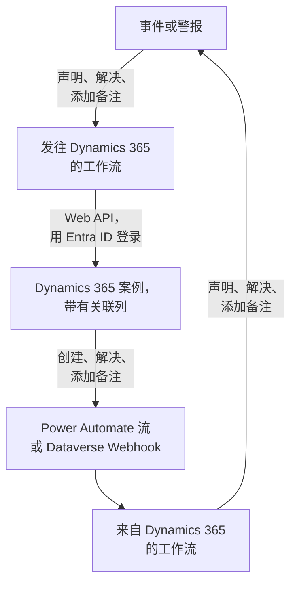

# Microsoft Dynamics 365

让 [Microsoft Dynamics 365](https://www.microsoft.com/dynamics-365) 案例与你的 OneUptime 事件和警报双向保持同步。现成的工作流模板会为每个事件或警报创建一个案例，在记录被解决时关闭它，并把备注复制进去。另一些模板会根据新案例声明事件，并把解决结果和备注同步回来。无需安装插件：工作流调用 Dataverse Web API，Dynamics 365 调用工作流的 Webhook URL。

:::cards
- [准备 Dynamics 365](#准备-dynamics-365): 一个应用注册、一个应用程序用户和一个关联列。
- [从模板开始](#从模板开始): 13 个模板、它们需要的设置，以及如何设置。
- [模板的工作方式](#模板的工作方式): 案例和记录如何保持关联，而不会形成循环。
- [自己构建](#自己构建): 模板不适用时，手动构建每个方向。
:::

## 工作方式



每个模板都是一个小工作流，所以你可以只选用需要的方向，用于事件、警报或两者。OneUptime → Dynamics 365 模板通过 Microsoft Entra ID 以应用程序身份登录，调用 Dataverse Web API。Dynamics 365 → OneUptime 模板在 Power Automate 流或 Dataverse Webhook 调用它们时启动。你在 Case 表中添加的一个文本列，把每个案例与它的记录关联起来。

## 开始之前

- 一个带有 **Case** 表的 Dynamics 365 环境。案例来自 Dynamics 365 Customer Service：没有它的 Dataverse 环境中没有可写入的 `incident` 表。
- 在 **Microsoft Entra ID** 中注册应用程序的权限，以及在环境中创建应用程序用户的权限。这两项权限通常属于两位不同的管理员。
- 在 OneUptime 中创建工作流的权限。在 OneUptime Cloud 上，工作流需要 **Growth** 或更高的套餐。

> [!NOTE]
> 本页使用 Dataverse 中的名称，而不是 Dynamics 表单上的标签。案例是 `incident` 表，它在 URL 中的集合是 `incidents`，键是 `incidentid`，标题列是 `title`。你看到的案例编号是 `ticketnumber`。

## 准备 Dynamics 365

模板和你自己构建的工作流都需要以下准备。OneUptime 使用 OAuth 2.0 客户端凭据流，以应用程序而不是个人的身份登录。

:::steps
### 在 Microsoft Entra ID 中注册应用程序

1. 以 Dynamics 环境所在租户的管理员身份登录 [Azure portal](https://portal.azure.com)，然后打开 **Microsoft Entra ID**。
2. 前往 **App registrations → New registration**。将其命名为 `OneUptime Integration`，**Supported account types** 保持为 **Accounts in this organizational directory only**，然后选择 **Register**。
3. 在应用的 **Overview** 页面上，复制 **Application (client) ID** 和 **Directory (tenant) ID**。
4. 前往 **Certificates & secrets → Client secrets → New client secret**，在离开页面之前复制密钥的 **Value**，而不是它的 ID：它再也不会显示。客户端密钥最长有效 24 个月，所以请记下它的过期时间。

不要添加 API 权限，也不要授予管理员同意：没有已登录的用户，它们不起任何作用。应用程序可以做什么，由 Dynamics 365 通过它的应用程序用户决定。

### 创建应用程序用户

1. 在 [Power Platform 管理中心](https://admin.powerplatform.microsoft.com/) 中，选择 **Manage → Environments**，然后选择你的环境。
2. 选择 **Settings → Users + permissions → Application users**，然后依次选择 **+ New app user** 和 **+ Add an app**。选择该应用注册，然后选择 **Add**。
3. 选择一个 **Business unit**，然后通过 **Security roles** 旁边的编辑图标为它分配一个自定义安全角色。在 Organization 级别，该角色需要：
   - **Case**：Create、Read、Write、Append 和 Append To。
   - **Note**：Create、Read 和 Append，供备注模板使用。
   - **Activity**：Create、Read 和 Append，因为关闭案例会记录一个 Case Resolution，而它是一种活动。
   - **Account**，如果案例是针对联系人提交的，还有 **Contact**：Read 和 Append To。
4. 选择 **Save**，然后选择 **Create**。

应用程序用户只能拥有自定义角色：复制一个现有角色，再删减它的权限。没有这个用户时，Microsoft Entra ID 仍会颁发令牌，但对 Dynamics 365 的每次调用都会以 `403` 和 `0x80072560`（"The user isn't a member of the organization."）失败。

### 在 Case 表中添加关联列

Dataverse 中没有类似 Jira 标签的东西，因此案例和 OneUptime 记录通过你添加的一列找到彼此。

1. 在 [make.powerapps.com](https://make.powerapps.com) 中选择你的环境，打开 **Tables → Case → Columns**，然后选择 **New column**。
2. 将其命名为 `OneUptime Link`，**Data type** 保持为 **Single line of text**，然后保存。默认最大长度 100 已经足够：模板最多写入 55 个字符。
3. 打开新列，复制它的 **Logical name**，例如 `new_oneuptimelink`。前缀来自你的解决方案发布者，因此你的前缀可能不同，例如 `cr4f2_oneuptimelink`。

如果客服人员应该看到这个关联，请把该列添加到 Case 表单中。
:::

## 从模板开始

**创建工作流** 对话框的类别列表中，**Dynamics 365** 下有 13 个 Dynamics 365 模板：先是 7 个事件模板，然后是 6 个警报模板，每组都在自己的标题下。它们共用关联列，因此任意组合都能一起工作。

### 事件模板

| 模板 | 作用 | 需要的设置 |
| --- | --- | --- |
| **OneUptime → Dynamics 365** | | |
| Create a Dynamics 365 case when an incident is declared | 为每个新事件创建一个案例，优先级根据事件的严重程度选择，关联列中写入事件的 ID。从 Dynamics 365 声明的事件和私密事件会被跳过。 | 五项 Dynamics 365 设置、新案例的客户，以及 OneUptime URL |
| Resolve the Dynamics 365 case when the incident is resolved | 事件被解决时，把关联的案例以 **Problem Solved** 关闭，并像手动解决时一样记录一个 Case Resolution。从不重新打开案例。 | 五项 Dynamics 365 设置 |
| Copy incident private notes to the Dynamics 365 case | 把每条新的私密备注作为备注添加到关联的案例中。 | 五项 Dynamics 365 设置 |
| Copy incident public notes to the Dynamics 365 case | 把每条新的公开备注作为备注添加到关联的案例中，让客服人员可以告诉客户状态页上写了什么。 | 五项 Dynamics 365 设置 |
| **Dynamics 365 → OneUptime** | | |
| Declare an incident when a Dynamics 365 case is created | 为每个新案例声明一个不显示在状态页上的事件，严重程度根据案例的优先级选择，然后把事件的 ID 写入案例的关联列。 | 五项 Dynamics 365 设置，以及一个用于新案例的流或 Webhook |
| Resolve the incident when its Dynamics 365 case is resolved | 关联的案例被解决时，解决该事件。 | 五项 Dynamics 365 设置，以及一个用于案例状态变更的流或 Webhook |
| Add Dynamics 365 case notes to the incident as private notes | 把客服人员添加到关联案例上的每条备注作为私密备注复制到事件中。 | 五项 Dynamics 365 设置，以及一个用于新备注的流或 Webhook |

### 警报模板

警报模板为警报完成同样的工作。它们少一个，因为警报没有公开备注；而且 **Create an alert when a Dynamics 365 case is created** 不写入任何状态页设置，因为警报永远不会出现在状态页上。

| 模板 | 作用 | 需要的设置 |
| --- | --- | --- |
| **OneUptime → Dynamics 365** | | |
| Create a Dynamics 365 case when an alert is created | 为每个新警报创建一个案例，包括监视器产生的每一条警报。从 Dynamics 365 创建的警报和私密警报会被跳过。 | 五项 Dynamics 365 设置、新案例的客户，以及 OneUptime URL |
| Resolve the Dynamics 365 case when the alert is resolved | 警报被解决时，把关联的案例以 **Problem Solved** 关闭。 | 五项 Dynamics 365 设置 |
| Copy alert private notes to the Dynamics 365 case | 把每条新的私密备注作为备注添加到关联的案例中。 | 五项 Dynamics 365 设置 |
| **Dynamics 365 → OneUptime** | | |
| Create an alert when a Dynamics 365 case is created | 为每个新案例创建一个警报，严重程度根据案例的优先级选择，然后把警报的 ID 写入案例的关联列。 | 五项 Dynamics 365 设置，以及一个用于新案例的流或 Webhook |
| Resolve the alert when its Dynamics 365 case is resolved | 关联的案例被解决时，解决该警报。 | 五项 Dynamics 365 设置，以及一个用于案例状态变更的流或 Webhook |
| Add Dynamics 365 case notes to the alert as private notes | 把客服人员添加到关联案例上的每条备注作为私密备注复制到警报中。 | 五项 Dynamics 365 设置，以及一个用于新备注的流或 Webhook |

除非你打开相应开关，否则 OneUptime → Dynamics 365 模板都不会把标记为 **私密事件** 的事件或标记为 **私密警报** 的警报发送到 Dynamics 365：记录本身、它的状态和备注都不会发送。参见 [更改模板的行为](#更改模板的行为)。

**监视器会自行产生警报，而且可能产生很多。** **Create a Dynamics 365 case when an alert is created** 会为每一条警报创建案例。除非每条警报都值得一个案例，否则请在触发器和工作流的其余部分之间放一个 **If / Else** 块，例如基于 `{{local.components.alert-on-create-1.returnValues.model.alertSeverity.name}}` 判断，并且只把它的 **Yes** 一侧继续往后连接。

### 模板需要的设置

创建向导的 **配置** 步骤最多询问七个值：每个模板都会询问前五个，也就是 Dynamics 365 设置，两个创建案例的模板还会询问最后两个。它会在创建任何内容之前检查每项 Dynamics 365 设置的格式，并告诉你应改为输入什么，因为格式错误的值在运行之前在任何地方都不会报错。

- **Dynamics 365 Environment URL** — 你的环境地址，例如 `https://yourorg.crm.dynamics.com`，可在 [Power Platform 管理中心](https://admin.powerplatform.microsoft.com/) 的 **Environments** 下选择你的环境后，在 **Environment URL** 中找到。只填地址：不是以 `/api/data/v9.2` 结尾的 Web API 端点，末尾也不要带斜杠。
- **Directory (Tenant) ID** — 来自应用注册的 **Overview** 页面。
- **Application (Client) ID** — 来自同一页面。
- **Client Secret Value** — **Certificates & secrets** 中客户端密钥的 **Value**。不是它的 **Secret ID**，那是一个 GUID：向导会拒绝在这里填写 GUID。
- **Case Link Column** — 关联列的逻辑名称，例如 `new_oneuptimelink`。
- **Customer for New Cases** — 只有两个创建案例的模板会询问。每个案例都需要一个客户，而 OneUptime 事件没有客户，因此所有新案例都针对同一个客户提交：粘贴一个客户（account）的 ID，如果是联系人则粘贴 `contacts(<id>)`。在 Dynamics 365 中打开该记录：地址中 `id=` 之后的部分就是它的 ID。
- **OneUptime URL** — 只有两个创建案例的模板会询问：你打开 OneUptime 的地址，例如 `https://oneuptime.com`。案例的描述用它链接回事件或警报。

**模板如何登录。** 向导会把租户、客户端 ID 和密钥保存到工作流 **工作流变量** 下的一个 [OAuth 2.0 变量](/docs/workflows/variables#oauth-20-变量会自动刷新的令牌) `dynamicsAccessToken` 中：Client Credentials、令牌 URL `https://login.microsoftonline.com/<tenant>/oauth2/v2.0/token`、作用域 `<environment URL>/.default`，以及在请求主体中发送并加密保存的客户端密钥。对 Dynamics 365 的每次调用都会发送 `Authorization: Bearer {{local.variables.dynamicsAccessToken}}`。OneUptime 在某个步骤第一次需要令牌时获取它，在过期之前获取新令牌，并在运行日志和步骤跟踪中把它替换为 `[REDACTED]`。

要在运行任何内容之前检查登录，请打开 **工作流变量**，在 `dynamicsAccessToken` 上点击 **查看**，然后点击 **立即刷新**。显示 **Access Token Fetched** 表示应用注册正确。否则，Microsoft Entra ID 的错误会指出问题所在，例如 `AADSTS7000215: Invalid client secret provided`。

每个工作流都保存自己的副本。更换客户端密钥时，请在每个 Dynamics 365 工作流中打开 `dynamicsAccessToken`，并使用 **更新凭据**。

### 创建工作流

:::steps
1. 打开 **工作流 → 创建工作流**。在 **或者从模板开始** 下，从类别列表中选择 **Dynamics 365**，或者在 **搜索模板…** 中输入 `Dynamics`，然后点击你想要的模板。模板打开后会显示它的作用以及将要询问的设置。点击 **使用此模板**。
2. **名称** 会根据模板自动填写。如果愿意，可以修改它。
3. **配置** 会询问上面的这些值。
4. 点击 **创建工作流**。每个工作流创建时都处于关闭状态：在它的 **生成器** 顶部打开 **已启用**。
:::

先从 **Create a Dynamics 365 case when an incident is declared** 开始，警报则从 **Create a Dynamics 365 case when an alert is created** 开始：同类的其他 OneUptime → Dynamics 365 模板都通过这个模板写入的关联找到案例。启用它，声明一个测试事件或创建一个测试警报，然后打开工作流的 **日志 → 运行记录**。这次运行的最后一步应显示 `✅ Opened Dynamics 365 case CAS-01001-X1Y2Z3 for INC-42, linked as oneuptime-incident-<id>.`

### 连接 Dynamics 365 → OneUptime 模板

Dynamics 365 → OneUptime 模板（3 个事件模板和 3 个警报模板）从 [Webhook 触发器](/docs/workflows/triggers#webhook) 启动，因此必须告诉 Dynamics 365 把事件发送到哪里。请按以下顺序操作：

1. 创建工作流，并且 **先启用它**。处于关闭状态的工作流会拒绝投递，而且这些投递不会排队。
2. 打开工作流的 **生成器**，点击 **Webhook** 触发器块（`webhook-1`），然后点击其设置顶部的 **复制 URL**。URL 的样子如下：

   ```text
   https://<your OneUptime host>/workflow/trigger/<webhook secret key>
   ```

3. 让 Dynamics 365 通过 Power Automate 流或 Dataverse Webhook 向它发布请求。

每个模板只需要知道哪一行发生了变化。它在做任何事之前都会从 Dynamics 365 重新读取那一行，因此从不从请求中获取案例的标题、状态或关联，也不在乎是两者中的哪一个发送的。

:::tabs
@tab Power Automate flow
在 [Power Automate](https://make.powerautomate.com) 中，创建一个使用 **Microsoft Dataverse** 触发器 **When a row is added, modified or deleted** 的 **Automated cloud flow**，按下表设置，并把 **Scope** 设为 **Organization**。添加内置的 **HTTP** 操作：**Method** 为 `POST`，**URI** 为工作流的 URL，一个 `Content-Type: application/json` 请求头，以及下面的主体，其中行的 ID 从触发器的动态内容中选取。

| 模板 | Change type | Table name | Select columns | Body |
| --- | --- | --- | --- | --- |
| 创建案例时声明事件 / 创建警报 | Added | Cases | | `{"incidentid": "<Case>"}` |
| 案例被解决时解决事件 / 警报 | Modified | Cases | `statecode,statuscode` | `{"incidentid": "<Case>"}` |
| 把案例备注作为私密备注添加到事件 / 警报 | Added | Notes | | `{"annotationid": "<Note>"}` |

如果只想发送部分案例，请使用触发器的 **Filter rows**，例如对高优先级案例使用 `prioritycode eq 1`。你也可以发布触发器的完整输出：模板会以同样的方式从中读取行的 ID 及其 `SdkMessage`。
@tab Dataverse webhook
用 [Plug-in Registration Tool](https://learn.microsoft.com/en-us/power-apps/developer/data-platform/register-web-hook) 注册该 URL：选择 **Register New WebHook**，使用 **HttpHeader** 身份验证和你自己定义的请求头；URL 本身就是密钥。然后为下面的每个事件在它上面注册一个步骤，把 **Event Pipeline Stage of Execution** 设为 **PostOperation**，**Execution Mode** 设为 **Asynchronous**。

| 模板 | Message | Primary Entity | Filtering Attributes |
| --- | --- | --- | --- |
| 创建案例时声明事件 / 创建警报 | `Create` | `incident` | |
| 案例被解决时解决事件 / 警报 | `Close`，以及用于他人所做状态变更的 `Update` | `incident` | `statecode, statuscode` (Update) |
| 把案例备注作为私密备注添加到事件 / 警报 | `Create` | `annotation` | |

解决案例会触发 **Close** 消息，而不是 **Update**，这就是该模板两者都需要的原因。Webhook 发布的是插件执行上下文，其中的行在 `PrimaryEntityId` 中给出，对于 **Close** 则在它的 `IncidentResolution` 中给出，模板从那里读取。Dataverse Webhook 只调用端口 80 和 443，并且自身没有行过滤器：除非你用 `ONLY_PRIORITIES` 缩小范围，否则每个新案例都会到达创建模板。
:::

在依赖其中任何一种之前：

- **任何拥有该 URL 的人都可以触发工作流。** 由于模板会从 Dynamics 365 重新读取每一行，请求最多只能让模板去查看一个真实存在的案例或备注。但它仍然可以让创建模板对一个尚未关联的案例采取行动。只把 URL 保存在流或 Webhook 中。如果泄露，请在工作流的 **生成器** 中点击 **Webhook** 触发器，点击 **重置 URL**，然后把新 URL 粘贴到流或 Webhook 中。旧 URL 会立即失效。
- **每个事件都是一次运行**，包括模板跳过的那些。在 OneUptime Cloud 上，每次都计入你套餐的工作流运行次数，在流中进行过滤可以减少这个数量。参见 [套餐限制](/docs/workflows/configuration#套餐限制)。
- **同时使用两个根据案例创建记录的模板？** **Declare an incident when a Dynamics 365 case is created** 和 **Create an alert when a Dynamics 365 case is created** 都会对发送给它们的每个案例采取行动。它们都会先检查关联列，但同一个新案例的两次投递会同时到达，因此该案例最终可能同时有一个事件和一个警报。请把不同的案例发送给这两个模板，例如按案例类型区分。

### 检查是否正常工作

每个模板都以一个说明发生了什么的 **Log** 步骤结束，因此请查看 **日志 → 运行记录** 中这次运行的最后一步：

- `✅` — 完成了它的工作，并给出案例、事件或警报。
- `ℹ️` — 有意跳过了该事件，并说明原因：案例没有关联到这类记录、备注来自另一边、记录是私密的，或者新状态没有映射到任何案例状态。
- `❌` — 某个调用失败了。对于 Dynamics 365 调用，这一行包含 Dynamics 365 的回应。
- `⚠️` — 根据案例创建记录的模板已经创建了记录，但 Dynamics 365 没有接受关联，因此其他模板暂时还找不到它。请手动在案例的列中输入关联。

如果运行在第一个 Dynamics 365 步骤停止，并显示 `Could not get an OAuth 2.0 access token for {{local.variables.dynamicsAccessToken}}`，说明登录设置有误，消息中会引用 Microsoft Entra ID 的回应。参见 [模板需要的设置](#模板需要的设置)。

## 模板的工作方式

### 两边如何保持关联

关联保存在案例中。属于事件的案例在其关联列中有 `oneuptime-incident-<incident id>`，属于警报的案例则有 `oneuptime-alert-<alert id>`。ID 是记录在仪表板中地址的最后一部分。

创建案例的模板在创建案例时写入它，根据案例创建记录的模板在记录创建后立即写入它。其他所有模板都通过它找到对方：OneUptime → Dynamics 365 模板按关联查找案例，Dynamics 365 → OneUptime 模板从案例中读取记录的 ID。要关联一个手动创建的案例，请自己在它的关联列中输入这个值，但前提是该记录还没有案例。

**一个案例只关联到一个事件或一个警报，不会同时关联两者。** 一列同时服务于两类记录。事件模板会忽略关联到警报的案例，反之亦然；根据案例创建记录的模板不会处理关联列中有任何内容的案例。

**一条记录只有一个案例。** 向案例写入的模板，只在恰好有一个案例带有该记录的关联时才会动作。如果关联被复制到第二个案例中，它们就会停止，每次运行都以一个给出两个案例的跳过结束：

```text
More than one Dynamics 365 case holds the link oneuptime-incident-<id> (CAS-01001-X1Y2Z3, CAS-01002-K4L5M6). Clear it on every case except the one opened for the incident.
```

根据案例创建的事件和警报，还会把案例的 ID 和编号保存在创建时写入的 `customFields.dynamicsCaseId` 和 `customFields.dynamicsCaseNumber` 中。创建案例的模板正是靠它得知记录已经有案例了。

### 模板如何避免循环

一个方向上的每次写入，在另一个方向上都是一个事件：添加到案例中的备注会作为一条新备注回来，在 OneUptime 中添加的私密备注会触发备注触发器。有四样东西阻止这种回声：

- **文本中的标记。** 模板添加到案例中的每条备注都以 `Synced from OneUptime: …` 为标题，它们记录的每个 Case Resolution 的主题也是如此。从 Dynamics 365 写入的每条备注，以及从那里发起的每次状态变更的根本原因，都以 `Synced from Dynamics 365` 开头。每个方向都会跳过带有对方标记的文本，即使是有人引用了标记的备注也一样。
- **从第一次保存起就有的关联。** OneUptime 创建的案例从它存在的那一刻起就带有关联，因此当它的 **Create** 回来时，根据案例创建记录的模板会发现它已关联，什么也不做。
- **`customFields.dynamicsCaseId`.** 根据案例创建的记录带有它，创建案例的模板会跳过这样的记录。
- **两边的状态都只向前移动。** 解决记录会关闭案例，随后案例的 **Close** 会发现记录已经解决。当案例先被解决时，记录会被解决，而它的更新会发现案例已经关闭。已经解决或已取消的案例永远不会被重新打开。

编辑模板时请保留这些标记。它们是每个脚本顶部辅助代码块中的 `FROM_ONEUPTIME` 和 `FROM_DYNAMICS` 常量。

### 更改模板的行为

打开工作流的 **生成器**，点击你想更改的块。你最可能想改的设置是脚本顶部附近的常量，位于 **Run Custom JavaScript** 块的 **JavaScript Code** 中，就在共享的辅助代码块下面。事件版本和警报版本在相同的块中有相同的常量。

| 常量 | 模板和块 | 控制的内容 |
| --- | --- | --- |
| `SYNC_PRIVATE_INCIDENTS`, `SYNC_PRIVATE_ALERTS` | 每个 OneUptime → Dynamics 365 模板 — `prepare-case-1`、`plan-case-1`、`build-note-1` | `false` 让私密记录不进入 Dynamics 365：不为它创建案例，不更改它的案例，也不添加它的备注。在每个应发送它们的模板中把它设为 `true`。 |
| `SEVERITY_TO_PRIORITY`, `DEFAULT_PRIORITY` | Create a Dynamics 365 case — `prepare-case-1` | 项目的严重程度按顺序分配到案例优先级上：最高的严重程度创建 High 案例（`1`），最低的创建 Low 案例（`3`），介于两者之间的创建 Normal 案例（`2`）。要自己选择优先级，请用小写名称列出严重程度，例如 `{ 'major incident': 1 }`。`DEFAULT_PRIORITY`（`2`）用于项目列表中没有的严重程度，或只有一种严重程度的项目。 |
| `CASE_ORIGIN`, `CASE_TYPE` | Create a Dynamics 365 case — `prepare-case-1` | 新案例的 `caseorigincode`（`3`，Web）和 `casetypecode`（`2`，Problem）。要设置其他任何列，请按逻辑名称把它添加到同一脚本的 `CASE` 中。 |
| `MAX_TITLE_LENGTH`, `MAX_DESCRIPTION_LENGTH` | Create a Dynamics 365 case — `prepare-case-1` | Case 表自身的限制，200 和 2000 个字符。无论截掉多少，描述都会保留链接回 OneUptime 的关联。如果你的 Case 表允许更多，可以调高它们。 |
| `RESOLVED_CASE_STATUS` | Resolve the Dynamics 365 case — `plan-case-1` | 已解决的记录关闭其案例时使用的状态：`5` 是 Problem Solved，`1000` 是 Information Provided。 |
| `STATE_TO_CASE_STATUS` | Resolve the Dynamics 365 case — `plan-case-1` | 当记录进入另一个状态时，按状态名称移动案例：`{ Acknowledged: 4 }` 会在事件被确认时把案例移到 Researching。Dynamics 365 的活动状态有 `1` In Progress、`2` On Hold、`3` Waiting for Details 和 `4` Researching。列在这里的已解决状态会以它指定的状态关闭案例。 |
| `PRIORITY_RANK` | Create from a Dynamics 365 case — `prepare-incident-1`、`prepare-alert-1` | 把案例优先级（`1` High、`2` Normal、`3` Low）映射到 `0`（最高的严重程度）、`1` 或 `2`（最低的严重程度）。未列出的优先级落在中间。对于新项目的两种警报严重程度，除非你把 `2: 1` 改为 `2: 0`，否则 Normal 会变成 Low。 |
| `ONLY_PRIORITIES` | Create from a Dynamics 365 case — `prepare-incident-1`、`prepare-alert-1` | 为空时接受流或 Webhook 发送的每个案例。`[1]` 只为高优先级案例创建记录。 |
| `CASE_STATUS_TO_STATE`, `CASE_STATE_TO_STATE_FLAG` | Resolve when the Dynamics 365 case is resolved — `decide-state-1` | 按名称把案例状态原因映射到 OneUptime 状态，例如 `{ Researching: 'Acknowledged' }`。否则由案例的状态决定：Resolved 会解决记录。添加 `2: 'isResolvedState'` 可以在案例被取消时也解决记录。 |
| `MESSAGES` | 每个 Dynamics 365 → OneUptime 模板 — `read-event-1` | 模板会处理的事件。把 `'Update'` 添加到备注模板的列表中，可以同时复制编辑过的备注：每次编辑都会成为一条新备注。 |
| `MAX_NOTE_LENGTH` | 备注模板 — `build-note-1`、`read-note-1` | 每个模板写入的最长备注：写入 Dynamics 365 的为 100,000 个字符，这是备注本身的限制；写入 OneUptime 的为 30,000 个字符。 |

用作键的状态和状态原因名称必须与其名称拼写完全一致，包括大小写。不要在代码中使用 `{{`：脚本在运行前会像其他设置一样被填充，因此连续两个左花括号会被当作引用读取。

### 限制

- **仅限 Microsoft 商业云。** 令牌 URL 是 `login.microsoftonline.com`。对于美国政府云（GCC High、DoD）或中国云，请打开 `dynamicsAccessToken`，使用 **编辑设置**，把令牌 URL 改为你所在云的登录主机，例如 `login.microsoftonline.us`。
- **Dynamics 365 可能会拒绝解决案例。** 你的 Customer Service 设置可能会在案例有未完成的活动或未关闭的子案例时阻止解决它，业务规则或插件也可能拒绝。运行会以 `❌ Dynamics 365 did not resolve the case` 结束并附上 Dynamics 365 给出的原因，案例保持原样。
- **记录和案例都不会往回走。** 重新打开案例不会改变 OneUptime 中的任何内容，已解决的记录也永远不会被重新打开。已经解决或已取消的案例永远不会为了再次关闭而被重新打开。
- **备注和描述都是纯文本。** 在 Dynamics 365 富文本编辑器中写的备注会以它显示的文本到达 OneUptime，在编辑器中写的或取自电子邮件的案例描述也是如此：段落和换行会保留，而格式、图片和电子邮件自身的样式会丢失。OneUptime 备注会以原始字符到达 Dynamics 365，包括 Markdown 在内。来自 Dynamics 365 的文本（案例的标题和描述、备注，以及状态、优先级、客户和人员的名称）会按原样读取：在其中输入的图片、链接、HTML、图表或聊天提及（例如 `<!channel>`）只会显示为字符，不起任何作用，因为在本会触发它的字符之后会插入一个不可见的 word joiner。复制这段文本时 word joiner 也会被保留。工作流会保留它创建时的脚本，因此用旧版本模板创建的工作流会按那个版本的方式写入文本：要获得这种行为，请从模板重新创建它。附件保留在 Dynamics 365 中；OneUptime 中的备注会给出文件名。
- **编辑过的备注不会被复制**，只复制新备注，除非你把 `'Update'` 添加到 `MESSAGES` 中。
- **私密事件和警报留在 OneUptime 中**，但 Dynamics 365 → OneUptime 模板不做检查：已关联案例上的备注和状态变更仍会到达私密记录。
- **每个案例都会得到一条记录。** 除非你在流中进行过滤或设置了 `ONLY_PRIORITIES`，否则根据案例创建记录的模板会为发送给它们的每个新案例创建一个事件或警报。在繁忙的客户服务环境中，这会是很多条。
- **同一个事件可能到达两次。** 当 OneUptime 回应 `502`、`503` 或 `504` 时，Dataverse Webhook 会重试一次。在第一次运行关联了案例之后才到达的重试 **Create** 会被忽略。在第一次运行仍在进行时到达的重试可能会创建第二条记录。

## 自己构建

模板涵盖了常见情况。要自己构建某个方向，本节会在完成 [准备 Dynamics 365](#准备-dynamics-365) 之后，针对事件手动构建两个方向。[对警报做同样的事](#对警报做同样的事) 说明了如何把它套用到警报上。

### 用 OAuth 2.0 变量登录

把令牌作为 [OAuth 2.0 变量](/docs/workflows/variables#oauth-20-变量会自动刷新的令牌) 创建一次，供所有工作流使用：

1. 前往 **工作流 → 全局变量**，打开 **创建工作流 变量** 旁边的 **更多** 菜单（**⋯**），选择 **Create OAuth 2.0 Variable**。将其命名为 `DYNAMICS_TOKEN`。
2. 在 **提供商** 中选择 **Microsoft Entra ID**，把 **令牌 URL** 中的 `{tenant-id}` 替换为你的 Directory (tenant) ID，然后选择 **Client Credentials**。
3. 在 **凭据** 中输入 **客户端 ID** 和 **客户端密钥**。在 **高级** 中把作用域设为 `https://yourorg.crm.dynamics.com/.default`，然后创建变量。

之后任何块都可以在它的 `Authorization` 请求头中发送 `Bearer {{global.variables.DYNAMICS_TOKEN}}`。OneUptime 会获取令牌，在过期之前获取新令牌，并让它不出现在运行日志中。

作用域必须是你的环境 URL 加上 `/.default`。环境 URL 错误是 `AADSTS70011: The provided value for the input parameter 'scope' is not valid` 的常见原因。

### 为每个事件创建案例

:::steps
1. 从零开始创建一个名为 `Incidents to Dynamics 365` 的工作流。点击虚线块，添加 **On Create Incident** 触发器。它的 **Fields to pass on** 已经包含 **标题**：点击 **添加字段** 并选择 **描述** 和 **事件编号**。ID 总会被传递。
2. 点击 **添加组件**，添加一个 **API Post (JSON)** 块，并把触发器的 **Success** 点连接到它。把它的 **Identifier** 设为 `create-case`，**URL** 设为 `https://yourorg.crm.dynamics.com/api/data/v9.2/incidents?$select=incidentid,ticketnumber`。
3. 在 **更多字段** 下，把它的 **Request Headers** 设为：

   ```json
   {
     "Authorization": "Bearer {{global.variables.DYNAMICS_TOKEN}}",
     "OData-MaxVersion": "4.0",
     "OData-Version": "4.0",
     "Accept": "application/json",
     "If-None-Match": "null",
     "Prefer": "return=representation"
   }
   ```

4. 把它的 **Request Body** 设为案例内容，并填入你的案例所属客户（account）的 GUID：

   ```json
   {
     "title": "OneUptime #{{local.components.incident-on-create-1.returnValues.model.incidentNumber}}: {{local.components.incident-on-create-1.returnValues.model.title}}",
     "description": "{{local.components.incident-on-create-1.returnValues.model.description}}",
     "caseorigincode": 3,
     "prioritycode": 1,
     "new_oneuptimelink": "oneuptime-incident-{{local.components.incident-on-create-1.returnValues.model._id}}",
     "customerid_account@odata.bind": "/accounts(00000000-0000-0000-0000-000000000000)"
   }
   ```

5. 打开 **已启用**，声明一个测试事件，然后打开 **日志 → 运行记录**。`create-case` 步骤会显示 `201`，以及包含新的 `incidentid` 和 `ticketnumber` 的响应主体。
:::

每个案例都需要一个客户，所以 `customerid` 是必填的。它可以指向客户（account）或联系人，因此你要写 `customerid_account@odata.bind` 或 `customerid_contact@odata.bind`，拼写必须完全一致。`Prefer: return=representation` 让响应变为带有案例本身的 `201`，这样下一个块就可以读取 `{{local.components.create-case.returnValues.response-body.incidentid}}`。没有它时，Dynamics 365 会返回不带主体的 `204`。

`new_oneuptimelink` 是 [准备 Dynamics 365](#准备-dynamics-365) 中的关联列，保存与模板写入的相同的值，因此你的工作流和模板能找到彼此的案例。请使用你的列的逻辑名称。

### 映射优先级和状态

Dynamics 365 自带的 `severitycode` 只有一个选项，所以请改为设置 `prioritycode`，并用一个 **If / Else** 块根据事件的严重程度分支，为每个严重程度设置一个优先级。以数字形式发送这些列：

| 列 | 值 |
| --- | --- |
| `prioritycode` | `1` High, `2` Normal, `3` Low |
| `caseorigincode` | `1` Phone, `2` Email, `3` Web, `2483` Facebook, `3986` Twitter, `700610000` IoT |
| `casetypecode` | `1` Question, `2` Problem, `3` Request |
| `statecode` | `0` Active, `1` Resolved, `2` Cancelled |
| `statuscode` | `1` In Progress, `2` On Hold, `3` Waiting for Details, `4` Researching, `5` Problem Solved, `6` Cancelled, `1000` Information Provided, `2000` Merged |

`statuscode` 可以自定义，因此你的环境中可能有自己的值。

### 事件解决时解决案例

把这部分构建为第二个工作流，这样这里的失败永远不会妨碍创建案例。

:::steps
1. 创建一个名为 `Close Dynamics 365 cases` 的工作流，使用 **On Update Incident** 触发器。在 **Fields to watch** 中点击 **添加字段** 并选择 **Current Incident State**。在 **Fields to pass on** 中点击 **添加字段**，展开 **Current Incident State** 并选择 **Is Resolved State**。
2. 添加一个 **If / Else** 块：**Value to check** 为 `{{local.components.incident-on-update-1.returnValues.model.currentIncidentState.isResolvedState}}`，**Comparison** 为 **is true**。
3. 在它的 **Yes** 一侧之后，添加一个 **API Get (JSON)** 块，**Identifier** 为 `find-case`，使用不含 `Prefer` 的相同请求头和以下 **URL**：

   ```text
   https://yourorg.crm.dynamics.com/api/data/v9.2/incidents?$select=incidentid&$filter=new_oneuptimelink%20eq%20'oneuptime-incident-{{local.components.incident-on-update-1.returnValues.model._id}}'
   ```

4. 在它之后添加一个发往 `https://yourorg.crm.dynamics.com/api/data/v9.2/CloseIncident` 的 **API Post (JSON)** 块，使用相同的请求头和以下主体：

   ```json
   {
     "IncidentResolution": {
       "@odata.type": "Microsoft.Dynamics.CRM.incidentresolution",
       "subject": "Resolved in OneUptime",
       "incidentid@odata.bind": "/incidents({{local.components.find-case.returnValues.response-body.value[0].incidentid}})"
     },
     "Status": 5
   }
   ```
:::

URL 会按原样发送，因此 `$filter` 中的空格要写成 `%20`。查询以 `value` 列表回应，`value[0]` 是其中第一个案例。`Status` 是 Resolved 状态下的一个 `statuscode`：`5` 是 Problem Solved。

请用 `CloseIncident` 来解决，而不是对 `statecode` 做 `PATCH`：它会记录已解决案例应有的 Case Resolution，而在管理员配置了状态转换的地方，`PATCH` 会被拒绝。对于其他内容，例如优先级或标题，请向 `https://yourorg.crm.dynamics.com/api/data/v9.2/incidents(<the case id>)` 发送一个 **API Patch (JSON)** 块，带上 `If-Match: *` 请求头（它能防止创建新案例），并且只包含你要更改的列。

### 接收来自 Dynamics 365 的变更

先构建接收工作流：

1. 创建一个名为 `Dynamics 365 to OneUptime` 的工作流，使用 **Webhook** 触发器。
2. 打开工作流的 **生成器**，点击 **Webhook** 触发器，然后点击其设置顶部的 **复制 URL**。URL 的样子如下：

   ```text
   https://oneuptime.com/workflow/trigger/<webhook secret key>
   ```

   在自托管安装中，URL 使用你自己的主机。像对待密码一样对待这个 URL：任何拥有它的人都可以启动工作流。如果泄露，请在同一位置点击 **重置 URL**，旧 URL 会立即失效。

3. 添加一个 **If / Else** 块，在做任何其他事之前先检查共享密钥：**Value to check** 为 `{{local.components.webhook-1.returnValues.request-headers.x-oneuptime-secret}}`，**Comparison** 为 **is equal to**，**Compare with** 为你自己设定、保存在密钥全局变量中的值。
4. 在它的 **Yes** 一侧之后，添加一个 **Update One Incident** 块。把它的 **Query** 设为 `{"_id": "{{local.components.webhook-1.returnValues.request-body.oneuptimeIncidentId}}"}`，**Data (JSON Object)** 设为要做的变更，例如新的 `currentIncidentStateId`。一个查询为 `{"name": "Resolved"}` 的 **Find One Incident State** 块会以 `{{local.components.incident-state-find-one-1.returnValues.model._id}}` 给出那个 ID。

启用它，然后让 Dynamics 365 调用它：

:::tabs
@tab Power Automate flow
1. 在 [Power Automate](https://make.powerautomate.com) 中，创建一个使用 **Microsoft Dataverse** 触发器 **When a row is added, modified or deleted** 的 **Automated cloud flow**：**Change type** 为 `Modified`，**Table name** 为 `Cases`，**Scope** 为 `Organization`，**Select columns** 为 `statecode,statuscode`，使它只在状态变化时触发。
2. 添加针对 `Cases` 的 **Get a row by ID**，行的 ID 取自触发器：更新只携带发生变化的列。
3. 添加内置的 **HTTP** 操作：**Method** 为 `POST`，**URI** 为工作流的 URL，请求头 `Content-Type: application/json` 和 `X-OneUptime-Secret: <your secret>`，以及根据该行构建的主体：`oneuptimeIncidentId` 是去掉 `oneuptime-incident-` 之后的关联列，例如 `replace(<link column>, 'oneuptime-incident-', '')`，与 `ticketnumber` 和 `statecode` 一起发送。
4. 保存流并启用它。

Microsoft Dataverse 连接器是高级连接器：流的所有者需要相应的许可证，许可证失效时流会停止。投递通常只需几秒。
@tab Dataverse webhook
1. 用 [Plug-in Registration Tool](https://learn.microsoft.com/en-us/power-apps/developer/data-platform/register-web-hook) 注册工作流的 URL：选择 **Register New WebHook**，使用 **HttpHeader** 身份验证和请求头 `X-OneUptime-Secret`。
2. 为 `incident` 上的 **Update** 消息注册一个步骤，把 **Filtering Attributes** 限制为你需要的列，并使用 **PostOperation** 和 **Asynchronous**。
3. 在工作流中读取负载：它是插件执行上下文，其中 `InputParameters` 是一个 `{key, value}` 对的列表，变化的行位于 `Target` 下。读取它最简单的方式是用 **Run Custom JavaScript** 块。

Dataverse 只调用端口 80 和 443，最多等待 60 秒的响应，并且只在 `502`、`503` 和 `504` 时重试一次。更新只携带发生变化的列，因此如需其他列，请注册一个后映像（post image）。
:::

### 对警报做同样的事

警报的工作方式相同。替换记录类型即可，其他都不变：

| 事件 | 警报 |
| --- | --- |
| **On Create Incident** (`incident-on-create-1`) | **On Create Alert** (`alert-on-create-1`) |
| **On Update Incident** (`incident-on-update-1`) | **On Update Alert** (`alert-on-update-1`) |
| `incidentNumber`, `currentIncidentState`, `incidentSeverity` | `alertNumber`, `currentAlertState`, `alertSeverity` |
| **Find One Incident State** | **Find One Alert State** |
| **Update One Incident** | **Update One Alert** |

一个工作流恰好只有一个触发器，因此事件和警报各需要一个工作流。要为两者做同样的 Dynamics 365 工作，请在一个使用 **Manual** 触发器的工作流中构建一次，然后在两边都用一个 **Execute Workflow** 块启动它。

## 故障排除

先在 **日志 → 运行记录** 中打开失败的步骤。两个 Microsoft 端点都会以说明问题的 JSON 主体回应，API 块把它保存在 `response-body` 中。

:::details 带有 AADSTS70011 的 400：作用域无效
作用域不是你的环境 URL 加上 `/.default`。从 Power Platform 管理中心复制 URL，并去掉末尾的斜杠和任何 `/api/data/...` 路径。
:::

:::details 来自 Dynamics 365 的 401 Unauthorized
`Authorization` 请求头缺失或格式错误。它必须是 `Bearer`、一个空格，然后是令牌。
:::

:::details 带有 0x80072560 的 403 Forbidden
"The user isn't a member of the organization"：应用程序用户不存在，或者属于另一个应用注册。令牌本身没有问题。请按 [准备 Dynamics 365](#准备-dynamics-365) 中的说明创建该用户。
:::

:::details 带有权限错误的 403 Forbidden
应用程序用户存在，但它的安全角色缺少调用所需的某项权限，例如 **Case** 上的 Create、Read 或 Write。
:::

:::details 关于客户的 400 Bad Request
`customerid` 是必填的。发送拼写完全一致的 `customerid_account@odata.bind` 或 `customerid_contact@odata.bind`，并附上 `/accounts(<guid>)` 这样的地址。
:::

:::details CloseIncident 返回 404 Not Found
`CloseIncident` 随 Dynamics 365 Customer Service 提供，仅有 Dataverse 时没有它。请在你环境的 `$metadata` 中搜索它。
:::

:::details 带有 DuplicateRecord 的 412 Precondition Failed
某条重复检测规则匹配了。请缩小该规则的范围，或者不再发送它用于匹配的字段。
:::

:::details 429 Too Many Requests
Dataverse 的服务保护限制允许每个用户在任意五分钟内发出约 6,000 个请求，并使用 20 分钟的执行时间。响应中带有以秒为单位的 `Retry-After`。请在请求集中爆发的工作流中放一个 **Sleep** 块，或者把工作移到计划工作流中。
:::

:::details OneUptime 什么也没收到
用 `curl` 自己向 Webhook URL 发送一个请求，并在 **日志 → 运行记录** 中查找它。如果你的请求到达了而 Dynamics 365 的没有，请检查上游：流自身的运行历史记录，或者 Dataverse Webhook 失败的 System Jobs。
:::

:::details 工作流运行了，但事件没有变化
当查询没有匹配到任何内容时，**Update One Incident** 块会报告 `Items Updated: 0`，这是成功，而不是错误。请检查请求中的 ID 确实是 OneUptime 事件的 ID，并且你查询的是 `_id`。
:::

## 后续步骤

:::cards
- [Jira](/docs/integrations/jira): 适用于 Jira 问题的同样双向同步。
- [工作流变量](/docs/workflows/variables#oauth-20-变量会自动刷新的令牌): OAuth 2.0 变量，以及它们保持有效的令牌。
- [工作流配置与安全](/docs/workflows/configuration): Webhook 安全、出站网络访问和套餐限制。
- [IP 地址](/docs/configuration/ip-addresses): 如果 Dynamics 365 位于允许列表之后，OneUptime 的出站地址。
:::
