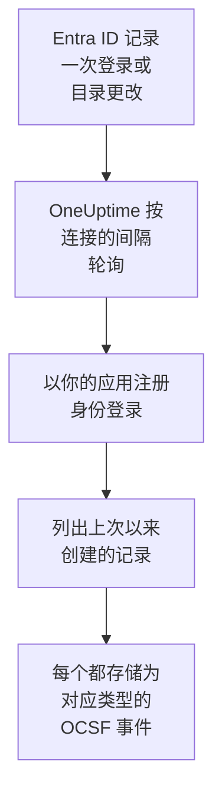

# Microsoft Entra ID

把 [Microsoft Entra ID](https://learn.microsoft.com/en-us/entra/identity/) 的登录和目录更改导入 OneUptime 的安全事件；如果你愿意，还可以导入 [Microsoft 365 审计日志](https://learn.microsoft.com/en-us/purview/audit-log-activities) 中 Exchange、SharePoint、OneDrive 和 Teams 的活动。在那里，你可以把它们与日志、跟踪和指标放在一起搜索，与其他所有来源进行关联分析，并为重要的内容呼叫值班人员。OneUptime 通过你创建的应用注册读取它们，不会更改你租户中的任何内容。

:::cards
- [设置连接](#设置连接): 一个应用注册、它的权限，以及连接的表单。
- [导入的内容](#导入的内容): 导入哪些记录，以及每条记录如何成为一个安全事件。
- [轮询的工作方式](#轮询的工作方式): 每次轮询读取的时间窗口，以及它为何与上一个窗口重叠 30 分钟。
- [故障排除](#故障排除): 每个错误的含义，以及需要更改什么。
:::

## 工作方式

OneUptime 每分钟轮询一次已过轮询间隔的每个已启用连接。一次轮询会以你的应用注册身份登录 Microsoft Entra ID，按以下顺序读取自上次轮询以来记录的目录更改（[List directoryAudits](https://learn.microsoft.com/en-us/graph/api/directoryaudit-list)）和登录（[List signIns](https://learn.microsoft.com/en-us/graph/api/signin-list)），然后在 **Microsoft 365 审计日志** 选项开启时，读取审计日志的新内容（[Office 365 Management Activity API](https://learn.microsoft.com/en-us/office/office-365-management-api/office-365-management-activity-api-reference)）。每条记录都存储为一个 [OCSF](https://schema.ocsf.io/) 事件：登录存为 Authentication 事件，分配的角色存为 User Access Management 事件，钓鱼判定存为 Detection Finding。

## 开始之前

- 在 OneUptime 中拥有 Project Owner、Project Admin 或 Security Admin 角色。Security Member 和 Security Viewer 可以查看连接及其运行历史，但不能更改它们。
- 对于登录：Microsoft Entra ID P1 或 P2，Microsoft 365 E3、E5 和 Business Premium 都包含它们：Microsoft Graph 只向这类租户提供登录。目录更改在任何租户中都能读取。
- 一个可以注册应用程序的 Entra 角色，例如 Application Administrator，以及一位能授予管理员同意的 Global Administrator 或 Privileged Role Administrator。
- 对于 Microsoft 365 审计日志：租户已开启审计，默认即为开启：在 [Microsoft Purview 门户](https://purview.microsoft.com) 中，**Audit** 不应显示 **Start recording user and admin activity**。
- 从 OneUptime 应用和工作进程到 `login.microsoftonline.com`、`graph.microsoft.com` 和 `manage.office.com` 的出站 HTTPS；Azure Government 则是到 `login.microsoftonline.us`、`graph.microsoft.us` 和 `manage.office365.us`。

## 设置连接

连接使用 [OAuth 2.0 客户端凭据流](https://learn.microsoft.com/en-us/entra/identity-platform/v2-oauth2-client-creds-grant-flow) 登录：始终作为应用程序，而不是作为某个人，并且只使用只读权限。

:::steps
### 注册应用程序

1. 登录 [Microsoft Entra 管理中心](https://entra.microsoft.com) 并打开 **App registrations**。
2. 选择 **New registration**。将其命名为 `OneUptime Security Events`，**Supported account types** 保持为 **Accounts in this organizational directory only**，重定向 URI 留空，然后选择 **Register**。
3. 在应用的 **Overview** 页面上，复制 **应用程序（客户端）ID** 和 **目录（租户）ID**。

### 允许它读取日志

1. 前往 **API permissions → Add a permission → Microsoft Graph → Application permissions**，选择 `AuditLog.Read.All`，然后选择 **Add permissions**。Microsoft 文档说明登录列表还可能需要 `Directory.Read.All`：如果授予同意后登录仍以 `403` 被拒绝，请添加它。
2. 对于 Microsoft 365 审计日志，添加第二项权限：**Add a permission → Office 365 Management APIs → Application permissions**，然后选择 `ActivityFeed.Read`。
3. 要让剧本禁用、启用和注销用户（参见 [遏制](/docs/telemetry/security-cases#遏制)），按同样的方式添加 `User.Read.All`、`User.EnableDisableAccount.All` 和 `User.RevokeSessions.All`。Microsoft 只允许同时具有 Privileged Authentication Administrator 角色的应用更改管理员的账户。
4. 为你的租户选择 **Grant admin consent for**，并确认。每项权限的状态都必须显示为 **Granted**：没有同意时，每次读取都会以 `403` 被拒绝。

### 创建客户端密码

前往 **Certificates & secrets → Client secrets → New client secret**，选择过期时间，然后选择 **Add**。离开页面之前，复制密码的 **Value**，而不是它的 **Secret ID**：它不会再次显示。到了过期那一天，轮询会以 `Microsoft Entra ID token request failed (HTTP 401)` 停止，直到你用 **更新凭据** 替换它。

### 在 OneUptime 中添加连接

打开 **产品 → Security Events → 连接**（`/dashboard/{projectId}/security-events/connections`），点击 **添加连接**，在 **身份** 下选择 **Microsoft Entra ID**，然后点击 **下一步**。填写下表中的设置，点击 **下一步**，并把密码的值粘贴到 **客户端密钥** 中。在 **轮询** 步骤中开启 **Microsoft 365 审计日志**，即可同时读取它。

### 保存之前先测试

点击 **保存前测试** 下的 **测试这些设置**。测试会用表单中的值登录并读取每个日志，但不会存储任何内容，因此错误的密码或缺失的同意会在连接存在之前暴露出来。然后点击 **下一步**，为连接填写 **名称** 并创建它。
:::

| 设置 | 在哪里找到 |
| --- | --- |
| **目录（租户）ID** | 应用的 **Overview** 页面。租户的 GUID，或已验证的域名，例如 `contoso.onmicrosoft.com`。开启 **Microsoft 365 审计日志** 时必须是 GUID：Management API 只按 GUID 识别租户。 |
| **应用程序（客户端）ID** | 应用的 **Overview** 页面。拥有 `AuditLog.Read.All` 的应用的 GUID。 |
| **云** | **Azure 公有云**，或用于 GCC High 的 **Azure Government（美国）** （`login.microsoftonline.us`、`graph.microsoft.us` 和 `manage.office365.us`）。 |
| **Microsoft 365 审计日志** | 可选，默认关闭。开启后，每次轮询也会读取 Microsoft 365 审计日志。应用需要 `ActivityFeed.Read`。 |
| **客户端密钥** | 密码的 **Value**。它会被加密，API 从不返回，也不会再次显示。在连接上用 **更新凭据** 替换它。 |

**轮询** 步骤还有可选的 **描述**、**轮询间隔（分钟）**（`1` 到 `1440` 之间的整数，初始为 `5`），以及初始为开启的 **已启用**。

## 导入的内容

每个事件的供应商为 `Microsoft`，产品为 `Microsoft Entra ID`。它的 `entra.log` 属性说明登录或更改来自哪个日志，Microsoft 365 记录的 `microsoft365.contentType` 说明它的内容类型。

| 记录 | OCSF 类别 | 严重性 |
| --- | --- | --- |
| 成功的登录 | Authentication (`3002`)，状态 `Success` | Informational |
| 等待第二步的登录，例如 MFA（`50074`、`50076`）或要求更改密码的提示 | Authentication (`3002`)，状态 `Interrupted` | Informational：是一个步骤，不是失败 |
| 失败的登录，附带 Entra 的原因和错误代码 | Authentication (`3002`)，状态 `Failure` | Low |
| Identity Protection 评为中等或高风险的登录 | Authentication (`3002`) | Medium 或 High |
| 按类别划分的用户、组或角色更改 | Account Change (`3001`)、Group Management (`3006`)、User Access Management (`3005`)，其余为 Entity Management (`3004`) | 特权角色（例如 Global Administrator）为 Medium；失败的更改为 Low |

开启 **Microsoft 365 审计日志** 后，会从中导入安全团队需要处理的记录，其余记录（例如打开的文件或阅读的邮件）只计数：

| Microsoft 365 记录 | OCSF 类别 | 严重性 |
| --- | --- | --- |
| Exchange cmdlet（例如 `New-InboxRule` 或 `Set-Mailbox`）、在 Outlook 中创建的收件箱规则，或以他人身份发送的邮件 | API Activity (`6003`) | 转发邮件时为 Medium，并将 `microsoft365.forwardsMail` 设为 `true` |
| 授予的邮箱权限，例如 `Add-MailboxPermission` | User Access Management (`3005`) | Low |
| 在 SharePoint 或 OneDrive 中共享的文件 | File Hosting Activity (`6006`) | 与来宾或任何人都能打开的链接共享时为 Low，并将 `microsoft365.sharedOutside` 设为 `true` |
| 添加或删除的网站集管理员 | User Access Management (`3005`) | Low |
| Microsoft Defender for Office 365 发现的恶意软件或钓鱼邮件 | Detection Finding (`2004`) | 恶意软件为 High，钓鱼为 Medium |
| Microsoft 365 发出的警报 | Detection Finding (`2004`) | 警报本身的严重性 |
| 添加到团队的应用、机器人或连接器 | Application Lifecycle (`6002`) | Low |

Exchange 以其系统账户运行的内部维护操作会被排除，除非它转发邮件。每个事件都保留整条记录，并展平为带点的键，例如 `status.errorCode` 或 `Parameters.ForwardTo`，因此规则可以按 Microsoft 给字段起的名称读取任何字段。规则库中针对 Entra ID 的规则按这里导入的形式读取它们。

同样的登录和目录更改也可以作为日志到达 OneUptime：由 Azure 诊断设置导出，并由 [你的日志](/docs/telemetry/security-events#在日志中查找安全事件) 读取。无论走哪条路，每条记录都会得到相同的事件 ID，但两条路都读取的记录会被存储两次：只通过一条路读取 Entra ID。

## 轮询的工作方式

- **记录按 Entra ID 记录它们的时间读取**：更改为 `activityDateTime`，登录为 `createdDateTime`。
- **第一次轮询会回溯 24 小时**，所以新连接会立刻显示最近的记录。
- **之后的每次轮询都从保存的游标之前 30 分钟开始。** Microsoft 文档说明这两个日志都会晚几分钟到达，因此重叠部分会在下一次轮询中读取迟到的记录，重复项会在项目内按记录 ID 丢弃。
- **一次轮询最多读取游标之后 24 小时。** 游标落后的连接会通过一连串 24 小时的窗口追赶。
- **没有 Microsoft Entra ID P1 或 P2 的租户** 会导入其目录更改，并且每次运行的 **Read sign-ins** 检查都会警告未读取登录。
- **失败的运行不会改变任何东西。** 发生网络错误或 Graph 返回错误状态后，游标和窗口长度保持不变，下一次轮询会再次读取同一个窗口。唯一的例外是请求超时：游标保持不变，但下一个窗口的长度减半，因为太重而无法及时响应的窗口每次重试都会超时。

Microsoft 365 审计日志按 Microsoft 提供每个内容 blob 的时间读取，每次一天，并且不会早于 Microsoft 保留它的 7 天。第一次轮询会让应用订阅 `Audit.Exchange`、`Audit.SharePoint` 和 `Audit.General`，Microsoft 会在 12 小时内提供新订阅的首批记录。审计日志从不会阻止 Entra ID 日志：缺少权限只是一个警告，窗口照常前进；而 Microsoft 一侧的故障（例如 `HTTP 503`）会让运行变为 **部分**，以便重新读取该窗口。

### 当一个窗口包含的内容超过一次轮询能读取的量时

每个日志都有自己的预算：10 页、每页 500 条目录更改，20 页、每页 500 条登录，以及 Microsoft 365 审计日志的 120 个请求和 10,000 条记录。一次轮询在 4 分钟后停止。当预算在窗口结束前让某个日志停止时，运行为 **部分**，其警告会指明该日志和预算。Microsoft Graph 先列出最新的记录，因此 OneUptime 会缩短窗口，而不是把游标移过它从未读到的记录：

1. **缩小。** 下一次轮询从同一个起点读取长度减半的窗口，并不断减半，直到某个窗口能被完整读取，最短为一分钟。运行的警告会说明这一点：`This window holds more records than one poll can read; the next poll reads a {n} minute window from the same starting point.` 已从较长窗口导入的记录会作为重复项被跳过。
2. **恢复。** 一个窗口被完整读取后，游标会移到它的末尾，下一个窗口的长度会再次加倍，最长为 24 小时。
3. **越过单独的一分钟。** 如果连一分钟内的记录都超过一次轮询能读取的量，轮询会越过这一分钟，让更新的记录继续到达。这次运行仍为 **部分**，**最近错误** 显示 `More records were created in the one minute from {cursor} to {end} than one poll can read. Polling moved past this minute so newer records keep arriving; use Import this time range in Diagnostics on this minute to recover what one run can read.` 用 **Import this time range** 导入这一分钟，即可找回一次运行能读取的内容。

更改 **轮询间隔（分钟）** 不会改变这些：它决定的是轮询多久开始一次，而不是窗口从哪里开始。

### 按需运行、预览和导入

在连接上点击 **诊断**，可以查看它最近的运行，并手动操作它。能更改该连接的人都可以启动这些操作；能查看它的人都可以阅读历史记录。

- **立即运行** 会立即开始一次轮询，使用通常的游标，即使连接未处于 **已启用** 状态也可以。
- **Preview records** 读取最长 7 天的时间范围，不导入任何内容。
- **Import this time range** 在你确认后导入最长 7 天的范围，不会移动游标。已导入的记录会被跳过。有 P1 或 P2 时，Microsoft Entra ID 会保留 30 天的登录和目录更改，没有时保留 7 天。
- 运行上的 **Copy diagnostics** 会复制它的报告以便提供给支持人员。报告从不包含凭据。

## 测试连接

连接所在行中的 **测试连接** 和表单中的 **测试这些设置** 在 API 进程中运行，而不是在后台工作进程中运行，所以即使工作进程出了问题，测试仍然会给出结果。它按顺序运行以下检查：

| 检查 | 检查的内容 |
| --- | --- |
| **配置** | 每项设置都存在且格式正确。此项失败时不会连接任何地方。 |
| **Authenticate with Microsoft Entra** | Entra ID 在你选择的云中为应用颁发 Microsoft Graph 的令牌。 |
| **Read sign-ins** | 可以读取过去 24 小时的登录。在没有 P1 或 P2 的租户中是警告，而不是失败。 |
| **Read directory changes** | 可以读取过去 24 小时的目录更改。 |
| **Read the Microsoft 365 audit log** | 仅在开启该选项时：Management API 有响应，以及应用订阅了哪些内容类型。 |
| **Records available to import** | 过去 24 小时内有多少登录和目录更改，每种最多数到 500，因此 `500+` 表示更多。一条都没有时为警告。 |
| **Background workers**、**Poll scheduler**、**Security event storage** | OneUptime 自身的一侧：有进程在处理 Worker 队列的作业，轮询作业每分钟运行一次，安全事件存储能够响应。 |
| **Scheduled polling** | 针对已保存的连接：轮询已开启，没有运行卡在等待工作进程的状态，并且轮询按时运行。 |

测试中的每个请求都有 20 秒的期限。测试从不导入任何内容，也不移动游标，每个失败的检查都会说明需要更改什么。

## 故障排除

连接的 **最近错误** 会保留完整的错误消息（凭据已隐去）。连接出错时，在它的 **操作** 列中选择 **查看错误** 来阅读，并在对话框中用 **复制错误** 复制。每条消息都以 `Microsoft Entra ID` 开头，接着指明失败的请求，并在有错误代码时引用 Microsoft 的错误代码。

:::details 最近错误 显示 `token request failed`
- `HTTP 401` 并带有 `invalid_client`：客户端密码错误或已过期。请创建一个新的，并用 **更新凭据** 保存。
- 提到应用程序（客户端）ID 或租户的 `HTTP 400`：在应用的 **Overview** 页面检查这两者，并确认 **云** 是该租户所在的云。
:::

:::details 最近错误 显示 `sign-ins request failed (HTTP 403)` 或 `audit logs request failed (HTTP 403)`
- 错误代码 `Authorization_RequestDenied`：应用缺少 `AuditLog.Read.All`，或未授予同意。请授予管理员同意，等待几分钟后再测试。对于登录，还要授予 `Directory.Read.All`。
- 错误代码 `Authentication_RequestFromNonPremiumTenantOrB2CTenant`：租户没有 Microsoft Entra ID P1 或 P2。目录更改仍会被导入。
:::

:::details 未读取 Microsoft 365 审计日志
- 带有 `AF10001` 的 `subscriptions request failed (HTTP 401)` 或 `(HTTP 403)`：应用缺少 Office 365 Management APIs 的 `ActivityFeed.Read`，或未授予同意。
- `AF20010` 到 `AF20013`：Management API 不认识该 **目录（租户）ID**。请使用租户的 GUID。
- 带有 `AF20023` 的 `subscription start failed`：管理员关闭了该订阅。无法订阅的内容类型会在运行的警告中列出，其他类型仍会被读取。
- 第一次轮询后数小时没有记录：Microsoft 会在 12 小时内提供新订阅的首批内容。
:::

:::details 最近错误 显示 `did not complete`
请求没有得到响应：超时、名称无法解析或地址被拒绝。请检查 OneUptime 应用和工作进程能否通过你使用的任何代理访问 [开始之前](#开始之前) 中的主机。
:::

:::details 测试通过，但 Last Polled 为 Never
轮询作业从未运行过。阅读 **Background workers** 和 **Poll scheduler** 检查。在自托管安装中，常见原因是应用上设置了 `DISABLE_QUEUE_WORKERS=true`，却没有单独的工作进程部署来处理作业：把它设为 `false`，或运行工作进程部署（Helm：`worker.enabled: true`，默认为 `false`）。
:::

## 后续步骤

:::cards
- [安全事件](/docs/telemetry/security-events): 搜索、关联分析你导入的内容，并据此发出警报。
- [Okta 系统日志](/docs/integrations/okta): 导入另一个身份提供商的登录。
- [Google Workspace](/docs/integrations/google-workspace): 导入 Google 的登录和管理员更改。
- [集成概述](/docs/integrations/index): 你可以连接的其他工具。
:::
