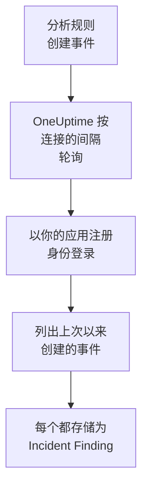

# Microsoft Sentinel

把 [Microsoft Sentinel](https://learn.microsoft.com/en-us/azure/sentinel/overview) 分析规则创建的事件（incident）导入 OneUptime 的安全事件。在那里，你可以把它们与日志、跟踪和指标放在一起搜索，与其他所有来源进行关联分析，并为重要的事件呼叫值班人员。OneUptime 通过你创建的应用注册读取它们，不会更改 Azure 中的任何内容。

:::cards
- [设置连接](#设置连接): 一个应用注册、一个角色，以及连接的表单。
- [导入的内容](#导入的内容): 每个 Sentinel 事件如何成为一个安全事件。
- [轮询的工作方式](#轮询的工作方式): 每次轮询读取的时间窗口，以及繁忙的工作区对它的影响。
- [故障排除](#故障排除): 每个错误的含义，以及需要更改什么。
:::

## 工作方式



OneUptime 每分钟轮询一次已过轮询间隔的每个已启用连接。一次轮询会以你的应用注册身份登录 Microsoft Entra ID，向 Azure Resource Manager 请求自上次轮询以来创建的事件，并把每个事件存储为一个 [OCSF](https://schema.ocsf.io/) Incident Finding 事件（类别 `2005`）。之后，检测规则、监视器和仪表板会像对待其他任何来源的安全事件一样对待它。

## 开始之前

- 在 OneUptime 中拥有 Project Owner、Project Admin 或 Security Admin 角色。Security Member 和 Security Viewer 可以查看连接及其运行历史，但不能更改它们。
- 一个启用了 Microsoft Sentinel 的 Log Analytics 工作区，位于 Azure 公有云或 Azure Government (US) 中。
- 在 Microsoft Entra ID 中创建应用注册和客户端密码的权限。
- 在包含该工作区的资源组上分配角色的权限，例如 Owner 或 User Access Administrator。

## 设置连接

连接使用 OAuth 2.0 客户端凭据流登录：始终作为应用程序，而不是作为某个人。它的访问权限来自一个 Azure 角色，因此应用注册不需要任何 API 权限。

:::steps
### 注册应用程序

1. 登录 [Azure portal](https://portal.azure.com) 并打开 **Microsoft Entra ID**。
2. 前往 **App registrations → New registration**。将其命名为 `OneUptime Sentinel connector`，**Supported account types** 保持为 **Accounts in this organizational directory only**，重定向 URI 留空，然后选择 **Register**。
3. 在应用的 **Overview** 页面上，复制 **应用程序（客户端）ID** 和 **目录（租户）ID**。
4. 前往 **Certificates & secrets → Client secrets → New client secret**，选择过期时间，然后选择 **Add**。离开页面之前，复制密码的 **Value**，而不是它的 **Secret ID**：它不会再次显示。

### 允许它读取事件

1. 在 Azure portal 中，打开包含 Log Analytics 工作区的资源组。
2. 选择 **Access control (IAM) → Add → Add role assignment**。
3. 在 **Role** 选项卡上，选择 **Microsoft Sentinel Reader**。
4. 在 **Members** 选项卡上，选择 **User, group, or service principal**，点击 **Select members**，然后按名称选择你的应用注册。
5. 选择 **Review + assign**。

该角色允许应用读取事件（`Microsoft.SecurityInsights/incidents/read`），但不能写入任何内容。Microsoft 建议在资源组而不是工作区上分配它，这样它也能覆盖提供事件的 `SecurityInsights` 解决方案。新的分配可能需要几分钟才能生效。

### 找到工作区的详细信息

在 Azure portal 中打开 Log Analytics 工作区。它的 **Overview** 页面会显示 **订阅 ID**、**Resource group** 和工作区的名称。工作区的资源 ID 也包含这三项：

```text
/subscriptions/{Subscription ID}/resourceGroups/{Resource group}/providers/Microsoft.OperationalInsights/workspaces/{Workspace name}
```

### 在 OneUptime 中添加连接

打开 **产品 → Security Events → 连接**（`/dashboard/{projectId}/security-events/connections`），点击 **添加连接**，选择 **Microsoft Sentinel**，然后点击 **下一步**。填写下表中的设置，点击 **下一步**，并把密码的值粘贴到 **客户端密钥** 中。

### 保存之前先测试

点击 **保存前测试** 下的 **测试这些设置**。测试会用表单中的值登录并读取事件，但不会存储任何内容，因此错误的密码或缺失的角色会在连接存在之前暴露出来。然后点击 **下一步**，为连接填写 **名称** 并创建它。
:::

| 设置 | 在哪里找到 |
| --- | --- |
| **目录（租户）ID** | 应用的 **Overview** 页面。租户的 GUID，或已验证的域名，例如 `contoso.onmicrosoft.com`。 |
| **应用程序（客户端）ID** | 应用的 **Overview** 页面。一个 GUID。 |
| **订阅 ID** | 工作区的 **Overview** 页面。一个 GUID。 |
| **Resource group** | 工作区的 **Overview** 页面。1 到 90 个字母、数字、下划线、连字符、句点或括号，不能以句点结尾。 |
| **Workspace name** | 工作区的 **Overview** 页面。3 到 90 个字母、数字或连字符，以字母或数字开头和结尾。 |
| **云** | **Azure 公有云**（`login.microsoftonline.com`、`management.azure.com`）或 **Azure Government（美国）** （`login.microsoftonline.us`、`management.usgovcloudapi.net`）。 |
| **客户端密钥** | 密码的 **Value**。它会被加密，API 从不返回，也不会再次显示。在连接上用 **更新凭据** 替换它。 |

**轮询** 步骤还有可选的 **描述**、**轮询间隔（分钟）**（`1` 到 `1440` 之间的整数，初始为 `5`），以及初始为开启的 **已启用**。

## 导入的内容

每个 Sentinel 事件都会成为一个 Incident Finding 事件（OCSF 类别 `2005`，活动 `Create`），归属于 `Microsoft Sentinel` 遥测服务：

| OCSF 列 | Sentinel 事件字段 |
| --- | --- |
| `time` | `properties.createdTimeUtc`，即 Sentinel 创建该事件的时间 |
| `eventUid` | `name`，即事件的 GUID，也是去重所依据的值 |
| `message`, `ruleName` | `properties.title` |
| `ruleId` | 第一个 `properties.relatedAnalyticRuleIds` 条目末尾的规则 GUID |
| `severityName` | `properties.severity`：`High`、`Medium`、`Low` 或 `Informational` |
| `statusName` | `properties.status`：`New`、`Active` 或 `Closed` |
| `mitreTactics` | `properties.additionalData.tactics`，转换为 ATT&CK ID：`Persistence` 变为 `TA0003` |
| `principalUser` | `properties.owner.userPrincipalName` 或 `properties.owner.email` |
| `targetResource` | `properties.incidentUrl`，即指向 Azure portal 中该事件的链接 |
| `observables` | 所有者的 UPN、电子邮件和对象 ID，以及每个标签的名称 |
| `attributes` | 整个事件，展平为点分隔的键，例如 `properties.classification` 和 `properties.firstActivityTimeUtc` |

在轮询窗口内创建的已关闭事件也会被导入。在安全事件资源管理器中按 `statusName` 过滤，即可只查看未关闭的事件。

## 轮询的工作方式

每次轮询都会列出在其时间窗口内创建的事件，从最早的开始，每页 50 个，并跟随 API 的 `nextLink`，直到读完整个窗口：

```text
GET https://management.azure.com/subscriptions/{sub}/resourceGroups/{rg}/providers/Microsoft.OperationalInsights/workspaces/{ws}/providers/Microsoft.SecurityInsights/incidents
    ?api-version=2024-03-01
    &$filter=(properties/createdTimeUtc ge {windowStart}) and (properties/createdTimeUtc lt {windowEnd})
    &$orderby=properties/createdTimeUtc asc
    &$top=50
```

- **创建时间就是游标。** 每小时运行一次的计划分析规则，会在它匹配的活动发生很久之后才创建事件，而事件的 `firstActivityTimeUtc` 可能早几个小时甚至几天。基于活动时间的游标会跳过所有这样的事件。活动时间保留在 `attributes` 中，Diagnostics 中的样本会同时显示这两个时间。
- **第一次轮询会回溯 24 小时**，所以新连接会立刻显示最近的事件。
- **之后的每次轮询都从保存的游标之前 1 分钟开始**，所以在两个窗口边界上创建的事件永远不会被跳过。
- **一次轮询最多读取游标之后 24 小时。** 游标落后的连接会通过一连串 24 小时的窗口追赶，此时它的 **健康状况** 显示为 **Catching up**。
- **重复项按事件的 GUID**（`name`）**在项目内去重**，所以重叠部分、重试的窗口和导入都不会把同一个事件存储两次。

### 当一个窗口包含的内容超过一次轮询能读取的量时

一次轮询最多读取 20 页、每页 50 个事件：共 1,000 个事件。当这个上限让它在窗口结束之前停下时，这次运行为 **部分**，并带有类似这样的警告：

```text
Stopped after 20 incidents requests (the per-run request limit) before reading the whole window. Incidents are read oldest first; every incident created before 2026-09-14T08:12:44.000Z was read.
```

事件按从早到晚的顺序读取，所以 OneUptime 会把游标移到它读取的最后一个事件的创建时间，下一次轮询就从那里开始，窗口长度不变。繁忙的工作区每次轮询大约追赶 1,000 个事件，而不是重复读取相同的事件。在同一时刻创建的事件会被读取两次，而去重检查会丢弃第二份。

当一次运行完全无法越过保存的游标时，OneUptime 会改为缩短窗口：

1. **缩小。** 下一次轮询从同一个起点读取长度减半的窗口，并不断减半，直到某个窗口能被完整读取，最短为一分钟。运行的警告会说明这一点：`This window holds more records than one poll can read; the next poll reads a {n} minute window from the same starting point.`
2. **恢复。** 一个窗口被完整读取后，下一个窗口的长度会再次加倍，最长为 24 小时。
3. **越过单独的一分钟。** 如果连一分钟内的内容都超过一次轮询能读取的量，轮询会越过这一分钟，让更新的事件继续到达。这次运行仍为 **部分**，**最近错误** 显示 `More records were created in the one minute from {cursor} to {end} than one poll can read. Polling moved past this minute so newer records keep arriving; use Import this time range in Diagnostics on this minute to recover what one run can read.` 用 **Import this time range** 导入这一分钟，即可找回一次运行能读取的内容。

因 Microsoft Entra ID 或 Azure Resource Manager 的错误而彻底失败的运行，会保留游标和窗口长度，下一次轮询会再次读取同一个窗口。唯一的例外是请求超时：游标保持不变，但下一个窗口的长度减半，因为太重而无法及时响应的窗口每次重试都会超时。更改 **轮询间隔（分钟）** 不会改变以上任何一点：它决定轮询多久开始一次，而不是窗口从哪里开始。

### 按需运行、预览和导入

在连接上点击 **诊断**，可以查看它最近的运行，并手动操作它。能更改该连接的人都可以启动这些操作；能查看它的人都可以阅读历史记录。

- **立即运行** 会立即开始一次轮询，使用通常的游标，即使连接未处于 **已启用** 状态也可以。
- **Preview incidents** 读取最长 7 天的时间范围，不导入任何内容。
- **Import this time range** 在你确认后导入最长 7 天的范围，不会移动游标。已导入的事件会被跳过。
- 运行上的 **Copy diagnostics** 会复制它的报告以便提供给支持人员。报告从不包含凭据。

## 测试连接

连接所在行中的 **测试连接** 和表单中的 **测试这些设置** 在 API 进程中运行，而不是在后台工作进程中运行，所以即使工作进程出了问题，测试仍然会给出结果。它按顺序运行以下检查：

| 检查 | 检查的内容 |
| --- | --- |
| **配置** | 每项设置都存在且格式正确。此项失败时不会连接任何地方。 |
| **Authenticate with Microsoft Entra** | Microsoft Entra ID 向你的应用注册颁发用于 Azure Resource Manager 的令牌。 |
| **Read incidents** | 可以读取过去 24 小时内创建的一个事件（`$top=1`）。这证明了角色和工作区的详细信息正确。 |
| **Incidents available to import** | 过去 24 小时和过去 7 天内创建了多少事件，各读取一页 50 个，所以 `50+` 表示更多。7 天内一个都没有是警告，而不是失败。 |
| **Background workers**、**Poll scheduler**、**Security event storage** | OneUptime 自身的一侧：有进程在处理 Worker 队列的作业，轮询作业每分钟运行一次，安全事件存储能够响应。 |
| **Scheduled polling** | 针对已保存的连接：轮询已开启，没有运行卡在等待工作进程的状态，并且轮询按时运行。 |

测试中的每个请求都有 20 秒的期限。测试从不导入任何内容，也不移动游标，每个失败的检查都会说明需要更改什么。

## 将安全事件发送到 Microsoft Sentinel

OneUptime 也可以通过 Azure Monitor 的 Logs Ingestion API 把它发现的内容发送到 Microsoft Sentinel，写入 Sentinel 所在工作区的一个自定义表。之后你的分析规则、搜寻查询和工作簿就可以在其他表旁边查询 `OneUptimeSecurityEvents_CL`。

:::steps
### 创建表及其数据收集规则

在 Azure 门户中，打开工作区的 **Tables → Create → New custom log (DCR-based)**。将表命名为 `OneUptimeSecurityEvents`，新建一个数据收集规则，如果表单要求，再新建一个数据收集终结点。把下面的示例作为示例文件上传，保持转换不变，然后创建表。

### 让应用程序向它发送

按照 [注册应用程序](#注册应用程序) 中的步骤注册一个应用程序并为它创建客户端密码。然后打开数据收集规则，在 **Access control (IAM) → Add → Add role assignment** 中选择 **Monitoring Metrics Publisher**，并选中该应用程序。

### 添加目标

打开 **产品 → Security Events → 连接**。在 **发送到你的 SIEM** 下点击 **添加目标**，在 **SIEM** 下选择 Microsoft Sentinel，然后点击 **下一步**。填写 **目录（租户）ID**、**应用程序（客户端）ID** 和 **客户端密钥**，从数据收集终结点（或规则）的 **Overview** 中取得的 **日志引入终结点**，以及从规则的 **JSON View** 中取得的 **数据收集规则不可变 ID**。**流** 是可选的：留空时为 `Custom-OneUptimeSecurityEvents_CL`。

### 发送测试事件并开始发送

点击 **发送测试事件**：几分钟内会有一行到达该表。然后在 **发送内容** 下保留 **仅检测结果** 或选择 **所有安全事件**，再点击 **开始发送**。
:::

示例文件，一行包含表的每一列：

```json title="oneuptime-security-events-sample.json"
[
  {
    "TimeGenerated": "2026-10-21T10:00:00.000Z",
    "EventId": "0193c0de-cccc-4aaa-8bbb-000000000001",
    "EventUid": "okta-1",
    "ClassName": "Authentication",
    "CategoryName": "Identity & Access Management",
    "ActivityName": "Logon",
    "Severity": "Medium",
    "SeverityId": 3,
    "Status": "Failure",
    "Message": "Failed sign-in for alice",
    "VendorName": "Okta",
    "ProductName": "Okta System Log",
    "RuleId": "",
    "RuleName": "",
    "MitreTactics": [],
    "MitreTechniques": [],
    "PrincipalUser": "alice@example.com",
    "PrincipalHost": "laptop-7",
    "PrincipalIp": "203.0.113.7",
    "TargetUser": "",
    "TargetHost": "app.example.com",
    "TargetIp": "198.51.100.20",
    "TargetPort": 443,
    "TargetResource": "",
    "ProcessName": "",
    "ProcessCommandLine": "",
    "ParentProcessName": "",
    "Observables": [
      "alice@example.com",
      "203.0.113.7"
    ],
    "Attributes": {
      "okta.outcome.reason": "INVALID_CREDENTIALS"
    }
  }
]
```

- Logs Ingestion API 每次调用最多接受 1 MB，所以行按每批最多 500 行发送。Azure 拒绝的批次会被拆分，直到找到它不接受的那一行并将其略去，限流（`429`）会重试。
- `403` 表示应用程序在该规则上缺少 **Monitoring Metrics Publisher**，`404` 表示不可变 ID 或流有误。
- OneUptime 从 Microsoft Sentinel 导入的事件（incident）永远不会被发回 Microsoft Sentinel。

## 故障排除

连接的 **最近错误** 会保留完整的错误消息（凭据已隐去），前面带有一个指明失败步骤的前缀。连接出错时，在它的 **操作** 列中选择 **查看错误** 来阅读，并在对话框中用 **复制错误** 复制。请先阅读前缀。

:::details Last Error 以 `Microsoft Sentinel token request` 开头
- `Microsoft Sentinel token request failed (HTTP ...)`：Microsoft Entra ID 拒绝颁发令牌，所以根本没有连接 Azure。消息会引用 Entra 的代码：
  - `AADSTS7000215` 或 `invalid_client`：**客户端密钥** 错误或已过期，或者填的是密码的 ID 而不是它的值。创建一个新密码，并用 **更新凭据** 保存。
  - `AADSTS700016` 或 `unauthorized_client`：**应用程序（客户端）ID** 不在所填的 **目录（租户）ID** 中。把两者与应用的 **Overview** 页面进行比较。
  - `AADSTS90002` 或 `HTTP 404`：没有这样的租户。**目录（租户）ID** 错误，或者它位于另一个云中：请检查 **云**。
  - `HTTP 429` 或 `HTTP 5xx`：Microsoft Entra ID 正在限流或不可用。下一次轮询会重试。
- `Microsoft Sentinel token request returned ...`：Microsoft Entra ID 返回了无法使用的内容，例如不是 JSON 或没有 `access_token` 的主体。这通常是中间的代理或网关造成的。
- 没有状态码的 `Microsoft Sentinel token request failed:`，或 `Microsoft Sentinel token request timed out after ... seconds with no response`：请求没有得到响应。检查 OneUptime 应用和工作进程到 `login.microsoftonline.com` 的 DNS、TLS 和出站 HTTPS。
:::

:::details Last Error 以 `Microsoft Sentinel incidents list` 开头
- `Microsoft Sentinel incidents list failed (HTTP ...)`：Azure Resource Manager 拒绝了请求。
  - `HTTP 401`：它不接受该令牌。几乎总是因为 **云** 与租户不匹配，或者应用注册已被删除。在两页之间过期的令牌会自动续订并重试一次。
  - `HTTP 403` 或 `AuthorizationFailed`：应用在资源组上还没有 **Microsoft Sentinel Reader**。分配该角色，并等待几分钟。
  - `HTTP 404`：没有具有该 **订阅 ID**、**Resource group** 和 **Workspace name** 的工作区，或者该工作区未启用 Microsoft Sentinel。请从工作区的 **Overview** 页面复制它们。
  - `HTTP 429` 或 `HTTP 5xx`：Azure Resource Manager 正在限流或不可用。下一次轮询会重试。
  - `HTTP 400`：Azure Resource Manager 拒绝了查询，而查询是由 OneUptime 构建的，与你的设置无关。请把消息发送给 OneUptime 支持人员。
- `Microsoft Sentinel incidents list returned ...`：Azure 返回了 `200`，但没有可读的事件页面，或者带有一个指向其他主机的 `nextLink`，连接器会拒绝这种链接，让令牌永远不离开 Azure Resource Manager。这种情况会被报告出来，而不是被当作空窗口，所以游标永远不会越过没人读过的事件。
- 没有状态码的 `Microsoft Sentinel incidents list failed:`，或 `Microsoft Sentinel incidents list timed out after ... seconds with no response`：请求没有得到响应。检查 OneUptime 工作进程到 `management.azure.com` 或 `management.usgovcloudapi.net` 的出站 HTTPS。
:::

:::details Last Polled 为 Never 且 Last Error 为空
这个连接还没有完成过任何轮询。运行 **测试连接**：它的 **Background workers** 和 **Poll scheduler** 检查会指出原因。在自托管安装中，常见原因是应用上设置了 `DISABLE_QUEUE_WORKERS=true`，却没有单独的工作进程部署来处理作业：把它设为 `false`，或运行工作进程部署（Helm：`worker.enabled: true`）。
:::

:::details 运行为 Partial
- `Stopped after 20 incidents requests (the per-run request limit) before reading the whole window`：窗口中的事件超过了一次运行能读取的 1,000 个。不会丢失任何内容：下一次轮询会从读取的最后一个事件之后开始。一次又一次轮询都保持 **部分** 的连接正在追赶积压，它的 **最近轮询** 和 **最近导入的事件** 会持续前进。
- `Microsoft Sentinel returned incidents out of creation-time order, so this run cannot name a point to resume from.`：API 忽略了从早到晚的顺序，所以这次运行无法把游标移到它的最后一个事件，下一次轮询会改为读取更短的窗口。如果反复出现，请把这次运行的报告发送给 OneUptime 支持人员。
- `More records were created in the one minute from ... than one poll can read`：轮询越过了这一分钟。请在 **诊断** 中用 **Import this time range** 导入它。一次导入读取的量与一次轮询相同。
:::

:::details 测试通过，但没有导入任何内容
阅读测试报告中的 **Incidents available to import**。过去 7 天为 `0` 表示工作区的分析规则没有创建任何事件，这不是连接的问题。在 Microsoft Sentinel 中检查这些规则是否已启用，并设置为创建事件。
:::

## Azure Government

把 **云** 设为 **Azure Government（美国）**。连接随后会在 `login.microsoftonline.us` 以 `https://management.usgovcloudapi.net/.default` 范围登录，并从 `management.usgovcloudapi.net` 读取事件。其他一切，包括角色分配，都相同。

## 你会得到什么

- **搜索。** 在安全事件资源管理器中，与其他所有来源放在一起，按严重程度、状态、所有者、标签或战术过滤事件。
- **关联分析。** 每个事件的所有者和标签都会作为 observable 建立索引，所以一次搜索就能找到提到它们的所有内容。
- **检测规则。** 按计划对你的安全事件运行的 Sigma 规则，会打开呼叫值班人员的警报。
- **监视器。** 安全事件监视器统计匹配的事件，例如新的 High 事件，并在超过阈值时打开事件或警报。

安全事件与其他遥测数据一样，按摄取的 GB 数计费。请参阅 [定价](https://oneuptime.com/pricing)。

## 后续步骤

:::cards
- [安全事件](/docs/telemetry/security-events): 搜索、关联分析你导入的内容，并据此发出警报。
- [Microsoft Defender XDR](/docs/integrations/microsoft-defender-xdr): 同时导入每个 Defender 工作负载的警报。
- [角色](/docs/permissions/reference#角色): Security 角色可以查看和更改的内容。
- [集成概述](/docs/integrations/index): 你可以连接的其他工具。
:::
