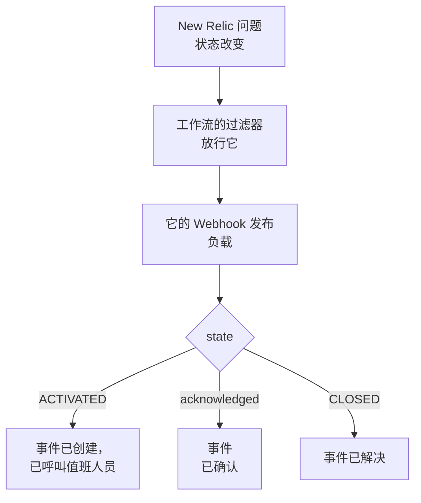

# New Relic

把 [New Relic](https://newrelic.com) 问题发送到 OneUptime，让每个问题都成为一个呼叫值班团队的事件或警报，在有人确认该问题时被确认，并在问题关闭时解决。New Relic 通过 [Webhook 目标](https://docs.newrelic.com/docs/alerts/get-notified/notification-integrations/) 发送它的问题，因此两边都无需安装任何东西。

:::cards
- [从模板开始](#从模板开始): 选择要呼叫的人，复制 URL，并查看每个问题会做什么。
- [配置 New Relic](#配置-new-relic): 一个 Webhook 目标，以及通知它的工作流。
- [测试](#测试): 先自己发送一个问题，再从 New Relic 发送一个。
- [故障排除](#故障排除): 问题没有到达，或事件一直未关闭时。
:::

## 工作方式



New Relic 工作流用它的过滤器挑选要发送的问题，并在问题被激活、确认或关闭时通知一个 Webhook 目标，附带一个由 New Relic 填写的 JSON 负载。OneUptime 靠问题的 ID 找到它所打开的事件。

## 开始之前

- 一个可以创建目标和工作流的 New Relic 账户。
- 在 OneUptime 中，需要创建工作流的权限。在 OneUptime Cloud 上，工作流需要 **Growth** 套餐或更高。

## 从模板开始

先设置 OneUptime：它会给你 New Relic 要发送到的 URL。**创建工作流** 对话框在其类别列表的 **New Relic** 下有两个 New Relic 模板：用于事件的 **Declare an incident for each New Relic issue**，以及用于警报的 **Create an alert for each New Relic issue**。两者作用相同，各自创建自己种类的记录。

:::steps
1. 前往 **工作流**，点击 **创建工作流**。在 **或者从模板开始** 下，在类别列表中选择 **New Relic**，点击 **Declare an incident for each New Relic issue**，或 **Create an alert for each New Relic issue**，然后点击 **使用此模板**。
2. 在 **Who to page for new New Relic issues** 下选择要呼叫的值班策略，不选则不呼叫任何人，然后点击 **创建工作流**。工作流会在 **生成器** 中打开，处于关闭状态。
3. 点击 **Webhook** 触发器，然后点击 **复制 URL**，把 URL 留给 New Relic 使用。
4. 在 **生成器** 顶部打开 **已启用**。处于关闭状态的工作流会以 `400` 回应 New Relic。
:::

然后 [配置 New Relic](#配置-new-relic)，让它把问题发送到这个 URL。工作流的 `read-event-1` 步骤打开时就是同样的设置，方便你回到 **生成器** 时查看。

### 工作流做什么

在 **Webhook** 触发器之后， **Check With JavaScript** 步骤 `read-event-1` 读取 New Relic 发送的 `state`，再由 **Incident From Another Tool**（警报模板中为 **Alert From Another Tool** ）按问题的 ID 执行它所代表的操作。事件把该 ID 保存在自定义字段 `newRelicIssueId` 中。

| New Relic 发送的内容 | 工作流做什么 |
| --- | --- |
| `state` 为 `ACTIVATED` 或 `CREATED` | 声明一个标题为 `New Relic: <issue>` 的事件，其严重程度为问题优先级所对应的严重程度，并且不显示在你的状态页上。它的描述链接到 New Relic 中的问题，并列出优先级、实体、策略和条件。它会呼叫你选择的值班策略。同一个问题再次到来，例如 New Relic 把它升为 CRITICAL，不会打开第二个事件，也不会再次呼叫任何人。 |
| `state` 为 `ACTIVATED` 且 `isAcknowledged` 为 `true` | 确认该问题的事件，值班升级随之停止。原因记录在它的时间线上。 |
| `state` 为 `CLOSED` | 解决该问题的事件，除非它已经解决。原因记录在它的时间线上。 |

对于没有事件的问题，确认或关闭不会改变任何东西。其他任何内容，例如来自其他工具的请求，都会原样保留： `read-event-1` 走 **No**，运行的 **步骤** 会说明原因。不会有任何内容回到 New Relic：它会在信号恢复时自行关闭其问题，而这正是解决事件的依据。

### 优先级与呼叫

每个新问题都会呼叫你选择的值班策略，无论其优先级如何：New Relic 会就地把同一个问题从 HIGH 升为 CRITICAL，所以等待 CRITICAL 的话，一个以 HIGH 打开后又恶化的问题永远不会呼叫。要让呼叫的问题更少，请收窄 New Relic 中该工作流的过滤器：只有通过它的内容才会到达 OneUptime。在新项目中，优先级映射到以下事件和警报严重程度：

| New Relic 优先级 | 事件 | 警报 | 值班 |
| --- | --- | --- | --- |
| CRITICAL | Critical Incident | High | 呼叫 |
| HIGH | Major Incident | Low | 呼叫 |
| MEDIUM | Minor Incident | Low | 呼叫 |
| LOW | Minor Incident | Low | 呼叫 |

使用你自己的严重程度时，CRITICAL 对应最严重的一个，HIGH 对应中间的一个，MEDIUM 和 LOW 对应最轻的一个。New Relic 升级其问题时，事件保持它打开时的严重程度。

要按名称把某个优先级映射到你的某个严重程度，请编辑 `read-event-1` 步骤中的 `SEVERITY_BY_NAME`，例如 `{ HIGH: 'Critical Incident' }`。

## 配置 New Relic

:::steps
### 添加 Webhook 目标

在 New Relic 中，前往 **Alerts → Destinations** 并添加一个 **Webhook** 目标。把 **Webhook name** 设为 `OneUptime`，把 **Endpoint URL** 设为你从 OneUptime 复制的 URL，然后保存。保持 **Use authorization** 关闭：URL 就是唯一的凭据。

### 添加工作流

前往 **Alerts → Workflows** 并点击 **Add a workflow**。将其命名为 `OneUptime`。它的过滤器决定哪些问题到达 OneUptime，例如只有 CRITICAL 的，或某个团队的。

### 通知该目标

把你创建的 **Webhook** 目标添加到工作流中。保留 New Relic 填写的负载，并在 `state` 之后添加一行 `isAcknowledged`，这样事件会随其问题一起被确认：

```json
{
  "id": {{ json issueId }},
  "issueUrl": {{ json issuePageUrl }},
  "title": {{ json annotations.title.[0] }},
  "priority": {{ json priority }},
  "impactedEntities": {{ json entitiesData.names }},
  "totalIncidents": {{ json totalIncidents }},
  "state": {{ json state }},
  "isAcknowledged": {{ json isAcknowledged }},
  "trigger": {{ json triggerEvent }},
  "isCorrelated": {{ json isCorrelated }},
  "createdAt": {{ createdAt }},
  "updatedAt": {{ updatedAt }},
  "sources": {{ json accumulations.source }},
  "alertPolicyNames": {{ json accumulations.policyName }},
  "alertConditionNames": {{ json accumulations.conditionName }},
  "workflowName": {{ json workflowName }}
}
```

要添加的行是 `"isAcknowledged": {{ json isAcknowledged }},`。然后点击 **Update message**。

### 在激活、确认和关闭时通知

点击目标上的三个点并选择 **Notify when**。保持 **Activated**、**Acknowledged** 和 **Closed** 开启。

### 激活工作流

点击 **Activate workflow**。
:::

OneUptime 工作流读取负载中的这些字段，其他的则不管：

| 字段 | New Relic 填入的内容 |
| --- | --- |
| `id` | 问题的 ID。 |
| `issueUrl` | 指向 New Relic 中该问题的链接。 |
| `title` | 问题的标题。 |
| `priority` | 问题有多紧急：`CRITICAL`、`HIGH`、`MEDIUM` 或 `LOW`。 |
| `state` | 问题所处的阶段：`CREATED`、`ACTIVATED` 或 `CLOSED`。 |
| `isAcknowledged` | 有人在 New Relic 中确认该问题后为 `true`。 |
| `impactedEntities` | 该问题涉及的实体的名称。 |
| `alertPolicyNames` | 该问题背后的策略的名称。 |
| `alertConditionNames` | 该问题背后的条件的名称。 |

## 测试

像 New Relic 那样，向你复制的 URL 发送一个问题：

```bash
curl -X POST "<url>" \
  -H "Content-Type: application/json" \
  -d '{
    "id": "7d4a2e1c-3b5f-4c8e-9a1d-2f6b8c0e4a71",
    "issueUrl": "https://radar-api.service.newrelic.com/accounts/1234567/issues/7d4a2e1c-3b5f-4c8e-9a1d-2f6b8c0e4a71?notifier=WEBHOOK",
    "title": "High CPU on checkout-service",
    "priority": "CRITICAL",
    "impactedEntities": ["checkout-service"],
    "state": "ACTIVATED",
    "isAcknowledged": false,
    "alertPolicyNames": ["Production"],
    "alertConditionNames": ["CPU above 90%"]
  }'
```

会打开一个标题为 `New Relic: High CPU on checkout-service` 的事件，并呼叫你选择的值班策略。把 `isAcknowledged` 设为 `true` 后发送同样的请求，事件就会被确认。把 `state` 设为 `CLOSED` 后发送，事件就会被解决。

然后从 New Relic 测试：打开工作流的 Webhook 消息，点击 **Send test notification**。要查看是否已到达，请打开 OneUptime 工作流的 **日志 → 运行记录**。

## 故障排除

:::details OneUptime 没有收到任何内容
- 检查 New Relic 中的工作流是否已激活，以及它的过滤器是否放行了该问题。
- 检查目标的 **Endpoint URL** 是否为 **Webhook** 触发器的 URL。
- 处于关闭状态的工作流会回应 `400`。在它的 **生成器** 顶部打开 **已启用**。
:::

:::details 工作流运行了，但什么也没打开
在 **日志 → 运行记录** 中打开该运行。它的 **步骤** 中的 `read-event-1` 条目会说明它为什么走了 **No**。

- `New Relic named no issue ID`：请保留负载中的 `"id": {{ json issueId }},` 这一行。
- `is in no state`：请保留负载中的 `"state": {{ json state }},` 这一行。
:::

:::details 事件没有被确认
- 负载需要有 `"isAcknowledged": {{ json isAcknowledged }},` 这一行。没有它，事件会打开并随其问题一起解决，但永远不会被确认。
- New Relic 中的工作流必须在 **Notify when** 下保持 **Acknowledged** 开启。
:::

:::details 事件被创建但从未被解决
- New Relic 中的工作流必须在 **Notify when** 下保持 **Closed** 开启。
- 在 **日志 → 运行记录** 中打开关闭的运行：它的最后一步会说明原因。关闭的 `id` 必须是该问题的，所以保持负载中的 `"id": {{ json issueId }},` 不变。
:::

:::details 为太多问题呼叫了值班人员
到达 OneUptime 的每个新问题都会呼叫。请收窄 New Relic 中该工作流的过滤器，让只有应该呼叫的问题才会到达。请参见 [优先级与呼叫](#优先级与呼叫)。
:::

:::details 没有呼叫值班人员
- 对于已有事件的问题，再来的通知不会再次呼叫任何人，所以升为 CRITICAL 不会呼叫任何人。
- 如果在 **创建工作流** 对话框中没有选择任何人，工作流就没有呼叫的步骤。
:::

## 安全

- **像对待密码一样对待 URL。** 任何拥有它的人都可以创建事件。如果泄露，请在工作流的 **Webhook** 触发器中点击 **重置 URL**。然后在 New Relic 中更新目标的 **Endpoint URL**。
- **链接指向 New Relic。** 无论请求中写了什么，模板只会链接 New Relic 站点上的问题，并把 New Relic 发送的内容作为文本写入。
- **自托管？** New Relic 从互联网发送 Webhook，所以你的 OneUptime 必须能从互联网通过 HTTPS 访问。

## 后续步骤

:::cards
- [工作流模板](/docs/workflows/authoring): 从模板创建工作流，并在生成器中修改它。
- [Datadog](/docs/integrations/datadog): 相同的模板，适用于 Datadog 监控器。
- [升级规则](/docs/on-call/escalation-rules): 决定值班策略呼叫谁、何时呼叫。
- [集成概述](/docs/integrations/index): 你可以连接的其他工具。
:::
