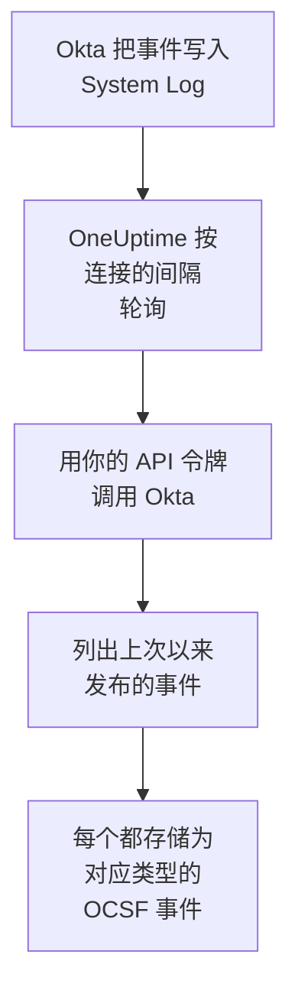

# Okta 系统日志

把 [Okta System Log](https://developer.okta.com/docs/reference/system-log-query/) 导入 OneUptime 的安全事件：登录、MFA 质询、账户和组的变更，以及 Okta 自己的威胁检测。在那里，你可以把它们与日志、跟踪和指标放在一起搜索，与其他所有来源进行关联分析，并为重要的事件呼叫值班人员。OneUptime 使用你创建的 API 令牌读取它们，不会在 Okta 中更改任何内容。

:::cards
- [设置连接](#设置连接): 一个 API 令牌，以及连接的表单。
- [导入的内容](#导入的内容): 导入哪些事件，以及每个事件如何成为一个安全事件。
- [轮询的工作方式](#轮询的工作方式): 每次轮询读取的时间窗口，以及它为何与上一个窗口重叠 15 分钟。
- [故障排除](#故障排除): 每个错误的含义，以及需要更改什么。
:::

## 工作方式



OneUptime 每分钟轮询一次已过轮询间隔的每个已启用连接。一次轮询会向 Okta 请求自上次轮询以来发布的 System Log 事件，并把每个事件存储为一个 [OCSF](https://schema.ocsf.io/) 事件：登录存储为 Authentication 事件，账户编辑存储为 Account Change，Okta 的检测存储为 Detection Finding。之后，检测规则、监视器和仪表板会像对待其他任何来源的安全事件一样对待它。它适用于每个 Okta 单元，包括 `okta.com`、`oktapreview.com` 和 `okta-emea.com`，也适用于使用自定义域名的组织。

## 开始之前

- 在 OneUptime 中拥有 Project Owner、Project Admin 或 Security Admin 角色。Security Member 和 Security Viewer 可以查看连接及其运行历史，但不能更改它们。
- 一个能查看 System Log 的 Okta 管理员，用来创建令牌。令牌能做它的管理员能做的事，所以请使用 Read-only Administrator：它读取 System Log，不更改任何内容。只读管理员也能看到用户、组、应用和设置，所以请像保管密码一样保管令牌。
- 最好为该管理员使用一个服务账户。当令牌的管理员被停用，或者令牌 30 天未被使用时，Okta 会停用该令牌。轮询每隔几分钟就会使用它，所以只要连接处于启用状态，令牌就一直在使用中。
- 如果你的组织只接受来自某个网络区域的 API 调用，就需要一个包含 OneUptime 调用来源地址的区域：在 OneUptime Cloud 上是它的出站地址，在自托管安装中是你的应用和工作进程主机的公网地址。

## 设置连接

:::steps
### 创建 API 令牌

1. 以只读管理员身份登录 Okta **Admin Console**。
2. 打开 **Security → API**，然后打开 **Tokens** 选项卡，选择 **Create token**。
3. 为它命名，例如 `OneUptime security events`。除非你的组织需要某个区域，否则请把调用来源保持为 **Any IP**。
4. 选择 **Create token**，然后复制 **Token Value**。Okta 只显示一次。

每个令牌可以使用组织 API 速率限制的一部分，令牌在 **Tokens** 选项卡中的那一行会显示这个份额。一次轮询最多发出 20 个请求，所以除非其他工具也使用同一个令牌，默认份额就绰绰有余。

### 在 OneUptime 中添加连接

打开 **产品 → Security Events → 连接**（`/dashboard/{projectId}/security-events/connections`），点击 **添加连接**，选择 **Okta System Log**，然后点击 **下一步**。填写下表中的设置，点击 **下一步**，然后把令牌粘贴到 **API token** 中。

### 保存之前先测试

点击 **保存前测试** 下的 **测试这些设置**。测试会用表单中的值登录并读取事件，不保存任何内容，所以错误的 URL 或无效的过滤器会在连接创建之前就暴露出来。然后点击 **下一步**，为连接设置一个 **名称** 并创建它。
:::

| 设置 | 填写什么 |
| --- | --- |
| **Okta organization URL** | 你的用户登录时使用的地址，例如 `https://acme.okta.com`、`https://acme.oktapreview.com` 或 `https://login.example.com`。它必须使用 `https`，且不带路径。不能使用 Admin Console 的 `-admin` 地址，因为它不提供 API。 |
| **Event filter** | 可选。一个选择要导入哪些事件的 [System Log 过滤器](https://developer.okta.com/docs/reference/core-okta-api/#filter)，例如 `eventType sw "user.session" or eventType sw "security"`。留空时导入下面的事件族。最多 2,000 个字符，写在一行中，并且不能针对 `published`：时间范围由 OneUptime 自己设置。 |
| **API token** | 令牌的值本身：OneUptime 会自己加上 `SSWS` 方案。它会被加密，API 从不返回它，也不会再次显示。要替换它，请在连接上使用 **更新凭据**。 |

**轮询** 步骤还有可选的 **描述**、**轮询间隔（分钟）**（`1` 到 `1440` 之间的整数，初始为 `5`），以及初始为开启的 **已启用**。

## 导入的内容

没有 **Event filter** 时，OneUptime 按 `eventType` 前缀导入安全团队关注的事件族。你自己的过滤器会替换这个列表，而不是在它基础上添加：

| 前缀 | 事件 |
| --- | --- |
| `user.session` | 登录和退出、访问 Admin Console、模拟用户 |
| `user.authentication` | 身份验证结果，包括单点登录 |
| `user.mfa` | 因素的注册、质询和重置 |
| `user.account` | 密码更改和重置、锁定、个人资料和权限变更 |
| `user.lifecycle` | 用户的创建、激活、暂停、停用和删除 |
| `security.` | ThreatInsight、可疑活动报告以及 Okta 的其他检测 |
| `policy.` | 登录策略评估和策略变更 |
| `system.api_token` | API 令牌的创建和吊销 |
| `application.user_membership` | 应用分配 |
| `group.user_membership` | 组成员身份变更 |

每个事件都会成为一个 OCSF 事件，供应商为 `Okta`，产品为 `Okta System Log`，类别由它的 `eventType` 决定：

| `eventType` | OCSF 类 | 活动 |
| --- | --- | --- |
| `user.session.start` | Authentication (`3002`) | `Logon` |
| `user.session.end` | Authentication (`3002`) | `Logoff` |
| `user.authentication.*` | Authentication (`3002`) | `Logon` |
| `user.mfa.*` | Authentication (`3002`) | `Authentication Ticket` |
| 其他 `user.session.*` 事件 | Authentication (`3002`) | `Other` |
| `user.account.*`, `user.lifecycle.*` | Account Change (`3001`) | 事件类型的最后一部分，例如 `Update Password` |
| `group.*` | Group Management (`3006`) | 事件类型的最后一部分，例如 `Add` |
| `security.*`，以及拒绝了访问的 `policy.evaluate_sign_on` | Detection Finding (`2004`) | `Create`，以事件类型作为规则名称 |
| 其他所有内容 | `0`，以事件类型命名 | 事件类型的最后一部分 |

不属于上述任何类的事件仍然保留每个字段，并且可以按其中任何一个字段搜索。每个事件都会填充以下列：

| Okta 字段 | OneUptime 列 |
| --- | --- |
| `uuid` | 事件 UID，也是去重所依据的值 |
| `published`，即事件发生的时间 | 事件时间 |
| `displayMessage`，否则事件类型和 `outcome.reason` | 消息 |
| `severity`：`DEBUG` 和 `INFO` 为 Informational，`WARN` 为 Medium，`ERROR` 为 High | 严重程度 |
| `outcome.result`，例如 `SUCCESS`、`FAILURE`、`ALLOW` 或 `DENY` | 状态 |
| `actor.alternateId`，否则 `actor.displayName`；`client.ipAddress` | 主体的用户和 IP |
| `target` 中 `User` 的 `alternateId` | 目标用户 |
| `target` 中 `AppInstance` 的 `alternateId` | 目标资源 |
| 操作者、每个目标以及客户端的 IP | Observable |
| 整个事件，展平为点分隔的键，例如 `client.userAgent.browser` 和 `debugContext.debugData.requestUri` | `attributes` |

`INFO` 级别的失败或被拒绝的登录会被提升为 Low，以便与成功的登录区分开。System Log 不包含 MITRE ATT&CK 引用，所以这些列保持为空。

## 轮询的工作方式

每次轮询列出在它的窗口中发布的事件，从最早的开始，每页 1,000 个，并跟随 Okta 发送的 `next` 链接，直到最后一页：

```text
GET {Okta organization URL}/api/v1/logs?since={window start}&until={window end}&sortOrder=ASCENDING&limit=1000&filter={Event filter}
```

- **发布时间就是游标。** System Log 事件就是活动本身，所以 `published` 既是活动发生的时间，也是轮询读取的值。
- **第一次轮询会回溯 24 小时**，所以新连接会立刻显示最近的事件。
- **之后的每次轮询都从保存的游标之前 15 分钟开始。** Okta 提示，带有结束时间的请求可能会遗漏延迟的事件，但它称这种情况很少见。重叠部分会在下一次轮询中读取这些事件。延迟超过 15 分钟的事件可能会落在游标后面：导入它的时间范围即可找回。
- **一次轮询最多读取游标之后 24 小时。** 游标落后的连接会通过一连串 24 小时的窗口追赶，此时它的 **健康状况** 显示为 **Catching up**。
- **重复项按 `uuid` 去重**，范围是整个项目，所以重叠部分、重试的窗口和导入都不会把同一个事件存储两次。

由于令牌会随每个请求一起发送，指向你的 **Okta organization URL** 之外任何地方的 `next` 链接都不会被跟随。

### 当一个窗口包含的内容超过一次轮询能读取的量时

一次轮询最多用 20 个请求读取最多 10,000 个事件。当窗口中的事件更多时，这次运行为 **部分**，并带有如下警告：

```text
Stopped after collecting 10000 events; the window holds more. The last event read was published at 2026-09-14T08:12:44.000Z.
```

事件从最早的开始读取，所以 OneUptime 会把游标移到它读取的最后一个事件的发布时间，下一次轮询就从那里开始，不带 15 分钟的重叠，窗口长度不变。繁忙的组织每次轮询追赶 10,000 个事件，而不是重复读取同样的内容。当游标越过那个点 15 分钟之后，重叠会恢复。

当一次运行完全无法越过保存的游标时，例如仅 15 分钟的重叠部分就包含超过 10,000 个事件，OneUptime 会改为缩短窗口：

1. **缩小。** 下一次轮询从同一个起点读取长度减半的窗口，并不断减半，直到某个窗口能被完整读取，最短为一分钟。运行的警告会说明这一点：`This window holds more records than one poll can read; the next poll reads a {n} minute window from the same starting point.`
2. **恢复。** 一个窗口被完整读取后，下一个窗口的长度会再次加倍，最长为 24 小时。
3. **越过单独的一分钟。** 如果连一分钟内的内容都超过一次轮询能读取的量，轮询会越过这一分钟，让更新的事件继续到达，之后轮询的重叠部分也不会再回到这一分钟。这次运行仍为 **部分**，**最近错误** 显示 `More records were created in the one minute from {cursor} to {end} than one poll can read. Polling moved past this minute so newer records keep arriving; use Import this time range in Diagnostics on this minute to recover what one run can read.` 用 **Import this time range** 导入这一分钟，就能找回一次运行能读取的内容，或者缩小 **Event filter** 的范围。

因 Okta 的错误而彻底失败的运行，会保留游标和窗口长度，下一次轮询会再次读取同一个窗口。唯一的例外是请求超时：游标保持不变，但下一个窗口的长度减半，因为重到无法及时得到响应的窗口每次尝试都会超时。更改 **轮询间隔（分钟）** 不会改变这些：它决定的是轮询多久开始一次，而不是窗口从哪里开始。

### 按需运行、预览和导入

在连接上点击 **诊断**，可以查看它最近的运行，并手动操作它。能更改该连接的人都可以启动这些操作；能查看它的人都可以阅读历史记录。

- **立即运行** 会立即开始一次轮询，使用通常的游标，即使连接未处于 **已启用** 状态也可以。
- **Preview log events** 读取最长 7 天的时间范围，不导入任何内容。
- **Import this time range** 在你确认后导入最长 7 天的范围，不会移动游标。已导入的事件会被跳过。Okta 会保留 90 天的 System Log。
- 运行上的 **Copy diagnostics** 会复制它的报告以便提供给支持人员。报告从不包含凭据。

## 测试连接

连接所在行中的 **测试连接** 和表单中的 **测试这些设置** 在 API 进程中运行，而不是在后台工作进程中运行，所以即使工作进程出了问题，测试仍然会给出结果。它按顺序运行以下检查：

| 检查 | 检查的内容 |
| --- | --- |
| **配置** | 每项设置都存在且格式正确。此项失败时不会连接任何地方。 |
| **Authenticate with Okta** | Okta 接受用于 System Log 的令牌，读取一个事件且不带过滤器。 |
| **Read System Log events** | 能通过轮询使用的过滤器（你自己的或默认的）读取过去 24 小时内的一个事件，所以无效的 **Event filter** 会在这里失败，而不是在第一次轮询时失败。 |
| **Events available to import** | 过去 24 小时和过去 7 天内发布了多少个事件，各统计一页（1,000 个），所以 `1000+` 表示更多。7 天内一个都没有是警告，而不是失败。 |
| **Background workers**、**Poll scheduler**、**Security event storage** | OneUptime 自身的一侧：有进程在处理 Worker 队列的作业，轮询作业每分钟运行一次，安全事件存储能够响应。 |
| **Scheduled polling** | 针对已保存的连接：轮询已开启，没有运行卡在等待工作进程的状态，并且轮询按时运行。 |

测试中的每个请求都有 20 秒的期限。测试从不导入任何内容，也不移动游标，每个失败的检查都会说明需要更改什么。

## 故障排除

连接的 **最近错误** 会保留完整的错误消息（凭据已隐去），前面带有一个指明失败步骤的前缀。连接出错时，在它的 **操作** 列中选择 **查看错误** 来阅读，并在对话框中用 **复制错误** 复制。每条消息都以 `Okta System Log events request` 开头，并在状态之后引用 Okta 自己的错误代码；请阅读后面的内容。

:::details Last Error 显示 `failed (HTTP 400)`
Okta 拒绝了请求的参数（`E0000053`）。如果令牌有效，问题几乎总是出在 **Event filter** 上：请检查它的运算符（`eq`、`ne`、`co`、`sw`、`ew`、`pr`、`gt`、`ge`、`lt` 和 `le`）、它的 `and` 和 `or`，以及值两边的双引号，或者清空它以使用默认事件族。对于导入，这也可能表示范围的开始时间早于 180 天前。
:::

:::details Last Error 显示 `failed (HTTP 401)` 或 `failed (HTTP 403)`
- `HTTP 401`：Okta 没有接受令牌（`E0000011`）。它已被吊销、30 天未被使用，或随它的管理员一起被停用；或者粘贴时带上了 `SSWS` 或多余的字符。请以只读管理员身份创建一个新令牌，并用 **更新凭据** 保存。
- `HTTP 403`：令牌能登录，但它的管理员无法读取 System Log（`E0000006`）。请以 Read-only Administrator 或 Super Administrator 身份创建令牌，并检查它的网络区域是否允许 OneUptime 调用来源的地址。
:::

:::details Last Error 显示 `failed (HTTP ...)` 和其他状态
- `HTTP 404`：该 URL 不提供 Okta 的 API。请使用组织自己的地址，例如 `https://acme.okta.com`，不带路径，也不要使用 `-admin` 地址。
- `HTTP 3xx`：Okta 重定向了请求，而由于令牌会随每个请求一起发送，重定向会被拒绝。请使用组织自己的地址。
- `HTTP 429`：Okta 正在限制该令牌（`E0000047`）。下一次轮询会重试。如果这种情况持续发生，请在 **Tokens** 选项卡中提高该令牌的速率限制份额，给 OneUptime 一个专用令牌，或者降低轮询频率。
- `HTTP 5xx`：Okta 出现故障，或者查询超过了 Okta 30 秒的限制（`E0000009`）。下一次轮询会重试；如果这种情况持续发生，请查看 [status.okta.com](https://status.okta.com)。
:::

:::details Last Error 显示 `returned` 或 `did not complete`
- `returned a non-JSON body.` 或 `returned an unrecognized response shape`：响应的不是 Okta 的 API，而是其他东西，例如登录页面或代理，或者 Okta 返回了错误。这会被报告出来，而不是当作空窗口处理，所以游标永远不会越过没人读过的事件。
- `returned a next link outside the Okta organization URL`：某个 `next` 链接指向了别处，因此没有被跟随。Okta 自己从不这样做：请查找改写标头的代理。
- `did not complete`：请求没有得到响应：超时、无法解析的名称、OneUptime 不信任的证书，或者被拒绝的地址。请检查 OneUptime 应用和工作进程能否通过 HTTPS（经由你使用的任何代理）访问你的组织。
:::

:::details Last Polled 为 Never 且 Last Error 为空
这个连接还没有完成过任何轮询。运行 **测试连接**：它的 **Background workers** 和 **Poll scheduler** 检查会指出原因。在自托管安装中，常见原因是应用上设置了 `DISABLE_QUEUE_WORKERS=true`，却没有单独的工作进程部署来处理作业：把它设为 `false`，或运行工作进程部署（Helm：`worker.enabled: true`）。
:::

:::details 运行为 Partial
- `Stopped after collecting 10000 events`：窗口中的事件超过了一次运行能读取的 10,000 个。不会丢失任何内容：下一次轮询会从读取的最后一个事件之后开始。一次又一次轮询都保持 **部分** 的连接正在追赶积压的内容，它的 **最近轮询** 和 **最近导入的事件** 会不断前进。如果它始终追不上，说明该组织发布的匹配事件多到一个轮询间隔装不下：请缩小 **Event filter** 的范围，或者缩短 **轮询间隔（分钟）**。
- `More records were created in the one minute from ... than one poll can read`：轮询越过了这一分钟。请在 **诊断** 中用 **Import this time range** 导入它。一次导入读取的量与一次轮询相同。
:::

:::details 测试通过，但没有导入任何内容
阅读测试报告中的 **Events available to import**。使用默认过滤器时，有用户的组织会一直发布登录事件，所以过去 7 天为 `0` 表示该 URL 是一个沙盒或未使用的组织。使用你自己的 **Event filter** 时，这表示过滤器什么都没匹配到：请与 Admin Console 的 System Log 中的事件类型进行比较。
:::

## 你会得到什么

- **搜索。** 在安全事件资源管理器中，与其他所有来源放在一起，按严重程度、状态、用户、IP 或任何 observable 过滤登录、MFA 结果、账户变更和 Okta 检测。
- **关联分析。** 每个事件的用户、应用和 IP 都会作为 observable 建立索引，所以一次搜索就能找到某个用户做过的所有事，并与其应用自己的日志放在一起。
- **检测规则。** 按计划对你的安全事件运行的 Sigma 规则，例如按 IP 统计的登录失败或按用户统计的 MFA 拒绝，会打开呼叫值班人员的警报。
- **监视器。** 安全事件监视器统计匹配的事件，并在超过阈值时打开事件或警报。

安全事件与其他遥测数据一样，按摄取的 GB 数计费。请参阅 [定价](https://oneuptime.com/pricing)。

## 后续步骤

:::cards
- [安全事件](/docs/telemetry/security-events): 搜索、关联分析你导入的内容，并据此发出警报。
- [AWS Security Hub](/docs/integrations/aws-security-hub): 同时导入你的云的发现结果。
- [角色](/docs/permissions/reference#角色): Security 角色可以查看和更改的内容。
- [集成概述](/docs/integrations/index): 你可以连接的其他工具。
:::
