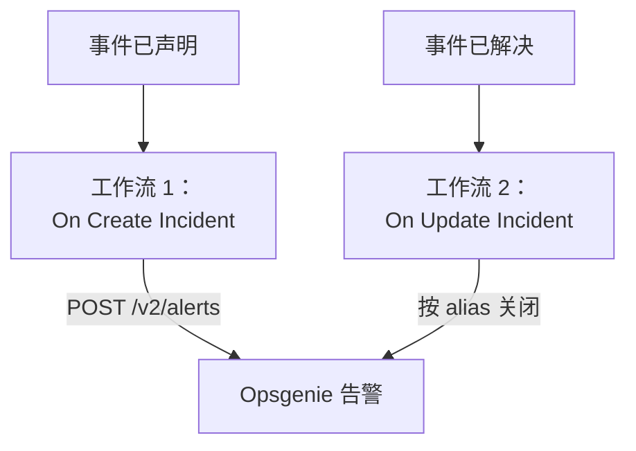

# Opsgenie

把 OneUptime 事件发送到 [Opsgenie](https://www.atlassian.com/software/opsgenie)。声明 OneUptime 事件时，一个工作流创建 Opsgenie 告警；OneUptime 事件被解决时，第二个工作流关闭它。在 Opsgenie 仍负责呼叫你的团队、OneUptime 负责监控你的系统期间，请使用这种方式。

:::cards
- [保存 API 密钥](#保存-api-密钥): 让 Opsgenie 的密钥不出现在工作流中。
- [创建 Opsgenie 告警](#为每个事件创建-opsgenie-告警): 一个工作流，两个块。
- [关闭它们](#关闭-opsgenie-告警): 第二个工作流，跟随事件的状态。
- [故障排除](#故障排除): Opsgenie 拒绝请求时。
:::

> [!IMPORTANT]
> Atlassian 已于 2025 年 6 月停止销售 Opsgenie，并将于 2027 年 4 月结束支持。OneUptime 也能通过值班策略、排班和升级规则呼叫人员。要把团队迁移过来，请参见 [从 Opsgenie 迁移](/docs/moving-to-oneuptime/opsgenie)：导入功能可以迁移你的用户、团队、排班和升级规则。

## 工作方式



两个工作流都调用 [Opsgenie Alert API](https://docs.opsgenie.com/docs/alert-api)。第一个工作流为告警设置一个由 OneUptime 事件 ID 生成的 `alias`，第二个工作流按这个 alias 关闭告警。

## 开始之前

- 一个 Opsgenie **API** 集成及其 **API Key**。在 Opsgenie 的 **Settings → Integrations** 下添加；如果要把告警发送给某个团队，则在该团队的 **Integrations** 下添加。
- 你的 Opsgenie 区域。在 `app.eu.opsgenie.com` 登录的欧洲账户使用 `api.eu.opsgenie.com`，其他所有账户使用 `api.opsgenie.com`。
- 在 OneUptime 中创建工作流和全局变量的权限。在 OneUptime Cloud 上，工作流需要 **Growth** 或更高的套餐。

## 保存 API 密钥

:::steps
1. 前往 **工作流 → 全局变量**，点击 **创建工作流 变量**。
2. 将其命名为 `OPSGENIE_KEY`，然后点击 **下一步**。
3. 把 API 密钥粘贴到 **内容** 中，打开 **密钥**，然后点击 **创建工作流 变量**。
:::

密钥变量在运行日志中会被替换为 `[REDACTED]`，因此密钥永远不会出现在运行中。

## 为每个事件创建 Opsgenie 告警

:::steps
### 创建工作流

前往 **工作流**，点击 **创建工作流**，然后点击 **从零开始**。将其命名为 `Incidents to Opsgenie`，然后点击 **创建工作流**。

### 添加触发器

点击虚线的 **选择启动此工作流的方式** 块，选择 **On Create Incident**。点击该触发器：它的 **Fields to pass on** 已经包含 **标题**，所以点击 **添加字段** 并选择 **描述**。

### 创建告警

点击 **添加组件**，添加一个 **API Post (JSON)** 块，并把触发器的 **Success** 点连接到它。把它的 **URL** 设为 `https://api.opsgenie.com/v2/alerts`，在欧洲则设为 `https://api.eu.opsgenie.com/v2/alerts`。在 **更多字段** 下，把 **Request Headers** 设为：

```json
{ "Authorization": "GenieKey {{global.variables.OPSGENIE_KEY}}" }
```

把 **Request Body** 设为：

```json
{
  "message": "{{local.components.incident-on-create-1.returnValues.model.title}}",
  "alias": "oneuptime-{{local.components.incident-on-create-1.returnValues.model._id}}",
  "description": "{{local.components.incident-on-create-1.returnValues.model.description}}",
  "priority": "P1",
  "source": "OneUptime"
}
```

### 测试，然后启用

点击 **运行工作流**，在 **事件** 中选择一个测试事件，然后运行。**API Post (JSON)** 步骤会显示 `202` 响应，片刻之后告警会出现在 Opsgenie 中。然后在 **生成器** 顶部打开 **已启用**。
:::

Opsgenie 的认证方式是单词 `GenieKey`、一个空格，然后是密钥。Opsgenie 把 `message` 限制为 130 个字符，它的优先级从 `P1` 到 `P5`：要发送每个事件自己的优先级，请参见 [映射优先级](#映射优先级)。

## 关闭 Opsgenie 告警

一个工作流只有一个触发器，因此关闭需要第二个工作流，在事件状态变化时启动。

:::steps
### 添加 On Update Incident 触发器

创建一个名为 `Close Opsgenie alerts` 的工作流，选择 **On Update Incident** 作为触发器。在 **Fields to watch** 中点击 **添加字段** 并选择 **Current Incident State**，使它只在状态变化时运行。在 **Fields to pass on** 中请求新状态是否为已解决状态：点击 **添加字段**，展开 **Current Incident State** 并选择 **Is Resolved State**。也可以点击 **以 JSON 编辑**，把 JSON 替换为：

```json
{ "_id": true, "currentIncidentState": { "isResolvedState": true } }
```

### 检查事件是否已解决

在触发器之后添加一个 **If / Else** 块。把 **Value to check** 设为 `{{local.components.incident-on-update-1.returnValues.model.currentIncidentState.isResolvedState}}`，**Comparison** 设为 **is true**。

### 关闭告警

在 **Yes** 一侧之后添加一个 **API Post (JSON)** 块，使用相同的 **Request Headers** 和以下 **URL**：

```text
https://api.opsgenie.com/v2/alerts/oneuptime-{{local.components.incident-on-update-1.returnValues.model._id}}/close?identifierType=alias
```

把它的 **Request Body** 设为 `{ "source": "OneUptime", "note": "Resolved in OneUptime" }`。

### 启用

打开 **已启用**，然后在 OneUptime 中解决一个测试事件。Opsgenie 会关闭它的告警。
:::

`identifierType=alias` 告诉 Opsgenie，地址是按 alias 而不是按告警自己的 ID 来指定告警的。

## 映射优先级

要把每个事件的严重程度作为 Opsgenie 优先级发送，请在触发器和 **API Post (JSON)** 块之间添加一个 **Run Custom JavaScript** 块。

1. 在触发器的 **Fields to pass on** 中点击 **添加字段**，展开 **事件严重性** 并选择 **名称**。
2. 把该块的 **Arguments** 设为 `{ "severity": "{{local.components.incident-on-create-1.returnValues.model.incidentSeverity.name}}" }`，**JavaScript Code** 设为：

   ```javascript
   // Your incident severities, by name, to Opsgenie's priorities.
   const PRIORITY = {
     "Critical Incident": "P1",
     "Major Incident": "P2",
     "Minor Incident": "P3",
   };

   return { priority: PRIORITY[args.severity] || "P3" };
   ```

3. 在请求主体中，把 `"priority"` 设为 `"{{local.components.javascript-1.returnValues.returnValue.priority}}"`。

上面的名称是新项目初始的三种严重程度。如果你重命名过它们，请使用你自己的名称。

## 故障排除

:::details Opsgenie 返回 401 或 403
密钥错误，或者属于另一个区域。请检查请求头是 `GenieKey`、一个空格和密钥，检查密钥属于 **API** 集成，并检查主机与你的区域一致：`api.opsgenie.com` 或 `api.eu.opsgenie.com`。
:::

:::details 关闭时返回 404
没有带该 alias 的告警。两个工作流必须以相同的方式生成 alias，即 `oneuptime-` 加事件的 `_id`，并且 URL 必须以 `?identifierType=alias` 结尾。
:::

:::details 步骤显示 202，但告警从未出现
Opsgenie 在处理请求之前就回应 `202`，因此之后被拒绝的请求仍然显示 `202`。请在 Opsgenie 的日志中查找该请求，了解它被拒绝的原因，例如集成已被关闭。
:::

:::details 工作流从未运行
检查它是否已启用：它的 **生成器** 顶部的 **已启用**。然后打开 **日志 → 运行记录**：走了 **If / Else** 块 **No** 一侧的运行，是一次不是解决的更新。
:::

## 后续步骤

:::cards
- [从 Opsgenie 迁移](/docs/moving-to-oneuptime/opsgenie): 在 Opsgenie 停止服务之前，把你的团队、排班和升级规则迁移过来。
- [升级规则](/docs/on-call/escalation-rules): 直接从 OneUptime 呼叫人员。
- [PagerDuty](/docs/integrations/pagerduty): 适用于 PagerDuty 的同样两个工作流。
- [集成概述](/docs/integrations/index): 每个集成背后的模式。
:::
