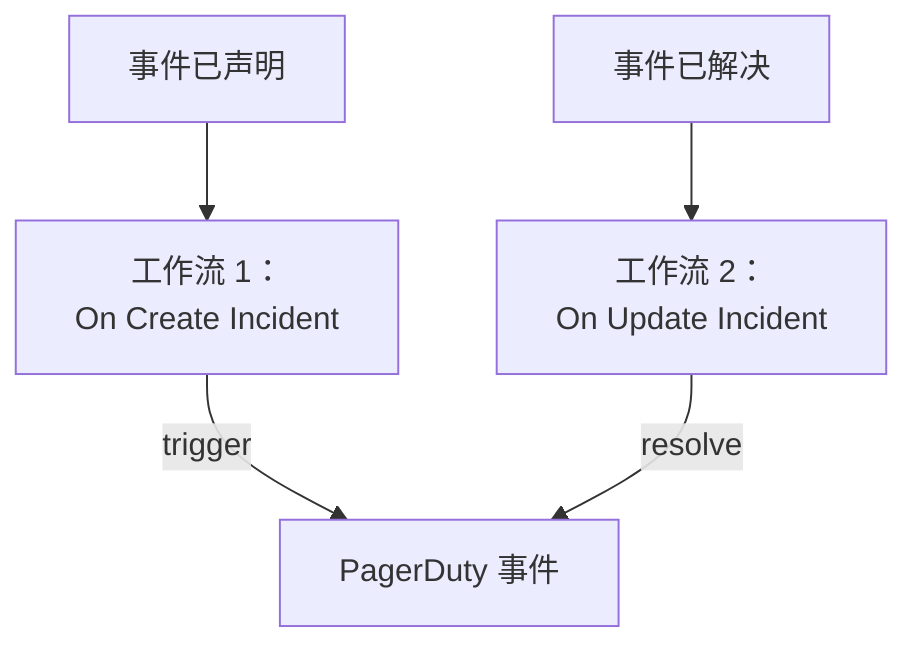

# PagerDuty

把 OneUptime 事件发送到 [PagerDuty](https://www.pagerduty.com)。声明 OneUptime 事件时，一个工作流触发 PagerDuty 事件；OneUptime 事件被解决时，第二个工作流解决它。当 PagerDuty 负责呼叫你的团队、OneUptime 负责监控你的系统时，请使用这种方式。

:::cards
- [保存路由密钥](#保存路由密钥): 让 PagerDuty 的密钥不出现在工作流中。
- [触发 PagerDuty 事件](#为每个事件触发-pagerduty-事件): 一个工作流，两个块。
- [解决它们](#解决-pagerduty-事件): 第二个工作流，跟随事件的状态。
- [故障排除](#故障排除): PagerDuty 拒绝某个事件时。
:::

> [!TIP]
> OneUptime 也能通过值班策略、排班和升级规则呼叫人员。要把团队从 PagerDuty 迁移过来，请参见 [从 PagerDuty 迁移](/docs/moving-to-oneuptime/pagerduty)：导入功能可以迁移你的用户、排班和升级策略。

## 工作方式



两个工作流都使用相同的 `dedup_key` 调用 PagerDuty 的 [Events API v2](https://developer.pagerduty.com/docs/events-api-v2/overview/)，该键由 OneUptime 事件的 ID 生成。PagerDuty 正是靠这个键知道 resolve 事件要关闭的是 trigger 事件打开的那个事件。

## 开始之前

- 一个带有 Events API v2 集成的 PagerDuty 服务。在 PagerDuty 中打开该服务，然后打开 **Integrations**，点击 **Add an integration** 并选择 **Events API V2**。复制它的 **Integration Key**：Events API 把它称为路由密钥（routing key）。
- 在 OneUptime 中创建工作流和全局变量的权限。在 OneUptime Cloud 上，工作流需要 **Growth** 或更高的套餐。

## 保存路由密钥

:::steps
1. 前往 **工作流 → 全局变量**，点击 **创建工作流 变量**。
2. 将其命名为 `PAGERDUTY_ROUTING_KEY`，然后点击 **下一步**。
3. 把集成密钥粘贴到 **内容** 中，打开 **密钥**，然后点击 **创建工作流 变量**。
:::

密钥变量在运行日志中会被替换为 `[REDACTED]`，因此密钥永远不会出现在运行中。

## 为每个事件触发 PagerDuty 事件

:::steps
### 创建工作流

前往 **工作流**，点击 **创建工作流**，然后点击 **从零开始**。将其命名为 `Incidents to PagerDuty`，然后点击 **创建工作流**。

### 添加触发器

点击虚线的 **选择启动此工作流的方式** 块，选择 **On Create Incident**。点击该触发器：它的 **Fields to pass on** 已经包含 **标题**，所以点击 **添加字段** 并选择 **描述**。

### 发送 trigger 事件

点击 **添加组件**，添加一个 **API Post (JSON)** 块，并把触发器的 **Success** 点连接到它。把它的 **URL** 设为 `https://events.pagerduty.com/v2/enqueue`，**Request Body** 设为：

```json
{
  "routing_key": "{{global.variables.PAGERDUTY_ROUTING_KEY}}",
  "event_action": "trigger",
  "dedup_key": "oneuptime-{{local.components.incident-on-create-1.returnValues.model._id}}",
  "payload": {
    "summary": "{{local.components.incident-on-create-1.returnValues.model.title}}",
    "source": "OneUptime",
    "severity": "critical",
    "custom_details": {
      "description": "{{local.components.incident-on-create-1.returnValues.model.description}}"
    }
  }
}
```

### 测试，然后启用

点击 **运行工作流**，在 **事件** 中选择一个测试事件，然后运行。**API Post (JSON)** 步骤会显示带有 `"status": "success"` 的 `202` 响应，PagerDuty 会创建一个事件。然后在 **生成器** 顶部打开 **已启用**。
:::

该块发送的是 JSON，因此不需要 `Content-Type` 请求头。PagerDuty 的 `severity` 是 `critical`、`error`、`warning` 和 `info` 之一：要发送每个事件自己的严重程度，请参见 [映射严重程度](#映射严重程度)。

## 解决 PagerDuty 事件

一个工作流只有一个触发器，因此解决需要第二个工作流，在事件状态变化时启动。

:::steps
### 添加 On Update Incident 触发器

创建一个名为 `Resolve PagerDuty incidents` 的工作流，选择 **On Update Incident** 作为触发器。在 **Fields to watch** 中点击 **添加字段** 并选择 **Current Incident State**，使它只在状态变化时运行。在 **Fields to pass on** 中请求新状态是否为已解决状态：点击 **添加字段**，展开 **Current Incident State** 并选择 **Is Resolved State**。也可以点击 **以 JSON 编辑**，把 JSON 替换为：

```json
{ "_id": true, "currentIncidentState": { "isResolvedState": true } }
```

### 检查事件是否已解决

在触发器之后添加一个 **If / Else** 块。把 **Value to check** 设为 `{{local.components.incident-on-update-1.returnValues.model.currentIncidentState.isResolvedState}}`，**Comparison** 设为 **is true**。

### 发送 resolve 事件

在 **Yes** 一侧之后添加一个 **API Post (JSON)** 块，使用相同的 **URL** 和以下 **Request Body**：

```json
{
  "routing_key": "{{global.variables.PAGERDUTY_ROUTING_KEY}}",
  "event_action": "resolve",
  "dedup_key": "oneuptime-{{local.components.incident-on-update-1.returnValues.model._id}}"
}
```

### 启用

打开 **已启用**，然后在 OneUptime 中解决一个测试事件。PagerDuty 会解决它的事件。
:::

检查 `isResolvedState` 而不是状态名称，这样即使你重命名了状态也能继续工作。参见 [事件状态与严重级别](/docs/incidents/states-and-severities)。

## 映射严重程度

要发送每个事件的严重程度，请在触发器和 **API Post (JSON)** 块之间添加一个 **Run Custom JavaScript** 块，并在请求主体中读取它的结果。

1. 在触发器的 **Fields to pass on** 中点击 **添加字段**，展开 **事件严重性** 并选择 **名称**。
2. 把该块的 **Arguments** 设为 `{ "severity": "{{local.components.incident-on-create-1.returnValues.model.incidentSeverity.name}}" }`，**JavaScript Code** 设为：

   ```javascript
   // Your incident severities, by name, to PagerDuty's.
   const SEVERITY = {
     "Critical Incident": "critical",
     "Major Incident": "error",
     "Minor Incident": "warning",
   };

   return { severity: SEVERITY[args.severity] || "info" };
   ```

3. 在请求主体中，把 `"severity"` 设为 `"{{local.components.javascript-1.returnValues.returnValue.severity}}"`。

上面的名称是新项目初始的三种严重程度。如果你重命名过它们，请使用你自己的名称。

## 故障排除

:::details PagerDuty 返回 400
响应主体会说明 PagerDuty 拒绝了什么，运行的 **API Post (JSON)** 步骤中可以看到它。通常是路由密钥不是 Events API v2 集成密钥：请从服务的 **Integrations** 中重新复制。缺少 `summary`、`source` 或 `severity` 的事件也会被拒绝。
:::

:::details resolve 事件没有关闭任何东西
两个事件必须带有完全相同的 `dedup_key`。请检查两个请求主体都以 `oneuptime-` 加事件的 `_id` 的方式生成它，并检查解决工作流已启用。
:::

:::details 工作流从未运行
检查它是否已启用：它的 **生成器** 顶部的 **已启用**。然后打开 **日志 → 运行记录**：走了 **If / Else** 块 **No** 一侧的运行，是一次不是解决的更新。
:::

:::details PagerDuty 显示的是引用而不是值
无法解析的引用会连同花括号按原样发送。请检查块的标识符、字段名，以及区分大小写的变量名。在运行的 **步骤** 选项卡上，带有这种引用的设置会被标记为 **Did not resolve**。
:::

## 后续步骤

:::cards
- [从 PagerDuty 迁移](/docs/moving-to-oneuptime/pagerduty): 把你的团队、排班和升级策略迁移过来。
- [升级规则](/docs/on-call/escalation-rules): 直接从 OneUptime 呼叫人员。
- [Opsgenie](/docs/integrations/opsgenie): 适用于 Opsgenie 的同样两个工作流。
- [集成概述](/docs/integrations/index): 每个集成背后的模式。
:::
