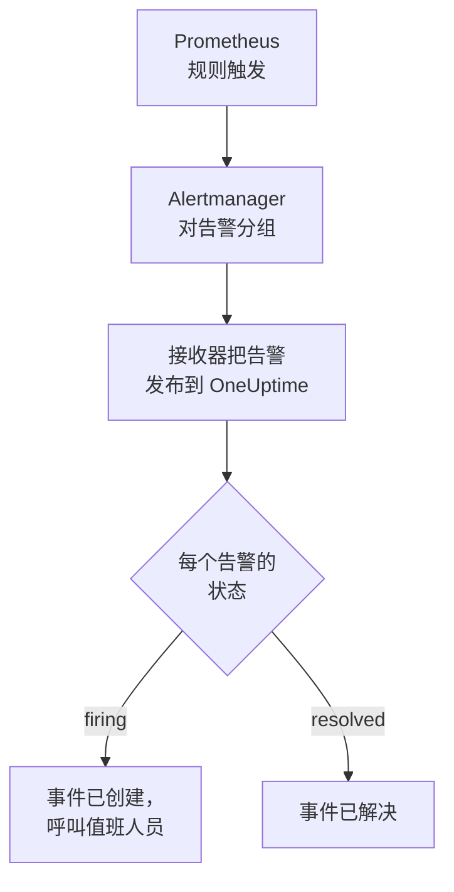

# Prometheus Alertmanager

把 [Prometheus Alertmanager](https://prometheus.io/docs/alerting/latest/alertmanager/) 告警发送到 OneUptime，让每个触发的告警都成为一个呼叫值班团队的事件，并在告警恢复时解决。Alertmanager 把通知发布到 Webhook 接收器，因此两边都无需安装任何东西。

:::cards
- [选择 OneUptime 接收告警的方式](#选择-oneuptime-接收告警的方式): Incoming Request 监视器，或你自己的工作流。
- [用监视器接收告警](#用监视器接收告警): 每个告警一个事件，恢复时自动解决。
- [配置 Alertmanager](#配置-alertmanager): 一个 Webhook 接收器，以及使用它的路由。
- [故障排除](#故障排除): 告警没有到达，或事件一直未关闭时。
:::

## 工作方式



Prometheus 评估你的告警规则，并把触发的告警发送给 Alertmanager。Alertmanager 按路由 `group_by` 中的标签对告警分组，并把每个组作为一个 JSON 通知发布到 Webhook 接收器。通知的 `alerts` 列表包含该组的每个告警，每个告警都有自己的 `status`（`firing` 或 `resolved`）、标签和注解，以及标识它的 `fingerprint`。

## 开始之前

- 一个你可以编辑其 `alertmanager.yml`，并且能够通过 HTTPS 访问你的 OneUptime 的 Alertmanager。
- 在 OneUptime 中创建监视器的权限；如果选择工作流方式，则需要创建工作流的权限。

## 选择 OneUptime 接收告警的方式

先设置 OneUptime：它会给你 Alertmanager 要发送到的 URL。

| 方式 | 适用情况 |
| --- | --- |
| Incoming Request 监视器（推荐） | 你希望每个告警都成为一个呼叫值班人员的事件，并在告警恢复时解决。无需构建任何东西。 |
| 带 Webhook 触发器的工作流 | 你需要自己的逻辑：先过滤告警、转换格式或调用其他系统。工作流为每个通知（而不是每个告警）打开一个事件，并且不会在恢复时解决它。 |

两者从同一个接收器收到相同的 JSON，所以你可以先用其中一种，之后只需修改 `alertmanager.yml` 中的一个 URL 就能切换。

## 用监视器接收告警

[Incoming Request 监视器](/docs/monitor/incoming-request-monitor) 会给你一个 URL，它的条件决定每个通知做什么。

:::steps
### 创建监视器

前往 **监视器**，点击 **创建监视器**。在 **监视器类型** 下选择 **Incoming Request**，将其命名为 `Alertmanager`，然后点击 **下一步**。

### 为每个触发的告警声明事件

在 **标准** 步骤中，打开第一个条件，也就是把监视器标记为离线的那个。把它的过滤器设为 **请求主体**、**包含**、`"status":"firing"`。这个条件在过滤器匹配时已经会声明事件。填写事件信息：

- **事件标题**：`{{requestBody.commonLabels.alertname}} on {{requestBody.commonLabels.instance}}`。
- **严重程度**：这些告警应有的事件严重程度。
- **值班** 下的 **值班策略**：要呼叫的策略。
- **更多字段** 下的 **自动解决事件**：保持开启，它默认就是开启的。关闭后会忽略恢复，事件将一直保持打开。

### 每个告警一个事件

在同一个条件中，打开 **设置** 并开启 **Group incidents and alerts by a payload field**。按下表填写，让每个告警都有自己的事件，并由它的恢复来解决：

| 字段 | 值 |
| --- | --- |
| **Open a separate incident for each…** | `requestBody.alerts[*].fingerprint` |
| **Field that signals recovery** | `requestBody.alerts[*].status` |
| **Value that means recovered** | `resolved` |

### 让监视器恢复在线

打开第二个条件，也就是把监视器标记为在线的那个，把它的过滤器设为 **请求主体**、**包含**、`"status":"resolved"`。

### 复制 URL

点击 **创建监视器**。监视器的 **概览** 页面会显示它的 **Heartbeat URL**。复制它供 Alertmanager 使用：

```text
https://oneuptime.com/heartbeat/<secret key>
```

自托管安装使用自己的主机来代替 `oneuptime.com`。
:::

`[*]` 会读取通知中的每个告警，因此包含三个告警的通知可以打开三个事件，数量最多为 **Max incidents per request**（不修改则为 `100`）。每个告警自己的 `status` 决定它的事件如何处理：当通知中的一个告警已解决、另外两个仍在触发时，只有已解决告警的事件会被关闭。每项设置的作用请参见 [接收来自其他系统的告警](/docs/monitor/incoming-request-monitor#接收来自其他系统的告警)。

> [!WARNING]
> 请按同一个通知内各告警之间互不相同的值分组。Alertmanager 的 `fingerprint` 是告警整个标签集的哈希，所以总是不同。路由 `group_by` 中的标签则永远相同：正是它们把告警放进了同一个通知。在下面的路由中按 `requestBody.alerts[*].labels.alertname` 分组，会把通知中的所有告警合并成一个事件，而该事件会跟随第一个告警的状态。

## 为事件命名

上面的标题读取通知中所有告警共有的标签：`commonLabels` 包含这些标签，`commonAnnotations` 包含它们共有的注解。下面的路由按 `alertname` 和 `instance` 分组，因此两者都有。在 **描述** 下，为事件设置一个 **事件描述**，例如：

```text
{{requestBody.commonAnnotations.summary}}

{{requestBody.commonAnnotations.description}}
Severity: {{requestBody.commonLabels.severity}}
Alertmanager: {{requestBody.externalURL}}
```

- 分组键也是一个变量，以其路径的最后一段命名：`{{fingerprint}}`。它是一个哈希，所以对响应者毫无意义。
- `{{requestBody.alerts[0].annotations.summary}}` 读取通知中的第一个告警，而它并不总是打开该事件的那个告警。
- 引用通知中不存在的字段时，该引用会连同花括号按原样保留，而不会被清空。

可以使用的所有变量请参见 [事件与告警模板](/docs/monitor/incident-alert-templating)。

## 配置 Alertmanager

:::steps
### 添加 Webhook 接收器

在 `alertmanager.yml` 中添加一个发布到你复制的 URL 的接收器，并把它设为路由的接收器：

```yaml title="alertmanager.yml"
route:
  receiver: oneuptime
  group_by: ["alertname", "instance"]

receivers:
  - name: oneuptime
    webhook_configs:
      - url: "https://oneuptime.com/heartbeat/<secret key>"
        send_resolved: true
```

`send_resolved: true` 是 Alertmanager 的默认值，写出来是为了让它保持开启：没有它，OneUptime 永远不会得知告警已恢复。Alertmanager 发送 `Content-Type: application/json`，监视器需要它才能读取通知中的字段。

### 重新加载 Alertmanager

重新加载配置，或重启 Alertmanager：

```bash
curl -X POST http://localhost:9093/-/reload
```
:::

该路由保留 Alertmanager 的默认时间设置。它在发送新组之前等待 `30s`（`group_wait`），在发送带有新告警的组之前等待 `5m`（`group_interval`），在重复未变化的通知之前等待 `4h`（`repeat_interval`）。

## 测试

像 Alertmanager 那样，向 OneUptime 发送一个包含两个触发告警的通知：

```bash
curl -X POST "https://oneuptime.com/heartbeat/<secret key>" \
  -H "Content-Type: application/json" \
  -d '{
    "version": "4",
    "status": "firing",
    "receiver": "oneuptime",
    "groupLabels": { "alertname": "DiskFull", "instance": "web-1" },
    "commonLabels": { "alertname": "DiskFull", "instance": "web-1", "severity": "critical" },
    "commonAnnotations": { "summary": "Disk almost full on web-1" },
    "externalURL": "http://alertmanager:9093",
    "alerts": [
      {
        "status": "firing",
        "labels": { "alertname": "DiskFull", "instance": "web-1", "severity": "critical", "device": "/dev/sda1" },
        "fingerprint": "a1b2c3d4e5f60001"
      },
      {
        "status": "firing",
        "labels": { "alertname": "DiskFull", "instance": "web-1", "severity": "critical", "device": "/dev/sdb1" },
        "fingerprint": "a1b2c3d4e5f60002"
      }
    ]
  }'
```

会打开两个事件，每个 `fingerprint` 一个，标题都是 `DiskFull on web-1`。把每个 `status` 都设为 `resolved` 后发送同样的请求，两个事件都会被解决。

要测试从 Alertmanager 开始的完整路径，请用 `amtool` 触发一个告警。Alertmanager 会在 `group_wait` 之后发送它，并在几分钟后告警过期时发送它的恢复：

```bash
amtool alert add test_alert severity=warning \
  --annotation=summary="Test from Alertmanager" \
  --alertmanager.url=http://localhost:9093
```

## 用工作流接收告警

当你需要在 Alertmanager 和事件之间加入自己的步骤时，请使用 [工作流](/docs/workflows/index)。

:::steps
### 创建工作流

前往 **工作流**，点击 **创建工作流**，然后点击 **从零开始**。将其命名为 `Alertmanager alerts`，然后点击 **创建工作流**。

### 添加 Webhook 触发器

点击虚线的 **选择启动此工作流的方式** 块并选择 **Webhook**。点击该触发器，然后点击 **复制 URL**，把该 URL 用在 `alertmanager.yml` 的接收器中。

### 检查通知是否为触发状态

点击 **添加组件**，添加一个 **If / Else** 块，并把触发器的 **Out** 点连接到它。把 **Value to check** 设为 `{{local.components.webhook-1.returnValues.request-body.status}}`，**Comparison** 设为 **is equal to**，**Compare with** 设为 `firing`。

### 声明事件

添加一个 **Create One Incident** 块，并把 **If / Else** 块的 **Yes** 一侧连接到它。在 **Incident Template** 中选择一个设置了严重程度和要呼叫的值班策略的模板（参见 [事件模板](/docs/incidents/settings#事件模板)）。在 **JSON Object** 中设置来自 Alertmanager 的内容：

```json
{
  "title": "{{local.components.webhook-1.returnValues.request-body.commonLabels.alertname}}",
  "description": "{{local.components.webhook-1.returnValues.request-body.commonAnnotations.summary}}\nAlertmanager: {{local.components.webhook-1.returnValues.request-body.externalURL}}"
}
```

如果不使用模板，**JSON Object** 中还需要 `incidentSeverityId`，即项目中某个事件严重程度的 ID。

### 启用工作流

在 **生成器** 顶部打开 **已启用**。处于关闭状态的工作流会以 `400` 回应 Alertmanager。
:::

一次运行处理一个通知，所以无论通知包含多少个告警，它都只声明一个事件。`resolved` 的通知会走向 **If / Else** 块的 **No** 一侧，那里没有连接任何东西，因此运行到此结束。要让每个告警一个事件并在恢复时解决，请使用监视器。

## 监控 Alertmanager 本身

两种方式都不会察觉 Prometheus 或 Alertmanager 停止工作：没有告警到达，看起来和一切正常完全一样。因此，请把一个始终在触发的告警路由到第二个监视器，当该告警不再到达时由它声明事件。[kube-prometheus-stack](https://github.com/prometheus-community/helm-charts/tree/main/charts/kube-prometheus-stack) 自带这样一个名为 `Watchdog` 的告警。在普通的 Prometheus 上，添加一条名为 `Watchdog`、表达式始终为真的告警规则，例如 `vector(1)`。

:::steps
### 创建看门狗监视器

创建第二个 Incoming Request 监视器，命名为 `Alertmanager watchdog`。把它第一个条件（把监视器标记为离线的那个）的过滤器设为 **Incoming Request**、**Not Recieved In Minutes**、`10`，把第二个条件的过滤器设为 **Incoming Request**、**Recieved In Minutes**、`10`。仪表板上这两项就是这样拼写的。复制新监视器的 **Heartbeat URL**。

### 把看门狗告警路由到它

为看门狗监视器的 URL 添加一个接收器，并添加一个每五分钟把 `Watchdog` 发送给它的路由。子路由会先于父路由的接收器匹配，因此 `Watchdog` 会发往看门狗监视器，其他所有告警仍发往第一个监视器：

```yaml title="alertmanager.yml"
route:
  receiver: oneuptime
  group_by: ["alertname", "instance"]
  routes:
    - receiver: oneuptime-watchdog
      matchers:
        - alertname = "Watchdog"
      group_wait: 0s
      group_interval: 5m
      repeat_interval: 5m

receivers:
  - name: oneuptime
    webhook_configs:
      - url: "https://oneuptime.com/heartbeat/<secret key>"
        send_resolved: true
  - name: oneuptime-watchdog
    webhook_configs:
      - url: "https://oneuptime.com/heartbeat/<watchdog secret key>"
```
:::

当看门狗告警十分钟没有到达时，看门狗监视器会变为离线并声明事件。下一个看门狗通知会让监视器恢复在线并解决该事件。

## 故障排除

:::details OneUptime 没有收到任何内容
- 检查 Alertmanager 的日志中是否有投递到接收器时的错误。
- 监视器会在检查任何内容之前立即回应 `200`，即使密钥错误也是如此。请查看监视器的时间线，确认通知是否到达。
- 处于关闭状态的工作流会回应 `400`。在它的 **生成器** 顶部打开 **已启用**。
:::

:::details 事件被创建但从未被解决
- 检查没有接收器设置了 `send_resolved: false`：那样 Alertmanager 永远不会发送恢复。
- 条件中的事件需要开启 **更多字段** 下的 **自动解决事件**。
- **Field that signals recovery** 必须是 `requestBody.alerts[*].status`，**Value that means recovered** 必须恰好是 `resolved`。比较区分大小写。
- 通知中超出 **Max incidents per request** 的告警根本不会被读取，所以它们的恢复也会丢失。
- 在突发中被跳过的恢复（见下文）会让它的事件永远保持打开：Alertmanager 会重复发送触发中的告警，但从不重复发送恢复。请手动解决这样的事件。
:::

:::details 完全没有打开事件
分组路径必须以 `requestBody.` 开头，并且路径中只有第一个 `[*]` 会读取列表。违反任一规则的路径不会匹配任何内容，也不会报错。
:::

:::details 一个装满告警的通知只得到一个事件
你按一个在通知内所有告警中都相同的标签分组了，最常见的是路由 `group_by` 中的标签。请改为按 `requestBody.alerts[*].fingerprint` 分组。
:::

:::details 事件显示的是引用而不是值
引用了通知中不存在的字段时，该引用会连同花括号按原样保留。不同的规则设置不同的注解，所以请使用你的规则实际设置的字段：`commonAnnotations` 中的字段，或每个告警 `annotations` 中的字段。
:::

:::details 事件太多
让路由按更少的标签分组，或调大 `group_interval`，让 Alertmanager 把相关告警一起发送。调低 **Max incidents per request** 可以限制一个通知产生的事件数，但超出上限的告警不会被读取，所以它们的恢复也会丢失。
:::

:::details 突发中有些通知被跳过
当较新的请求在较早的请求被评估之前到达监视器时，OneUptime 只评估较新的那个，以免单个发送方压垮监视器。突发中的最后一个通知总会被评估，但关于其他告警的较早通知可能被跳过，因为 Alertmanager 把每个组都发送到同一个 URL。请调大 `group_wait` 和 `group_interval`，拉开通知之间的间隔。在自托管安装中，请在 OneUptime 应用的环境中设置 `INCOMING_REQUEST_INGEST_COALESCE_ENABLED=false`，以评估每个请求。
:::

## 安全

- **像对待密码一样对待 URL。** 任何拥有它的人都可以创建事件。如果泄露，请重置它：在监视器的 **设置** 页面使用 **重置传入请求密钥**，或在工作流的 **Webhook** 触发器中使用 **重置 URL**。然后更新 `alertmanager.yml` 中接收器的 `url`。
- **自托管？** 让 Alertmanager 能够穿过防火墙，通过 HTTPS 访问你的 OneUptime。

## 后续步骤

:::cards
- [入站请求监控](/docs/monitor/incoming-request-monitor): 接收告警的监视器的所有设置。
- [Grafana](/docs/integrations/grafana): 适用于 Grafana 告警的相同设置。
- [升级规则](/docs/on-call/escalation-rules): 决定值班策略呼叫谁、何时呼叫。
- [集成概述](/docs/integrations/index): 你可以连接的其他工具。
:::
