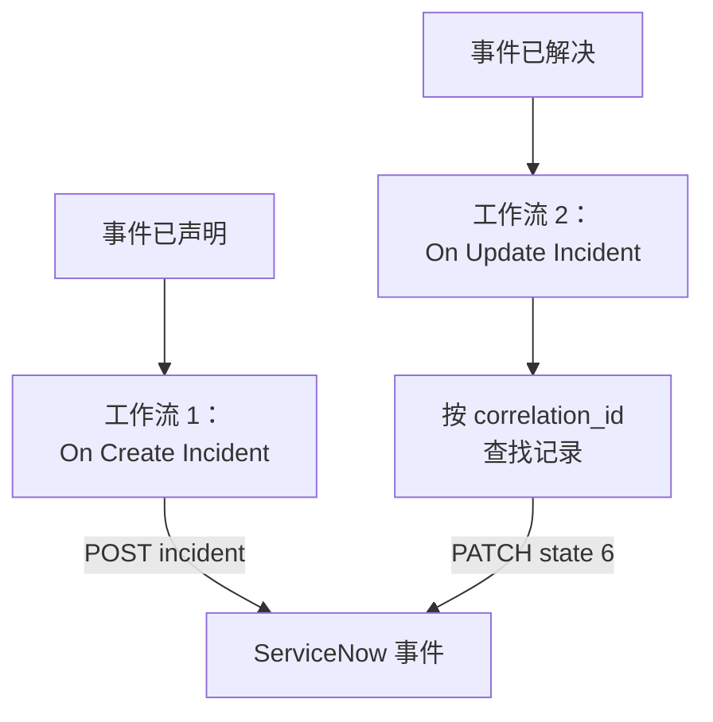

# ServiceNow

为每个 OneUptime 事件创建一个 [ServiceNow](https://www.servicenow.com) 事件，并在 OneUptime 事件被解决时解决它，让你的服务台跟上监控看到的情况。两个工作流调用 ServiceNow 的 [Table API](https://developer.servicenow.com/dev.do#!/reference/api/latest/rest/c_TableAPI)。

:::cards
- [保存凭据](#保存凭据): 让 ServiceNow 密码不出现在工作流中。
- [创建 ServiceNow 事件](#为每个事件创建-servicenow-事件): 一个工作流，两个块。
- [解决它们](#解决-servicenow-事件): 找到记录，然后关闭它。
- [故障排除](#故障排除): ServiceNow 拒绝请求时。
:::

## 工作方式



第一个工作流把 OneUptime 事件的 ID 写入记录的 `correlation_id`。第二个工作流按它查找记录，然后解决该记录。

## 开始之前

- 一个 ServiceNow 实例，例如 `https://your-instance.service-now.com`。
- 一个用于集成的 ServiceNow 用户，能够在 `incident` 表中创建和更新记录，通常具有 `itil` 角色。请求用它的用户名和密码签名。
- 在 OneUptime 中创建工作流和全局变量的权限。在 OneUptime Cloud 上，工作流需要 **Growth** 或更高的套餐。

## 保存凭据

Table API 使用 Basic 身份验证：把用户名和密码编码在一起。

:::steps
1. 在 macOS 或 Linux 上编码一次：

   ```bash
   printf '%s' 'integration.user:password' | base64 | tr -d '\n'
   ```

   请使用 `printf`，不要用 `echo`：`echo` 会添加一个换行符，它会和其余内容一起被编码，从而破坏凭据。

2. 在 OneUptime 中前往 **工作流 → 全局变量**，点击 **创建工作流 变量**。将其命名为 `SERVICENOW_AUTH`，然后点击 **下一步**。
3. 把编码后的值粘贴到 **内容** 中，打开 **密钥**，然后点击 **创建工作流 变量**。
:::

## 为每个事件创建 ServiceNow 事件

:::steps
### 创建工作流

前往 **工作流**，点击 **创建工作流**，然后点击 **从零开始**。将其命名为 `Incidents to ServiceNow`，然后点击 **创建工作流**。

### 添加触发器

点击虚线的 **选择启动此工作流的方式** 块，选择 **On Create Incident**。点击该触发器：它的 **Fields to pass on** 已经包含 **标题**，所以点击 **添加字段** 并选择 **描述**。

### 创建记录

点击 **添加组件**，添加一个 **API Post (JSON)** 块，并把触发器的 **Success** 点连接到它。把它的 **URL** 设为 `https://your-instance.service-now.com/api/now/table/incident`。在 **更多字段** 下，把 **Request Headers** 设为：

```json
{
  "Authorization": "Basic {{global.variables.SERVICENOW_AUTH}}",
  "Accept": "application/json"
}
```

把 **Request Body** 设为：

```json
{
  "short_description": "OneUptime: {{local.components.incident-on-create-1.returnValues.model.title}}",
  "description": "{{local.components.incident-on-create-1.returnValues.model.description}}",
  "urgency": "1",
  "impact": "1",
  "correlation_id": "oneuptime-{{local.components.incident-on-create-1.returnValues.model._id}}"
}
```

### 测试，然后启用

点击 **运行工作流**，在 **事件** 中选择一个测试事件，然后运行。**API Post (JSON)** 步骤会显示一个 `201` 响应，其中包含新记录及其 `sys_id` 和 `number`，例如 `INC0012345`。然后在 **生成器** 顶部打开 **已启用**。
:::

`urgency` 和 `impact` 用 `1` 表示高、`2` 表示中、`3` 表示低，ServiceNow 根据这两者算出优先级。`incident` 表的任何其他列都可以按列名放进请求主体。

## 解决 ServiceNow 事件

一个工作流只有一个触发器，因此解决需要第二个工作流，在事件状态变化时启动。

:::steps
### 添加 On Update Incident 触发器

创建一个名为 `Resolve ServiceNow incidents` 的工作流，选择 **On Update Incident** 作为触发器。在 **Fields to watch** 中点击 **添加字段** 并选择 **Current Incident State**，使它只在状态变化时运行。在 **Fields to pass on** 中请求新状态是否为已解决状态：点击 **添加字段**，展开 **Current Incident State** 并选择 **Is Resolved State**。也可以点击 **以 JSON 编辑**，把 JSON 替换为：

```json
{ "_id": true, "currentIncidentState": { "isResolvedState": true } }
```

### 检查事件是否已解决

在触发器之后添加一个 **If / Else** 块。把 **Value to check** 设为 `{{local.components.incident-on-update-1.returnValues.model.currentIncidentState.isResolvedState}}`，**Comparison** 设为 **is true**。

### 查找记录

在 **Yes** 一侧之后添加一个 **API Get (JSON)** 块，使用相同的 **Request Headers** 和以下 **URL**：

```text
https://your-instance.service-now.com/api/now/table/incident?sysparm_query=correlation_id=oneuptime-{{local.components.incident-on-update-1.returnValues.model._id}}&sysparm_fields=sys_id&sysparm_limit=1
```

### 解决记录

在查找块的 **Success** 之后添加一个 **API Patch (JSON)** 块，使用相同的 **Request Headers** 和以下 **URL**：

```text
https://your-instance.service-now.com/api/now/table/incident/{{local.components.api-get-1.returnValues.response-body.result[0].sys_id}}
```

把它的 **Request Body** 设为：

```json
{
  "state": "6",
  "close_code": "Solution provided",
  "close_notes": "Resolved in OneUptime"
}
```

### 启用

打开 **已启用**，然后在 OneUptime 中解决一个测试事件。它对应的 ServiceNow 事件会变为 Resolved。
:::

在 ServiceNow 默认的事件状态中，`state` `6` 表示 Resolved。`close_code` 必须是你的实例中的某个解决代码。许多实例在没有解决代码和备注的情况下不会解决事件，所以两者都要发送。

## 故障排除

:::details ServiceNow 返回 401
凭据错误。用 `printf`（不要用 `echo`）重新编码 `username:password`，并替换 `SERVICENOW_AUTH` 的内容。
:::

:::details ServiceNow 返回 403
该用户无法写入 `incident` 表。为它授予 `itil` 角色或具有相同权限的角色，并检查没有访问控制规则阻止它使用 Table API。
:::

:::details ServiceNow 返回 400，或者解决后没有任何变化
某个列名或值与你的实例不符：例如自定义过的 `state` 列表，或者你的实例中没有的 `close_code`。请与 ServiceNow 中 **System Definition → Tables** 下的 `incident` 表以及记录本身的表单进行比较。
:::

:::details 解决时返回 404
查找步骤没有找到记录，所以 URL 中保留了按原样写的引用。请检查第一个工作流是否写入了 `correlation_id`，以及两个工作流是否以相同的方式生成它：`oneuptime-` 加事件的 `_id`。
:::

## 后续步骤

:::cards
- [Jira](/docs/integrations/jira): 由现成模板保持同步的双向集成。
- [工作流组件](/docs/workflows/components#api): API 块的所有设置。
- [工作流运行记录](/docs/workflows/runs-and-logs): 查看每个请求发送了什么、收到了什么。
- [集成概述](/docs/integrations/index): 每个集成背后的模式。
:::
