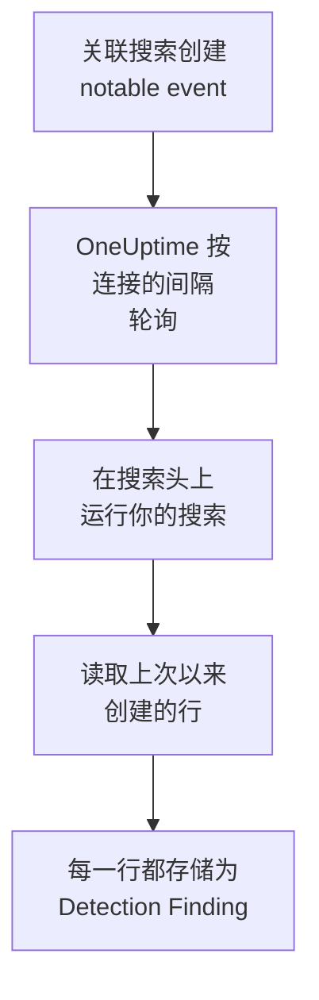

# Splunk Enterprise Security

把 [Splunk Enterprise Security](https://www.splunk.com/en_us/products/enterprise-security.html) 的关联搜索创建的 notable event 导入 OneUptime 的安全事件。在那里，你可以把它们与日志、跟踪和指标放在一起搜索，与其他所有来源进行关联分析，并为重要的事件呼叫值班人员。OneUptime 以你创建的 Splunk 用户身份，在你的搜索头上运行一次搜索来读取它们，不会在 Splunk 中更改任何内容。由于这只是一次搜索，它可以导入任何索引或任何已保存搜索的输出，而不仅仅是 notable event。

:::cards
- [设置连接](#设置连接): 一个令牌、一个角色，以及连接的表单。
- [导入的内容](#导入的内容): 搜索的每一行如何成为一个安全事件。
- [轮询的工作方式](#轮询的工作方式): 每次轮询读取的时间窗口，以及繁忙的搜索头对它的影响。
- [故障排除](#故障排除): 每个错误的含义，以及需要更改什么。
:::

## 工作方式



OneUptime 每分钟轮询一次已过轮询间隔的每个已启用连接。一次轮询会通过搜索头的 REST API，针对自上次轮询以来创建的行运行你的搜索，并把每一行存储为一个 [OCSF](https://schema.ocsf.io/) Detection Finding 事件（类 `2004`）。之后，检测规则、监视器和仪表板会像对待其他任何来源的安全事件一样对待它。

## 开始之前

- 在 OneUptime 中拥有 Project Owner、Project Admin 或 Security Admin 角色。Security Member 和 Security Viewer 可以查看连接及其运行历史，但不能更改它们。
- 运行 Splunk Enterprise 9.0.1 或更高版本的搜索头，或 Splunk Cloud Platform。OneUptime 在管理端口（通常为 `8089`）上与其 REST API 通信。端口 `8000` 上的 Splunk Web 不提供 REST API。
- 一个供 OneUptime 使用的 Splunk 用户，其角色具有 `search` 能力，并且可以读取搜索所读取的索引：对于 notable event 是 `notable`。Enterprise Security 的 `ess_analyst` 和 `ess_user` 角色两者都会授予。连接只做读取，所以角色不需要其他任何权限。
- 一个 OneUptime 能通过 HTTPS 访问到的搜索头。OneUptime Cloud 从互联网连接，所以搜索头需要一个公网地址：私有地址会被拒绝。自托管的 OneUptime 从它的应用和工作进程容器连接，可以访问你私有网络中的搜索头，除非 `DATA_SOURCE_BLOCK_PRIVATE_ADDRESSES` 为 `true`。

## 设置连接

连接使用 Splunk 身份验证令牌，或者用户名和密码进行身份验证。

:::steps
### 创建身份验证令牌

1. 在 Splunk Web 中，打开 **Settings → Tokens**。如果 Splunk 提示令牌身份验证已关闭，请先选择 **Enable Token Authentication**。
2. 选择 **New Token**。在 **User** 中输入为 OneUptime 创建的 Splunk 用户，在 **Audience** 中说明令牌的用途，例如 `OneUptime security events`。
3. 选择一个 **Expiration**，或者不设过期时间。会过期的令牌在你替换它之前会让连接停止工作。
4. 选择 **Create** 并复制令牌。Splunk 只显示它一次。

如果要改用密码进行身份验证，请跳过这一步，并准备好该用户的名称和密码。

### 在 OneUptime 中添加连接

打开 **产品 → Security Events → 连接**（`/dashboard/{projectId}/security-events/connections`），点击 **添加连接**，选择 **Splunk Enterprise Security**，然后点击 **下一步**。填写下表中的设置，点击 **下一步**，然后把令牌粘贴到 **Authentication token** 中，或者把密码粘贴到 **密码** 中。

### 保存之前先测试

点击 **保存前测试** 下的 **测试这些设置**。测试会用表单中的值进行身份验证并运行你的搜索，不保存任何内容，所以错误的端口或缺少的角色会在连接创建之前就暴露出来。然后点击 **下一步**，为连接设置一个 **名称** 并创建它。
:::

| 设置 | 填写什么 |
| --- | --- |
| **Splunk management URL** | 搜索头的 REST API，例如 `https://splunk.example.com:8089`。它必须使用 `https`，且不带查询字符串。路径会被保留，以便用于在某个路径下提供 API 的反向代理。 |
| **搜索** | 选择要导入什么内容的搜索，在你更改之前为 `index=notable`。可以缩小它的范围，例如 `index=notable urgency IN (high, critical)`。OneUptime 会自己添加时间范围，所以搜索不能设置 `earliest` 或 `latest`，也不能以管道符开头。开头的 `search` 会被去掉。 |
| **用户名** | Splunk 用户的名称，仅当它使用密码进行身份验证时才需要。 |
| **Authentication token** | 第一步中的令牌。保存了令牌时，使用的是令牌，而不是用户名和密码。 |
| **密码** | Splunk 用户的密码，仅当不使用令牌时才需要。 |

**Authentication token** 和 **密码** 会被加密，API 从不返回它们，也不会再次显示。要替换其中一个，请在连接上使用 **更新凭据**。要从一种身份验证方式切换到另一种，请在那里输入新的方式，并打开 **Remove the stored Authentication token** 或 **Remove the stored Password**。

**轮询** 步骤还有可选的 **描述**、**轮询间隔（分钟）**（`1` 到 `1440` 之间的整数，初始为 `5`），以及初始为开启的 **已启用**。

## 导入的内容

搜索返回的每一行都会成为一个 Detection Finding 事件（OCSF 类 `2004`），供应商为 `Splunk`，产品为 `Splunk Enterprise Security`。对于一个 notable event：

| Splunk 字段 | OneUptime 列 |
| --- | --- |
| `event_id`，否则 `_bkt` 和 `_cd`，否则行的哈希 | 事件 UID，也是去重所依据的值 |
| `_time`，即关联搜索创建 notable event 的时间 | 事件时间 |
| `rule_name`，否则 `search_name`，否则 `source` | 规则名称 |
| `search_name`，否则 `source`，否则 `rule_name` | 规则 ID |
| `rule_title`，否则 `rule_description`，否则规则名称 | 消息 |
| `urgency`，否则 `severity` | 严重程度 |
| `status_label`，否则 `status_description`，否则 `status` 中保存的审查状态的名称 | 状态 |
| `annotations.mitre_attack`，以及 `mitre_technique_id` 和 `mitre_tactic` 等字段 | MITRE ATT&CK 战术和技术 |
| `user` 或 `src_user`；`src`、`src_ip` 或 `src_host`；`process`、`process_name` 或 `parent_process` | 主体的用户、IP、主机和进程 |
| `dest_user`；`dest`、`dest_ip` 或 `dest_host`；`dest_port` | 目标的用户、IP、主机和端口 |
| `file_path`、`url` 或 `risk_object` | 目标资源 |
| 每个用户、主机和 IP，以及 `dvc`、`host`、`file_hash`、`file_name`、`url`、`domain`、`query` 和 `risk_object` | Observable |
| 行中的每个字段，例如 `security_domain`、`owner`、`orig_sid` 和 `_raw` | `attributes`，使用字段本身的名称 |

来自其他索引的行也以同样的方式导入。它的字段填不满的列保持为空，每个字段仍然可以在 `attributes` 中搜索。

## 轮询的工作方式

每次轮询都会在它的窗口上运行一次导出搜索，从最早的开始：

```text
POST {Splunk management URL}/services/search/v2/jobs/export
    search=search index=notable | fields * | sort 0 _time | head 10001
    earliest_time={window start}
    latest_time={window end}
    output_mode=json
```

- **创建时间就是游标。** 窗口针对的是 `_time`，对于 notable event，这是关联搜索创建它的时间，而不是它所发现的活动发生的时间。每小时运行一次的搜索会把它的 notable event 标记为其运行的时间，所以不会有 notable event 落在游标后面。
- **第一次轮询会回溯 24 小时**，所以新连接会立刻显示最近的 notable event。
- **之后的每次轮询都从保存的游标之前 1 分钟开始**，所以在两个窗口边界上创建的行永远不会被漏掉。
- **一次轮询最多读取游标之后 24 小时。** 游标落后的连接会通过一连串 24 小时的窗口追赶，此时它的 **健康状况** 显示为 **Catching up**。
- **重复项按 `event_id`，或 Splunk 自己的 `_bkt` 和 `_cd` 去重**，范围是整个项目，所以重叠部分、重试的窗口和导入都不会把同一行存储两次。

早于 9.0.1 的搜索头会对发往 `search/v2/jobs/export` 的请求返回 `404`。这时 OneUptime 会把请求发往已弃用的 `search/jobs/export`，运行会在警告中说明这一点。请升级搜索头：当前版本会关闭该端点。

### 当一个窗口包含的内容超过一次轮询能读取的量时

一次轮询最多读取 10,000 行。当窗口中的行更多时，这次运行为 **部分**，并带有如下警告：

```text
Stopped after collecting 10000 records; the window holds more. Records are read oldest first, and the last one read was created at 2026-09-14T08:12:44.000Z, where the next poll can resume.
```

搜索按 `_time` 从早到晚对窗口排序，所以 OneUptime 会把游标移到它读取的最后一行的创建时间，下一次轮询就从那里开始，窗口长度不变。繁忙的搜索头每次轮询追赶 10,000 行，而不是重复读取同样的行。在同一时刻创建的行会被读取两次，去重检查会丢弃第二份副本。Splunk 在返回任何一行之前会先对整个窗口排序，所以 **搜索** 中找到远超所需内容的搜索会拖慢每一次轮询。请让它保持精确。

当一次运行完全无法越过保存的游标时，OneUptime 会改为缩短窗口：

1. **缩小。** 下一次轮询从同一个起点读取长度减半的窗口，并不断减半，直到某个窗口能被完整读取，最短为一分钟。运行的警告会说明这一点：`This window holds more records than one poll can read; the next poll reads a {n} minute window from the same starting point.`
2. **恢复。** 一个窗口被完整读取后，下一个窗口的长度会再次加倍，最长为 24 小时。
3. **越过单独的一分钟。** 如果连一分钟内的内容都超过一次轮询能读取的量，轮询会越过这一分钟，让更新的 notable event 继续到达。这次运行仍为 **部分**，**最近错误** 显示 `More records were created in the one minute from {cursor} to {end} than one poll can read. Polling moved past this minute so newer records keep arriving; use Import this time range in Diagnostics on this minute to recover what one run can read.` 用 **Import this time range** 导入这一分钟，就能找回一次运行能读取的内容。

因 Splunk 的错误而彻底失败的运行，会保留游标和窗口长度，下一次轮询会再次读取同一个窗口。唯一的例外是请求超时：游标保持不变，但下一个窗口的长度减半，因为重到无法及时得到响应的窗口每次尝试都会超时。更改 **轮询间隔（分钟）** 不会改变这些：它决定的是轮询多久开始一次，而不是窗口从哪里开始。

### 按需运行、预览和导入

在连接上点击 **诊断**，可以查看它最近的运行，并手动操作它。能更改该连接的人都可以启动这些操作；能查看它的人都可以阅读历史记录。

- **立即运行** 会立即开始一次轮询，使用通常的游标，即使连接未处于 **已启用** 状态也可以。
- **Preview notable events** 读取最长 7 天的时间范围，不导入任何内容。
- **Import this time range** 在你确认后导入最长 7 天的范围，不会移动游标。已导入的行会被跳过。
- 运行上的 **Copy diagnostics** 会复制它的报告以便提供给支持人员。报告从不包含凭据。

## 测试连接

连接所在行中的 **测试连接** 和表单中的 **测试这些设置** 在 API 进程中运行，而不是在后台工作进程中运行，所以即使工作进程出了问题，测试仍然会给出结果。它按顺序运行以下检查：

| 检查 | 检查的内容 |
| --- | --- |
| **配置** | 每项设置都存在且格式正确。此项失败时不会连接任何地方。 |
| **Authenticate with Splunk** | Splunk 接受令牌，或者用户名和密码，并说明用户及其角色，方便你与原本想授予的角色进行比较。 |
| **Run the search on Splunk** | **搜索** 中的搜索在过去 24 小时上运行，只取一行，并说明是哪个导出端点作出了响应。 |
| **Notable events available to import** | **搜索** 中的搜索在过去 24 小时和过去 7 天内找到的行数。7 天内一行都没有是警告，而不是失败。 |
| **Background workers**、**Poll scheduler**、**Security event storage** | OneUptime 自身的一侧：有进程在处理 Worker 队列的作业，轮询作业每分钟运行一次，安全事件存储能够响应。 |
| **Scheduled polling** | 针对已保存的连接：轮询已开启，没有运行卡在等待工作进程的状态，并且轮询按时运行。 |

测试中的每个请求都有 20 秒的期限。测试从不导入任何内容，也不移动游标，每个失败的检查都会说明需要更改什么。

## 将安全事件发送到 Splunk

OneUptime 也可以通过 Splunk 的 HTTP Event Collector（HEC）把它发现的内容发送到 Splunk，让你的搜索和仪表板在你自己的检测结果旁边看到 OneUptime 的检测结果。每个安全事件都是一个 sourcetype 为 `oneuptime:security` 的 HEC 事件，其字段按 Splunk 的 Common Information Model 命名：`src`、`src_ip`、`src_user`、`dest`、`dest_ip`、`dest_port`、`user`、`signature` 和 `severity`。

:::steps
### 创建 HEC 令牌

在 Splunk Web 中打开 **Settings → Data inputs → HTTP Event Collector**，点击 **New Token**。为它命名，选择它可以写入的索引及其默认索引，然后复制令牌的值。在 Splunk Cloud 上，HEC 监听 `https://http-inputs-<stack>.splunkcloud.com`；在 Splunk Enterprise 上，在 **Global Settings** 打开令牌后监听端口 `8088`。

### 添加目标

打开 **产品 → Security Events → 连接**。在 **发送到你的 SIEM** 下点击 **添加目标**，在 **SIEM** 下选择 Splunk，然后点击 **下一步**。填写 **HEC URL**，并把令牌粘贴到 **HEC 令牌** 中。**索引** 和 **源类型** 是可选的：留空时，事件会以 sourcetype `oneuptime:security` 进入令牌的默认索引。

### 发送测试事件并开始发送

点击 **发送测试事件**：一个信息级事件会按表单中的设置发送到 Splunk，不会保存任何内容。用 `sourcetype="oneuptime:security"` 搜索它。然后在 **发送内容** 下保留 **仅检测结果** 或选择 **所有安全事件**，再点击 **开始发送**。
:::

- **HEC URL** 必须使用 `https`，并带有 OneUptime 信任的证书：证书检查从不跳过。
- 事件按每批最多 500 个发送。Splunk 拒绝的事件会被略去并在 **查看错误** 中列出，繁忙的收集器（`503`）会重试，令牌或索引被拒绝时会停止发送，直到你修复它。
- OneUptime 从 Splunk 导入的 notable event 永远不会被发回 Splunk。

## 故障排除

连接的 **最近错误** 会保留完整的错误消息（凭据已隐去），前面带有一个指明失败步骤的前缀。连接出错时，在它的 **操作** 列中选择 **查看错误** 来阅读，并在对话框中用 **复制错误** 复制。请先阅读前缀。

:::details Last Error 以 `Splunk Enterprise Security authentication request` 开头
- `Splunk Enterprise Security authentication request failed (HTTP ...)`：Splunk 拒绝说明调用者是谁。
  - `HTTP 401`：Splunk 没有接受凭据。令牌错误、已过期或已删除，搜索头上关闭了令牌身份验证，或者用户名或密码错误。请创建一个新令牌，并用 **更新凭据** 保存。
  - `HTTP 404`：**Splunk management URL** 不是 REST API。它指向了端口 `8000` 上的 Splunk Web，或者带有搜索头不提供的路径。
- `Splunk Enterprise Security authentication request returned ...`：响应的不是搜索头的 REST API，而是其他东西，例如端口 `8000` 上 Splunk Web 的 HTML 或某个代理的页面。请让 URL 指向管理端口。
:::

:::details Last Error 以 `Splunk Enterprise Security search export` 或 `Splunk Enterprise Security count search` 开头
- `Splunk Enterprise Security search export failed (HTTP ...)`：Splunk 拒绝运行该搜索。
  - `HTTP 400`：Splunk 无法解析该搜索。在 Splunk Web 中运行 **搜索** 中的搜索，即可看到它的错误。
  - `HTTP 403`：用户的角色缺少 `search` 能力，或者无法读取该索引。请把 `notable` 或你的索引添加到该角色可以搜索的索引中。
  - `HTTP 404`：该 URL 上两个导出端点都不存在，所以它不是搜索头的管理端口。
  - `HTTP 429` 或 `HTTP 5xx`：Splunk 正在限制该用户、负载过高，或者搜索达到了它的某个限制。下一次轮询会重试。
- `Splunk Enterprise Security search export was rejected by Splunk on an HTTP 200`：Splunk 作出了响应，但因错误停止了搜索。消息中会引用该错误。
- `Splunk Enterprise Security search export returned a body that is not newline-delimited JSON.`：响应的不是 REST API，而是其他东西，例如 Splunk Web 或某个代理的登录页面。这会被报告出来，而不是当作空窗口处理，所以游标永远不会越过没人读过的行。
- `Splunk Enterprise Security count search ...`：同样的失败，来自 **Notable events available to import** 的计数，只有测试才会运行它。
:::

:::details Last Error 以 `did not complete` 结尾
`Splunk Enterprise Security search export did not complete`（其他步骤也一样）表示请求没有得到响应：超时、无法解析的名称、OneUptime 不信任的证书，或者被拒绝的私有地址。请检查 OneUptime 应用和工作进程能否打开到管理端口的 HTTPS 连接。如果搜索头能响应其他请求，但搜索超时，说明它排序的内容太多：下一次轮询会读取长度减半的窗口，而把 **搜索** 中的搜索范围缩小，就能彻底解决问题。
:::

:::details Last Polled 为 Never 且 Last Error 为空
这个连接还没有完成过任何轮询。运行 **测试连接**：它的 **Background workers** 和 **Poll scheduler** 检查会指出原因。在自托管安装中，常见原因是应用上设置了 `DISABLE_QUEUE_WORKERS=true`，却没有单独的工作进程部署来处理作业：把它设为 `false`，或运行工作进程部署（Helm：`worker.enabled: true`）。
:::

:::details 运行为 Partial
- `Stopped after collecting 10000 records; the window holds more`：窗口中的行超过了一次运行能读取的 10,000 行。不会丢失任何内容：下一次轮询会从读取的最后一行之后开始。一次又一次轮询都保持 **部分** 的连接正在追赶积压的内容，它的 **最近轮询** 和 **最近导入的事件** 会不断前进。如果它始终追不上，说明 **搜索** 中的搜索在每个轮询间隔内找到的行超过 10,000 行：请缩小它的范围，或者缩短 **轮询间隔（分钟）**。
- `More records were created in the one minute from ... than one poll can read`：轮询越过了这一分钟。请在 **诊断** 中用 **Import this time range** 导入它。一次导入读取的量与一次轮询相同。
:::

:::details 测试通过，但没有导入任何内容
阅读测试报告中的 **Notable events available to import**。过去 7 天为 `0` 表示 **搜索** 中的搜索在 Splunk 中什么都没找到：请在 Incident Review 中检查关联搜索是否已启用并在创建 notable event，以及 **搜索** 中的搜索是否比预期更窄。
:::

## 你会得到什么

- **搜索。** 在安全事件资源管理器中，与其他所有来源放在一起，按紧急程度、状态、规则、用户、主机或任何 observable 过滤 notable event。
- **关联分析。** 每一行的用户、主机、IP 和域名都会作为 observable 建立索引，所以一次搜索就能找到提到它们的所有内容。
- **检测规则。** 按计划对你的安全事件运行的 Sigma 规则，会打开呼叫值班人员的警报。
- **监视器。** 安全事件监视器统计匹配的事件，例如新的严重 notable event，并在超过阈值时打开事件或警报。

安全事件与其他遥测数据一样，按摄取的 GB 数计费。请参阅 [定价](https://oneuptime.com/pricing)。

## 后续步骤

:::cards
- [安全事件](/docs/telemetry/security-events): 搜索、关联分析你导入的内容，并据此发出警报。
- [Elastic Security](/docs/integrations/elastic-security): 同时导入 Elastic 堆栈的检测警报。
- [角色](/docs/permissions/reference#角色): Security 角色可以查看和更改的内容。
- [集成概述](/docs/integrations/index): 你可以连接的其他工具。
:::
