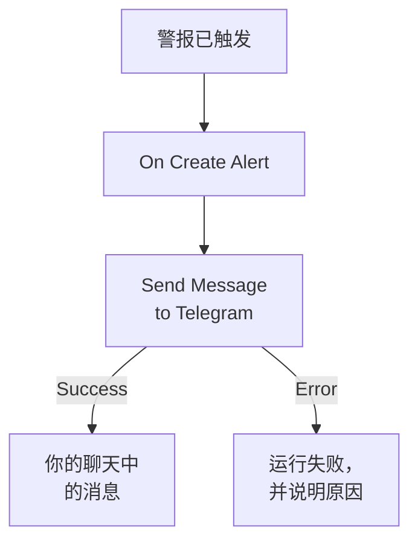

# Telegram

在警报触发或事件打开时，向 [Telegram](https://telegram.org) 聊天、群组或频道发送一条消息。OneUptime 的工作流步骤 **Send Message to Telegram** 以你创建的机器人身份发送消息，现成的模板会为警报构建工作流。此集成是 **出站** 的：机器人只发送消息，不读取聊天中的内容。

:::cards
- [工作方式](#工作方式): 警报触发时工作流会做什么。
- [设置](#设置集成): 一个机器人、它的聊天，然后是工作流：从模板创建或从零开始。
- [提示](#提示): 纯文本、长消息和事件。
- [故障排除](#故障排除): Telegram 的错误是什么意思，以及该改什么。
:::

## 工作方式



该步骤以你的机器人身份，通过 Telegram 的 Bot API 把 **Message Text** 发送到聊天。Telegram 接受消息时，它走 **Success** 输出；Telegram 拒绝时，它带着 Telegram 给出的原因走 **Error** 输出。像模板中那样 **Error** 上没有连接任何东西时，未能发送的运行会失败，其 **步骤** 会说明原因。

## 开始之前

- 一个 Telegram 账户，用来创建机器人并把它添加到聊天中。
- 在 OneUptime 中，拥有创建工作流和变量的权限。在 OneUptime Cloud 上，工作流需要 **Growth** 或更高的计划。

## 设置集成

:::steps
### 创建机器人

在 Telegram 中，向 [@BotFather](https://t.me/BotFather) 发送 `/newbot` 并回答它的问题。它会给你机器人的令牌，例如 `123456789:ABCdefGhIJKlmnoPQRstuVWxyz`。任何拥有该令牌的人都可以用你的机器人发送消息，所以请像保管密码一样保管它。

### 找到聊天的 ID

1. 把机器人添加到群组，或者让它成为频道的管理员。要给某个人发消息，需要对方先与机器人开始聊天。
2. 在群组中发送一条提及机器人的消息，例如 `/start@your_bot`，让机器人看到它。
3. 在浏览器中打开 `https://api.telegram.org/bot<token>/getUpdates`，把 `<token>` 换成机器人的令牌。
4. 在响应中找到 `"chat":{"id":`。它后面的数字就是聊天的 ID。群组的 ID 以 `-` 开头，大型群组的 ID 以 `-100` 开头。

公开频道可以用它的 `@username` 来指定，而不用 ID。

### 构建工作流

从模板开始，它会为警报构建整个工作流，或者从零开始。

:::tabs
@tab 从模板创建
1. 打开 **工作流**，然后点击 **创建工作流**。
2. 在 **搜索模板…** 中输入 `Telegram`，点击 **Tell Telegram when an alert fires**，然后点击 **使用此模板**。
3. 保留名称 **Notify Telegram on new alert** 或更改它，然后点击 **下一步**。
4. 把令牌粘贴到 **Telegram Bot Token** 中，把 ID 粘贴到 **Telegram Chat ID** 中，然后点击 **创建工作流**。

工作流会在 **生成器** 中打开，包含两个步骤： **On Create Alert**，以及发送警报编号、标题、严重程度和状态的 **Send Message to Telegram**。令牌会保存为工作流的机密变量 `telegramBotToken`，ID 保存为 `telegramChatId`。
@tab 从零开始
1. 把令牌保存为机密的全局变量：前往 **工作流 → 全局变量**，点击 **创建工作流 变量**，将其命名为 `TELEGRAM_BOT_TOKEN`，然后点击 **下一步**。把令牌粘贴到 **内容** 中，打开 **密钥**，然后点击 **创建工作流 变量**。
2. 前往 **工作流**，点击 **创建工作流**，选择 **从零开始**，为工作流命名，然后点击 **创建工作流**。
3. 在 **生成器** 中，点击 **选择启动此工作流的方式**，然后在 **热门** 下选择 **On Create Alert**。点击触发器：它的 **Fields to pass on** 已经包含 **标题**，所以点击 **添加字段**，再选择消息要显示的其他字段，例如 **Alert Number With Prefix**。
4. 点击 **添加组件**，搜索 `telegram`，然后点击 **Send Message to Telegram**。把触发器的 **Success** 输出连接到它。
5. 点击新步骤。在 **Telegram Bot Token** 中点击 **{ }**，然后在 **Global variables** 下选择 `TELEGRAM_BOT_TOKEN`。在 **Chat ID** 中输入聊天的 ID，在 **Message Text** 中写下消息，并用 **{ }** 插入警报的字段。
:::

从零开始编写的消息通过如下引用读取警报的字段：

```text
🚨 Alert {{local.components.alert-on-create-1.returnValues.model.alertNumberWithPrefix}} fired
Title: {{local.components.alert-on-create-1.returnValues.model.title}}
```

### 开启并测试

在 **生成器** 顶部打开 **已启用**。从现在起，每个新警报都会发送到聊天中。

要在不触发警报的情况下进行测试，请点击 **运行工作流**，在 **警报** 下选择一个已有的警报：列表中会列出最近的警报，输入它的编号或标题的一部分可以找到其他警报。点击 **手动运行工作流**，然后用 **运行** 确认。**工作流运行** 面板会跟踪这次运行，消息会出现在聊天中。如果该步骤改走 **Error**，运行就会失败， **步骤** 中该步骤的条目会说明原因：请参阅 [故障排除](#故障排除)。
:::

## 提示

- **纯文本。** 该步骤按输入的原样发送文本，不使用 Telegram 的格式，所以 `*` 和 `_` 会原样显示。
- **注意 4,096 个字符的限制。** Telegram 接受最多 4,096 个字符的消息。更长的消息会被截断，并以 "… (truncated — see OneUptime for the full text)" 结尾，而不是被拒绝。
- **事件也可以。** 基于 **On Create Incident** 构建同样的工作流，或者基于 **On Update Incident** 发送状态变更。要只发送部分警报，请在该步骤之前放一个 **If / Else** 块。
- **会检查令牌的格式。** 格式不像 `123456789:ABCdef…` 的令牌会在发送任何内容之前让运行停止，并且令牌永远不会写入日志。

## 故障排除

当该步骤走 **Error** 时，运行会失败，运行的 **步骤** 中该步骤的条目会给出 Telegram 的原因。机器人必须在聊天中，所以请先检查这一点。

:::details Telegram 返回 "Bad Request: chat not found"
**Chat ID** 错误，或者机器人看不到该聊天：请把机器人添加到群组，让它成为频道的管理员，或者请对方与机器人开始聊天。群组的 ID 以 `-` 开头。
:::

:::details Telegram 返回 "Forbidden: bot was blocked by the user" 或 "bot is not a member"
对方屏蔽了机器人，或者机器人已被移出群组或频道。请把它重新添加回去，或者发送到另一个聊天。
:::

:::details Telegram 返回 "Unauthorized"
Telegram 没有接受令牌：它已在 @BotFather 中被吊销，或者复制错了。请从 @BotFather 复制机器人当前的令牌，并替换变量的值。
:::

:::details Telegram 返回 "Too Many Requests: retry after"
Telegram 会限制一个机器人的发送速度，尤其是发往群组时。集中出现的警报可能会触及这个限制：请发送更少的消息，例如只针对部分严重程度。
:::

## 后续步骤

:::cards
- [工作流组件](/docs/workflows/components#telegram): 步骤的每项设置，以及各输出的含义。
- [Discord](/docs/integrations/discord): 同样的思路，用于 Discord 频道。
- [工作流运行记录](/docs/workflows/runs-and-logs): 查看工作流每次运行都做了什么。
- [集成概述](/docs/integrations/index): 出站模式，以及你可以连接的其他工具。
:::
