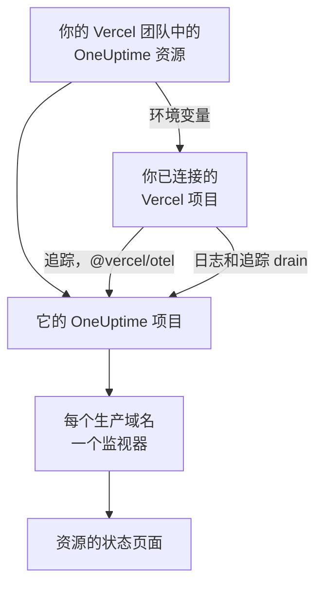

# Vercel

从 [Vercel Marketplace](https://vercel.com/marketplace) 把 OneUptime 添加到你的 Vercel 团队。你用 Vercel 账户登录，费用计入你的 Vercel 账单，你的 Vercel 项目会在 OneUptime 中获得追踪、日志、可用性监控和状态页面，无需手动设置任何内容。

:::cards
- [把 OneUptime 添加到你的 Vercel 团队](#把-oneuptime-添加到你的-vercel-团队): 在 Vercel 控制台中选择资源、套餐和你的项目。
- [使用 @vercel/otel 发送追踪](#使用-vercelotel-发送追踪): 环境变量已经设置好了。
- [使用 drain 发送日志和追踪](#使用-drain-发送日志和追踪): Vercel 自己的日志和 span，适用于 Pro 和 Enterprise。
- [套餐和账单](#套餐和账单): OneUptime 的套餐，计入你的 Vercel 发票。
:::

## 工作原理

你在 Vercel 中添加的每个 OneUptime 资源都是一个独立的 OneUptime 项目。你连接到该资源的每个 Vercel 项目都会从 Vercel 获得该资源的环境变量，项目借助这些变量把追踪发送到 OneUptime。Drain 发送 Vercel 的日志和 span，而每个已连接项目的生产域名都会在资源的状态页面上获得一个可用性监视器。



该集成适用于 OneUptime Cloud（`oneuptime.com`）。自托管的 OneUptime 无法从 Vercel Marketplace 添加：请参阅 [自托管 OneUptime](#自托管-oneuptime)。

## 开始之前

- **一个 Vercel 团队**，任何套餐均可。日志和追踪 drain 需要 Vercel 的 Pro 或 Enterprise 套餐；来自 `@vercel/otel` 的追踪在所有套餐上都可用。
- Vercel 账户上的 **已验证的电子邮件地址**。OneUptime 用它为你登录；如果你还没有 OneUptime 账户，也会用它为你创建一个。
- **Vercel 中的支付方式**，所有套餐都需要：监视器和遥测按用量计费，Free 套餐也不例外。请参阅 [套餐和账单](#套餐和账单)。

## 把 OneUptime 添加到你的 Vercel 团队

:::steps
### 在 Vercel Marketplace 上打开 OneUptime

在 Vercel 控制台中打开 **Integrations**，然后打开 **Browse Marketplace**，在 **Observability** 下找到 OneUptime。点击 **安装**，并接受 OneUptime 的条款。

### 选择套餐

选择 **免费**、**Growth** 或 **Scale**。这些是 OneUptime 自己的套餐，价格以 [oneuptime.com/pricing](https://oneuptime.com/pricing) 上列出的为准。

### 为资源命名并选择设置

按资源要监控的对象为它命名，例如 `storefront`：它的 OneUptime 项目和状态页面都会以此命名。有两项设置默认开启：

- **Monitor production domains**：为你连接的每个 Vercel 项目的生产域名创建一个网站监视器。
- **Create a status page**：为资源创建一个公开的状态页面，显示这些监视器。

### 连接你的项目

选择向此资源发送数据的 Vercel 项目，以及获得其环境变量的环境。不要为连接设置自定义前缀：`@vercel/otel` 按变量本来的名称读取它们。
:::

资源会在几秒钟内准备就绪。点击 **Open in OneUptime** 查看它的项目。

## 每个资源提供的内容

| 内容 | 在哪里找到 |
| --- | --- |
| 一个以资源命名的 OneUptime 项目 | 你是它的所有者。你的团队成员从 Vercel 打开它时就会加入。 |
| 一个名为 `Vercel` 的摄取密钥 | **项目设置 → 遥测与 APM → 摄取密钥** |
| 每个已连接 Vercel 项目中的环境变量 | Vercel 中该项目的 **Settings → Environment Variables** |
| 每个已连接项目的一个网站监视器 | **监视器**，以 Vercel 项目命名 |
| 一个公开的状态页面 | **状态页面**，以资源命名 |

每个已连接项目中的环境变量都相同：

| 变量 | 值 |
| --- | --- |
| `OTEL_EXPORTER_OTLP_ENDPOINT` | `https://oneuptime.com/otlp` |
| `OTEL_EXPORTER_OTLP_HEADERS` | `x-oneuptime-token=` 加上资源的摄取密钥 |
| `OTEL_EXPORTER_OTLP_PROTOCOL` | `http/protobuf` |
| `ONEUPTIME_TELEMETRY_INGESTION_KEY` | 摄取密钥本身，由 drain 发送 |

部署在构建时获得这些变量：连接项目后，请重新部署。

## 使用 @vercel/otel 发送追踪

`@vercel/otel` 是 Vercel 为 Next.js 以及 Vercel 运行的其他框架提供的 OpenTelemetry 软件包。它读取 `OTEL_EXPORTER_OTLP_*` 变量，因此连接到资源的项目只需要这个软件包。

:::steps
### 安装软件包

```bash
npm install @vercel/otel @opentelemetry/api @opentelemetry/api-logs
```

### 注册它

在项目根目录下创建 `instrumentation.ts`（如果项目有 `src` 目录，则在其中创建），并为服务命名：

```ts title="instrumentation.ts"
import { registerOTel } from "@vercel/otel";

export function register(): void {
  registerOTel({ serviceName: "storefront" });
}
```

### 部署

部署项目。它的追踪会以服务名称出现在 **追踪** 中。
:::

在 Vercel 的 Pro 和 Enterprise 套餐上，还要添加一个追踪 drain：这样 Vercel 会把它为每个请求生成的 span 连同你的应用的 span 一起发送给 OneUptime，而 `@vercel/otel` 把这些 span 留给 drain 发送，所以不会有任何数据重复到达。

## 使用 drain 发送日志和追踪

Drain 会把 Vercel 记录的关于你的项目的内容发送到 OneUptime：日志 drain 发送项目的构建、函数、边缘和请求日志，追踪 drain 发送项目的 span。Drain 需要 Vercel 的 Pro 或 Enterprise 套餐，Vercel 会把它们发送的数据计入你的 Vercel 账单。

:::steps
### 添加 drain

在 Vercel 中打开 **Team Settings → Drains**，然后点击 **Add Drain**。选择 **Logs** 或 **Traces**，然后在 **Native Integrations** 下选择 OneUptime。

### 选择项目

选择项目；对于日志，还要选择来源和环境。Drain 使用资源的摄取密钥发送数据：无需输入任何内容。
:::

每个 Vercel 项目在 OneUptime 中都是一个以该项目命名的服务。日志保留它的时间、级别和消息，它的请求信息则使用 OpenTelemetry 的名称：

| Vercel 字段 | 在 OneUptime 中 |
| --- | --- |
| `projectName` | 服务，`service.name` |
| `timestamp`、`level`、`message` | 日志的时间、严重程度和正文 |
| `deploymentId`、`environment` | `vercel.deployment.id`、`deployment.environment.name` |
| `proxy.method`、`proxy.path`、`proxy.statusCode` | `http.request.method`、`url.path`、`vercel.proxy.status_code` |
| `traceId`、`spanId` | 日志所属的追踪，链接到 **追踪** 中的该追踪 |
| 其他所有字段 | `vercel.` 下的属性，例如 `vercel.source` |

## 可用性监视器和状态页面

当你连接一个 Vercel 项目时，OneUptime 会为它的生产域名创建一个网站监视器，从 OneUptime 的探测器进行检查，并把它添加到资源的状态页面。在首次生产部署之前连接的项目还没有域名：它的监视器会在那次部署时创建。断开项目的连接会删除它的监视器。

每个监视器都是一个活跃监视器，与其他监视器一样计费，工作方式也与你自己创建的监视器相同：请参阅 [网站监控](/docs/monitor/website-monitor)。如果不想创建任何监视器，请在 Vercel 中资源的设置里关闭 **Monitor production domains**。重新打开它会创建仍然缺少的监视器。

## 从 Vercel 打开 OneUptime

点击资源上的 **Open in OneUptime**，或者它在 Vercel 中的任何链接，你就会用 Vercel 账户的电子邮件地址登录 OneUptime。第一次打开时你会加入资源的项目：如果你是 Vercel 团队的所有者或成员，就以管理员身份加入；如果你拥有团队的某个只读角色，就以成员身份加入。

如果已经存在使用该电子邮件地址的 OneUptime 账户，你登录的就是这个账户。如果该账户开启了双因素身份验证，或属于 OneUptime 管理员，则改为使用它的密码登录。无论哪种情况，你都会加入该项目。

## 套餐和账单

| | 工作方式 |
| --- | --- |
| 套餐 | **免费**、**Growth** 和 **Scale**，价格与 oneuptime.com 上的相同：套餐的每用户价格、每个监视器每月 $1 的活跃监视器，以及按 GB 计费的遥测。 |
| 在哪里付款 | 在你的 Vercel 发票上，每月一次，每个资源分别计费。Vercel 会在资源上显示当月到目前为止的用量，每小时更新一次。 |
| 试用期 | 套餐试用期内不收取任何费用：用户、监视器和遥测都不收费。 |
| 更改套餐 | 在 Vercel 中的资源上更改，或在 OneUptime 的 **项目设置 → 账单和发票 → 账单** 下更改。在任一处更改都会同时更改两边。 |
| 未付发票 | Vercel 会在 15 天内重试付款。之后，项目会停止提供服务，直到发票付清：它的数据会保留，不会删除任何内容。 |

在发票上，每个资源都有分别对应其用户、活跃监视器、遥测以及余额充值（如有）的明细行，以每单位 $0.01 的用量单位计。

## 移除 OneUptime

| 你 | 结果 |
| --- | --- |
| 在 Vercel 中删除资源 | 对截至那时的用量计费之后，它的项目会被删除。已连接的 Vercel 项目会在下次部署时失去它的环境变量。 |
| 从团队中卸载 OneUptime | 每个资源的项目都会被删除，并发送最终发票。 |
| 在 OneUptime 中删除项目 | Vercel 中的资源也会被删除。 |

> [!CAUTION]
> 删除项目会永久删除它的监视器、状态页面、事件和遥测。请先导出你想保留的所有内容。

## 自托管 OneUptime

自托管的 OneUptime 无法从 Vercel Marketplace 添加，因为 Vercel Marketplace 只开通 OneUptime Cloud。你的 Vercel 项目仍然可以向它发送数据：

- **追踪**：在 Vercel 项目的 **Settings → Environment Variables** 中，设置 [每个资源提供的内容](#每个资源提供的内容) 中的变量，端点使用 `https://YOUR-ONEUPTIME-HOST/otlp`，并使用你的项目的摄取密钥。
- **日志**：在 **Team Settings → Drains** 中添加一个自定义日志 drain，发送到 `https://YOUR-ONEUPTIME-HOST/telemetry/vercel/v1/logs`，格式为 JSON 或 NDJSON。添加带有你的摄取密钥的 `x-oneuptime-token` 请求头，并把 drain 的签名密钥设为同一个密钥：OneUptime 只接受 Vercel 用它签名的投递。

同样的自定义 drain 也适用于 OneUptime Cloud，只需把主机设为 `oneuptime.com`。

## 故障排除

:::details 没有追踪到达
- 重新部署项目：在项目连接之前构建的部署没有 `OTEL_EXPORTER_OTLP_*` 变量。
- 在项目的 **Settings → Environment Variables** 中检查变量的名称。使用自定义前缀建立的连接会重命名这些变量，`@vercel/otel` 就不再读取它们：请不带前缀重新连接项目。
- 检查 `instrumentation.ts` 是否调用了 `registerOTel`；在 Next.js 14 及更早版本上，还要检查 `next.config.js` 中是否开启了 `experimental.instrumentationHook`。
:::

:::details Vercel 显示 drain 出错
Vercel 会显示 OneUptime 对 drain 投递的应答：

- 消息中带有 `x-vercel-signature` 的 `403`：Vercel 没有用它发送的密钥为投递签名。对于自定义 drain，请检查它的 `x-oneuptime-token` 请求头，并把它的签名密钥设为同一个密钥。
- `401`：OneUptime 找不到使用 drain 所发送密钥的项目：该密钥已被删除，或者在两处都输错了。请使用 **项目设置 → 遥测与 APM → 摄取密钥** 中的密钥。
- `422`：该密钥已被停用。请在同一页面上重新启用它，或使用另一个密钥。
:::

:::details 已连接的项目没有监视器
- Vercel 中资源的设置里关闭了 **Monitor production domains**。
- 项目还没有生产域名：它的监视器会在首次生产部署时创建。
- 项目的活跃监视器数量已达到其套餐允许的上限：请升级套餐，然后关闭再重新打开 **Monitor production domains**。
:::

:::details Vercel 提示验证你的电子邮件地址
OneUptime 需要一个经 Vercel 验证的电子邮件地址，而使用该地址的现有 OneUptime 账户也需要验证它自己的地址。验证地址后，重新添加资源或再次打开 OneUptime。
:::

## 后续步骤

:::cards
- [跟踪浏览器](/docs/telemetry/traces-explorer): 找到一个慢请求及其 span。
- [日志浏览器](/docs/telemetry/logs-explorer): 搜索你的 Vercel 日志。
- [状态页面](/docs/status-pages/index): 为资源的状态页面应用你的品牌，并添加订阅者。
- [摄取密钥](/docs/telemetry/ingestion-keys): 轮换或停用资源的密钥。
:::
