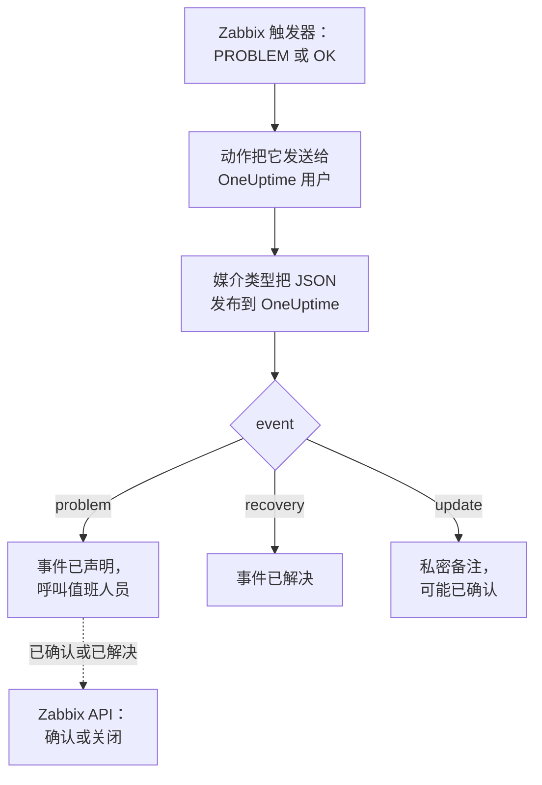

# Zabbix

把 [Zabbix](https://www.zabbix.com) 问题发送到 OneUptime，让每个问题都成为一个呼叫值班团队的事件，并在 Zabbix 恢复时解决。现成的工作流模板让两边保持同步：人们在 Zabbix 中的操作会记录到事件上，确认或解决事件会确认或关闭 Zabbix 中的问题。Zabbix 通过 Webhook 媒介类型发送每个问题，因此两边都无需安装任何东西。

:::cards
- [选择 OneUptime 接收问题的方式](#选择-oneuptime-接收问题的方式): 工作流模板，或 Incoming Request 监视器。
- [从模板开始](#从模板开始): 六个模板，它们做什么，以及需要填写什么。
- [配置 Zabbix](#配置-zabbix): 一个媒介类型、一个用户和一个动作。
- [故障排除](#故障排除): 问题没有到达，或事件一直未关闭时。
:::

## 工作方式



Zabbix 通过用户的媒介把问题发送给该用户。这里的媒介是一个名为 **OneUptime** 的 Webhook 媒介类型：每出现一个问题、每次问题恢复、每次有人在 Zabbix 中更新问题，它的脚本都会把一个小的 JSON 文档发布到 OneUptime，其中包含问题的事件 ID、名称、主机和严重程度。OneUptime 通过事件 ID 找到某个问题创建的事件。

## 开始之前

- 一台由你管理的 Zabbix 服务器。本指南针对 Zabbix 6.0 LTS 和 7.0 LTS 编写。从 Zabbix 5.0 起，Webhook 媒介类型的工作方式相同。调用 Zabbix API 的模板需要 Zabbix 6.4 或更高版本，或者 [在 Zabbix 6.0 上做一处修改](#在-zabbix-60-上)。
- 一台能够通过 HTTPS 访问你的 OneUptime 的 Zabbix 服务器；对于调用 Zabbix 的模板，还需要一个能够访问 Zabbix 的 OneUptime。
- 在 OneUptime 中创建工作流的权限；如果选择监视器方式，则需要创建监视器的权限。在 OneUptime Cloud 上，工作流需要 **Growth** 或更高的套餐。

## 选择 OneUptime 接收问题的方式

先设置 OneUptime：它会给你 Zabbix 要发送到的 URL。

| 方式 | 适用情况 |
| --- | --- |
| 工作流模板（推荐） | 你希望每个问题都按其 Zabbix 严重程度成为一个事件或警报，High 和 Disaster 时呼叫值班人员，恢复时解决，人们在 Zabbix 中的操作记录在上面，并从 OneUptime 确认或关闭 Zabbix 中的问题。 |
| Incoming Request 监视器 | 你希望不用工作流、在任何套餐上都能创建事件，并有一个状态跟随 Zabbix 的监视器。不会有任何内容回到 Zabbix。 |

两者从同一个媒介类型收到相同的 JSON，所以你可以先用其中一种，之后只需修改 Zabbix 中的一个 URL 就能切换。

## 从模板开始

**创建工作流** 对话框在其类别列表的 **Zabbix** 下有六个 Zabbix 模板：三个用于事件，然后是同样的三个用于警报。

| 模板 | 作用 | 需要填写 |
| --- | --- | --- |
| **事件** | | |
| Declare an incident for each Zabbix problem | 接收 Zabbix 所发送的一切的工作流。它为每个问题声明一个事件，High 和 Disaster 时呼叫值班人员，记录在 Zabbix 中所做的更新，并在恢复时解决事件。 | Zabbix URL |
| Acknowledge or close the Zabbix problem with the incident | 事件被确认时，确认其问题。事件被解决时，关闭问题；如果 Zabbix 不允许手动关闭，则改为确认问题。 | Zabbix URL、Zabbix API Token |
| Copy incident private notes to the Zabbix problem | 把事件上的每条私密备注作为消息添加到其问题中。 | Zabbix URL、Zabbix API Token |
| **警报** | | |
| Create an alert for each Zabbix problem | 与事件相同，只是为每个问题创建一个警报。 | Zabbix URL |
| Acknowledge or close the Zabbix problem with the alert | 与事件相同，依据警报的状态。 | Zabbix URL、Zabbix API Token |
| Copy alert private notes to the Zabbix problem | 把警报上的每条私密备注作为消息添加到其问题中。 | Zabbix URL、Zabbix API Token |

先从 **Declare an incident for each Zabbix problem** 开始，警报则从 **Create an alert for each Zabbix problem** 开始：它创建的事件或警报会把问题的事件 ID 保存在自定义字段 `zabbixEventId` 中，另外两个模板通过它找到问题。

### 模板需要填写的内容

- **Zabbix URL**：你打开 Zabbix 的地址，例如 `https://zabbix.example.com`；如果 Zabbix 运行在某个路径下，则为 `https://example.com/zabbix`。指向问题的链接会指向这里，调用 Zabbix 的模板会把请求发送到它的 `api_jsonrpc.php`。该字段不接受 Zabbix 内某个页面的地址。
- **Zabbix API Token**：工作流所代表的 Zabbix 用户的 API 令牌。[创建 API 令牌](#创建-api-令牌) 介绍了如何创建。它会保存为密钥变量，并且只发送给 Zabbix：放在 `Authorization` 标头中，在 Zabbix 6.0 上则放在请求正文中。

### 用模板接收问题

:::steps
1. 前往 **工作流**，点击 **创建工作流**。在 **或者从模板开始** 下，在类别列表中选择 **Zabbix**，点击 **Declare an incident for each Zabbix problem**，然后点击 **使用此模板**。
2. 填写 **Zabbix URL**。在 **Who to page for High and Disaster problems** 下选择要呼叫的值班策略，不选则不呼叫任何人，然后点击 **创建工作流**。工作流会在 **生成器** 中打开，处于关闭状态。
3. 点击 **Webhook** 触发器，然后点击 **复制 URL**，把 URL 留给 Zabbix 使用。
4. 在 **生成器** 顶部打开 **已启用**。处于关闭状态的工作流会以 `400` 回应 Zabbix。
:::

然后 [配置 Zabbix](#配置-zabbix)，让它把问题发送到这个 URL。

### 工作流做什么

在 **Webhook** 触发器之后， **Check With JavaScript** 步骤 `read-event-1` 读取媒介类型发送的 `event`，再由 **Incident From Another Tool**（警报模板中为 **Alert From Another Tool** ）按问题的事件 ID 执行它所代表的操作：

| 事件类型 | 工作流做什么 |
| --- | --- |
| `problem` | 声明一个标题为 `Zabbix: <problem> on <host>` 的事件，其严重程度为 Zabbix 严重程度所对应的严重程度，并且不显示在你的状态页上。它的描述链接到 Zabbix 中的问题，并列出主机、严重程度、开始时间、运行数据和标签。对于 High 或 Disaster 问题，它会呼叫你选择的值班策略。Zabbix 以相同事件 ID 再次发送的问题不会创建第二个事件。 |
| `recovery` | 解决问题的事件，除非它已经解决。原因记录在它的时间线上。 |
| `update` | 把在 Zabbix 中所做的操作作为私密备注添加到事件：谁做的、做了什么、写了什么。如果这次更新确认了问题，它也会确认事件，值班升级随之停止。 |

其他任何内容，例如来自其他工具的请求，都会原样保留： `read-event-1` 走 **No**，运行的 **步骤** 会说明原因。失败的步骤会让运行失败，它在 **步骤** 中的条目会说明原因。

### 严重程度

在新项目中，模板把 Zabbix 的六个严重程度映射到以下事件和警报严重程度：

| Zabbix 严重程度 | 事件 | 警报 | 值班 |
| --- | --- | --- | --- |
| Disaster | Critical Incident | High | 呼叫 |
| High | Critical Incident | High | 呼叫 |
| Average | Major Incident | Low | 不呼叫 |
| Warning | Major Incident | Low | 不呼叫 |
| Information | Minor Incident | Low | 不呼叫 |
| Not classified | Minor Incident | Low | 不呼叫 |

使用你自己的严重程度时，Disaster 和 High 对应最严重的一个，Average 和 Warning 对应中间的一个，Information 和 Not classified 对应最轻的一个。Zabbix 把严重程度编号为 0（Not classified）到 5（Disaster），模板读取的是编号，所以在 Zabbix 中重命名严重程度不会改变任何东西。

- 要按名称把某个严重程度映射到你的某个严重程度，请编辑 `read-event-1` 步骤中的 `SEVERITY_BY_NAME`，例如 Warning 对应 `{ 2: 'Minor Incident' }`。
- 要让 Average 问题也呼叫值班人员，请把 `if-page-1` **If / Else** 步骤的 **Compare with** 设为 `3`。

### 把确认和备注发送回 Zabbix

:::steps
1. [创建 API 令牌](#创建-api-令牌)。
2. 从 **Acknowledge or close the Zabbix problem with the incident** 创建工作流。填写 **Zabbix URL** 和 **Zabbix API Token**，点击 **创建工作流**，然后打开 **已启用**。
3. 如果也想把备注发送到 Zabbix，请对 **Copy incident private notes to the Zabbix problem** 做同样的操作。
:::

状态模板会先向 Zabbix 查询问题，因此 Zabbix 已经确认或解决的问题会保持原样。要关闭问题，它的触发器需要在 Zabbix 中启用 **Allow manual close**。否则，问题会改为被确认，并附上一条说明事件已解决的消息，Zabbix 会在问题恢复时关闭它。不是由 Zabbix 问题创建的事件，以及标记为 **私密事件** 的事件，永远不会发送到 Zabbix。

### 创建 API 令牌

:::steps
1. 使用 [接收问题](#创建接收问题的用户) 的 `OneUptime` 用户。Zabbix 不会把用户自己的更新发送给该用户，因此使用这个用户的令牌时，OneUptime 的确认和消息永远不会作为更新回到 OneUptime。
2. 在 **Users → User roles** 中检查用户的角色。它需要启用 **Access to API**，并允许 **Acknowledge problems**、**Add problem comments** 和 **Close problems**。除非有人改过，**User role** 都允许这些操作。
3. 在 **Users → User groups** 中检查用户的用户组。对主机组的 **Read** 权限足以确认问题和添加消息。要关闭问题，需要 **Read-write**。
4. 前往 **Users → API tokens**，点击 **Create API token**。选择 `OneUptime` 用户，取消勾选 **Set expiration date and time** 或记下日期，然后点击 **Add**。
5. 复制 **Auth token**：Zabbix 只显示一次。把它粘贴到 **Zabbix API Token** 中。
:::

### 在 Zabbix 6.0 上

Zabbix 6.0 从请求正文而不是 `Authorization` 标头中读取 API 令牌。在每个调用 Zabbix 的模板的 **Update Zabbix Problem** 步骤中，打开 **更多字段** 下的 **Zabbix 6.0**。Zabbix 7.2 及更高版本会拒绝正文中的令牌，所以升级时请再次关闭它。

## 用监视器接收问题

[Incoming Request 监视器](/docs/monitor/incoming-request-monitor) 会给你一个 URL，它的条件决定每个请求做什么。

:::steps
### 创建监视器

前往 **监视器**，点击 **创建监视器**。在 **监视器类型** 下选择 **Incoming Request**，将其命名为 `Zabbix`，然后点击 **下一步**。

### 为每个问题声明事件

在 **标准** 步骤中，打开第一个条件，也就是把监视器标记为离线的那个。把它的过滤器设为 **请求主体**、**包含**、`"status":"1"`。这个条件在过滤器匹配时已经会声明事件。填写事件信息：

- **事件标题**：`Zabbix: {{requestBody.name}} on {{requestBody.host}}`。
- **严重程度**：Zabbix 问题应有的事件严重程度。
- **值班** 下的 **值班策略**：要呼叫的策略。
- **更多字段** 下的 **自动解决事件**：保持开启，它默认就是开启的。关闭后会忽略恢复，事件将一直保持打开。

### 每个问题一个事件

在同一个条件中，打开 **设置** 并开启 **Group incidents and alerts by a payload field**。按下表填写，让每个问题都有自己的事件，并由它的恢复来解决：

| 字段 | 值 |
| --- | --- |
| **Open a separate incident for each…** | `requestBody.event_id` |
| **Field that signals recovery** | `requestBody.status` |
| **Value that means recovered** | `0` |

### 让监视器恢复在线

打开第二个条件，也就是把监视器标记为在线的那个，把它的过滤器设为 **请求主体**、**包含**、`"status":"0"`。

### 复制 URL

点击 **创建监视器**。监视器的 **概览** 页面会显示它的 **Heartbeat URL**。复制它供 Zabbix 使用：

```text
https://oneuptime.com/heartbeat/<secret key>
```

自托管安装使用自己的主机来代替 `oneuptime.com`。
:::

监视器按原样读取请求的 JSON：`"status":"1"`，没有空格。每项设置的作用请参见 [接收来自其他系统的告警](/docs/monitor/incoming-request-monitor#接收来自其他系统的告警)。在 Zabbix 中所做的更新也以 `"status":"1"` 发送，监视器会再次把它读作该问题，不会创建第二个事件。

## 配置 Zabbix

Zabbix 需要三样东西：一个发布到 OneUptime 的媒介类型、一个接收它的用户，以及一个把问题发送给该用户的动作。

:::steps
### 创建 OneUptime 媒介类型

1. 前往 **Alerts → Media types**（在 Zabbix 6.0 上为 **Administration → Media types**），点击 **Create media type**。
2. 把 **Name** 设为 `OneUptime`，**Type** 设为 **Webhook**。
3. 添加以下 **Parameters**。每一项都把一个 Zabbix [宏](https://www.zabbix.com/documentation/current/en/manual/appendix/macros/supported_by_location) 映射到请求中：

   | 名称 | 值 |
   | --- | --- |
   | `url` | `{ALERT.SENDTO}` |
   | `event_id` | `{EVENT.ID}` |
   | `event_name` | `{EVENT.NAME}` |
   | `event_value` | `{EVENT.VALUE}` |
   | `event_severity` | `{EVENT.SEVERITY}` |
   | `event_nseverity` | `{EVENT.NSEVERITY}` |
   | `host` | `{HOST.NAME}` |
   | `event_date` | `{EVENT.DATE}` |
   | `event_time` | `{EVENT.TIME}` |
   | `event_opdata` | `{EVENT.OPDATA}` |
   | `event_tags` | `{EVENT.TAGSJSON}` |
   | `trigger_id` | `{TRIGGER.ID}` |
   | `event_update_status` | `{EVENT.UPDATE.STATUS}` |
   | `event_update_action` | `{EVENT.UPDATE.ACTION}` |
   | `event_update_message` | `{EVENT.UPDATE.MESSAGE}` |
   | `event_update_user` | `{USER.FULLNAME}` |

4. 把以下内容粘贴到 **Script** 中：

   ```javascript
   var params = JSON.parse(value);

   // Zabbix leaves a macro it has no value for as it is written, such as
   // {EVENT.UPDATE.MESSAGE} on a problem: it is sent as nothing.
   function given(text) {
     var written = String(text === undefined || text === null ? "" : text);
     return /^\{[A-Z0-9_.]+\}$/.test(written) || written === "*UNKNOWN*"
       ? ""
       : written;
   }

   var isUpdate = given(params.event_update_status) === "1";
   var payload = {
     source: "zabbix",
     // "problem", "recovery" or "update".
     event: isUpdate
       ? "update"
       : params.event_value === "0"
         ? "recovery"
         : "problem",
     event_id: params.event_id,
     name: params.event_name,
     host: params.host,
     severity: params.event_severity,
     // 0 Not classified, 1 Information, 2 Warning, 3 Average, 4 High, 5 Disaster.
     severity_number: params.event_nseverity,
     // "1" for a problem, "0" for its recovery.
     status: params.event_value,
     date: params.event_date,
     time: params.event_time,
     opdata: given(params.event_opdata),
     tags: [],
     trigger_id: params.trigger_id,
   };

   try {
     var tags = JSON.parse(given(params.event_tags) || "[]");
     payload.tags = Array.isArray(tags) ? tags : [];
   } catch (error) {
     payload.tags = [];
   }

   if (isUpdate) {
     payload.update = {
       action: given(params.event_update_action),
       message: given(params.event_update_message),
       user: given(params.event_update_user),
     };
   }

   var request = new HttpRequest();
   request.addHeader("Content-Type: application/json");

   var response = request.post(params.url, JSON.stringify(payload));

   if (request.getStatus() < 200 || request.getStatus() >= 300) {
     throw (
       "OneUptime responded with HTTP " + request.getStatus() + ": " + response
     );
   }

   return "OK";
   ```

5. 在 **Message templates** 选项卡上，为 **Problem**、**Problem recovery** 和 **Problem update** 各添加一个模板。模板文本留空：请求由脚本构建。Zabbix 只会把媒介类型用于它有模板的事件类型。
6. 点击 **Add**。

### 创建接收问题的用户

1. 前往 **Users → Users**（在 Zabbix 6.0 上为 **Administration → Users**），点击 **Create user**。将其命名为 `OneUptime`，并为它指定一个用户组和一个能够接收通知的角色，例如 **User role**。
2. 在 **Media** 选项卡上点击 **Add**。把 **Type** 设为 `OneUptime`，**Send to** 设为你从 OneUptime 复制的 URL。**When active** 和严重程度保持不变，或者取消勾选 OneUptime 不应收到的严重程度。
3. 点击 **Add**，然后再次点击 **Add** 保存用户。

### 用动作把问题发送到 OneUptime

1. 前往 **Alerts → Actions → Trigger actions**（在 Zabbix 6.0 上为 **Configuration → Actions**），点击 **Create action**。将其命名为 `Notify OneUptime`。
2. 如有需要，在 **Conditions** 下缩小范围，例如 **Trigger severity is greater than or equals Warning**。没有条件时，每个问题都会被发送。
3. 在 **Operations** 选项卡上，添加一个通过 `OneUptime` 媒介类型发送给 `OneUptime` 用户的操作。
4. 在 **Recovery operations** 下添加同样的操作，这样恢复也会被发送；再在 **Update operations** 下添加，这样在 Zabbix 中所做的确认和评论也会被发送。
5. 点击 **Add**，并检查该动作已启用。
:::

要把一些问题发送到事件模板、另一些发送到警报模板，请给 `OneUptime` 用户两个类型为 `OneUptime` 的媒介：每个媒介发送到一个工作流的 URL，并带上它应接收的严重程度。

## 测试

1. 在 Zabbix 中打开 **Alerts → Media types**，点击 `OneUptime` 旁边的 **Test**。填入你复制的 URL，以及示例值，例如 `event_id` `12345`、`event_name` `Test problem`、`host` `web-1`、`event_nseverity` `4` 和 `event_value` `1`。点击 **Test**：Zabbix 会显示脚本的回应 `OK`，或者脚本抛出的错误。
2. 在 OneUptime 中打开工作流的 **日志 → 运行记录** 检查这次运行；或者打开监视器，检查是否创建了事件。
3. 用 `event_value` `0` 和相同的 `event_id` 再测试一次。事件会被解决。

然后让一个真实的触发器触发，例如暂时调低某个阈值，观察问题到达。要试试更新，请在 Zabbix 中附上一条消息确认该问题：事件会得到一条私密备注，并被确认。

## 映射 Zabbix 严重程度

Zabbix 以文本形式发送严重程度：`Not classified`、`Information`、`Warning`、`Average`、`High` 或 `Disaster`。

- **使用模板时**，严重程度会自动为你映射：参见 [严重程度](#严重程度)。
- **使用监视器时**，为每组严重程度点击 **添加条件**，并把新条件拖到第一个条件上方：条件从上往下检查，第一个匹配的条件起决定作用。为每个条件设置两个过滤器，`"status":"1"` 和一个严重程度，例如 `"severity":"Disaster"`，并把 **匹配条件** 设为 **全部**。为每个条件设置一个事件，带有自己的 **严重程度** 和 **自动解决事件**，以及相同的分组设置。

## 故障排除

:::details OneUptime 没有收到任何内容
- 在 Zabbix 中打开 **Reports → Action log**，检查动作是否发送了问题，以及返回了什么。
- 从 Zabbix 服务器自己发送一个请求：`curl -i -X POST <url> -H 'Content-Type: application/json' -d '{"source":"zabbix","event":"problem","event_id":"1","name":"Test","host":"test","severity_number":"4","status":"1"}'`。
- 监视器会在检查任何内容之前立即回应 `200`，即使密钥错误也是如此。请查看监视器的时间线，确认请求是否到达。
- 处于关闭状态的工作流会回应 `400`。在它的 **生成器** 顶部打开 **已启用**。
:::

:::details Zabbix 报告脚本错误
打开媒介类型并使用 **Test**：Zabbix 会显示脚本的结果或它抛出的错误。OneUptime 返回的非 `2xx` 响应会被脚本连同状态码一起抛出，所以请先检查 URL。
:::

:::details 事件被创建但从未被解决
- 动作需要 **Recovery operations**，否则 Zabbix 永远不会发送恢复。
- 使用模板时，打开工作流的 **日志 → 运行记录** 中恢复的那次运行：它的最后一步会说明原因。对于没有创建事件的问题，恢复不会改变任何东西。
- 使用监视器时，条件中的事件需要启用 **更多字段** 下的 **自动解决事件**。**Field that signals recovery** 必须是 `requestBody.status`，**Value that means recovered** 必须恰好是 `0`。
:::

:::details Zabbix 中的问题没有被确认或关闭
在 **日志 → 运行记录** 中打开状态模板的运行：它的最后一步会说明 Zabbix 的回应。

- `Not authorized`：API 令牌错误、已过期或已禁用，或者 Zabbix 早于 6.4（参见 [在 Zabbix 6.0 上](#在-zabbix-60-上)）。
- `Cannot close problem: trigger does not allow manual closing`：在触发器上打开 **Allow manual close**。模板已经会改为确认这类问题，而不是关闭它们。
- `No permissions to referred object or it does not exist!`：用户能看到问题，但需要 **Read-write** 权限才能关闭它。
- `Zabbix has no problem with event ID`：用户看不到问题的主机。请为其用户组授予对该主机组的 **Read** 权限。
:::

:::details 事件显示的是引用而不是值
引用了请求中不存在的字段时，该引用会连同花括号按原样保留，而不会被清空。请检查 Zabbix 是否发送了 `Content-Type: application/json`，以及你使用的字段名（`name`、`host`、`severity`、`status`、`event_id`）是否与脚本的负载一致。对于工作流，请在 **日志 → 运行记录** 中打开这次运行，并与触发器收到的内容进行比较。参见 [陷阱](/docs/workflows/variables#陷阱)。
:::

:::details 每个问题都到达两次
动作很可能有两个发送给同一用户的操作，例如第一步和一个升级步骤。无论收到什么，模板对每个事件 ID 只创建一个事件，但每次投递都是一次运行。请检查动作的 **Operations**。
:::

## 安全

- **像对待密码一样对待 URL。** 任何拥有它的人都可以创建事件。如果泄露，请重置它：在工作流的 **Webhook** 触发器中使用 **重置 URL**，或在监视器的 **设置** 页面使用 **重置传入请求密钥**。然后更新 Zabbix 用户媒介中的 **Send to**。
- **链接指向你的 Zabbix。** 无论请求中写了什么，模板都会链接到其 **Zabbix URL** 所指站点上的问题，并把 Zabbix 发送的内容作为文本写入。
- **让 API 令牌只做工作流需要做的事。** 它是一个密钥变量，在运行日志中会被隐藏，并且只发送给 Zabbix：除非打开了 **Zabbix 6.0**，否则放在 `Authorization` 标头中。给它的用户一个仅允许上述操作的角色，如果令牌泄露，请在 **Users → API tokens** 中删除它。
- **只发送需要事件的内容。** 使用动作的条件或用户媒介的严重程度，把低严重程度的问题留在 Zabbix 中。
- **自托管？** 让你的 Zabbix 服务器能够穿过防火墙，通过 HTTPS 访问你的 OneUptime。要调用私有网络中的 Zabbix，工作流需要 [出站网络访问](/docs/workflows/configuration#出站网络访问)。

## 后续步骤

:::cards
- [工作流模板](/docs/workflows/authoring): 从模板创建工作流，并在生成器中修改它。
- [入站请求监控](/docs/monitor/incoming-request-monitor): 接收 Zabbix 问题的监视器的所有设置。
- [升级规则](/docs/on-call/escalation-rules): 决定值班策略呼叫谁、何时呼叫。
- [集成概述](/docs/integrations/index): 你可以连接的其他工具。
:::
