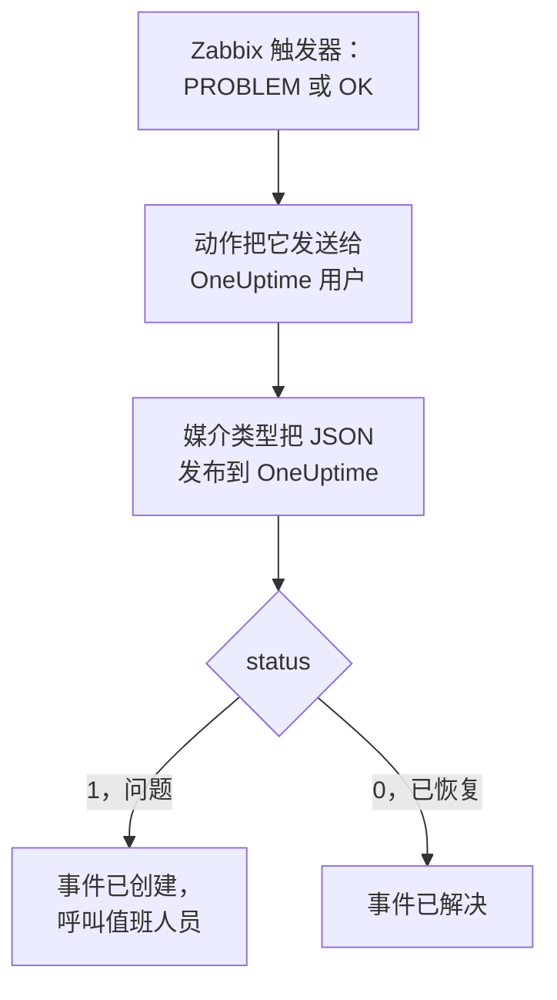

# Zabbix

把 [Zabbix](https://www.zabbix.com) 问题发送到 OneUptime，让每个问题都成为一个呼叫值班团队的事件，并在 Zabbix 恢复时解决。Zabbix 通过 Webhook 媒介类型发送每个问题，因此两边都无需安装任何东西。

:::cards
- [选择 OneUptime 接收问题的方式](#选择-oneuptime-接收问题的方式): Incoming Request 监视器，或你自己的工作流。
- [用监视器接收问题](#用监视器接收问题): 每个问题一个事件，恢复时自动解决。
- [配置 Zabbix](#配置-zabbix): 一个媒介类型、一个用户和一个动作。
- [故障排除](#故障排除): 问题没有到达，或事件一直未关闭时。
:::

## 工作方式



Zabbix 通过用户的媒介把问题发送给该用户。这里的媒介是一个名为 **OneUptime** 的 Webhook 媒介类型：它的脚本把一个小的 JSON 文档发布到 OneUptime，其中包含问题的事件 ID、名称、主机、严重程度和状态。状态为 `1` 表示问题，为 `0` 表示问题已恢复。

## 开始之前

- 一台由你管理的 Zabbix 服务器。本指南针对 Zabbix 6.0 LTS 和 7.0 LTS 编写。从 Zabbix 5.0 起，Webhook 媒介类型的工作方式相同。
- 一台能够通过 HTTPS 访问你的 OneUptime 的 Zabbix 服务器。
- 在 OneUptime 中创建监视器的权限；如果选择工作流方式，则需要创建工作流的权限。

## 选择 OneUptime 接收问题的方式

先设置 OneUptime：它会给你 Zabbix 要发送到的 URL。

| 方式 | 适用情况 |
| --- | --- |
| Incoming Request 监视器（推荐） | 你希望每个 Zabbix 问题都成为一个呼叫值班人员的事件，并在 Zabbix 恢复时解决。无需构建任何东西。 |
| 带 Webhook 触发器的工作流 | 你需要自己的逻辑：先过滤问题、转换格式或调用其他系统。工作流不会在恢复时自行解决事件。 |

两者从同一个媒介类型收到相同的 JSON，所以你可以先用其中一种，之后只需修改 Zabbix 中的一个 URL 就能切换。

## 用监视器接收问题

[Incoming Request 监视器](/docs/monitor/incoming-request-monitor) 会给你一个 URL，它的条件决定每个请求做什么。

:::steps
### 创建监视器

前往 **监视器**，点击 **创建监视器**。在 **监视器类型** 下选择 **Incoming Request**，将其命名为 `Zabbix`，然后点击 **下一步**。

### 为每个问题声明事件

在 **标准** 步骤中，打开第一个条件，也就是把监视器标记为离线的那个。把它的过滤器设为 **请求主体**、**包含**、`"status":"1"`。这个条件在过滤器匹配时已经会声明事件。填写事件信息：

- **事件标题**：`Zabbix: {{requestBody.name}} on {{requestBody.host}}`。
- **严重程度**：Zabbix 问题应有的事件严重程度。
- **值班** 下的 **值班策略**：要呼叫的策略。
- **更多字段** 下的 **自动解决事件**：保持开启，它默认就是开启的。关闭后会忽略恢复，事件将一直保持打开。

### 每个问题一个事件

在同一个条件中，打开 **设置** 并开启 **Group incidents and alerts by a payload field**。按下表填写，让每个问题都有自己的事件，并由它的恢复来解决：

| 字段 | 值 |
| --- | --- |
| **Open a separate incident for each…** | `requestBody.event_id` |
| **Field that signals recovery** | `requestBody.status` |
| **Value that means recovered** | `0` |

### 让监视器恢复在线

打开第二个条件，也就是把监视器标记为在线的那个，把它的过滤器设为 **请求主体**、**包含**、`"status":"0"`。

### 复制 URL

点击 **创建监视器**。监视器的 **概览** 页面会显示它的 **Heartbeat URL**。复制它供 Zabbix 使用：

```text
https://oneuptime.com/heartbeat/<secret key>
```

自托管安装使用自己的主机来代替 `oneuptime.com`。
:::

监视器按原样读取请求的 JSON：`"status":"1"`，没有空格。每项设置的作用请参见 [接收来自其他系统的告警](/docs/monitor/incoming-request-monitor#接收来自其他系统的告警)。

## 用工作流接收问题

当你需要在 Zabbix 和事件之间加入自己的步骤时，请使用 [工作流](/docs/workflows/index)。

:::steps
### 创建工作流

前往 **工作流**，点击 **创建工作流**，然后点击 **从零开始**。将其命名为 `Zabbix problems`，然后点击 **创建工作流**。

### 添加 Webhook 触发器

点击虚线的 **Choose what starts this workflow** 块并选择 **Webhook**。点击该触发器，然后点击 **复制 URL**，把 URL 留给 Zabbix 使用。

### 检查是否为问题

点击 **添加组件**，添加一个 **If / Else** 块，并把触发器的 **Out** 点连接到它。把 **Value to check** 设为 `{{local.components.webhook-1.returnValues.request-body.status}}`，**Comparison** 设为 **is equal to**，**Compare with** 设为 `1`。

### 声明事件

添加一个 **Create One Incident** 块，并把 **If / Else** 块的 **Yes** 一侧连接到它。在 **Incident Template** 中选择一个设置了严重程度和要呼叫的值班策略的模板（参见 [事件模板](/docs/incidents/settings#事件模板)）。在 **JSON Object** 中设置来自 Zabbix 的内容：

```json
{
  "title": "Zabbix: {{local.components.webhook-1.returnValues.request-body.name}}",
  "description": "Host: {{local.components.webhook-1.returnValues.request-body.host}}\nSeverity: {{local.components.webhook-1.returnValues.request-body.severity}}\nZabbix event: {{local.components.webhook-1.returnValues.request-body.event_id}}"
}
```

如果不使用模板，**JSON Object** 中还需要 `incidentSeverityId`，即项目中某个事件严重程度的 ID。

### 启用

在 **生成器** 顶部打开 **已启用**。处于关闭状态的工作流会以 `400` 回应 Zabbix。
:::

恢复会走向 **If / Else** 块的 **No** 一侧，那里没有连接任何东西，因此运行到此结束。要在恢复时解决事件，请使用监视器。

## 配置 Zabbix

Zabbix 需要三样东西：一个发布到 OneUptime 的媒介类型、一个接收它的用户，以及一个把问题发送给该用户的动作。

:::steps
### 创建 OneUptime 媒介类型

1. 前往 **Alerts → Media types**（在 Zabbix 6.0 上为 **Administration → Media types**），点击 **Create media type**。
2. 把 **Name** 设为 `OneUptime`，**Type** 设为 **Webhook**。
3. 添加以下 **Parameters**。每一项都把一个 Zabbix [宏](https://www.zabbix.com/documentation/current/en/manual/appendix/macros/supported_by_location) 映射到请求中：

   | 名称 | 值 |
   | --- | --- |
   | `url` | `{ALERT.SENDTO}` |
   | `event_id` | `{EVENT.ID}` |
   | `event_name` | `{EVENT.NAME}` |
   | `event_value` | `{EVENT.VALUE}` |
   | `event_severity` | `{EVENT.SEVERITY}` |
   | `host` | `{HOST.NAME}` |
   | `event_date` | `{EVENT.DATE}` |
   | `event_time` | `{EVENT.TIME}` |

4. 把以下内容粘贴到 **Script** 中：

   ```javascript
   var params = JSON.parse(value);
   var request = new HttpRequest();
   request.addHeader("Content-Type: application/json");

   var payload = {
     source: "zabbix",
     event_id: params.event_id,
     name: params.event_name,
     host: params.host,
     severity: params.event_severity,
     // "1" for a problem, "0" for its recovery.
     status: params.event_value,
     date: params.event_date,
     time: params.event_time,
   };

   var response = request.post(params.url, JSON.stringify(payload));

   if (request.getStatus() < 200 || request.getStatus() >= 300) {
     throw (
       "OneUptime responded with HTTP " + request.getStatus() + ": " + response
     );
   }

   return "OK";
   ```

5. 在 **Message templates** 选项卡上，为 **Problem** 和 **Problem recovery** 各添加一个模板。模板文本留空：请求由脚本构建。Zabbix 只会把媒介类型用于它有模板的事件类型。
6. 点击 **Add**。

### 创建接收问题的用户

1. 前往 **Users → Users**（在 Zabbix 6.0 上为 **Administration → Users**），点击 **Create user**。将其命名为 `OneUptime`，并为它指定一个用户组和一个能够接收通知的角色，例如 **User role**。
2. 在 **Media** 选项卡上点击 **Add**。把 **Type** 设为 `OneUptime`，**Send to** 设为你从 OneUptime 复制的 URL。**When active** 和严重程度保持不变，或者取消勾选 OneUptime 不应收到的严重程度。
3. 点击 **Add**，然后再次点击 **Add** 保存用户。

### 用动作把问题发送到 OneUptime

1. 前往 **Alerts → Actions → Trigger actions**（在 Zabbix 6.0 上为 **Configuration → Actions**），点击 **Create action**。将其命名为 `Notify OneUptime`。
2. 如有需要，在 **Conditions** 下缩小范围，例如 **Trigger severity is greater than or equals Warning**。没有条件时，每个问题都会被发送。
3. 在 **Operations** 选项卡上，添加一个通过 `OneUptime` 媒介类型发送给 `OneUptime` 用户的操作。
4. 在 **Recovery operations** 下添加同样的操作，这样恢复也会被发送。
5. 点击 **Add**，并检查该动作已启用。
:::

## 测试

1. 在 Zabbix 中打开 **Alerts → Media types**，点击 `OneUptime` 旁边的 **Test**。填入你复制的 URL，以及示例值，例如 `event_id` `12345`、`event_name` `Test problem`、`host` `web-1` 和 `event_value` `1`。点击 **Test**：Zabbix 会显示脚本的回应 `OK`，或者脚本抛出的错误。
2. 在 OneUptime 中打开监视器，检查是否创建了事件；或者打开工作流的 **日志 → 运行记录** 检查这次运行。
3. 用 `event_value` `0` 和相同的 `event_id` 再测试一次。使用监视器时，事件会被解决。

然后让一个真实的触发器触发，例如暂时调低某个阈值，观察问题到达。

## 映射 Zabbix 严重程度

Zabbix 以文本形式发送严重程度：`Not classified`、`Information`、`Warning`、`Average`、`High` 或 `Disaster`。

- **使用监视器时**，为每组严重程度点击 **添加条件**，并把新条件拖到第一个条件上方：条件从上往下检查，第一个匹配的条件起决定作用。为每个条件设置两个过滤器，`"status":"1"` 和一个严重程度，例如 `"severity":"Disaster"`，并把 **匹配条件** 设为 **全部**。为每个条件设置一个事件，带有自己的 **严重程度** 和 **自动解决事件**，以及相同的分组设置。
- **使用工作流时**，针对 `{{local.components.webhook-1.returnValues.request-body.severity}}` 添加一个 [Switch / Case](/docs/workflows/components#switch-case) 块，为每个严重程度设置一个分支，并在每个分支后面添加一个带有自己模板的 **Create One Incident** 块。

## 故障排除

:::details OneUptime 没有收到任何内容
- 在 Zabbix 中打开 **Reports → Action log**，检查动作是否发送了问题，以及返回了什么。
- 从 Zabbix 服务器自己发送一个请求：`curl -i -X POST <url> -H 'Content-Type: application/json' -d '{"status":"1","event_id":"1","name":"Test","host":"test"}'`。
- 监视器会在检查任何内容之前立即回应 `200`，即使密钥错误也是如此。请查看监视器的时间线，确认请求是否到达。
- 处于关闭状态的工作流会回应 `400`。在它的 **生成器** 顶部打开 **已启用**。
:::

:::details Zabbix 报告脚本错误
打开媒介类型并使用 **Test**：Zabbix 会显示脚本的结果或它抛出的错误。OneUptime 返回的非 `2xx` 响应会被脚本连同状态码一起抛出，所以请先检查 URL。
:::

:::details 事件被创建但从未被解决
- 动作需要 **Recovery operations**，否则 Zabbix 永远不会发送恢复。
- 条件中的事件需要开启 **更多字段** 下的 **自动解决事件**。
- **Field that signals recovery** 必须是 `requestBody.status`，**Value that means recovered** 必须恰好是 `0`。
- 工作流不会在恢复时解决事件。请使用监视器。
:::

:::details 事件显示的是引用而不是值
引用了请求中不存在的字段时，该引用会连同花括号按原样保留，而不会被清空。请检查 Zabbix 是否发送了 `Content-Type: application/json`，以及你使用的字段名（`name`、`host`、`severity`、`status`、`event_id`）是否与脚本的负载一致。对于工作流，请在 **日志 → 运行记录** 中打开这次运行，并与触发器收到的内容进行比较。参见 [陷阱](/docs/workflows/variables#陷阱)。
:::

:::details 每个问题都到达两次
动作很可能有两个发送给同一用户的操作，例如第一步和一个升级步骤。请检查动作的 **Operations**。
:::

## 安全

- **像对待密码一样对待 URL。** 任何拥有它的人都可以创建事件。如果泄露，请重置它：在监视器的 **设置** 页面使用 **重置传入请求密钥**，或在工作流的 **Webhook** 触发器中使用 **重置 URL**。然后更新 Zabbix 用户媒介中的 **Send to**。
- **只发送需要事件的内容。** 使用动作的条件或用户媒介的严重程度，把低严重程度的问题留在 Zabbix 中。
- **自托管？** 让你的 Zabbix 服务器能够穿过防火墙，通过 HTTPS 访问你的 OneUptime。

## 后续步骤

:::cards
- [入站请求监控](/docs/monitor/incoming-request-monitor): 接收 Zabbix 问题的监视器的所有设置。
- [升级规则](/docs/on-call/escalation-rules): 决定值班策略呼叫谁、何时呼叫。
- [工作流触发器](/docs/workflows/triggers#webhook): 工作流的 Webhook URL 如何工作。
- [集成概述](/docs/integrations/index): 你可以连接的其他工具。
:::
