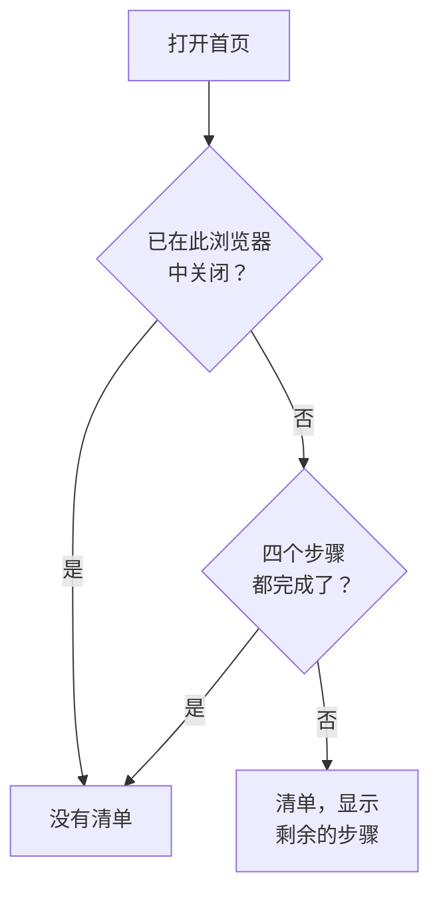

# 首页与快捷键

首页是你在项目中看到的第一个页面。它让你一眼就知道现在是否有需要你处理的事情，并引导新项目完成初始设置。本页介绍首页显示的内容、如何在仪表板中找到任何产品、页面或操作，以及能让你少在菜单中来回的键盘快捷键。

:::cards
- [首页显示的内容](#首页显示的内容): 是否有问题、哪些事项需要你处理、项目包含哪些内容，以及所有产品。
- [四处浏览](#四处浏览): 产品菜单，以及每个页面顶部的栏。
- [搜索](#搜索页面设置或操作): 输入名称即可找到任何页面、设置或操作。
- [键盘快捷键](#键盘快捷键): 按两个键即可前往首页、监视器或事件。
:::

## 首页显示的内容

在顶部栏中打开 **首页**，或在任意位置按 `g` 再按 `h`。首页是你的项目的概览。它从上到下显示：

1. 一个搜索框，旁边是 **声明事件** 和 **创建**。
2. 一行说明是否有问题的文字，下方是五个数字，统计需要关注的内容。
3. **欢迎使用 OneUptime 👋**：新项目的清单，完成之前一直显示。
4. **需要关注**：当前所有未解决的问题，逐一列出名称。
5. **您的项目**：项目由哪些内容组成；安排了维护时，还会显示 **即将进行的维护**。
6. **探索 OneUptime**：所有产品，每次显示一个类别。

### 搜索和创建

搜索框会打开搜索，与按 `Mod` + `K` 相同：输入任何页面、监视器、事件、告警、状态页面或值班策略的名称即可。请参阅 [搜索](#搜索页面设置或操作)。**声明事件** 会打开用于声明事件的表单。**创建** 提供 **创建监视器**、**安排维护** 和 **创建公告**。每一项都只向有权使用它的人显示。

### 状态标题

顶部的这一行会指出当前未解决的最紧急事项，并使用与之相应的颜色：

| 情况 | 首页显示 |
| --- | --- |
| 有未解决的事件 | 有多少个活跃事件，以红色显示 |
| 没有未解决的事件，但有未解决的告警、无法运行的监视器或有风险的 SLO | 有多少个问题需要关注，以琥珀色显示 |
| 没有任何问题，且有维护正在进行 | 有多少个维护事件正在进行中 |
| 监视器正在运行，且没有任何未解决的事项 | **所有系统运行正常** |
| 项目中还没有监视器 | **还没有监控任何内容** |

它的旁边会显示首页上次读取项目数据的时间，**刷新** 会重新读取一次。当你离开一分钟或更久后再回到首页所在的浏览器标签页时，它会自动刷新。

在还没有监控任何内容时，这一行的末尾会显示 **创建您的第一个监视器**，它会打开创建监视器的表单。只有有权创建监视器的人才能看到它。

### 五个数字

每个数字统计某样东西，告诉你它是否需要你处理，并打开它背后的列表。

| 数字 | 统计内容 | 计数为零时 |
| --- | --- | --- |
| **活跃事件** | 尚未解决的事件 | **一切正常** |
| **活跃警报** | 尚未解决的告警 | **一切正常** |
| **无法运行的监视器** | 状态不属于运行正常类状态的监视器。已归档的监视器不计入。 | **全部运行正常** |
| **进行中的维护** | 正在进行的计划维护事件 | **暂无进行中** |
| **有风险的 SLO** | 已开启且有风险或已用完错误预算的 SLO | **预算健康** |

计数大于零时显示 **需要关注**，维护和 SLO 则分别显示 **进行中** 和 **预算正在消耗**。还没有监视器的项目会看到 **还没有监视器**，没有 SLO 的项目会看到 **还没有 SLO**：空项目并不等同于健康的项目。此时这两项会打开 **监视器** 和 **SLOs** 列表，你可以在那里创建第一个。

### 欢迎清单

清单引导你完成项目发挥作用之前需要的四件事。每个步骤都会打开完成它的页面，并在项目具备它所要求的内容时自动勾选。

| 步骤 | 完成条件 | 打开 |
| --- | --- | --- |
| **创建您的第一个监视器** | 项目中有一个监视器。 | **创建监视器** 表单；对于不能创建监视器的人，则是 **监视器** 列表。 |
| **发布状态页面** | 项目中有一个状态页面。 | **状态页面** |
| **邀请您的团队** | 除你之外，项目中还有其他人，或已邀请了其他人。 | **用户** |
| **设置值班策略** | 项目中有一个值班策略。 | **值班** |

在步骤下方，**OneUptime 如何运作** 按问题流经的顺序展示四个核心产品：**监视器**、**事件与警报**、**值班** 和 **状态页面**。点击其中一个即可打开。

四个步骤全部完成后，清单就会消失。要提前隐藏它，请点击 **关闭**。关闭会在此浏览器中针对此项目被记住；步骤打开的所有内容仍然在 **产品** 菜单中。

### 需要关注

**需要关注** 按名称列出这些数字所统计的内容：未解决的事件、未解决的告警、无法运行的监视器、有风险的 SLO 和正在进行的维护，最紧急的排在最前面。每一行都会显示其严重性或状态，注明事件或告警何时开始、维护何时结束，并会打开对应的记录。每种类型最多显示五项，其余的可以通过 **显示全部** 查看。没有任何未解决的事项时，这里会显示 **没有需要您关注的事项**。

### 您的项目

**您的项目** 统计项目中的 **监视器**、**状态页面**、**值班策略**、**SLOs**、**服务**、**仪表板** 和 **工作流**，已归档的不计入。每一行都会打开对应的列表。项目中一个都没有的类型会显示 **设置**，而不是数字。

**即将进行的维护** 列出接下来的三个计划维护窗口，最早开始的排在最前面。没有安排任何维护时，这一部分不会显示。

### 探索 OneUptime

**探索 OneUptime** 展示 **产品** 菜单中的产品，每次显示一个类别，从基础分组开始。每个产品都会说明它的用途，点击即可打开。

### 首页的侧边菜单

首页本身没有侧边菜单：菜单中的内容，首页已经全部展示。首页打开的列表共用一个侧边菜单，其中每个列表都带有计数，点击 **概览** 即可返回首页：

| 部分 | 页面 |
| --- | --- |
| **首页** | **概览** |
| **事件** | **活动事件** 和 **活动片段** |
| **警报** | **活动警报** 和 **活动片段** |
| **监视器** | **无法运行** |
| **计划事件** | **进行中** |

片段将相关的事件或告警归为一组，让你把它们作为一个整体处理。请参阅 [核心概念](/docs/introduction/core-concepts#事件和告警)。

## 四处浏览

OneUptime 中的一切都在顶部栏的 **产品** 下。菜单把各个分组列为同一个列表中的行，并且打开时总是展开第一个分组，即基础：监控、事件、警报、值班、状态页面、计划维护和 SLOs。其他每个分组（可观测性、AI、代码、资源、基础设施、仪表板与自动化和设置）都折叠为同一列表中的一行。每一行列出该分组包含的产品，并说明有多少个。点击一行即可展开或折叠它，也可以用方向键移到该行并按 **Enter**。

- **搜索能找到一切。** 在菜单的搜索框中输入，即可按名称、按功能，或按 `k8s`、`RUM` 这样的常用词找到任何产品。搜索也会查找折叠的分组。
- **从你所在的位置开始。** 你当前所在页面的分组会自动展开，最近打开的产品会列在顶部。
- **你的选择会保留。** 菜单会在你的浏览器中记住你展开或折叠了其他哪些分组。即使你折叠过基础分组，每次打开菜单时它都会重新展开。
- **在手机上**，菜单按钮以同样的方式列出产品：基础分组在顶部展开，其他每个分组都是一行，轻点即可展开。

### 顶部的栏

每个页面的顶部有两条栏。

| 位置 | 内容 |
| --- | --- |
| 左上 | 项目选择器：切换到你的另一个项目，或创建新项目。 |
| 右上 | **搜索** 和 **询问 AI**、显示当前需要你处理的事项（活动事件和告警、你正在值班的值班策略、待处理的邀请）的通知铃铛、**帮助**，以及你的头像，它会打开你的 [账户](/docs/introduction/your-account) 菜单。 |
| 其下方 | 左侧是 **首页** 和 **产品**，右侧是 **用户设置**：OneUptime 在此项目中联系你的方式。 |

**帮助** 会打开本文档（**文档**）和 **Keyboard shortcuts** 列表，并提供邮件和 Slack 支持。在手机等窄屏上，为节省空间，**搜索**、**询问 AI** 和 **帮助** 会被隐藏；铃铛和你的头像会保留。

### 页面和列表

每个页面标题的上方都有一条路径，例如 *项目 › Docker › 设置 › 所有者规则*，说明页面所在的位置。最后一步之前的每一步都会打开它的页面。

- **列表会自动保持最新。** 无论在哪里创建、确认或解决了事件或警报，事件、警报和片段列表都会在几秒内显示出来，无需刷新。当你正在列表上做某件事时，例如勾选了行或打开了对话框，列表会等待，等你完成后再更新。
- **在手机上，筛选条件会折叠起来**，收在 **过滤器** 后面，让列表从更靠上的位置开始。你设置的筛选条件会和 **全部清除** 一起保持可见。按 **过滤器** 可以查看所有筛选条件，再按一次即可折叠。

## 搜索页面、设置或操作

按 **Cmd+K**（Mac）或 **Ctrl+K**（Windows 和 Linux），或点击顶部栏中的搜索图标，然后开始输入。搜索可以找到：

- **菜单中的每个页面**，按菜单给它的名称：API 密钥、危险区域、值班计划、事件严重性、你自己的通知方式。每个结果都会显示它所在的位置，例如 *项目设置 › 高级*，因此同名页面（事件、告警和监视器中的自定义字段）很容易区分。
- **页面上的设置**，按其卡片或开关显示的名称：*登录时要求使用 SSO* 会找到 SSO，*通知渠道* 会找到 通知设置。名称可以用英文输入，也可以用你的语言输入。
- **操作**，按你想做的事：声明事件、创建监视器，或者打开危险区域的 Delete Project。会更改内容的操作只提供给有权执行它的人。
- **你的监视器、事件、告警、状态页面和值班策略**，按名称。

搜索会按你的本意理解你输入的内容：

- 大小写、重音符号、空格和连字符都不影响结果：*on-call*、*on call* 和 *oncall* 会找到相同的页面，单词顺序也不限。
- 它知道许多页面的其他叫法（英文）：*pager* 或 *escalation* 对应值班策略，*rota* 对应值班计划，*2fa* 对应双因素身份验证，*delete project* 对应危险区域。
- 加上产品名称可以缩小搜索范围：*incident custom fields* 会找到事件的自定义字段页面。
- 即使有小的拼写错误，例如 *incidnet*，在没有完全匹配的结果时，仍然能找到你想要的内容。

搜索框为空时，搜索会列出你最近打开的页面、操作和产品。

## 键盘快捷键

在仪表板的任意位置按 `?` 可查看所有快捷键，也可以打开 **帮助** 并选择 **Keyboard shortcuts**。在 Mac 上，`Mod` 是 Command 键；在 Windows 和 Linux 上，它是 Ctrl 键。

| 按键 | 作用 |
| --- | --- |
| `Mod` + `K` | 打开命令面板：搜索任何页面、设置或操作。 |
| `Mod` + `I` | 就你正在查看的内容询问 AI。 |
| `/` | 搜索此页面上的列表。 |
| `?` | 显示键盘快捷键。 |
| `Esc` | 关闭对话框或面板。 |

### 前往某个产品

按 `g`，然后按一个字母，即可直接前往某个产品。请在按下 `g` 后 1.5 秒内按下字母。

| 按键 | 前往 |
| --- | --- |
| `g` 然后 `h` | 首页 |
| `g` 然后 `m` | 监控 |
| `g` 然后 `i` | 事件 |
| `g` 然后 `a` | 警报 |
| `g` 然后 `o` | 值班 |
| `g` 然后 `s` | 状态页面 |
| `g` 然后 `e` | 计划维护 |
| `g` 然后 `d` | 仪表板 |
| `g` 然后 `l` | 日志 |
| `g` 然后 `t` | 跟踪 |

快捷键不会妨碍你。在字段中输入时，`?`、`/` 和 `g` 不起作用；对话框打开时，任何按键都不会离开当前页面，因此误按一个键不会让你丢失填了一半的表单。其他任何产品，只需用 `Mod` + `K` 搜索即可到达。

## 后续步骤

:::cards
- [快速开始](/docs/introduction/quickstart): 一步步完成欢迎清单。
- [您的账户](/docs/introduction/your-account): 你的个人资料、登录安全、语言和主题。
- [询问 AI](/docs/ai/ask-ai): Ask AI 能为你回答什么、做什么。
- [核心概念](/docs/introduction/core-concepts): 监视器、事件、告警和值班分别是什么。
:::
