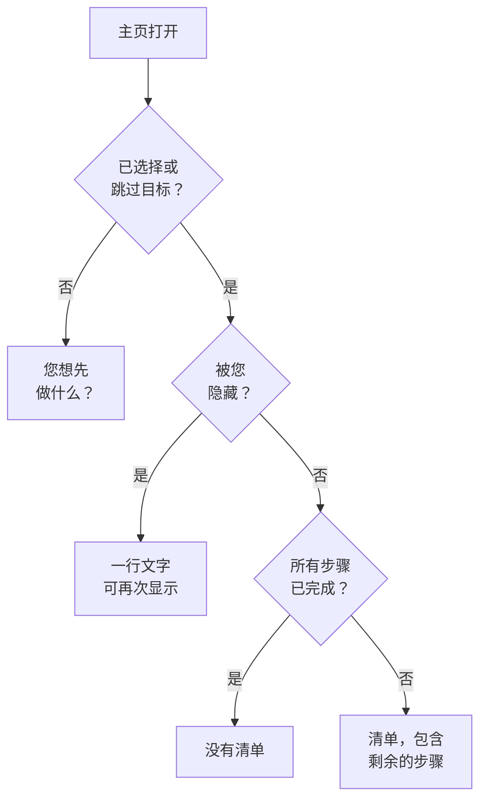

# 首页与快捷键

首页是你在项目中看到的第一个页面。它让你一眼就知道现在是否有需要你处理的事情，并引导新项目完成初始设置。本页介绍首页显示的内容、如何在仪表板中找到任何产品、页面或操作，以及能让你少在菜单中来回的键盘快捷键。

:::cards
- [首页显示的内容](#首页显示的内容): 是否有问题、哪些事项需要你处理、项目包含哪些内容，以及所有产品。
- [四处浏览](#四处浏览): 产品菜单，以及每个页面顶部的栏。
- [搜索](#搜索页面设置或操作): 输入名称即可找到任何页面、设置或操作。
- [键盘快捷键](#键盘快捷键): 按两个键即可前往首页、监视器或事件。
:::

## 首页显示的内容

在顶部栏中打开 **首页**，或在任意位置按 `g` 再按 `h`。首页是你的项目的概览，只有这一个页面，没有侧边菜单。它从上到下显示：

1. 一个搜索框，旁边是 **声明事件** 和 **创建**。
2. 一行说明是否有问题的文字，下方是五个数字，统计需要关注的内容。
3. **欢迎使用 OneUptime 👋**：新项目的清单，完成之前一直显示。
4. **需要关注**：当前所有未解决的问题，逐一列出名称。
5. **您的项目**：项目由哪些内容组成；安排了维护时，还会显示 **即将进行的维护**。
6. **探索 OneUptime**：所有产品，每次显示一个类别。

### 搜索和创建

搜索框会打开搜索，与按 `Mod` + `K` 相同：输入任何页面、监视器、事件、告警、状态页面或值班策略的名称即可。请参阅 [搜索](#搜索页面设置或操作)。**声明事件** 会打开用于声明事件的表单。**创建** 提供 **创建监视器**、**安排维护** 和 **创建公告**。每一项都只向有权使用它的人显示。

### 状态标题

顶部的这一行会指出当前未解决的最紧急事项，并使用与之相应的颜色：

| 情况 | 首页显示 |
| --- | --- |
| 有未解决的事件 | 有多少个活跃事件，以红色显示 |
| 没有未解决的事件，但有未解决的告警、无法运行的监视器或有风险的 SLO | 有多少个问题需要关注，以琥珀色显示 |
| 没有任何问题，且有维护正在进行 | 有多少个维护事件正在进行中 |
| 监视器正在运行，且没有任何未解决的事项 | **所有系统运行正常** |
| 项目中还没有监视器 | **还没有监控任何内容** |

它的旁边会显示首页上次读取项目数据的时间，**刷新** 会重新读取一次。当你离开一分钟或更久后再回到首页所在的浏览器标签页时，它会自动刷新。

在还没有监控任何内容时，这一行的末尾会显示 **创建您的第一个监视器**，它会打开引导式设置 **在我的网站或 API 宕机时知道**。只有有权创建监视器的人才能看到它。

### 五个数字

每个数字统计某样东西，告诉你它是否需要你处理，并在它所属的产品中打开它背后的列表。

| 数字 | 统计内容 | 计数为零时 | 打开 |
| --- | --- | --- | --- |
| **活跃事件** | 尚未解决的事件 | **一切正常** | **事件 → 活动事件** |
| **活跃警报** | 尚未解决的告警 | **一切正常** | **警报 → 活动警报** |
| **无法运行的监视器** | 状态不属于运行正常类状态的监视器。已归档的监视器和已关闭监控的监视器不计入。 | **全部运行正常** | **监视器 → 无法运行** |
| **进行中的维护** | 正在进行的维护事件 | **暂无进行中** | **计划维护 → 进行中的维护事件** |
| **有风险的 SLO** | 已开启且有风险或已用完错误预算的 SLO | **预算健康** | **SLOs** |

计数大于零时显示 **需要关注**，维护和 SLO 则分别显示 **进行中** 和 **预算正在消耗**。只要有 SLO 处于风险中，**有风险的 SLO** 就会打开 **SLOs** 列表，并只显示这些 SLO。还没有监视器的项目会看到 **还没有监视器**，没有 SLO 的项目会看到 **还没有 SLO**：空项目并不等同于健康的项目。此时这两项会打开 **监视器** 和 **SLOs** 列表，你可以在那里创建第一个。

### 欢迎清单

项目所有者或管理员第一次打开新项目的主页时，卡片会问 **您想先做什么？** 勾选一个或多个目标，例如 **在我的网站或 API 宕机时知道** 或 **只是随便看看**，然后点击 **继续**：清单就会包含这些目标需要的步骤。**跳过** 会给出每个项目都有的四个步骤。之后要重新回答，请点击清单上的 **更改**。已经在使用监视器、遥测或值班的项目不会被询问。

每个步骤在真正生效时自动勾选，而不是在记录存在时，所有设置此项目的人在每台设备上都看到同一份清单：

| 步骤 | 完成条件 | 打开 |
| --- | --- | --- |
| **从您当前的工具导入** | 从其他工具的导入完成。 | **从其他工具导入** |
| **创建您的第一个监视器** | 收到它的第一次检查结果。 | 引导式设置 **在我的网站或 API 宕机时知道**，对于不能创建监视器的人则是 **监视器** 列表。 |
| **连接服务器或集群** | 收到它的第一批指标。 | **主机** |
| **发送您的第一批日志、指标或追踪** | 收到项目的第一批日志、指标、追踪、异常或性能剖析。 | 引导式设置 **发送日志、指标和追踪，然后获取警报** |
| **设置值班策略** | 测试呼叫被确认、呼叫送达某人，或值班规则运行一个能通知到某人的策略。 | 引导式设置 **出现故障时呼叫合适的人** |
| **发布状态页面** | 状态页面显示一个监视器。 | 引导式设置 **发布状态页面**，对于不能创建状态页面的人则是 **状态页面** 列表。 |
| **邀请您的团队** | 有人接受了您的邀请。 | **用户** |

要先做的步骤标有 **下一步**。在只限一人的 OneUptime Cloud Free 套餐中，**邀请您的团队** 会说明需要 Growth 套餐，并打开 **账单**。在尚无法发送电子邮件的自托管服务器上，服务器管理员会先看到 **此服务器尚无法发送电子邮件**，它会打开管理控制台。

引导式设置在一个页面上逐步完成整项工作，最后说明它设置了什么以及下一步做什么。以后要再次打开，请搜索它的名称。

在步骤下方，**OneUptime 如何运作** 按问题流经的顺序展示四个核心产品：**监视器**、**事件与警报**、**值班** 和 **状态页面**。点击其中一个即可打开。下方还说明了为这一流程提供输入的是什么，即遥测和基础设施，并链接到 [核心概念](/docs/introduction/core-concepts) 和 [术语表](/docs/introduction/glossary)。

所有步骤完成后，清单会对所有人消失。要提前隐藏，请点击 **隐藏**：它只对您隐藏，在每台设备上都如此，并留下一行包含 **显示** 和 **OneUptime 如何运作**。作为成员被邀请加入项目的人看不到这份清单。在任何项目中，**OneUptime 如何运作** 都只需点击一下：从 **帮助** 打开，或点击 **探索 OneUptime** 旁边的按钮。

### 需要关注

**需要关注** 按名称列出这些数字所统计的内容：未解决的事件、未解决的告警、无法运行的监视器、有风险的 SLO 和正在进行的维护，最紧急的排在最前面。每一行都会显示其严重性或状态，注明事件或告警何时开始、维护何时结束，并会打开对应的记录。每种类型最多显示五项，其余的可以通过 **显示全部** 查看，它打开的列表与该类型的数字打开的相同。没有任何未解决的事项时，这里会显示 **没有需要您关注的事项**。

### 配置健康

当项目配置中的某些问题会让相关人员收不到通知时，**需要关注** 的最后会出现 **设置**，显示有多少项需要查看。点击它会打开 **配置健康**，按严重程度从高到低，在 **呼叫无法送达**、**值得修复** 和 **建议** 下列出配置有误的地方：不呼叫任何人的监视器、没有任何规则或监视器运行的值班策略、无法被呼叫的响应人、已关闭的 SMS、无人值班的值班排班、不显示任何监视器的状态页。每条发现都用一句话说明哪里有问题，并附有打开修复位置的按钮；监视器的发现，就是它的 **宕机时** 卡片指出的断点。团队有意保留原样的发现，可以填写原因后对所有人隐藏，并可从 **已忽略** 中恢复。在搜索中可以通过 **配置健康** 找到此页面，询问 AI 也会根据它回答“我的配置没问题吗？”。

### 您的项目

**您的项目** 统计项目中的 **监视器**、**状态页面**、**值班策略**、**SLOs**、**服务**、**仪表板** 和 **工作流**，已归档的不计入。每一行都会打开对应的列表。项目中一个都没有的类型会显示 **设置**，而不是数字。

**即将进行的维护** 列出接下来的三个计划维护窗口，最早开始的排在最前面。没有安排任何维护时，这一部分不会显示。

### 探索 OneUptime

**探索 OneUptime** 展示 **产品** 菜单中的产品，每次显示一个类别，从基础分组开始。每个产品都会说明它的用途，点击即可打开。项目中隐藏的产品不会出现在这里。

## 四处浏览

OneUptime 中的一切都在顶部栏的 **产品** 下。菜单把各个分组列为同一个列表中的行，并且打开时总是展开第一个分组，即基础：监控、事件、警报、值班、状态页面、计划维护和 SLOs。其他每个分组（可观测性、安全、AI、代码、资源、基础设施、云、仪表板与自动化和设置）都折叠为同一列表中的一行。每一行列出该分组包含的产品，并说明有多少个。点击一行即可展开或折叠它，也可以用方向键移到该行并按 **Enter**。

- **搜索能找到一切。** 在菜单的搜索框中输入，即可按名称、按功能，或按 `k8s`、`RUM` 这样的常用词找到任何产品。搜索也会查找折叠的分组。
- **从你所在的位置开始。** 你当前所在页面的分组会自动展开，最近打开的产品会列在顶部。
- **你的选择会保留。** 菜单会在你的浏览器中记住你展开或折叠了其他哪些分组。即使你折叠过基础分组，每次打开菜单时它都会重新展开。
- **在手机上**，菜单按钮以同样的方式列出产品：基础分组在顶部展开，其他每个分组都是一行，轻点即可展开。
- **项目不使用的产品。** 项目所有者或管理员可以在 **项目设置 → 基础 → 产品** 中隐藏它们。隐藏的产品会移到菜单的最后一行 **更多产品** 下：搜索仍能找到它，它的页面照常工作，数据也会继续到达。当其中某个产品开始收到数据时，首页会告诉能重新显示它的人。
- **固定。** 把产品保留在顶部栏中，位于 **首页** 和 **产品** 旁边：在菜单中按下它卡片上的图钉，或按下它页面标题旁的 **固定**。最多可以固定五个，它们会跟随你到每个浏览器。在手机上，你固定的产品会排在菜单最前面。
- **正在使用的产品。** 除基础分组和设置外，每个分组中项目正在使用的产品排在前面，尚未设置的产品会显示 **未设置**。在 OneUptime Cloud 上，你的套餐不包含的产品会显示包含它的套餐名称。

### 顶部的栏

每个页面的顶部有两条栏。

| 位置 | 内容 |
| --- | --- |
| 左上 | 项目选择器：切换到你的另一个项目，或创建新项目。 |
| 右上 | **搜索** 和 **询问 AI**、显示当前需要你处理的事项（活动事件和告警、你正在值班的值班策略、待处理的邀请）的通知铃铛、**帮助**，以及你的头像，它会打开你的 [账户](/docs/introduction/your-account) 菜单。 |
| 其下方 | 左侧是 **首页** 和 **产品**，右侧是 **用户设置**：OneUptime 在此项目中联系你的方式。 |

**帮助** 先列出帮助你学习的内容：**快速开始**、**OneUptime 如何运作**、**术语表** 和本文档（**文档**）。下面是 **键盘快捷键** 列表以及邮件和 Slack 支持。在平板电脑或窄窗口中，为节省空间，**询问 AI** 会被隐藏：可以在 **搜索** 的操作中找到它。在手机上，**搜索** 和 **帮助** 会移到菜单按钮的列表中，分别位于顶部和底部；铃铛和你的头像会保留。

带虚线下划线的词，例如新建监控器表单上的 **探测器**，在你指向它、用 Tab 键移到它上面或点按它时会显示含义。点击 **阅读更多** 会在 [术语表](/docs/introduction/glossary) 中打开这个词。

### 页面和列表

每个页面标题的上方都有一条路径，例如 *项目 › Docker › 设置 › 所有者规则*，说明页面所在的位置。最后一步之前的每一步都会打开它的页面。

- **列表会自动保持最新。** 无论在哪里创建、确认或解决了事件或警报，事件、警报和片段列表都会在几秒内显示出来，无需刷新。当你正在列表上做某件事时，例如勾选了行或打开了对话框，列表会等待，等你完成后再更新。
- **在手机上，筛选条件会折叠起来**，收在 **过滤器** 后面，让列表从更靠上的位置开始。你设置的筛选条件会和 **全部清除** 一起保持可见。按 **过滤器** 可以查看所有筛选条件，再按一次即可折叠。
- 列表 **⋯** 菜单中的 **列** 用来选择列表显示哪些列以及它们的顺序，并在此浏览器中为你保存。项目所有者或项目管理员还可以在那里勾选 **向此项目中的所有人显示这些列**：没有为该列表选择自己的列的人都会看到这些列，而 **重置为项目默认值** 会把你自己的列恢复为这些列。
- 同一菜单中的 **紧凑行** 会让所有列表的行变矮，长列表因此能多显示约五分之一的行。该选择保存在此浏览器中。
- **在手机上，或在窄得放不下自身各行的卡片中，列表会显示为卡片，每行一张。** 卡片上方的横条会说明它们的排序方式，例如 **按名称排序**：按下它可以选择排序所依据的列，以及 **升序** 或 **降序**。
- **事件的页面以其编号开头。** 页面标题、路径中对应的一步和浏览器标签页都显示为 `INC-42 Checkout is down`，提到它的对话框也是如此，因此标题相同的事件也能区分开。警报、维护事件和片段也一样。

## 搜索页面、设置或操作

按 **Cmd+K**（Mac）或 **Ctrl+K**（Windows 和 Linux），或点击顶部栏中的搜索图标，然后开始输入。搜索可以找到：

- **菜单中的每个页面**，按菜单给它的名称：API 密钥、危险区域、值班计划、事件严重性、你自己的通知方式。每个结果都会显示它所在的位置，例如 *项目设置 › 高级*，因此同名页面（事件、告警和监视器中的自定义字段）很容易区分。
- **页面上的设置**，按其卡片或开关显示的名称：*登录时要求使用 SSO* 会找到 SSO，*自定义 SMTP 配置* 会找到 通知渠道。名称可以用英文输入，也可以用你的语言输入。
- **操作**，按你想做的事：声明事件、创建监视器，或者打开危险区域的 Delete Project。会更改内容的操作只提供给有权执行它的人。
- **你的监视器、事件、告警、状态页面和值班策略**，按名称；事件和告警也可按编号查找，例如 `INC-42`。每个事件和告警的结果都以编号开头，因此标题相同的也能区分开。
- **文档**：在所有其他结果下方的 *文档* 分组中，以你的语言列出与你输入的词相符的页面和章节，即使有拼写错误也能找到。每一项都在新标签页中打开，你不会离开当前页面。

搜索会按你的本意理解你输入的内容：

- 大小写、重音符号、空格和连字符都不影响结果：*on-call*、*on call* 和 *oncall* 会找到相同的页面，单词顺序也不限。
- 它知道许多页面的其他叫法（英文）：*pager* 或 *escalation* 对应值班策略，*rota* 对应值班计划，*2fa* 对应双因素身份验证，*delete project* 对应危险区域。
- 加上产品名称可以缩小搜索范围：*incident custom fields* 会找到事件的自定义字段页面。
- 即使有小的拼写错误，例如 *incidnet*，在没有完全匹配的结果时，仍然能找到你想要的内容。

搜索框为空时，搜索会列出你最近打开的页面、操作和产品。

## 键盘快捷键

在仪表板的任意位置按 `?` 可查看所有快捷键，也可以打开 **帮助** 并选择 **键盘快捷键**。在 Mac 上，`Mod` 是 Command 键；在 Windows 和 Linux 上，它是 Ctrl 键。

| 按键 | 作用 |
| --- | --- |
| `Mod` + `K` | 打开命令面板：搜索任何页面、设置或操作。 |
| `Mod` + `I` | 就你正在查看的内容询问 AI。 |
| `/` | 搜索此页面上的列表。 |
| `?` | 显示键盘快捷键。 |
| `Esc` | 关闭对话框或面板。 |

### 前往某个产品

按 `g`，然后按一个字母，即可直接前往某个产品。请在按下 `g` 后 1.5 秒内按下字母。

| 按键 | 前往 |
| --- | --- |
| `g` 然后 `h` | 首页 |
| `g` 然后 `m` | 监控 |
| `g` 然后 `i` | 事件 |
| `g` 然后 `a` | 警报 |
| `g` 然后 `o` | 值班 |
| `g` 然后 `s` | 状态页面 |
| `g` 然后 `e` | 计划维护 |
| `g` 然后 `d` | 仪表板 |
| `g` 然后 `l` | 日志 |
| `g` 然后 `t` | 跟踪 |

快捷键不会妨碍你。在字段中输入时，`?`、`/` 和 `g` 不起作用；对话框打开时，任何按键都不会离开当前页面，因此误按一个键不会让你丢失填了一半的表单。其他任何产品，只需用 `Mod` + `K` 搜索即可到达。

## 后续步骤

:::cards
- [快速开始](/docs/introduction/quickstart): 一步步完成欢迎清单。
- [您的账户](/docs/introduction/your-account): 你的个人资料、登录安全、语言和主题。
- [询问 AI](/docs/ai/ask-ai): Ask AI 能为你回答什么、做什么。
- [核心概念](/docs/introduction/core-concepts): 监视器、事件、告警和值班分别是什么。
:::
