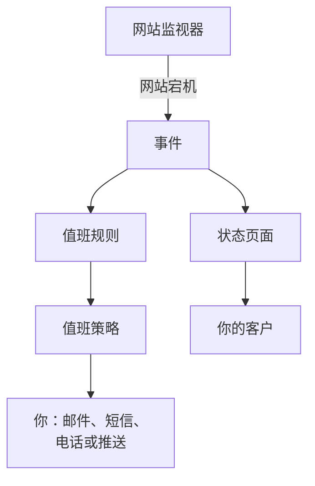

# 快速开始

本指南带你在大约十五分钟内，从一个新账户走到一套可用的配置：一个每五分钟检查一次网站的监视器，一个在网站宕机时呼叫你的值班策略，以及一个告知客户的状态页面。它按照项目首页上的 **欢迎使用 OneUptime 👋** 清单，以及清单各步骤打开的引导式设置进行。

从其他工具迁移过来？请先 [导入现有配置](/docs/introduction/getting-started#从其他工具迁移)：你的监视器、值班计划和状态页面都会随你一起迁移。

## 开始之前

- **一个账户。** 在 OneUptime Cloud 上，前往 [oneuptime.com](https://oneuptime.com/accounts/register) 注册，并打开发给你的邮件中的链接。在你自己的安装上，在浏览器中打开它并注册：第一个账户会成为主管理员。要安装 OneUptime，请参阅 [Docker Compose](/docs/installation/docker-compose)。
- **一个要监控的网站。** 任何通过 HTTP 或 HTTPS 应答的地址都可以，例如你公司的主页。

## 创建项目

OneUptime 中的一切都位于项目中：你的监视器、事件、值班策略、状态页面，以及处理它们的人员。

:::steps
### 开始一个新项目

第一次登录时，OneUptime 会显示 **没有项目**。点击 **创建新项目**。如果已有人邀请你加入某个项目，请改为在同一页面上接受邀请。

### 为它命名

输入 **项目名称**，例如你公司的名称。在 OneUptime Cloud 上，还要在其下方选择一个套餐：已默认选中 Free，付费套餐从免费试用开始。

### 创建它

点击 **创建项目**。项目首页随即打开，顶部是 **欢迎使用 OneUptime 👋** 清单。 它会先问 **您想先做什么？**：勾选 **在我的网站或 API 宕机时知道**、**出现故障时呼叫合适的人** 和 **用状态页面告知我的客户**，然后点击 **继续**。
:::

## 监控你的网站

:::steps
### 打开网站设置

在清单中点击 **创建您的第一个监视器**。它会打开引导式设置 **在我的网站或 API 宕机时知道**，在一个页面上检查你的网站、选择通知谁并发送一次测试。不能创建监视器的人会改为看到 **监视器** 列表。

### 输入地址

在 **我们要检查什么？** 下，在 **网站或 API 地址** 中输入网站的完整地址，例如 `https://example.com`，然后点击 **开始检查**。探测器会立即检查它，之后每 5 分钟检查一次：当网站没有响应，或返回错误时，监视器会变为 **离线** 并声明一个事件。点击 **继续**。

在 OneUptime Cloud 的 Free 套餐中，监视器按用量计费，因此项目需要先有付款方式才能检查你的网站：没有付款方式时，该步骤会请你 [添加付款方式](/docs/configuration/billing#支付方式)。

### 选择通知谁

在 **要通知谁？** 下，你已经在 **呼叫对象** 中。点击 **保存并继续**：这会创建 `Default on-call policy`，它会在项目中每个新事件和警报时呼叫你，一开始通过邮件。若还要呼叫已在项目中的团队成员，请先点击 **添加团队成员**。

### 给自己发送测试

在 **发送测试** 下，点击 **给我发送测试呼叫**，选择 **严重程度**，然后点击 **发送测试呼叫**。打开邮件中的链接（邮件中写有 TEST），并在那里确认这次呼叫。然后点击对话框中的 **完成**，再点击 **继续**：设置会以一份它所配置内容的摘要结束。
:::

若要自己设置每个选项，或检查网站以外的内容，请从 **产品** 菜单打开 **监视器**，然后点击 **创建监视器**。[创建监视器](/docs/monitor/create-monitor) 介绍了表单和每种监视器类型。

要同时检查 API，并了解首次检查一直没有结果时该怎么办，请按照 [在网站或 API 宕机时收到通知](/docs/guides/website-down) 操作。

## 在网站宕机时收到呼叫

网站设置已经创建了 `Default on-call policy`，它会在每个新事件和警报时通过邮件呼叫你，因此清单会把 **设置值班策略** 标为已完成。它的引导式设置仍然可以添加你的手机、与你一起被呼叫的人，以及无人响应时会发生什么。

:::steps
### 打开值班设置

按 `Ctrl+K`（Mac 上按 `Cmd+K`），输入 `get paged`，然后选择 **出现故障时呼叫合适的人**。在清单尚未勾选 **设置值班策略** 时，该步骤也会打开同一个引导式设置。

### 选择联系你的方式

在 **我们该如何联系你？** 下，你的登录邮箱已经列出。若要接收推送通知，请从 App Store 或 Google Play 安装 OneUptime On-Call 应用并登录，然后点击 **重新检查**。若还要通过短信和电话联系你，请点击 **开启短信和电话**，在 **你的电话号码** 中输入号码，然后点击 **通过短信发送验证码**：在 OneUptime Cloud 上，短信和电话从项目余额中付费，所以该步骤会先请你充值。点击 **继续**。

### 选择还有谁被呼叫

在 **还有谁值班？** 下，在 **值班策略** 中保留 `Default on-call policy`。若要与你一起呼叫团队成员，请在 **添加到第一条升级规则** 下添加他们。点击 **保存并继续**。

### 决定无人响应时怎么办

在 **如果无人响应怎么办？** 下，当项目中只有你一个人时，选择 **再次呼叫同一批人**。有团队成员加入后，**呼叫其他人** 会呼叫你在 **接着呼叫** 下选择的人。在 OneUptime Cloud 上，只有付费套餐提供此选项。点击 **保存并继续**。

### 发送测试呼叫

在 **发送测试呼叫** 下，点击 **测试此策略**，选择 **严重程度**，然后点击 **发送测试呼叫**。从邮件、短信或电话中确认这次呼叫，然后点击对话框中的 **完成**，再点击 **继续**。设置以 **呼叫已设置** 结束。
:::

> [!NOTE]
> 新项目中的短信和电话呼叫默认关闭。项目所有者、Billing Admin 或拥有 Manage Billing 权限的人，可以在 **项目设置 → 通知 → 通知渠道** 下的 **通知渠道** 卡片中打开它们。

两条值班规则运行这个策略：一条针对每个新事件，一条针对每个新警报。要查看第一条，请从 **产品** 菜单打开 **事件**，在侧边菜单中展开 **规则**，然后选择 **值班规则**：它匹配 **所有事件**。若只想在部分事件（例如严重事件）时呼叫该策略，请在那里编辑这条规则，或点击 **创建Incident On-Call Rule** 添加你自己的规则。

若要改为逐个字段创建策略，请从 **产品** 菜单打开 **值班**，然后点击 **创建值班策略**。关于更多级别、轮换以及每个级别等待多久，请参阅 [升级规则](/docs/on-call/escalation-rules) 和 [值班计划](/docs/on-call/schedules)。

关于设置的每个界面，以及呼叫没有送达时该怎么办，请按照 [通过电话、短信或推送接收呼叫](/docs/guides/paging) 操作。

## 发布状态页面

:::steps
### 打开状态页面设置

在清单中点击 **发布状态页面**。它会打开引导式设置 **发布状态页面**，为页面命名、把你的监视器放到页面上，并展示客户看到的内容。不能创建状态页面的人会改为看到 **状态页面** 列表。网站设置的摘要也会以 **在状态页上显示** 打开同一个设置。

### 命名并选择你的监视器

在 **命名并选择要显示的内容** 下，保留它建议的 **状态页名称**，或输入你自己的名称。在 **显示的内容** 下，勾选你的网站监视器，然后点击 **创建状态页**。从这一刻起，页面在它的链接上公开：任何拥有其地址的人都能打开它。

### 打开页面

在 **这是客户看到的内容** 下，打开 **公开链接** 下的地址：你的网站显示为正常运行。回到设置中，点击 **看起来不错**。设置会以一份下一步该做什么的摘要结束。
:::

若要改为手动创建页面，请从 **产品** 菜单打开 **状态页面**，点击 **创建状态页面**，然后在它的 **概览** 中通过 **添加监视器** 添加你的监视器。要为页面使用你自己的徽标和颜色，请参阅 [状态页品牌与域名](/docs/status-pages/branding-and-domains)。

若要通过 HTTPS 把状态页面放到你自己的域名上，请按照 [发布状态页面](/docs/guides/status-page) 操作。

## 邀请你的团队

在清单中点击 **邀请您的团队**，或从 **产品** 菜单的 **设置** 下打开 **用户**。点击 **邀请用户**，输入对方的 **电子邮件**，并选择一个 **团队**：默认选中的是成员团队。点击 **邀请**。OneUptime 会通过邮件向对方发送邀请，而团队决定对方可以做什么。请参阅 [用户、团队与权限](/docs/permissions/index)。

## 试一试

声明一个测试事件，看看整条链路如何运作。

:::steps
### 声明测试事件

打开 **事件** 并点击 **声明事件**。输入 **标题**，例如 `Test incident`，选择 **事件严重性**，然后点击 **下一步**。在 **监视器** 下选择你的网站监视器，这样事件就会显示在你的状态页面上。一直点击 **下一步** 直到摘要，然后点击 **声明事件**。

### 观察结果

一两分钟内，你的值班策略会呼叫你，事件也会显示在你的状态页面上。

### 解决它

在事件页面上点击 **解决**。呼叫停止，事件从你的状态页面上消失。
:::

> [!WARNING]
> 在你解决测试事件之前，任何打开你状态页面的人都会看到它。请在分享页面地址之前进行测试。

## 故障排查

:::details 我没有收到呼叫
打开事件，在其侧边菜单中选择 **值班执行**：它会显示你的策略是否运行，以及呼叫了谁。如果没有运行，请检查你的值班规则是否已启用并指定了该策略。如果运行了，请检查 **用户设置 → 通知方式** 下的方式是否已验证。
:::

:::details 事件没有显示在我的状态页面上
当事件的某个监视器在状态页面上时，状态页面才会显示该事件。请检查事件的受影响资源中是否列出了你的监视器，以及该监视器是否在状态页面上。
:::

:::details 监视器显示离线，但我的网站正常
打开监视器，查看探测器收到了什么。请参阅 [网站监控](/docs/monitor/website-monitor) 的故障排查部分。
:::

## 后续步骤

:::cards
- [核心概念](/docs/introduction/core-concepts): 你刚刚设置的内容背后的概念。
- [术语表](/docs/introduction/glossary): 你一路上遇到的每个词，用一两句话解释。
- [值班计划](/docs/on-call/schedules): 与团队分担值班。
- [状态页品牌与域名](/docs/status-pages/branding-and-domains): 让状态页面体现你的品牌。
- [OpenTelemetry](/docs/telemetry/open-telemetry): 从你的应用发送日志、指标和追踪。
:::
