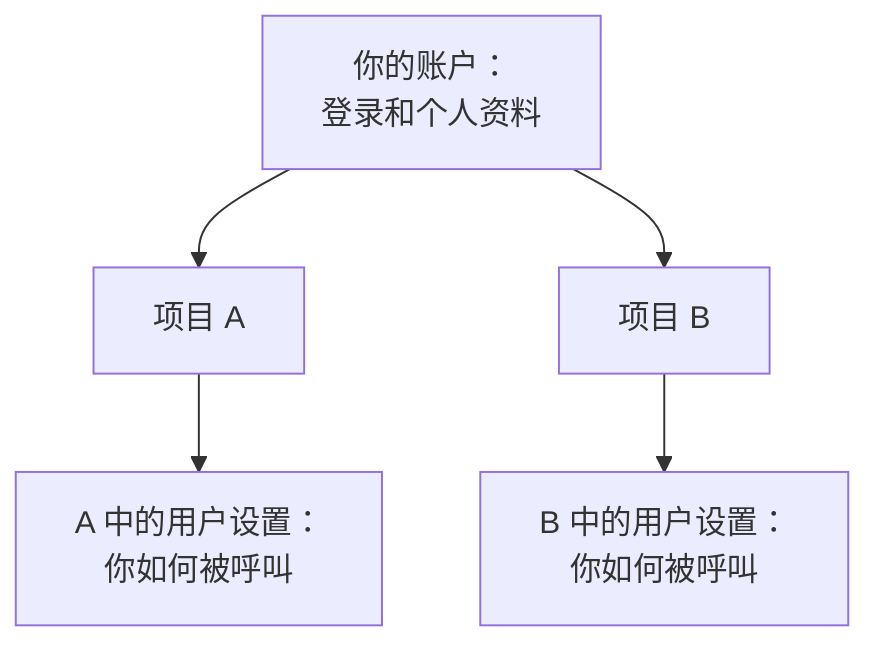

# 您的账户

你的账户是 OneUptime 认识你的方式：你用来登录的邮箱和密码、你的姓名、时区和语言，以及保护你登录的措施。一个账户可以属于多个项目，这些设置会跟随你进入每一个项目。OneUptime 如何联系你、何时呼叫你，则在每个项目的 **用户设置** 中设置。

:::cards
- [你的个人资料](#你的个人资料): 你的姓名、邮箱、时区、语言和头像。
- [安全登录](#安全登录): 你的密码、登录链接、通行密钥和双因素身份验证。
- [你的项目](#你的项目): 切换项目、创建项目和接受邀请。
- [用户设置](#每个项目为你保存的内容): OneUptime 在每个项目中如何联系你。
:::

## 用户菜单

点击仪表板右上角你的头像。

| 菜单项 | 作用 |
| --- | --- |
| **个人资料** | 打开 **用户配置**：你的姓名、邮箱、时区、语言、头像和登录安全。 |
| **管理员设置** | 打开 Admin Dashboard。只有自托管安装的主管理员才能看到它。 |
| **主题** | 设置仪表板的主题：**浅色**、**深色** 或 **系统**，系统会按你设备的设置显示浅色或深色。 |
| **退出登录** | 让你退出登录，并立即在每台 OneUptime 服务器上生效。如果管理员已设置，也会让你退出身份提供商的登录。 |

**用户配置** 有自己的侧边菜单。**基础** 包含 **概览** 和 **头像**。**安全** 和 **危险区域** 是折叠的：点击分组的标题即可展开。

## 你的个人资料

:::steps
### 打开你的个人资料

点击右上角你的头像，然后选择 **个人资料**。**概览** 页面会打开并显示 **基本信息** 卡片：你的姓名、邮箱、时区和语言。

### 编辑你的信息

点击 **编辑用户**，修改你需要的内容：

- **电子邮件**：你用来登录的地址。如果你修改了它，OneUptime 会向新地址发送一个链接，打开该链接后你的地址才会更改。在此之前，你仍使用当前地址登录，**取消更改** 可以停止这次更改。主管理员自己的地址会立即更改。如果链接过期，**重新发送链接** 会发送一个新链接。每当你的地址更改时，OneUptime 都会给你原来的地址发送邮件。
- **全名**：你的团队在 OneUptime 各处看到的名字。
- **时区**：仪表板显示和读取时间所用的时区，也用于发给你的通知中的时间。
- **语言**：你登录的每个浏览器中仪表板的语言，也是你的值班呼叫的语言。未设置时，呼叫为英语，仪表板跟随你的浏览器。

点击 **保存更改**。

### 添加头像

选择 **头像**，点击 **Update Profile Picture** 并上传图片。它会显示在你的用户菜单中，以及人员列表中你的名字旁边。
:::

> [!NOTE]
> 你第一次在某个浏览器上登录时，OneUptime 会把该浏览器的时区保存到你的个人资料中。如果你之后在浏览器时区不同的地方登录，仪表板会询问是否要 **更新时区**。关闭询问后，对于该时区它不会再问。

## 安全登录

在 **用户配置** 的侧边菜单中展开 **安全**。它有三个页面。

| 页面 | 用途 |
| --- | --- |
| **密码管理** | 设置新密码。 |
| **通行密钥** | 无需密码即可登录，使用指纹、面容、屏幕锁或安全密钥。 |
| **双因素身份验证** | 在密码或电子邮件链接之后要求第二步：来自应用的验证码，或安全密钥。 |

### 更改密码

:::steps
1. 打开 **安全 → 密码管理**。
2. 在 **新密码** 中输入新密码，并在 **确认密码** 中再输入一次。密码长度至少为 15 个字符，且不能容易被猜到，例如常见密码或重复的模式：几个互不相关的词就很好。输入时，字段下方的检查清单会逐项打勾。
3. 点击 **更新密码**。
:::

设置新密码后，所有设备都会退出你的账户，已发送的重置链接和登录链接也会失效。

所有设置密码的页面要求都一样：注册、**忘记密码？** 发出的重置链接、本页面，以及服务器管理员的 **设置密码**。在此规则之前设置的密码在你更改之前仍然可用。

### 添加通行密钥

:::steps
1. 打开 **安全 → 通行密钥** 并点击 **添加通行密钥**。
2. 为它取一个你认得出的名字，例如你的设备或密码管理器的名称，然后点击 **创建通行密钥**。
3. 按照浏览器的提示保存通行密钥。
:::

下次在登录页面上选择 **更多登录方式** → **使用通行密钥登录**。

### 使用电子邮件链接登录

你可以使用链接代替密码登录。无需任何设置。

:::steps
1. 在登录页面上选择 **更多登录方式** → **通过电子邮件发送登录链接**。
2. 输入你的电子邮件地址并点击 **发送登录链接**。页面随后显示 **请查收电子邮件**。
3. 打开邮件中的链接并点击 **登录**。
:::

该链接仅可使用一次，有效期 15 分钟，较新的链接会替换它。你可以在另一台设备上打开它，并在那台设备上登录。如果你使用双因素身份验证，OneUptime 仍会要求第二步。

> [!NOTE]
> 自托管安装的主管理员可以在 **Admin Dashboard > 设置 > 认证** 中通过 **允许使用电子邮件链接登录** 关闭登录链接。已发送的链接随后失效。当服务器要求 SSO 时，登录页面仅提供 SSO。

### 开启双因素身份验证

双因素身份验证在你使用密码或电子邮件链接登录时生效。它只会在你的第二步可用之后开启，因此不会要求你没有的步骤。

:::steps
### 选择第二步

打开 **安全 → 双因素身份验证**，点击 **启用双因素身份验证**。选择 **身份验证器应用** 或 **安全密钥**，然后点击 **继续**。

### 完成设置

如果是身份验证器应用，用 1Password、Google Authenticator 或 Microsoft Authenticator 等应用扫描二维码，输入它显示的 6 位验证码，然后点击 **验证并完成**。如果是 USB 或 NFC 密钥，为它命名并按照浏览器的提示操作。随后双因素身份验证即开启，卡片显示 **已启用**。从你下一次使用密码或电子邮件链接登录开始，OneUptime 会要求第二步。

### 保存备用代码

你第一次添加应用、密钥或通行密钥时，OneUptime 会显示 **您的备用代码**。如果你丢失了应用或密钥，每个备用代码可以让你登录一次。复制或下载它们，勾选表示你已保存的复选框，然后点击 **完成**。
:::

如果你已在 **身份验证器应用** 下有应用，或在 **安全密钥** 下有密钥，**启用双因素身份验证** 只会请你确认。开启期间，无法删除你的最后一个应用、密钥或通行密钥：请先添加另一个，或关闭双因素身份验证。如果卡片显示 **需要设置**，说明双因素身份验证已开启但尚未设置任何内容，通常是管理员要求开启的：点击 **完成设置**，否则下次登录时会要求你设置。

### 在登录时设置双因素身份验证

当管理员要求双因素身份验证而你还没有设置任何内容时，你下一次使用密码或电子邮件链接登录时，会在让你进入之前要求你先完成设置。选择 **身份验证器应用** 或 **安全密钥**，然后点击 **继续**：

- **身份验证器应用**：扫描二维码，输入应用显示的 6 位验证码，然后点击 **验证并登录**。
- **安全密钥**：点击 **注册安全密钥**，然后按照浏览器的提示操作。触碰 USB 或 NFC 密钥，或者使用手机或电脑的指纹、面容或屏幕锁定。

如果你还没有备用代码，OneUptime 随后会显示一次，然后你就登录了。**选择其他方式** 会返回选择界面。无法注册安全密钥的浏览器（例如在没有 HTTPS 的页面上）只会提供身份验证器应用。

> [!TIP]
> 备用代码快用完了？同一页面上的 **重新生成代码** 会给你一组新的备用代码，旧的备用代码会立即失效。

### 当你的组织管理你的登录时

在要求单点登录的服务器上，你只能通过组织的身份提供商（例如 Okta 或 Microsoft Entra ID）登录，OneUptime 不会为你设置密码、通行密钥或双因素身份验证。此时 **用户配置** 中没有 **安全** 部分，其 **概览** 会在 **单点登录** 下显示你的提供商。请在身份提供商处更改密码和第二步。除非服务器管理员将其清除，否则你之前设置的内容仍会保存，但只有在服务器不再要求单点登录时才会重新生效。如果服务器管理员清除了它，你会收到一封电子邮件。主管理员保留自己的 **安全** 设置。

当你所属的每个项目都要求单点登录并开启了 **通过 SSO 管理登录** 时，情况也一样。你的密码仍然可以让你登录 OneUptime，但每个项目都要求使用 SSO，因此 OneUptime 不会为你设置新的密码、通行密钥或第二步：

- **不这样做的项目**：一旦你成为某个不要求 SSO、或未开启 **通过 SSO 管理登录** 的项目的成员，或受邀加入这样的项目，你的 **安全** 部分就会回来。此时 **概览** 会在 **单点登录** 下列出这些项目，作为你的设置归你所有的原因。离开该项目后，这些设置会再次被收回。
- **使用不同提供商的项目**：如果你的所有项目都管理登录，且各自使用自己的身份提供商，**概览** 会列出每个提供商。
- **主管理员** 始终保留自己的 **安全** 设置。
- **你之前设置的内容** 仍会保存。服务器管理员可以将其清除，拥有你所属全部项目的所有者也可以；清除时你会收到一封电子邮件。

## 你的项目

你可以属于任意数量的项目。仪表板左上角的项目选择器会列出它们：选择一个即可切换。

- **创建项目**：打开项目选择器并点击 **创建新项目**。在自托管安装上，管理员可以把创建项目的权限仅保留给管理员。
- **接受邀请**：有人邀请你时，右上角的铃铛会显示待处理的邀请，并打开 **项目邀请**。你可以在那里 **接受** 或 **拒绝**。
- **离开项目**：请管理该项目用户的人，在项目的 **用户** 页面上使用 **从项目中移除** 将你移除。

## 每个项目为你保存的内容

**用户设置** 位于顶部栏下方那条栏的右侧，只属于你，并且每个项目各有一份。在你值班的每个项目中都打开它。还有需要设置的内容时，它会打开 **设置清单**；没有必要的事项后，则打开 **通知方式**。

| 页面 | 用途 | 了解更多 |
| --- | --- | --- |
| **设置清单** | 引导你完成下面的所有内容，并显示还剩哪些要做。 | |
| **通知方式** | OneUptime 可以联系你的邮箱、电话号码、应用和 Webhook。你的登录邮箱会自动添加。 | |
| **如何联系我** | 值班策略呼叫你时，使用哪种方式，以及多久之后使用。 | [升级规则](/docs/on-call/escalation-rules) |
| **通知设置** | 你通过哪个渠道接收关于事件、警报、监视器等的哪些更新。 | |
| **邮件偏好设置** | 你收到多少邮件：逐封发送，还是汇总发送。 | [通知汇总](/docs/emails/notification-rollup) |
| **值班日志** | 发给你的每一次呼叫，以及它的结果。 | |
| **来电号码** | 来电策略拨打给你的号码。 | [来电策略](/docs/on-call/incoming-call-policy) |
| **日历订阅** | 你在 Google 日历、Apple 日历或 Outlook 中的值班班次。 | [日历订阅源](/docs/on-call/calendar-feeds) |

## 语言和主题

主题保存在你的浏览器中，因此在其他浏览器或设备上需要重新设置。语言一经选择就会保存在你的账户中，你登录的每个浏览器都会以它启动。退出登录后它们仍会保留，因此在共用电脑上，下一个人也会沿用你的设置。

- **语言**：仪表板以你浏览器的语言启动。要更改语言，请使用任意页面底部的语言菜单。你的选择会像个人资料中的 **语言** 一样保存在账户中，OneUptime 会用它撰写你的值班呼叫。请参阅 [你的呼叫所用的语言](/docs/notifications/index#你的呼叫所用的语言)。本文档在顶部有自己的语言菜单。
- **主题**：在用户菜单中选择 **浅色**、**深色** 或 **系统**。**系统** 会按你设备的设置显示浅色或深色，并随之变化；每个浏览器都从它开始。登录页面使用同一主题。

## 删除你的账户

打开 **危险区域 → 删除账户**。只有当你不属于任何项目时才能删除账户：该页面会列出你仍然所在的项目。先离开这些项目，然后点击 **删除账户** 并确认。删除账户是永久性的，无法撤销。

## 故障排查

:::details 我没有收到验证地址的邮件
再次登录会发送一个新链接：也请检查你的垃圾邮件文件夹。如果无法登录，请使用登录页面上的 **忘记密码？** 链接。重置链接同样会验证你的地址。
:::

:::details 注册后收到一封邮件，说我已经有账户了
该地址已经有一个 OneUptime 账户，所以注册没有创建也没有更改任何内容。请用它登录；如果不记得密码，请使用登录页面上的 **忘记密码？** 链接。注册页面对每个地址的回答都一样，所以不会让任何人知道哪些地址有账户。
:::

:::details 我的电子邮件地址没有更改
只有打开 OneUptime 发送到新地址的链接后，你的地址才会更改。该链接有效期 24 小时：过期后，你的个人资料中会显示这一点，**重新发送链接** 会发送一个新链接。如果另一个账户已经在使用该地址，发送到那里的邮件会说明这一点，你的地址保持不变。
:::

:::details 我收到一封邮件，说我的电子邮件地址已更改
每当账户的地址更改时，OneUptime 都会给原来的地址发送邮件：当你打开发送到新地址的链接时，当服务器管理员更改它时，或者当你组织的身份提供商更改它时。如果是你自己更改的，则无需任何操作。如果不是，说明某个能登录你账户的人把它改到了自己的地址：请用原来的地址联系你的服务器管理员，在 OneUptime Cloud 上则联系 support@oneuptime.com，他们可以将地址改回来。邮件只显示新地址的一部分，也不包含撤销更改的链接：这样的链接对任何能读取你原来邮箱的人都有效。
:::

:::details 我丢失了身份验证器应用
在登录的第二步，选择 **无法使用身份验证器？** 并输入你的一个备用代码。然后打开 **安全 → 双因素身份验证** 并添加你的新应用。如果没有备用代码，请让你的 OneUptime 安装的管理员为你的账户重置双因素身份验证。
:::

:::details 登录要求我等待后才能尝试另一个验证码
连续输入 5 个错误验证码后，下一个验证码需要等待才会被检查：先是 1 分钟，然后 2 分钟、4 分钟，依此类推，最长 1 小时。无论从哪里输入，OneUptime 都会为你的账户统计错误的验证码，在开始等待时给你发邮件，并在你输入正确的验证码后重新计数。请等待后再试，使用安全密钥登录，或者选择 **无法使用身份验证器？** 并输入一个备用代码。如果这些验证码不是你输入的，说明有人知道你的密码或能读取你的电子邮件，OneUptime 发给你的邮件会说明是哪一种情况。如果有人能读取你的电子邮件，请先更改你的电子邮件账户的密码，并删除任何不是你设置的转发：仅仅换一个新的 OneUptime 密码，并不能阻止对方再申请一个登录链接。然后使用登录页面上的 **忘记密码？** 重置密码，这会结束等待，并让已发送的登录链接失效。
:::

:::details 仪表板中的时间差了一个小时
仪表板使用你个人资料中的 **时区** 显示时间，而不是你电脑的时区。请在 **用户配置 → 概览** 中检查。
:::

## 后续步骤

:::cards
- [首页与快捷键](/docs/introduction/home): 在仪表板中找到方向。
- [升级规则](/docs/on-call/escalation-rules): 值班策略如何呼叫你。
- [用户、团队与权限](/docs/permissions/index): 是什么决定了你在项目中可以做什么。
- [SSO](/docs/identity/sso): 通过你公司的身份提供商登录。
:::
