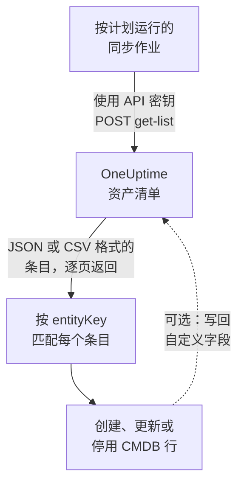

# 导出到 CMDB

如果你已经在使用 CMDB 或资产台账，OneUptime 并不打算取代它。OneUptime 拥有而 CMDB 通常缺少的，是一幅关于实际正在运行什么的图景，而且无需任何人维护就能保持最新：它从遥测中发现，也从已在监视你的网络和云账户的轮询器中发现。本页介绍如何把这幅图景导入你自己的记录系统。

:::cards
- [同步如何工作](#同步如何工作): 一个按计划运行的作业，读取列表并按稳定的键进行匹配。
- [拉取目录](#拉取目录): 请求，逐页获取 JSON 或 CSV。
- [资产详情](#资产详情): 主机和网络设备共用的信息和键。
- [写回](#写回): 把你的资产标签推送到 OneUptime，并添加它看不到的东西。
:::

## 同步如何工作

同步是一个按计划运行的作业。它使用 API 密钥通过 REST API 读取资产清单列表，按身份键把每个条目与 CMDB 中的一行匹配，并创建、更新或停用行使两者一致。它也可以把值写回条目的自定义字段。



## 可以拉取什么

有三个 REST 资源，每个都具有 [OneUptime API](/docs/api-reference/api-reference) 的标准端点：

| 资源 | 端点 | 包含什么 |
| --- | --- | --- |
| 资产清单条目 | `/api/inventory-item` | 环境中每样东西一行 |
| 自定义字段定义 | `/api/inventory-item-custom-field` | 你的项目自己的字段词汇 |
| 关系 | `/api/inventory-item-relationship` | 条目之间有方向的连接 |

资产清单条目中有用的列：

| 列 | 含义 |
| --- | --- |
| `_id` | OneUptime 的 ID：用作你的外部引用 |
| `entityType` | `host`、`k8s.pod`、`network.device`、`appliance`、… |
| `entityKey` | 稳定的身份哈希。它在重命名后保持不变，因此更适合用来匹配 |
| `displayName` | 供人阅读的名称 |
| `source` | `discovered`、`inventory` 或 `manual` |
| `description` | 自由文本 |
| `identifyingAttributes` | 使条目成为其本身的属性，永不改变 |
| `descriptiveAttributes` | 在它上面观察到的其他一切：请参阅下文的 [资产详情](#资产详情)、[主机资产属性](#主机资产属性) 和 [网络设备资产属性](#网络设备资产属性) |
| `customFields` | 你自己的字段，以字段名称为键 |
| `resourceType` / `resourceId` | 指向更完整的 OneUptime 记录的指针（如果有） |
| `firstSeenAt` / `lastSeenAt` | 首次和最后一次观察到它的时间 |
| `isArchived` | 是否已移出活动列表 |

## 开始之前

同步需要一个可以读取资产清单的 API 密钥。在 OneUptime Cloud 上，API 密钥需要 **Growth** 或更高的套餐。

:::steps
### 创建 API 密钥

打开 **项目设置 → 高级 → API 密钥**，然后点击 **创建API 密钥**。为它填写 **名称**，并在 **访问** 下选择 **查看者** 以读取项目中的一切，或选择 **稍后选择权限** 以只授予同步所需的权限。

### 只授予所需的权限

只读导出需要一个权限，即 **Read Telemetry Service**：资产清单共用遥测权限，而没有自己的权限。在密钥的页面上点击 **添加权限** 并选择它。要写回值，还需添加 **Edit Telemetry Service**。

### 复制密钥

从密钥的页面复制 **API 密钥**，并让你的作业可以使用它：

```bash
export ONEUPTIME_API_KEY="your-api-key"
```
:::

密钥通过每个请求的 `ApiKey` 标头发送，读取的是它自己项目的资产清单，因此请求无需指明项目。

## 拉取目录

带上你需要的列，向列表端点发送 `POST`。`select` 是必需的：API 只返回你请求的内容。

```bash
curl -X POST 'https://oneuptime.com/api/inventory-item/get-list' \
  -H "ApiKey: $ONEUPTIME_API_KEY" \
  -H 'Content-Type: application/json' \
  -d '{
    "query": { "isArchived": false },
    "select": {
      "_id": true,
      "entityType": true,
      "entityKey": true,
      "displayName": true,
      "source": true,
      "customFields": true,
      "descriptiveAttributes": true,
      "lastSeenAt": true
    },
    "sort": { "displayName": "ASC" },
    "limit": 100,
    "skip": 0
  }'
```

在自托管安装中，请用你自己的 OneUptime 地址替换 `https://oneuptime.com`。响应为 `{ "data": [...], "count": ... }`，其中 `count` 是匹配条目的总数。按你的 `limit` 递增 `skip` 来翻页，直到取完全部；`limit` 最大为 10,000。日期和 `_id` 以外的 ID 会被包装后返回，形如 `{ "_type": "DateTime", "value": "..." }` 和 `{ "_type": "ObjectID", "value": "..." }`：请从 `value` 中读取。

### 仅网络设备

按 `entityType` 缩小列表：

```bash
curl -X POST 'https://oneuptime.com/api/inventory-item/get-list' \
  -H "ApiKey: $ONEUPTIME_API_KEY" \
  -H 'Content-Type: application/json' \
  -d '{
    "query": { "entityType": "network.device", "isArchived": false },
    "select": { "_id": true, "entityKey": true, "displayName": true, "customFields": true },
    "limit": 100,
    "skip": 0
  }'
```

每个网络设备的 `descriptiveAttributes` 包含其主机名、IP 地址、序列号、MAC 地址、制造商、型号、固件、操作系统、角色、站点和位置：请参阅下文的 [网络设备资产属性](#网络设备资产属性)。轮询器知道的其他信息（例如接口和邻居）位于 Network Device 记录本身：沿着 `resourceId` 访问 `/api/network-device/:id/get-item`，或直接拉取 `/api/network-device/get-list`。

### 以 CSV 格式

任何列表端点在加上 `?output-type=csv` 后都会以 CSV 而不是 JSON 响应：

```bash
curl -X POST 'https://oneuptime.com/api/inventory-item/get-list?output-type=csv' \
  -H "ApiKey: $ONEUPTIME_API_KEY" \
  -H 'Content-Type: application/json' \
  -d '{ "query": {}, "select": { "displayName": true, "entityType": true, "customFields": true }, "limit": 500, "skip": 0 }' \
  -o inventory.csv
```

仪表板中的 **All Items** 列表也以同样方式导出，包含你已开启的自定义字段列。每项 [资产详情](#资产详情) 在那里也是一列：**主机名**、**IP 地址**、**序列号**、**模型** 等一开始是隐藏的，请在列选择器中开启它们，导出就会为每项信息包含一列，无论该行是主机还是网络设备。

## 资产详情

主机和网络设备用相同的信息描述，并存储在相同的键下。无论某一行是服务器还是交换机，CMDB 的同一列都保存序列号；仪表板中条目的 **资产详情** 卡片对两者都以相同顺序显示每项信息。没有任何来源报告过的信息会显示为 **未知**，而不是被省略，因此缺口一目了然。

| 信息 | 键 | 在主机上 | 在网络设备上 |
| --- | --- | --- | --- |
| 主机名 | `host.name` | 主机的名称。它是主机的身份，因此位于 `identifyingAttributes` 中 | 设备自己的名称：其 SNMP `sysName`，否则为发现时找到的 NetBIOS 或 DNS 名称。绝不会是它的 IP 地址 |
| IP 地址 | `host.ip` | 采集器报告的每个地址 | OneUptime 轮询的地址（当它是 IP 地址时），否则为其探测器将该 DNS 名称解析到的地址 |
| MAC 地址 | `host.mac` | 检测得到 | 在设备上输入，或从遍历过的路由器的 ARP 表中获知 |
| 序列号 | `host.serial_number` | 标注 | ENTITY-MIB |
| 制造商 | `device.manufacturer` | 标注 | ENTITY-MIB，否则为 `sysDescr` 或 `sysObjectID` 指明的内容 |
| 模型 | `device.model.name` | 标注 | ENTITY-MIB，否则为 `sysDescr` 指明的内容 |
| 固件版本 | `device.firmware.version` | 标注 | ENTITY-MIB，否则为 `sysDescr` 指明的内容 |
| 操作系统 | `os.name` | `os.description`（或 `os.type`） | `sysDescr` 指明的内容：Cisco IOS、Junos OS、Arista EOS、Linux |
| 操作系统版本 | `os.version` | 检测得到 | ENTITY-MIB，否则为 `sysDescr` 指明的内容 |
| Device Type | `device.type` | 标注。否则卡片会根据其操作系统和名称进行分类（服务器、防火墙……） | 它的角色：你分配的角色，否则为拓扑图绘制它时使用的角色 |
| 位置 | `device.location` | 标注。否则卡片显示其云可用区 | `sysLocation`。卡片会优先显示其站点 |

下文的 [主机表](#主机资产属性) 和 [网络设备表](#网络设备资产属性) 详细说明了每个值的来源。

## 主机资产属性

主机上的 `descriptiveAttributes` 包含 CMDB 行通常需要的资产信息，以其 OpenTelemetry 属性名为键：

| 字段 | 键 | 默认采集？ |
| --- | --- | --- |
| IP 地址 | `host.ip` | 是：机器有多个时以逗号分隔 |
| MAC 地址 | `host.mac` | 是：以逗号分隔，每个已启用的接口一个，格式如 `AC-DE-48-23-45-67` |
| 架构 | `host.arch` | 是 |
| 机器 ID | `host.id` | 是：Windows 上为机器 GUID，Linux 上为 `/etc/machine-id` |
| 操作系统 | `os.type`、`os.description`、`os.version` | 是 |
| 云上位置 | `cloud.provider`、`cloud.region`、`cloud.availability_zone` | 仅在有云检测器时 |
| 序列号 | `host.serial_number` | 需要一步配置 |
| 制造商 | `device.manufacturer` | 需要一步配置 |
| 型号 | `device.model.name` | 需要一步配置 |
| 固件（BIOS 或 UEFI）版本 | `device.firmware.version` | 需要一步配置 |
| 操作系统名称 | `os.name` | 仅来自会报告它的 SDK：否则由 `os.description` 指明操作系统 |
| 设备类型 | `device.type` | 可选：以同样方式标注（`Hypervisor`、`Workstation`） |
| 位置 | `device.location` | 可选：以同样方式标注（`Frankfurt DC, Rack B4`） |

所有标为“是”的项都来自采集器的 `resourcedetection` 处理器，并且已经包含在 OneUptime 为你生成的配置中。

`cloud.*` 键需要该处理器中有云检测器：`detectors: [system, env, ec2]`，其他云则为 `gcp` 或 `azure`。随附的配置只运行 `[system, env]`，因此在你添加检测器之前，这三个键保持为空。

序列号、制造商、型号和固件没有资源检测器：它们存放在机器的固件中，在 Windows 上通过 WMI、在 Linux 上通过 DMI 读取，因此在机器初始配置时一次性标注到资源上。你希望出现在行中的设备类型或位置也以同样方式标注。[资产清单属性](/docs/telemetry/host-otel-collector#清单属性ipmac序列号厂商型号固件) 提供了每种操作系统的确切代码片段。`host.manufacturer`、`host.model.name`、`host.firmware.version` 和 `host.bios.version` 也作为其他写法被接受，并存储在 `device.*` 键下（`device.serial_number` 则存储在 `host.serial_number` 下），因此同步对每项信息只需读取一个键。

如果你的 CMDB 已经以硬件标识符为键，`host.id` 值得考虑作为匹配键：与 `entityKey` 不同，它是机器自己的 ID，因此与端点管理工具为同一台机器报告的值一致。

属性只会添加，不会清空：停止报告的属性仍保留在行中，因此你的同步已读取过的值永远不会悄无声息地消失。

## 网络设备资产属性

网络设备（`entityType: network.device`）从其 Network Device 记录镜像而来，其 `descriptiveAttributes` 对相同的信息使用与主机相同的键，因此无论该行是服务器还是交换机，CMDB 的同一列都保存序列号：

| 字段 | 键 | 来源 |
| --- | --- | --- |
| 主机名 | `host.name` | 设备自己的名称：其 SNMP `sysName`，否则为发现时找到的 NetBIOS 或反向 DNS 名称。只有 IP 地址能命名它时省略 |
| IP 地址 | `host.ip` | OneUptime 轮询的地址（当它是 IP 地址时）。对于按 DNS 名称轮询的设备，为其探测器最近一次将该名称解析到的地址 |
| DNS 名称 | `net.device.dns_name` | 发现时找到的反向 DNS 名称，或 OneUptime 轮询的 DNS 名称 |
| MAC 地址 | `host.mac` | 在设备上输入，或从遍历过的路由器的 ARP 表中获知 |
| 制造商 | `device.manufacturer` | ENTITY-MIB `entPhysicalMfgName`，否则为 `sysDescr` 指明的厂商，否则为 `sysObjectID` 的供应商 |
| 型号 | `device.model.name` | ENTITY-MIB `entPhysicalModelName`，否则为 `sysDescr` 指明的型号 |
| 序列号 | `host.serial_number` | ENTITY-MIB `entPhysicalSerialNum` |
| 固件版本 | `device.firmware.version` | ENTITY-MIB `entPhysicalFirmwareRev`，否则为 Ubiquiti、HPE 和 Aruba 设备上 `sysDescr` 指明的固件 |
| 操作系统 | `os.name` | `sysDescr` 指明的操作系统 |
| 软件或操作系统版本 | `os.version` | ENTITY-MIB `entPhysicalSoftwareRev`，否则为 `sysDescr` 指明的版本 |
| 系统描述 | `os.description` | `sysDescr` |
| 设备类型 | `device.type` | 你为设备分配的角色，否则为拓扑图对它的分类角色，使用你的项目为该角色起的名称 |
| 位置 | `device.location` | `sysLocation`，除非它是代理的默认值，例如 Net-SNMP 的“Sitting on the Dock of the Bay” |
| 站点 | `oneuptime.site.name` | 设备所分配到的 Network Site |
| 轮询地址 | `net.device.hostname` | OneUptime 轮询的地址：IP 地址或 DNS 名称。为在 `host.name` 和 `host.ip` 出现之前编写的同步而保留 |

ENTITY-MIB 行会在设备的首次 SNMP 遍历之后填充。未被遍历的设备（仅通过 ping 监控或尚未轮询）仍会从对其地址的最近一次发现扫描通过 SNMP 读取的内容中获得名称、制造商、操作系统和位置，并从遍历过的路由器的 ARP 表中获得 MAC 地址。不实现 ENTITY-MIB 的设备没有可报告的序列号或固件。不过对许多平台而言，它的 `sysDescr` 仍会指明型号和操作系统：Cisco Meraki MX 报告 `Meraki MX85`，从而填充制造商和型号。`sysDescr` 没有已知格式的平台不会添加任何内容，而不是去猜测。

当 [Meraki 连接](/docs/monitor/network-traffic#不用-netflow-的-cisco-meraki) 读取其组织时，Meraki 设备会从 Meraki 控制台获取其自身轮询留空的信息：序列号、型号、固件和制造商，MAC 地址，名称，管理地址，所登记的街道地址，以及类型。如果设备的序列号或 MAC 地址与 Meraki 设备相同，或者 OneUptime 在 Meraki 设备的管理地址上轮询该设备且名称相同，该设备就是该组织的设备之一。保存在设备上的值以及其自身轮询读取的值优先。

保存在设备上的值（手动输入或通过 API 设置）绝不会被发现读取的内容替换。在设备自身遍历读取的值和扫描读取的值之间，使用较新的那个。只有当扫描在该地址找到的是同一台机器时，才会使用它读取的内容：当它读取的系统名称、`sysObjectID` 或 NetBIOS 名称与设备的不符时，它在那里读取的任何内容都不会被使用。条目的 **资产详情** 卡片会说明每个值的来源和时间。

主机名永远不会是 IP 地址。只有地址能命名的设备有 `host.ip`，没有 `host.name`。一旦它的 SNMP 遍历报告了系统名称，`host.name` 会在下一轮处理时出现。

这些值每十五分钟从 Network Device 记录复制一次，并且会 **替换** 之前的值，而不是追加到之前的值上，因此在设备上清除的值（例如移除的 MAC 地址）也会从资产清单条目中消失。

没有*可用升级*版本：SNMP 没有用于此的标准对象，因此 OneUptime 记录的是设备正在运行的版本。

## 将条目与 CMDB 行匹配

按 `entityKey` 匹配，而不是按 `displayName`。它是条目身份属性的哈希，因此在重命名和新标签之后保持不变：重新打标签的主机在显示名称改变时仍保留相同的键。`_id` 同样稳定，如果你只与一个项目打交道，它是最简单的外键。

`customFields` 中的日期是 ISO-8601 UTC 字符串，CSV 导出也按这种方式写入，而不是用仪表板显示的更友好的形式，因此导入时不会出现解析上的意外。

## 保持最新

没有变更推送。按适合你的间隔轮询列表端点，并按 `entityKey` 比较。`lastSeenAt` 表示条目最后一次被观察到的时间，这通常是发现自上次运行以来变得静默的条目的最省事的方法。

要立即重新读取网络设备，而不必等待其下一次轮询和下一次复制，请在其条目的 **资产详情** 卡片上点击 **刷新**，或使用拥有 **Edit Network Device** 权限的密钥发送 `POST /api/network-device/{id}/refresh`。其探测器会在一分钟内轮询它，其 Meraki 连接会重新读取组织，新的读取结果一到，其条目就会被复制。

在两次运行之间消失的条目，要么已经过期（发现的条目静默时间超过了其时间窗口），要么其所属记录已被删除。带有自定义字段值的镜像条目在其记录消失时会被归档而不是删除，因此用 `"isArchived": true` 查询，即可在不丢失其附带资产数据的情况下查看已停用的条目。

## 写回

相同的端点也接受写入，因此同步可以把值推送到 `customFields`：例如，把你的 CMDB 已拥有的资产标签标注到对应的 OneUptime 条目上。为此，密钥需要 **Edit Telemetry Service**。

你也可以为 OneUptime 看不到的东西添加条目：使用 `POST /api/inventory-item`，`entityType` 为 `external.service`、`external.database` 或 `appliance`，并提供 `displayName`。OneUptime 会为你计算身份键，这些条目永远不会过期。为此，密钥需要 **Create Telemetry Service**。

## 故障排查

:::details 每个请求都被拒绝并返回 402 Payment Required
在 OneUptime Cloud 上，只有当项目处于 **Growth** 或更高套餐时，API 密钥才能工作。不会删除任何内容：项目一回到该套餐，密钥就会原样重新工作。请参阅 [低于其套餐时的 API 密钥和 SCIM](/docs/api-reference/api-reference#低于其套餐时的-api-密钥和-scim)。
:::

:::details 每个请求都返回 422 You do not have permissions
该密钥没有任何可读取资产清单的权限。用 **稍后选择权限** 创建的密钥在获得权限之前什么也做不了：按照 [开始之前](#开始之前) 的说明，在其页面上添加 **Read Telemetry Service**。
:::

:::details 列表返回时缺少我需要的列
列表只返回 `select` 指明的列以及 `_id`。把你读取的每一列都加入 `select`，包括 `descriptiveAttributes` 和 `customFields`。
:::

:::details 我预期的条目不见了
当你发送 `"isArchived": false` 时，已归档的条目会被排除。发现的条目静默超过其时间窗口后会被移除，镜像的条目会随其记录一起消失。请求 `"isArchived": true` 即可查看已归档的条目。
:::

## 后续步骤

:::cards
- [资产清单概览](/docs/inventory/overview): 条目从哪里来，以及每个条目保留多久。
- [资产清单自定义字段](/docs/inventory/custom-fields): 定义你的同步读写的字段。
- [OneUptime API 参考](/docs/api-reference/api-reference): 请求、状态码，以及每次写入都遵循的规则。
:::
