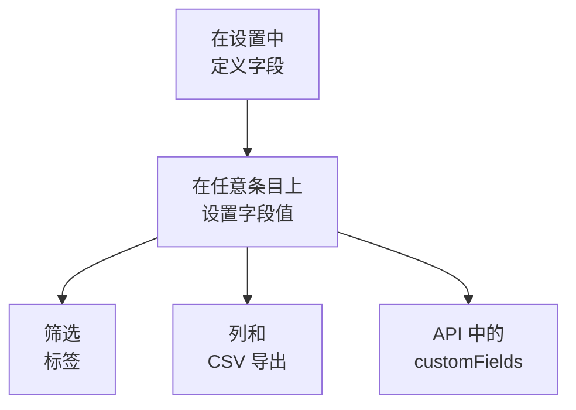

# 资产清单自定义字段

OneUptime 会发现你的环境里有什么。自定义字段记录的是再怎么监视也无法得知的信息：标签上的序列号、保修到期的日期、哪个团队拥有某样东西、它是在用还是放在备件抽屉里。为项目定义一次字段，然后在每个条目上填写。

:::cards
- [自定义字段如何工作](#自定义字段如何工作): 一套词汇，用在每个条目上，无论其来源。
- [定义字段](#定义字段): 创建字段、选择类型、列出下拉列表的选项。
- [筛选列表](#筛选列表): 两次点击就能找到下个季度到期的东西。
- [说明和限制](#说明和限制): 重命名、重复、日期和已删除的字段。
:::

## 自定义字段如何工作

字段为项目定义一次，每个条目都可以为它存一个值：OneUptime 发现的条目、它镜像的条目，以及你手动添加的条目都可以。字段会成为列表上方的筛选标签、一个可选的列，以及 CSV 导出中的一列。API 读写相同的值，位于每个条目的 `customFields` 之下。

> [!NOTE]
> 在 OneUptime Cloud 上，自定义字段属于 **Growth** 及以上套餐。低于该套餐时，字段无法定义、列出或更改：API 返回 `402 Payment Required`，列表也不会显示自定义字段的筛选标签或列。

## 定义字段

:::steps
### 打开自定义字段页面

转到 **产品 → 资源 → 资产清单**，在侧边菜单中打开 **设置**，然后打开 **自定义字段**。

### 创建字段

点击 **创建Inventory Item Custom Field**。为它填写 **字段名称**、可选的 **字段描述**，并从下表中选择 **字段类型**。

### 列出下拉列表的选项

对于下拉列表类型，在 **下拉选项** 下添加选项。每个选项都可以带一种颜色，在表格单元格和筛选标签中以相同方式使用：选择一种命名颜色、**无颜色**，或选择 **自定义颜色** 来使用精确的颜色代码。拖动选项的手柄可以改变它在列表中的位置。
:::

| 类型 | 适用于 |
| --- | --- |
| **文本** | 序列号、资产标签、机架位置、采购订单号 |
| **数字** | 成本、机架单元、端口数 |
| **布尔值** | 是否在支持期内、是否在 PCI 范围内 |
| **下拉列表（单选）** | 生命周期状态、环境、重要程度：从固定列表中选一个答案 |
| **下拉列表（多选）** | 合规范围、标签：从固定列表中选多个答案 |
| **日期** | 采购日期、保修到期日、停止支持日期 |
| **日期和时间** | 上次审计时间、退役时间 |
| **长文本** | 访问说明、备注：多行纯文本 |
| **富文本（Markdown）** | 带格式和链接的备注，在 Markdown 编辑器中编写 |
| **文件** | 保修证书、已签署的采购订单、机架标签的照片：一个文件 |
| **多个文件** | 手册、发票和照片：最多 10 个文件 |

## 一套完整的资产词汇示例

典型的硬件资产台账可以直接对应到这些字段：

| 字段名称 | 类型 | 示例 |
| --- | --- | --- |
| `Serial Number` | 文本 | `FDO24160ABC` |
| `Asset Tag` | 文本 | `IT-004821` |
| `Purchase Date` | 日期 | 2024-03-11 |
| `Warranty Expiry` | 日期 | 2027-03-10 |
| `Lifecycle Status` | 下拉列表 | 在用、备用、维修中、已退役 |
| `Assigned Site` | 下拉列表 | 伦敦数据中心、法兰克福数据中心、总部办公室 |
| `Owner Team` | 下拉列表 | 网络、平台、安全 |
| `Cost Centre` | 文本 | `CC-4410` |

在条目的 **自定义字段** 页面上设置这些值。任何条目都可以填写，无论其来源，因此 OneUptime 发现的交换机和它镜像的网络设备，都与你手动添加的设备使用同一套资产词汇。

## 筛选列表

每个自定义字段都会成为 **All Items** 列表上方的筛选标签，标签提供适合其类型的比较方式：

| 字段类型 | 比较方式 |
| --- | --- |
| **文本**、**长文本**、**富文本（Markdown）** | 是、不是、包含、不包含、开头是、结尾是、为空、不为空 |
| **数字** | 是、不是、大于、大于或等于、小于、小于或等于、为空、不为空 |
| **布尔值**、**下拉列表（单选）**、**下拉列表（多选）** | 是、不是、为空、不为空 |
| **日期**、**日期和时间** | 是、之前、之后、之间、为空、不为空 |
| **文件**、**多个文件** | 是 |

**文件** 或 **多个文件** 字段的筛选标签只问一件事：字段是 **有文件** 还是 **无文件**。

筛选标签之间以“与”组合，因此“Warranty Expiry 在 2026-10-01 之前，且 Lifecycle Status 是 在用”就是列表的一个视图。这正是资产台账存在的意义所要回答的问题，也是使用日期类型而不是在文本字段中写日期的原因：文本字段可以照样保存 `2026-10-01`，却无法告诉你下个季度有什么到期。

自定义字段列一开始是隐藏的：请在列选择器中开启。它们无法排序，因为这些值一起存放在一个 JSON 列中，而列表无法按该列排序。

## 说明和限制

- 值按字段名称存放在每个条目上。重命名字段不会迁移已按旧名称存放的值。事件的自定义字段是例外：重命名其中一个会迁移它的值（请参阅 [重命名字段](/docs/incidents/settings#重命名字段)）。
- 在条目已经有值之后，下拉列表的选项仍可以添加、重命名、拖动排序和移除。重命名的选项会在所有用到它的条目上随之更改；移除的选项会保留在用到它的条目上，并显示为已不再是选项，除非你为这些条目另选一个（请参阅 [更改下拉选项](/docs/incidents/settings#更改下拉选项)）。
- 没有任何机制让值保持唯一。两个条目可以有相同的序列号，没有什么会阻止你。
- 日期以 ISO-8601 UTC 时间戳存储，并以你自己的时区显示。
- 删除字段会将它从列表和筛选栏中移除。已经写入的值会保留在条目上。
- **文件** 或 **多个文件** 字段接受每个不超过 10 MB 的文件，种类见 [文件字段](/docs/incidents/settings#文件字段)，且须在本项目中上传。只有能查看该条目的人可以下载这些文件；一个文件不再被任何地方引用时即被删除。

## 后续步骤

:::cards
- [资产清单概览](/docs/inventory/overview): 条目从哪里来，以及每个页面显示什么。
- [导出到 CMDB](/docs/inventory/cmdb-sync): 把条目及其自定义字段导入另一个系统。
- [事件自定义字段](/docs/incidents/settings#自定义字段): 事件上也有相同的字段类型，还多出几种。
:::
