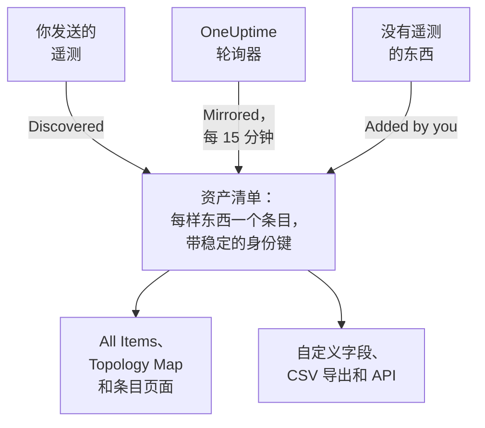

# 资产清单概览

资产清单是一个列表，汇集了 OneUptime 对你的环境所知道的一切：服务、主机、Kubernetes 对象、虚拟机、网络设备、云资源、IoT 设备、无服务器函数，以及根本不发送遥测的东西。其中大部分会根据 OneUptime 已在监视的内容自动填充。你需要补充的是监视无法告诉它的信息：某样东西的用途、谁拥有它、保修何时到期。[术语表](/docs/introduction/glossary#你监视的对象) 说明了其中每一类记录是什么。

:::cards
- [条目如何进入资产清单](#条目如何进入资产清单): 发现、镜像，或由你添加。
- [熟悉各个页面](#熟悉各个页面): 资产清单的页面，以及每个条目自己的页面。
- [从 Esper 导入设备](#从-esper-导入设备): 你的 Esper 租户注册的每台 Android 设备和 Apple 设备，并保持最新。
- [从 Microsoft Intune 导入设备](#从-microsoft-intune-导入设备): Intune 管理的每台 Windows 电脑、Mac、iPhone、iPad 和 Android 设备，并保持最新。
- [手动添加](#手动添加): 第三方 API、外部数据库或设备。
- [归档而不是删除](#归档而不是删除): 整理列表并让它保持整洁的方法。
:::

## 条目如何进入资产清单

OneUptime 为了监控本来就在观察你的环境，因此目录是根据它观察到的内容建立的，而不是根据某人记得录入的内容。每个条目都有一个来源，来源决定了条目归谁管理：你能否编辑它，以及它能否自行消失。

| 来源 | API 中的值 | 来自哪里 | 保留多久 |
| --- | --- | --- | --- |
| **已发现** | `discovered` | 遥测到达时读取的 OpenTelemetry 资源属性：发送遥测的服务、主机、Kubernetes 对象或虚拟机。 | 每批遥测都会重新登记。静默时间超过其类别的时间窗口后被移除（见下文）。 |
| **已镜像** | `inventory` | OneUptime 轮询器维护的记录：网络设备、云资源、IoT 设备、无服务器函数、RUM 应用、Docker 主机、Podman 主机，以及 Esper 或 Microsoft Intune 连接导入的设备。每 15 分钟复制一次；Esper 设备则在其连接每次被读取时复制。 | 与其记录共存亡。删除记录，条目也随之消失。 |
| **由您添加** | `manual` | 由你为 OneUptime 看不到的东西添加：第三方 API、由供应商托管的数据库、机架里的设备。 | 直到你删除它。不会自动过期。 |

发现或镜像的条目无法重命名，也无法改为其他类型：来源会在下一轮处理时覆盖这些更改。条目的 **设置** 页面会告诉你应在何处做持久的更改。无论来源如何，你随时都可以为任何条目添加的是自定义字段值：请参阅 [资产清单自定义字段](/docs/inventory/custom-fields)。

### 静默的条目保留多久

发现的条目有心跳。每当它的遥测到达，最后出现时间就会向前推进，列表的 **状态** 列显示这个时间有多近。来自 Esper 或 Intune 的设备也是如此：它每次向其设备管理服务签入时都会更新。其他镜像的条目和你添加的条目没有心跳，因此它们的状态保持空白，而不是显示告警。

| 状态 | 含义 |
| --- | --- |
| **实时** | 最近 30 分钟内出现过。 |
| **最近** | 最近一天内出现过。 |
| **已过时** | 超过一天没有出现。**已沉寂** 页面会列出这些条目。 |

OneUptime 每 3 小时移除一次静默时间超过其类别时间窗口的发现条目，已归档的也包括在内，它们的自定义字段值也会随之消失。镜像的条目和你添加的条目永远不会以这种方式被移除。

| 条目类别 | 没有遥测多久后被移除 |
| --- | --- |
| Pod、Deployment、Proxmox 客户机和 VMware 虚拟机 | 1 天 |
| Kubernetes 节点和命名空间、Proxmox 节点、VMware 主机、集群和数据存储，以及你的链路所调用的数据库和远程服务 | 7 天 |
| 服务、主机、Kubernetes、Proxmox 和 Ceph 集群、存储阵列、vCenter 和 Docker Swarm 集群 | 30 天 |

OneUptime 发现的关系如果 30 天内没有再次出现，就会被移除。

## 熟悉各个页面

打开 **产品 → 资源 → 资产清单**。它的侧边菜单包含以下页面。**按来源**、**设置**、**帮助** 和 **高级** 一开始是折叠的：点击分区标题即可展开。

| 页面 | 你在那里能找到什么 |
| --- | --- |
| **概览** | 你有多少条目、它们是什么、有多少已静默，以及最近添加了什么。 |
| **所有项目** | 所有条目。按名称、描述或身份键搜索，按类型、来源、状态或自定义字段缩小列表，并手动添加条目。 |
| **托管设备** | 你的 Esper 和 Microsoft Intune 连接，以及它们导入的每台设备，附带其状态、组、型号和操作系统。 |
| **拓扑地图** | 条目之间如何连接：服务、它们调用的对象，以及它们运行所在的主机、Pod 和设备。 |
| **已沉寂** | 超过一天没有动静的条目：没有发送遥测的发现条目，以及不再向 Esper 签入的设备。 |
| **按来源** | 某一个来源的条目：**已发现**、**已镜像** 或 **由您添加**。 |
| **设置 → 自定义字段** | 你的项目在每个条目上记录的字段。 |
| **帮助 → 文档** | 资产清单的简短指南，以及它能识别的条目类别。 |
| **高级 → 已归档** | 你归档的条目。可以在这里取消归档。 |

打开一个条目，它自己的侧边菜单中有 **概览**（类型、来源和状态，以及在它上面观察到的每个属性）、**连接** 和 **自定义字段**；**日志**、**追踪**、**指标**、**性能剖析** 和 **异常**；以及 **事件**、**警报** 和 **计划维护**。**高级** 下面有 **设置**、**审计日志** 和 **删除清单项**。遥测页面显示条目自身发送的内容。事件、警报和维护事件属于该条目所代表的服务、主机或 Kubernetes 集群；在其他任何条目上，这些页面会告诉你应该改看哪个资源。

### 资产详情

主机或网络设备有一个 **资产详情** 卡片，以相同的方式描述两者：主机名、IP 地址、MAC 地址、序列号、制造商、型号、固件版本、操作系统、操作系统版本、设备类型和位置。Android 设备的卡片还有其安全补丁级别，来自 Android 代理或 Esper。没有任何来源报告过的信息显示为 **未知**，卡片会说明原因以及如何补全这些未知信息：设备未通过 SNMP 报告这些信息、设备尚未被读取，或 Meraki 设备的这些信息保存在其控制台中。

- 主机的信息来自其遥测中的资源属性：IP 和 MAC 地址、架构和操作系统开箱即有，序列号、制造商、型号和固件在你标注后才有。
- 网络设备的信息来自其 SNMP 轮询、角色和站点。其轮询尚未读取的信息来自发现：对其地址的最近一次扫描、路由器的 ARP 表，或其探测器的 DNS 查询。没有 ENTITY-MIB 的设备（例如 Meraki MX）仍会从系统描述中获得制造商、型号和操作系统，并从自身端口获得 MAC 地址。它的 IP 地址永远不会显示为主机名。
- 当 [Meraki 连接](/docs/monitor/network-traffic#不用-netflow-的-cisco-meraki) 读取其组织时，Meraki 设备还会从 Meraki 控制台获取其轮询留空的信息，其中包括序列号、型号和固件。

卡片会说明每项信息的来源和时间。大多数信息共有的来源，例如主机的采集器、网络设备自身的 SNMP 轮询或读取它的发现扫描，只在信息下方提及一次。其他来源，例如路由器的 ARP 表或保存在设备上的值，会在对应信息下方说明。保存在网络设备上的值绝不会被发现读取的内容替换，两者不同时，卡片会同时显示两者。

网络设备的卡片上有一个 **刷新** 按钮，供有权编辑网络设备的人使用。它会立即重新读取设备：其探测器会在一分钟内轮询它，其 Meraki 连接会重新读取组织。卡片会说明新的读取结果何时到达，或探测器无法连接到该设备；读取结果一到，条目就会从设备复制。

这些信息也是 **所有项目** 列表中的列，在你开启之前处于隐藏状态，并会进入列表的 CSV 导出。[导出到 CMDB](/docs/inventory/cmdb-sync#资产详情) 列出了它们的键。

### 连接

条目的 **连接** 页面列出它在两个方向上的相邻条目，分为 **调用**、**调用方**、**运行于** 和 **相关** 几组。每组显示总数（连接超过 100,000 个的组显示“100,000+”），**显示更多** 可以翻看其余部分，因此繁忙的集群、命名空间或节点会显示每一个连接，而不只是前几个。该页面不受时间范围限制：它包括通过 API 手动添加的关系，以及已归档的相邻条目。已不在资产清单中的相邻条目会按其键显示。

## 从 Esper 导入设备

连接一个 Esper 租户后，它注册的每台设备都会出现在资产清单中：它的 Android 设备，包括应用从未启动过的设备，以及它的 iPhone、iPad 和 Apple TV。每台设备是一台主机，带有只有 Esper 才知道的信息：它的组，它的操作系统和构建号，它的序列号和 IMEI，它的电池和存储，以及 Android 设备的安全补丁级别和已安装的应用。Esper 不会主动发送任何内容，因此 OneUptime 按计划读取：每 15 分钟读取一次设备，每 6 小时读取一次每台 Android 设备的应用。

:::steps
### 在 Esper 中创建 API 密钥

在 Esper 控制台中，于 API Key Management 下创建一个密钥。OneUptime 只读取数据，因此只要密钥所属用户的 Esper 角色能够读取设备、组和应用就足够了。密钥一旦被替换，或其所属用户被删除，就会失效。

### 连接租户

转到 **产品 → 资源 → 资产清单**，然后打开 **托管设备**，点击 **连接设备管理服务**，然后选择 **Esper**。输入 **租户**，也就是你的 Esper 控制台地址中 `.esper.cloud` 之前的名称（`acme.esper.cloud` 对应 `acme`），以及 **API 密钥**。**更多字段** 中包含连接的名称和读取频率。

### 检查首次读取

**连接** 会在保存任何内容之前测试密钥：它会告诉你一次读取将导入多少台设备，或者告诉你哪里出错以及如何修复。首次读取会在一分钟内开始，连接所在的行会显示读取结果。
:::

| Esper 报告的内容 | 显示位置 |
| --- | --- |
| 型号、制造商、序列号、操作系统及其版本、构建号，以及 IP 和 MAC 地址 | 设备的 **资产详情** 卡片，以及 **所有项目** 的列 |
| 状态、上次签入、组、安全补丁级别、IMEI、电池、存储和 Esper 代理 | 设备的 **Esper** 卡片，以及 **托管设备** 的 **设备** 列表 |
| 应用及其版本 | 设备的 **已安装的应用** 列表 |

### 一台设备，而不是两台

从设备发送遥测的应用或 Android Agent，只要以与 Esper 相同的方式命名设备，就会与 Esper 导入的设备合并为一个条目。请根据 Esper 在每台设备上填入的托管配置设置以下资源属性：

| 资源属性 | 托管配置值 | 含义 |
| --- | --- | --- |
| `host.name` | `${esper.deviceName}` | 设备在 Esper 中的名称，例如 `ESP-ID-AAAAW`。必需。 |
| `host.serial_number` | `${esper.serialNumber}` | 设备的序列号。可选。 |

OneUptime 先按设备在 Esper 中的名称查找其条目，再按其序列号查找，都不匹配时才新建一个。Android Agent 会根据其 `device_name` 和 `device_serial` 设置来设置这两个属性，[Android 端设置](/docs/rum/android-setup#从-esper-导入设备群) 则展示了应用的托管配置。

### 设备沉寂或离开 Esper 时

超过 30 分钟未签入的 Android 设备会显示为 **离线**，并说明它上次签入是多久以前；iPhone、iPad 和 Apple TV 在 Apple 推送服务唤醒它们时才签入，间隔可能长达数小时，因此超过一天未签入才显示为 **离线**。其条目的 **状态** 取决于它的上次签入，如果它的遥测更近，则取决于遥测，因此静默一天的设备会出现在 **已沉寂** 页面上。

从 Esper 中移除的设备会被标记为 **已移除**，其条目会被归档：它会离开列表，并在 **高级 → 已归档** 下等待。回到 Esper 的设备也会回到列表中。设备离开 30 天后，它会被删除，其条目也会被删除，除非遥测或你为该条目添加了内容。

### 设备停止签入时收到警报

在 **托管设备** 中，点击连接所在行的 **设置警报**，然后创建 **Esper Android Device Stopped Checking In** 和 **Esper Apple Device Stopped Checking In**。前者会为每台超过 1 小时未向 Esper 签入的 Android 设备各打开一条以该设备命名的警报，后者则为每台超过一天未签入的 Apple 设备打开，设备再次签入后警报即被解决。

每次读取该连接时，都会以指标 `oneuptime.managed_device.check_in.age` 记录每台设备上次签入距今多少分钟，监视器每 5 分钟检查一次每台设备的最新值。同时运行 Android Agent 的设备交由 **Host Stopped Reporting** 监视，因此不会重复发出警报；从 Esper 移除的设备，其警报会被解决。读取失败时不会记录任何内容，因此在下一次读取之前，警报既不会打开也不会解决。对于夜间关机的设备群，请调高监视器的阈值。

## 从 Microsoft Intune 导入设备

连接一个 Microsoft Intune 租户后，Intune 管理的每台设备都会出现在资产清单中：它的 Windows 电脑、Mac、iPhone、iPad、Android 设备和 Linux 计算机。每台设备是一台主机，带有 Intune 掌握的信息：它的类别，它的操作系统及其版本，它的序列号和 IMEI，它的合规性、所有权和注册方式，它的存储，以及 Intune 在它上面发现的应用。Intune 不会主动发送任何内容，因此 OneUptime 按计划读取：每 15 分钟读取一次设备，每 6 小时读取一次每台设备的应用。

:::steps
### 在 Microsoft Entra 中注册应用

在 Microsoft Entra 管理中心打开 `App registrations`，点击 `New registration`。为它命名，保留 `Accounts in this organizational directory only`，然后注册。它的 `Overview` 页面显示 OneUptime 需要的两个 ID：`Application (client) ID` 和 `Directory (tenant) ID`。

### 让它读取 Intune 的设备

在 `API permissions` 下，依次点击 `Add a permission`、`Microsoft Graph`、`Application permissions`，然后添加 `DeviceManagementManagedDevices.Read.All`。接着点击 `Grant admin consent`，只有租户的管理员才能这样做。OneUptime 只需要这一个权限：它能列出设备以及 Intune 在设备上发现的应用，并且什么也改不了。

### 创建客户端密码

在 `Certificates & secrets` 下，点击 `New client secret`，复制它的 `Value`，而不是它的 `Secret ID`：Microsoft 只显示一次这个值。密码过期后就无法使用，所以请在过期前新建一个，并在编辑连接时填入。

### 连接 Intune 租户

转到 **产品 → 资源 → 资产清单**，然后打开 **托管设备**，点击 **连接设备管理服务**，然后选择 **Microsoft Intune**。输入 **租户 ID**、**应用程序(客户端) ID** 和 **客户端密钥**。如果租户位于美国政府云中，请在 **更多字段** 下的 **云** 中选择它。**连接** 会在保存任何内容之前测试应用注册：它会告诉你一次读取将导入多少台设备，或者哪里出了问题以及如何修复。
:::

设备大约每 8 小时向 Intune 签入一次，它的上次签入就是它最后一次签入的时间：一天没有签入的设备显示为 **离线**。它的应用是 Intune 在它上面发现的应用，Microsoft Graph 只在其 beta 版本中列出它们：对于个人设备，是 Intune 管理的应用。Intune 的组是 Microsoft Entra 的组，此权限不会读取，因此设备的组就是它的设备类别。不会读取任何关于设备用户的信息。

Intune 用设备所有者起的名字来命名设备，因此两台设备可能同名：所有没人改过名的 iPhone 都叫 `iPhone`。一个连接中两台设备共用的名字，在资产清单中不属于其中任何一台：每台设备改用其序列号命名，一旦没有其他设备使用这个名字，就会取回自己的名字。

要在设备停止签入时收到警报，请点击连接所在行的 **设置警报**，然后创建 **Intune Device Stopped Checking In**。它会为每台超过一天未向 Intune 签入的设备各打开一条以该设备命名的警报。周末关机的笔记本电脑看起来也一样，所以如果一天对你的设备来说太短，请调高监视器的阈值。

## 手动添加

为 OneUptime 永远无法自行看到的东西添加条目，这样依赖关系就能落在真实存在的对象上，而这个对象也能携带你的自定义字段。

:::steps
### 打开所有项目

转到 **产品 → 资源 → 资产清单**，然后打开 **所有项目**。

### 添加条目

点击 **添加项**。选择它的 **类型**，为它填写 **名称**，并可选填写 **描述**。名称和类型共同构成条目的身份，因此同一类型的两个条目不能同名。

### 填写自定义字段

打开新条目。它的来源显示为 **由您添加**，它的 **自定义字段** 页面可以填写你的项目所跟踪的值。
:::

可以手动添加的类型有三种：

- `external.service`（**外部服务**）：第三方 API 或软件即服务依赖。
- `external.database`（**外部数据库**）：不属于 OneUptime 可建模的服务器的数据库。数据库服务器，无论是自托管还是托管服务，从 PostgreSQL 到 Snowflake，都应改为在 **数据库 → 创建数据库** 中添加（[数据库](/docs/telemetry/databases)）：那条记录会与指向同一地址的链路、容器和引擎指标关联，而资产清单条目永远做不到这一点；用两种方式添加同一台服务器，会留下两条互不关联的记录。
- `appliance`（**专用设备**）：没有代理的硬件或软件。

这个限制是为了防止重复。手动创建的、OneUptime 能观察到的类型的条目（例如主机）会以你输入的名称作为键，而同一台机器的发现条目则以它报告的属性作为键。两者永远不会合并，于是同一台主机会永久地在你的列表中出现两次。

## 归档而不是删除

归档会把条目移出列表，同时保留它的身份、历史和自定义字段值。它的意思是：我已经看到了它，不想让它出现在我的列表里。归档的条目仍会继续收集遥测。

| 来源 | 归档 | 删除 |
| --- | --- | --- |
| **已发现** | 保持归档。 | 随下一批遥测回来。 |
| **已镜像** | 保持归档。 | 随下一次复制回来。请改为删除原始记录。 |
| **由您添加** | 保持归档。 | 永久消失。 |

要归档条目，可以在 **所有项目** 中选中它们一次性归档，也可以打开一个条目，使用其 **设置** 页面上的 **归档** 卡片。已归档的条目位于 **资产清单 → 高级 → 已归档**，你可以在那里选中它们并取消归档。

> [!NOTE]
> 当镜像的设备从其所属记录中移除时，OneUptime 也会移除它的条目，除非该条目带有你填写的自定义字段值。这些值是唯一的副本，而且无法撤销，因此条目会被归档而不是删除。你可以在 **高级 → 已归档** 中找到它，你填写的所有内容都完好无损。

## 关系和拓扑

OneUptime 在观察条目时用有方向的关系把它们连接起来。**资产清单 → 拓扑地图** 会绘制这些关系，条目的 **连接** 页面会列出它自己的关系。请参阅 [拓扑](/docs/telemetry/topology)。

| 关系 | 示例 |
| --- | --- |
| `runs-on` | Pod 运行在节点上；虚拟机运行在它的主机上。 |
| `member-of` | Pod、节点或命名空间是集群的成员。 |
| `hosted-on` | 服务托管在主机上。 |
| `part-of` | Pod 是其 Deployment 的一部分。 |
| `depends-on` | 一个服务调用另一个服务，依据是在两者之间穿行的 Span。 |

## 后续步骤

:::cards
- [资产清单自定义字段](/docs/inventory/custom-fields): 跟踪序列号、保修日期、所有者和生命周期状态。
- [导出到 CMDB](/docs/inventory/cmdb-sync): 把目录导入你自己的记录系统。
- [数据库](/docs/telemetry/databases): 监控你的服务所使用的数据库服务器。
:::
