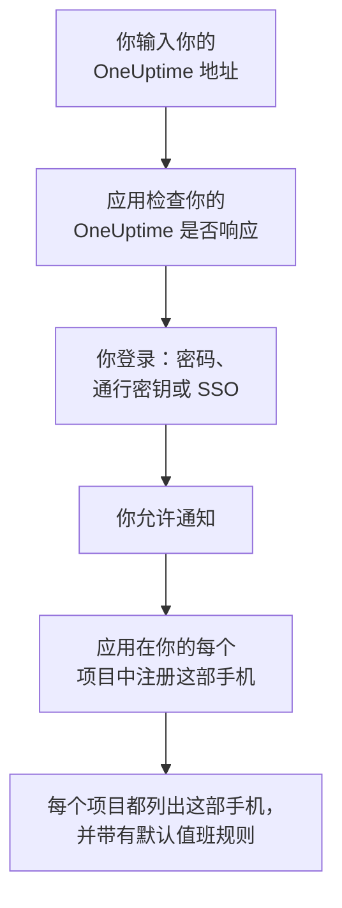
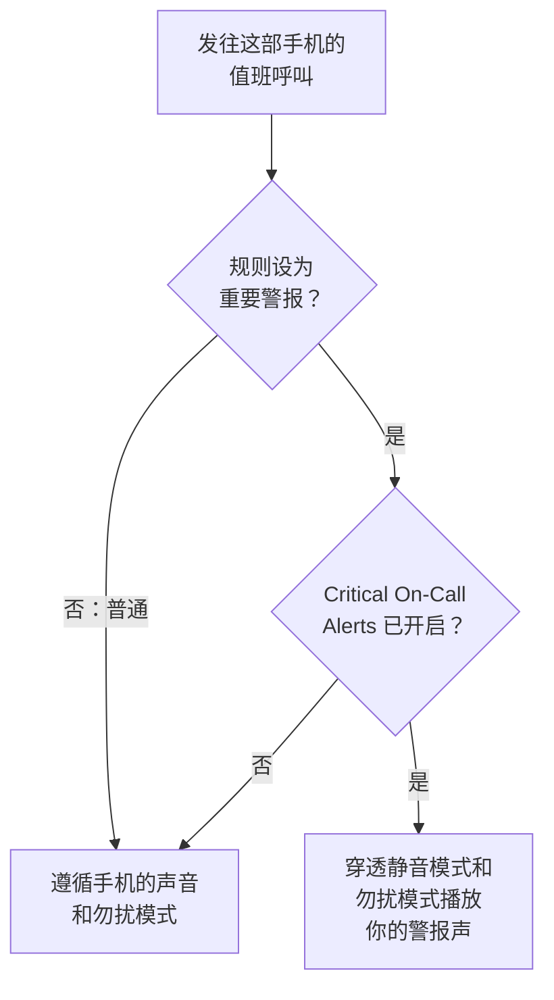

# Android 安装

在 Android 手机或平板上安装 **OneUptime On-Call**，将它连接到你的 OneUptime 并登录。然后给自己发送一条测试通知，并让紧急的值班呼叫穿透静音模式和勿扰模式响起。

:::cards
- [安装应用](#安装应用): 从 Google Play 安装，或在没有 Google Play 的手机上安装 APK。
- [登录](#登录): 先输入你的 OneUptime 地址，再登录账号。
- [确认呼叫能送达手机](#确认呼叫能送达手机): 在仪表板中找到这部手机并测试。
- [穿透静音模式](#穿透静音模式): 关键提醒和警报声。
- [故障排除](#故障排除): 登录、通知和安装问题。
:::

## 开始之前

- 运行 Android 7.0 或更高版本的手机或平板。
- 一个 OneUptime 项目中的账号。要接收呼叫，你还必须在值班：参见 [升级规则](/docs/on-call/escalation-rules)。
- 你的 OneUptime 的地址：OneUptime Cloud 上是 `https://oneuptime.com`，或你自己的地址，例如 `https://oneuptime.example.com`。应用只通过 HTTPS 连接。

## 安装应用

:::tabs
@tab Google Play
1. 在手机上打开 [Google Play 上的 OneUptime On-Call](https://play.google.com/store/apps/details?id=com.oneuptime.oncall)，或在 Google Play 中搜索 OneUptime On-Call。
2. 点按 **安装**，然后点按 **打开**。

Google Play 会让应用保持最新。
@tab APK
适用于没有 Google Play 的手机。每个 OneUptime 版本都会用同一份代码构建 APK，并把它附在 GitHub 上的发布版本中。

1. 在手机上打开 [最新的 APK](https://github.com/OneUptime/oneuptime/releases/latest/download/oneuptime-on-call-android-app.apk)。
2. 打开下载的文件。如果 Android 询问，请允许你的浏览器安装未知应用，然后点按 **安装**。
3. 从你的应用列表中打开 OneUptime On-Call。

APK 不会自动更新：请不时在其上覆盖安装最新的 APK。你的登录状态和设置会保留。
:::

## 登录

:::steps
### 输入你的 OneUptime 地址
打开应用。在 **Connect your workspace** 上，使用 OneUptime Cloud 时保留 `https://oneuptime.com`，否则输入你自己的 OneUptime 地址，然后点按 **Connect**。`https://<your-oneuptime>/api/status` 响应后，应用就会继续。

### 登录你的账号
使用你的账号支持的登录方式：

- 你的电子邮件和密码，然后点按 **Sign In**。**Forgot password?** 会通过电子邮件给你发送一个设置新密码的链接。
- **Sign in with a passkey**，前提是你已在仪表板中添加了通行密钥：参见 [添加通行密钥](/docs/introduction/your-account#添加通行密钥)。浏览器会打开以确认它，然后把你带回应用。
- **Sign in with SSO**，如果你的组织使用单点登录。选择你的身份提供商，或输入你的工作电子邮件并点按 **Continue**。会打开一个安全浏览器，登录后你会回到应用。

开启双因素身份验证后，输入身份验证器应用中的六位数验证码，或你的一个备用码。应用中无法使用安全密钥。如果管理员要求双因素身份验证而你还没有设置，应用会先和你一起设置身份验证器应用。

### 允许通知
当 Android 询问是否允许 OneUptime On-Call 发送通知时，点按 **允许**。Android 13 及更高版本会询问；更早的版本默认允许，除非你关闭。

随后，应用会在你的每个项目中注册这部手机。每个项目都会把它列在你的推送设备中，并带有默认值班规则，因此从现在起你的呼叫会送达它。
:::

应用一次显示一个项目：点按屏幕顶部的项目名称即可切换。要求单点登录的项目会在 **Settings → Manage Projects** 中显示 **SSO Required**，直到你在那里点按 **Authenticate with SSO**。

## 确认呼叫能送达手机

:::steps
### 在仪表板中找到这部手机
在仪表板中，打开 **用户设置 → 通知方式** 和 **Push Notifications** 选项卡。这部手机按型号名称列在 **推送通知设备** 下。每个项目都有自己的列表。

### 发送测试
点击手机所在行的 **测试通知**。手机会收到一条通知；点按它即可打开应用。
:::

你的值班规则决定哪些呼叫发送到这部手机，以及多快发送：参见 **用户设置 → 值班规则**。新手机会获得与你添加的任何其他方式相同的默认规则。

## 穿透静音模式

默认情况下，值班呼叫遵循手机的声音设置：静音的手机保持安静，勿扰模式会拦下呼叫。关键提醒让值班呼叫穿透这两者响起。它们默认关闭，需要你在每部手机上分别开启。

:::steps
### 开启 Critical On-Call Alerts
在应用中打开 **Settings**，在 **Notifications** 下开启 **Critical On-Call Alerts**。

### 允许勿扰权限
Android 会打开它的 **勿扰权限** 列表。为 OneUptime On-Call 开启该权限，然后返回应用：应用会检查权限，并在开关下方说明呼叫是否会穿透。

### 选择警报声
点按开关下方的 **Alarm sound**。除了手机自己的声音，它还提供 Klaxon、Siren、Digital alarm、Smoke alarm 和由轻到响的 Rising alarm。点按声音旁边的播放按钮即可试听。关键呼叫以手机的闹钟音量播放，所以请把闹钟音量调高。
:::

只有值班呼叫会穿透，而且只有来自设为 **重要警报**（默认值）的值班规则的呼叫才会穿透。设为 **普通** 的规则无论开关如何都会遵循手机的设置，这样你可以在严重事件时被叫醒，而轻微事件只会静默呼叫你。把手机静音后发送一条 **测试通知**，即可听到呼叫会怎样响起。

## 防止呼叫延迟送达

OneUptime 以高优先级发送值班呼叫，Android 即使在手机闲置了几个小时后也会投递它们。但限制应用电池使用的手机仍可能拦下它们：

- 打开 **设置 → 应用 → OneUptime On-Call → 电池**，然后选择 **不受限制**。有些手机称之为 **应用的电池用量**。
- 在 **设置 → 应用 → OneUptime On-Call → 通知** 下确认应用的通知已开启。
- 不要把 OneUptime On-Call 放进手机的任何省电列表或休眠应用列表。

## 锁定应用

在应用的 **Settings** 下开启 **Biometrics Login**，应用每次启动时都会要求你的指纹、面部或手机的屏幕锁定。手机设置了指纹或面部解锁后，这个开关才会出现。同一屏幕上的 **Appearance** 用于选择浅色或深色外观，或跟随手机设置。

## 更新、退出登录或卸载

- **更新。** Google Play 会更新应用。若使用 APK，请在其上覆盖安装最新的 APK。应用的版本显示在其 **Settings** 屏幕底部。
- **退出登录。** **Settings → Log Out** 会让你退出登录，并从每个项目的推送设备中移除这部手机及其值班规则。再次登录会以默认规则重新添加它。
- **卸载。** 像卸载其他应用一样移除它。如果你当时仍处于登录状态，这部手机会一直留在你的列表中，直到发往它的推送失败：OneUptime 随后会将其标记为 **未收到通知**。用 **删除** 删除该条目：重新安装应用并登录后，这部手机会作为新条目添加，并带有默认规则。

## 故障排除

:::details “Could not connect to the server”
应用无法访问 `https://<your-oneuptime>/api/status`。检查地址，包括 `https://`。如果你的 OneUptime 位于专用网络中，请先将手机连接到该网络，例如通过 VPN。在手机的浏览器中打开该地址：当手机能访问 OneUptime 时，它会显示 `{"status":"ok"}`。
:::

:::details 收不到通知
- 检查 Android 设置中应用的通知是否已开启，以及勿扰模式是否已关闭或关键提醒是否已开启。
- 检查这部手机是否列在 **用户设置 → 通知方式** 的 **Push Notifications** 中，并向它发送一条 **测试通知**。
- 如果这部手机被标记为 **未收到通知**，请在登录状态下打开应用。它会重新注册这部手机；参见 [手机需要重新注册的情况](/docs/mobile-desktop-apps/faq-troubleshooting#手机需要重新注册的情况)。
- 在 **用户设置 → 值班规则** 下检查你的值班规则。
- 在自托管的 OneUptime 上，检查你的服务器能否访问它的推送中继：参见 [推送通知](/docs/self-hosted/push-notifications#网络访问)。
:::

:::details 关键提醒在勿扰模式下不响
打开应用的 **Settings**：**Critical On-Call Alerts** 下方的那一行会说明缺少什么。通常是没有允许勿扰权限：在 **设置 → 通知 → 勿扰权限** 下允许它，然后返回应用。如果你选择了警报声，该声音的通知渠道也必须被允许覆盖勿扰模式。
:::

:::details 安装 APK 时提示“未安装应用”
手机上已经有来自其他来源（例如 Google Play）的 OneUptime On-Call，而 Android 不会在一个之上安装另一个。卸载它，安装 APK，然后重新登录。
:::

:::details 没有 Biometrics Login 开关
在 Android 设置中设置指纹或面部解锁后，这个开关就会出现。
:::

## 后续步骤

:::cards
- [常见问题与故障排除](/docs/mobile-desktop-apps/faq-troubleshooting): 手机不再收到呼叫时该怎么办。
- [iOS 安装](/docs/mobile-desktop-apps/ios-installation): 在 iPhone 或 iPad 上使用同一个应用。
- [升级规则](/docs/on-call/escalation-rules): 决定呼叫谁以及何时呼叫。
- [推送通知](/docs/self-hosted/push-notifications): 自托管的 OneUptime 如何向手机发送呼叫。
:::
