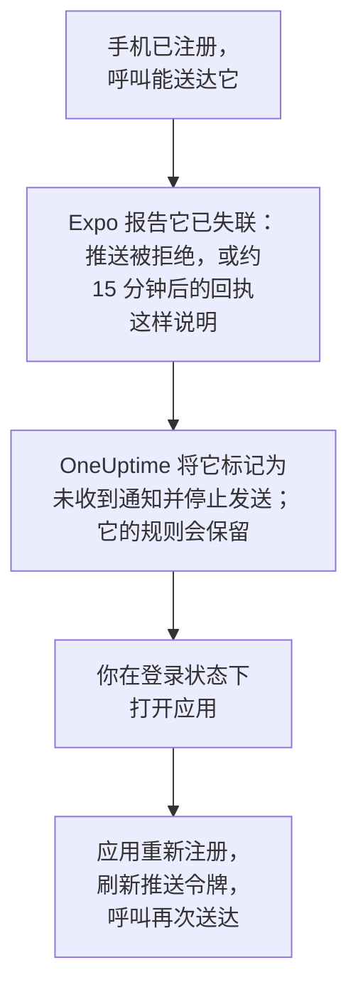

# 常见问题与故障排除

关于 OneUptime 移动应用和桌面应用的常见问题解答，以及最常见问题的解决方法：登录、收不到的通知，以及需要重新注册的手机。

:::cards
- [移动应用常见问题](#移动应用常见问题): 设备、项目、自托管和安全。
- [桌面应用常见问题](#桌面应用常见问题): 桌面应用是什么，以及它不能做什么。
- [手机需要重新注册的情况](#手机需要重新注册的情况): 手机为什么不再收到呼叫，以及如何恢复。
- [故障排除](#故障排除): 登录、通知和安装问题。
:::

## 移动应用常见问题

:::details 这个应用免费吗？
是的。OneUptime On-Call 在 App Store、Google Play 上免费提供，在 GitHub 上也有免费的 APK。你使用 OneUptime 账号登录。
:::

:::details 它能在哪些手机和平板上运行？
运行 iOS 或 iPadOS 16.4 或更高版本的 iPhone 和 iPad，以及运行 Android 7.0 或更高版本的 Android 手机和平板。
:::

:::details 它适用于自托管的 OneUptime 吗？
适用。在应用启动时输入你的 OneUptime 的 `https://` 地址，或在登录屏幕上点按 **Change Server**。默认情况下，你的服务器通过 OneUptime 推送中继向手机发送呼叫，因此它不需要 Apple、Google 或 Expo 账号：参见 [推送通知](/docs/self-hosted/push-notifications)。
:::

:::details 我可以在多个项目中使用它吗？
可以。应用会在你所属的每个项目中注册这部手机，因此每个项目都可以呼叫你。它一次显示一个项目：点按屏幕顶部的项目名称即可切换。
:::

:::details 我可以在多部手机上登录吗？
可以。每部手机或平板都是一个独立的推送设备，有自己的值班规则和自己的关键提醒设置。
:::

:::details 我能在应用中做什么？
- **Home**: 项目中需要关注的内容：进行中的事件和警报、未关闭的安全案例（如果你的角色可以查看）、有问题的监视器，以及分组后的事件。
- **Monitors**: 所有监视器，可按健康状况筛选，并可查看各自的详情。
- **Inbox**: 事件和警报，以及将它们分组的片段。打开其中一个即可 **Acknowledge**、**Resolve** 或 **Add Note**。如果你的角色可以查看项目的安全案例，**Security** 会列出未关闭的案例：打开其中一个，即可对等待审批的剧本步骤使用 **Approve** 或 **Reject**、用 **Assign to me** 接手案例，或使用 **Close case**。
- **On-Call**: 你是否在值班以及值班到何时、还有谁在值班、发给你的呼叫，以及 **Cover for me**，它会在一段时间内把你的呼叫交给一位队友。
- **Settings**: 你的项目和单点登录、外观、关键提醒和警报声、**Biometrics Login**、你的值班日历订阅，以及 **Log Out**。

其他所有内容都在仪表板中。
:::

:::details 我可以直接从通知确认呼叫吗？
不可以。点按通知：应用会在正确的项目中打开它所涉及的事件、警报、片段或安全案例，你在那里确认它。如果应用已锁定或你已退出登录，它会在你进入后立即打开该呼叫。
:::

:::details 我在手机上的登录安全吗？
应用只通过 HTTPS 与你的 OneUptime 通信。你的登录信息保存在手机上应用自己的存储中，**Log Out** 会删除它，并在服务器上退出该会话。开启 **Biometrics Login**，应用每次启动时都会要求你的面部、指纹或密码。
:::

:::details 应用可以离线使用吗？
不可以。没有网络连接时，它会在屏幕顶部显示 **No internet connection**，连接恢复后会继续工作。
:::

## 桌面应用常见问题

:::details 桌面应用是什么？
它是从浏览器安装为应用的 OneUptime 仪表板：有自己的窗口，在“开始”菜单、程序坞或启动器中有图标，并且能显示通知。它能做仪表板能做的一切，因为它就是仪表板。
:::

:::details 为什么它不在应用商店中？
不需要。应用每次打开时都会从你的 OneUptime 加载仪表板，因此无论在 Windows、macOS 还是 Linux 上，它始终是你的 OneUptime 正在运行的版本，无需更新任何内容。
:::

:::details 它能像手机一样叫醒我吗？
不能。浏览器无法覆盖勿扰模式或专注模式，因此桌面通知最多只能和电脑允许的一样响。对于必须叫醒你的呼叫，请使用开启了关键提醒的移动应用。
:::

:::details 它可以离线使用吗？
不可以。它需要连接到你的 OneUptime，就像浏览器标签页中的仪表板一样。
:::

## 手机需要重新注册的情况

OneUptime 通过 Expo 发送手机的呼叫，Expo 再把它们交给 Apple 或 Google。当 Expo 表示已无法再联系到这部手机时，OneUptime 就会停止向它发送，直到应用重新注册它。

当手机上的应用被删除，或其推送令牌不再有效时，Expo 会报告这部手机已失联。手机不会被删除：**用户设置 → 通知方式** 的 **Push Notifications** 选项卡会将它显示为 **未收到通知**，未送达它的呼叫的值班时间线会说明原因。你的其他手机和通知方式会照常收到呼叫。

应用每次启动、你登录时以及你回到应用时都会注册这部手机，但最多每五分钟一次。注册时会再次向 Expo 请求推送令牌，从而刷新令牌，手机会以原有的规则再次收到呼叫。

| 发生了什么 | 怎么做 | OneUptime 怎么做 |
| --- | --- | --- |
| 应用仍已安装 | 在登录状态下打开它 | 手机再次收到通知，规则保持不变 |
| 你在 iPhone 或 iPad 上重新安装了应用 | 安装并登录 | 通常会带回同一个条目及其规则 |
| 你在 Android 上重新安装了应用 | 安装、登录并删除旧条目 | 新建一个带默认规则的条目；旧条目保持标记状态 |
| 用旧手机的备份设置的新手机 | 在新手机上打开应用 | 如果旧手机的条目已被标记，新手机会连同规则一起接管它；否则新手机会获得自己的条目 |
| 从头设置的新手机 | 登录并删除旧条目 | 新建一个带默认规则的条目 |
| 你退出了应用的登录 | 重新登录 | 退出登录已删除这部手机及其规则；它会带着默认规则回来 |

浏览器的推送订阅过期时，它也可能不再收到通知。仪表板会在可以时续订；如果浏览器一直处于标记状态，请在该浏览器中用 **注册设备** 重新注册它。

## 故障排除

### 登录

:::details “Could not connect to the server”
应用无法访问 `https://<your-oneuptime>/api/status`。检查地址，包括 `https://`：应用不会通过普通 HTTP 连接。如果你的 OneUptime 位于专用网络中，请先将手机连接到该网络，例如通过 VPN。当手机能访问 OneUptime 时，在手机浏览器中打开该地址会显示 `{"status":"ok"}`。
:::

:::details “No SSO configuration found for the email”
该电子邮件所属的项目都没有设置单点登录，或者该电子邮件在这个 OneUptime 上没有账号。检查电子邮件，或使用密码登录。管理员为整个安装设置的身份提供商会列在电子邮件字段之前。
:::

:::details 安全密钥是你唯一的第二因素
应用无法使用安全密钥。请使用你的一个备用码登录，或在仪表板中为你的账号添加身份验证器应用：参见 [开启双因素身份验证](/docs/introduction/your-account#开启双因素身份验证)。
:::

:::details 通行密钥登录失败
通行密钥要求你的 OneUptime 地址以 `https://` 开头，并且需要你为这个 OneUptime 添加的通行密钥：参见 [添加通行密钥](/docs/introduction/your-account#添加通行密钥)。要使用其他服务器，请在登录屏幕上点按 **Change Server**。
:::

### 通知

:::details 手机收不到通知
- 检查手机是否允许来自 OneUptime On-Call 的通知，以及勿扰模式或专注模式是否在拦下它们。
- 在 **用户设置 → 通知方式** 的 **Push Notifications** 选项卡中，确认这部手机已列出，并向它发送一条 **测试通知**。
- 如果它被标记为 **未收到通知**，请在登录状态下打开应用：参见 [手机需要重新注册的情况](#手机需要重新注册的情况)。
- 在 **用户设置 → 值班规则** 下检查你的值班规则：它们决定哪些呼叫送达哪种方式。
- 在自托管的 OneUptime 上，检查服务器能否访问它的推送中继：参见 [推送通知](/docs/self-hosted/push-notifications#网络访问)。
:::

:::details Android 上的呼叫延迟送达
在 Android 的 OneUptime On-Call 设置中，将应用的电池使用设为 **不受限制**，并且不要把应用放进任何省电列表：参见 [防止呼叫延迟送达](/docs/mobile-desktop-apps/android-installation#防止呼叫延迟送达)。
:::

:::details 关键提醒无法穿透静音模式
打开应用的 **Settings**：**Critical On-Call Alerts** 下方的那一行会说明这部手机缺少什么。然后在 **用户设置 → 值班规则** 下确认发送该呼叫的值班规则设为 **重要警报**，而不是 **普通**。每部手机都有自己的开关。
:::

### 桌面应用

:::details 地址栏中没有安装图标
请在登录后从仪表板页面、通过 `https://`、在 Edge 或 Chrome 中安装，或在 macOS Sonoma 14 或更高版本上的 Safari 中安装。如果图标没有出现，也可以用浏览器的菜单安装：参见 [Windows 安装](/docs/mobile-desktop-apps/windows-installation#安装应用)。
:::

:::details 电脑上没有通知
在 **用户设置 → 通知方式** 的 **Push Notifications** 选项卡中，用 **注册设备** 注册浏览器，在询问时允许通知，并检查电脑自己的通知设置。自托管的 OneUptime 需要配置 VAPID 密钥才能发送浏览器通知。
:::

## 获取帮助

如果这里的内容与你看到的不符，请 [在 GitHub 上提交 issue](https://github.com/OneUptime/oneuptime/issues)，并附上你的应用版本（位于其 **Settings** 屏幕底部）和你使用的平台。

## 后续步骤

:::cards
- [应用概览](/docs/mobile-desktop-apps/index): 该用哪个应用，以及应用如何连接 OneUptime。
- [Android 安装](/docs/mobile-desktop-apps/android-installation): 在 Android 上安装并设置应用。
- [iOS 安装](/docs/mobile-desktop-apps/ios-installation): 在 iPhone 或 iPad 上安装并设置应用。
- [推送通知](/docs/self-hosted/push-notifications): 自托管的 OneUptime 如何发送呼叫，以及 Expo 的错误。
:::
