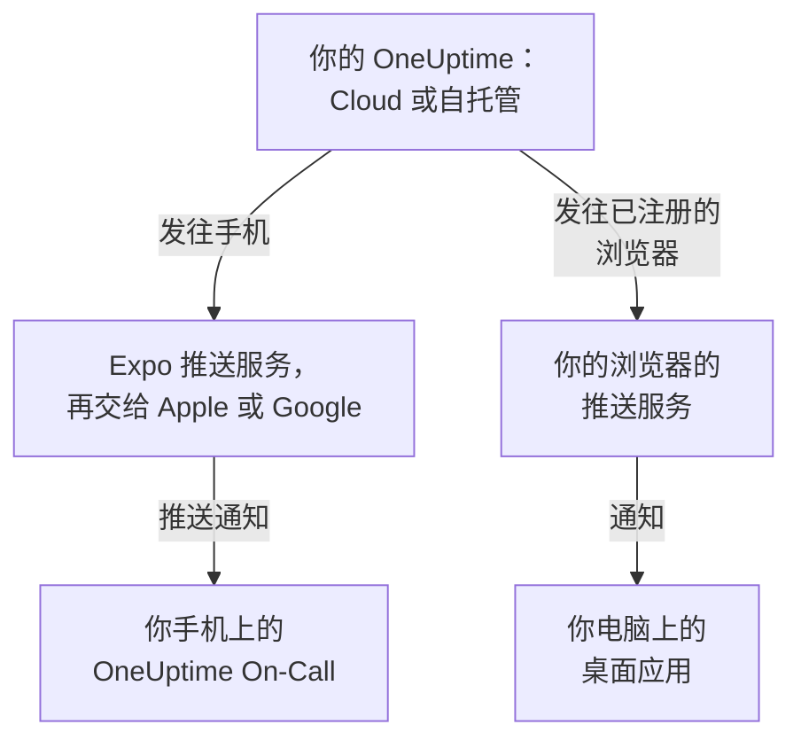

# 应用概览

OneUptime 有一个手机应用和一个电脑应用。适用于 iPhone、iPad 和 Android 的 **OneUptime On-Call** 会在你值班时呼叫你，让你无论身在何处都能确认和解决事件。在 Windows、macOS 和 Linux 上，OneUptime 仪表板可以从浏览器安装为桌面应用，在自己的窗口中打开。两者都适用于 OneUptime Cloud 和自托管的 OneUptime。

:::cards
- [选择应用](#选择应用): 并排比较每个应用的用途。
- [应用如何连接 OneUptime](#应用如何连接-oneuptime): 登录和值班呼叫经过的路径。
- [获取移动应用](#获取移动应用): 从 App Store、Google Play 或 GitHub 获取。
- [获取桌面应用](#获取桌面应用): 从 Edge、Chrome 或 Safari 安装仪表板。
:::

## 选择应用

|  | 移动应用 | 桌面应用 |
| --- | --- | --- |
| 是什么 | OneUptime On-Call，适用于 iPhone、iPad 和 Android 的原生应用 | 从浏览器安装的 OneUptime 仪表板 |
| 从哪里获取 | App Store、Google Play 或 GitHub 上的 APK | 你自己的 OneUptime：无需下载任何内容 |
| 值班呼叫 | 能穿透静音模式和勿扰模式响起的推送通知 | 注册浏览器之后的浏览器通知 |
| 能做什么 | 事件、警报、安全案例、监视器以及谁在值班；确认、解决、批准剧本步骤和添加备注 | 仪表板能做的一切 |
| 更新 | 从应用商店更新，或安装更新的 APK | 每次打开时从你的 OneUptime 加载仪表板 |
| 运行环境 | iOS 16.4 或更高版本，Android 7.0 或更高版本 | Windows、macOS 和 Linux 上的 Edge 或 Chrome，或 macOS Sonoma 14 或更高版本上的 Safari |

两者可以同时使用：工作时让桌面应用保持打开，夜里让手机叫醒你。

## 应用如何连接 OneUptime

移动应用登录你的 OneUptime，并在你所属的每个项目中注册这部手机。此后，OneUptime 通过 Expo 推送服务发送手机的推送通知（包括值班呼叫），Expo 再把它们交给 Apple 或 Google 投递。自托管的 OneUptime 默认通过 OneUptime 推送中继发送，因此不需要自己的 Apple、Google 或 Expo 账号：参见 [推送通知](/docs/self-hosted/push-notifications)。

桌面应用就是在自己窗口中的仪表板本身。为推送通知注册它的浏览器之后，它就会显示通知：Windows、macOS 和 Linux 的页面会说明如何注册。

## 开始之前

- 一个 OneUptime 项目中的账号。要接收呼叫，你还必须在值班：参见 [升级规则](/docs/on-call/escalation-rules)。
- 你的 OneUptime 的地址。在 OneUptime Cloud 上是 `https://oneuptime.com`；自托管的 OneUptime 有自己的地址，例如 `https://oneuptime.example.com`。
- 通过 HTTPS 提供的 OneUptime。移动应用不会通过普通 HTTP 连接，而浏览器只为 HTTPS 网站显示通知，Edge 和 Chrome 也只为 HTTPS 网站安装应用。

## 获取移动应用

:::steps
### 安装 OneUptime On-Call
在 iPhone 或 iPad 上从 [App Store](https://apps.apple.com/us/app/oneuptime-on-call/id6759615391) 获取，在 Android 上从 [Google Play](https://play.google.com/store/apps/details?id=com.oneuptime.oncall) 获取。没有 Google Play 的 Android 手机，请改为安装 [APK](https://github.com/OneUptime/oneuptime/releases/latest/download/oneuptime-on-call-android-app.apk)。仪表板的 **项目设置 → 通知 → 移动应用** 中也有同样的链接。

### 连接到你的 OneUptime
打开应用，使用 OneUptime Cloud 时保留 `https://oneuptime.com`，否则输入你自己的 OneUptime 地址，然后用密码、通行密钥或单点登录登录。

### 允许通知
手机询问时允许通知。应用会在你的每个项目中注册这部手机，值班呼叫就会开始送达。
:::

每一步的详细说明以及之后要检查的内容，请参见 [Android 安装](/docs/mobile-desktop-apps/android-installation) 和 [iOS 安装](/docs/mobile-desktop-apps/ios-installation)。

## 获取桌面应用

:::steps
### 打开仪表板
在 Microsoft Edge 或 Google Chrome 中登录你的 OneUptime，在 Mac 上也可以用 Safari。

### 安装
在 Edge 或 Chrome 中，点击地址栏右侧的安装图标。在 Safari 中，选择 **文件 → 添加到程序坞**。

### 像其他应用一样打开它
它会从“开始”菜单、程序坞或应用启动器在自己的窗口中打开。
:::

各浏览器的分步说明，请参见 [Windows 安装](/docs/mobile-desktop-apps/windows-installation)、[macOS 安装](/docs/mobile-desktop-apps/macos-installation) 和 [Linux 安装](/docs/mobile-desktop-apps/linux-installation)。

## 后续步骤

:::cards
- [Android 安装](/docs/mobile-desktop-apps/android-installation): 在 Android 上安装应用、登录，并确认呼叫能够送达。
- [iOS 安装](/docs/mobile-desktop-apps/ios-installation): 在 iPhone 或 iPad 上安装应用并开启关键提醒。
- [Windows 安装](/docs/mobile-desktop-apps/windows-installation): 从 Edge 或 Chrome 安装仪表板。
- [macOS 安装](/docs/mobile-desktop-apps/macos-installation): 从 Safari、Chrome 或 Edge 把仪表板添加到程序坞。
- [Linux 安装](/docs/mobile-desktop-apps/linux-installation): 从 Chrome、Chromium 或 Edge 安装仪表板。
- [常见问题与故障排除](/docs/mobile-desktop-apps/faq-troubleshooting): 解答、修复方法，以及手机不再收到呼叫时该怎么办。
:::
