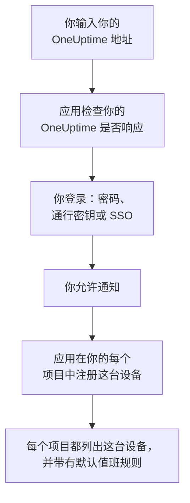
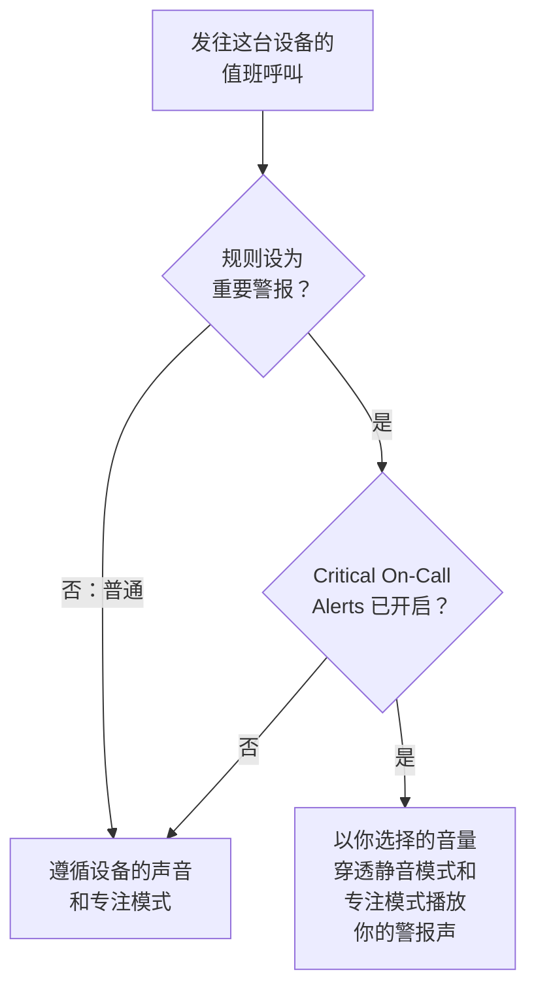

# iOS 安装

从 App Store 在 iPhone 或 iPad 上安装 **OneUptime On-Call**，将它连接到你的 OneUptime 并登录。然后给自己发送一条测试通知，并让紧急的值班呼叫穿透静音模式和专注模式响起。

:::cards
- [安装应用](#安装应用): 从 App Store 安装。
- [登录](#登录): 先输入你的 OneUptime 地址，再登录账号。
- [确认呼叫能送达设备](#确认呼叫能送达设备): 在仪表板中找到它并测试。
- [穿透静音模式](#穿透静音模式): 关键提醒、警报声及其音量。
- [故障排除](#故障排除): 登录、通知和关键提醒问题。
:::

## 开始之前

- 运行 iOS 16.4 或更高版本的 iPhone，或运行 iPadOS 16.4 或更高版本的 iPad。
- 一个 OneUptime 项目中的账号。要接收呼叫，你还必须在值班：参见 [升级规则](/docs/on-call/escalation-rules)。
- 你的 OneUptime 的地址：OneUptime Cloud 上是 `https://oneuptime.com`，或你自己的地址，例如 `https://oneuptime.example.com`。应用只通过 HTTPS 连接。

## 安装应用

1. 在 iPhone 或 iPad 上打开 [App Store 上的 OneUptime On-Call](https://apps.apple.com/us/app/oneuptime-on-call/id6759615391)，或在 App Store 中搜索 OneUptime On-Call。
2. 轻点 **获取**，然后用面容 ID、触控 ID 或你的 Apple 账户密码确认。
3. 轻点 **打开**，或从主屏幕打开 OneUptime On-Call。

只要 **设置 → App Store** 中的 **App 更新** 处于开启状态，App Store 就会让应用保持最新。

## 登录

:::steps
### 输入你的 OneUptime 地址
打开应用。在 **Connect your workspace** 上，使用 OneUptime Cloud 时保留 `https://oneuptime.com`，否则输入你自己的 OneUptime 地址，然后轻点 **Connect**。`https://<your-oneuptime>/api/status` 响应后，应用就会继续。

### 登录你的账号
使用你的账号支持的登录方式：

- 你的电子邮件和密码，然后轻点 **Sign In**。**Forgot password?** 会通过电子邮件给你发送一个设置新密码的链接。
- **Sign in with a passkey**，前提是你已在仪表板中添加了通行密钥：参见 [添加通行密钥](/docs/introduction/your-account#添加通行密钥)。会打开一个浏览器面板以确认它，然后把你带回应用。
- **Sign in with SSO**，如果你的组织使用单点登录。选择你的身份提供商，或输入你的工作电子邮件并轻点 **Continue**。会打开一个安全浏览器，登录后你会回到应用。

开启双因素身份验证后，输入身份验证器应用中的六位数验证码，或你的一个备用码。应用中无法使用安全密钥。如果管理员要求双因素身份验证而你还没有设置，应用会先和你一起设置身份验证器应用。

### 允许通知
当 iOS 询问是否允许 OneUptime On-Call 向你发送通知时，轻点 **允许**。

随后，应用会在你的每个项目中注册这台 iPhone 或 iPad。每个项目都会把它列在你的推送设备中，并带有默认值班规则，因此从现在起你的呼叫会送达它。
:::

应用一次显示一个项目：轻点屏幕顶部的项目名称即可切换。要求单点登录的项目会在 **Settings → Manage Projects** 中显示 **SSO Required**，直到你在那里轻点 **Authenticate with SSO**。

## 确认呼叫能送达设备

:::steps
### 在仪表板中找到这台设备
在仪表板中，打开 **用户设置 → 通知方式** 和 **Push Notifications** 选项卡。这台 iPhone 或 iPad 按型号名称列在 **推送通知设备** 下。每个项目都有自己的列表。

### 发送测试
点击设备所在行的 **测试通知**。设备会收到一条通知；轻点它即可打开应用。
:::

你的值班规则决定哪些呼叫发送到这台设备，以及多快发送：参见 **用户设置 → 值班规则**。新设备会获得与你添加的任何其他方式相同的默认规则。

## 穿透静音模式

默认情况下，值班呼叫遵循设备的声音设置：静音模式会让它保持安静，而勿扰模式等专注模式会拦下它。关键提醒让值班呼叫穿透这两者响起。它们默认关闭，需要你在每台设备上分别开启。

:::steps
### 开启 Critical On-Call Alerts
在应用中打开 **Settings**，在 **Notifications** 下开启 **Critical On-Call Alerts**。

### 允许关键提醒
当 iOS 询问是否允许 OneUptime On-Call 发送关键提醒时，轻点 **允许**。随后 iOS 会在 **设置 → 通知 → OneUptime On-Call** 下为应用添加一个 **关键提醒** 开关，你以后可以在那里改变主意。应用开关下方的那一行会说明呼叫是否会穿透。

### 选择警报声及其音量
轻点开关下方的 **Alarm sound**。除了设备自己的关键提醒声音，它还提供 Klaxon、Siren、Digital alarm、Smoke alarm 和由轻到响的 Rising alarm。轻点声音旁边的播放按钮即可试听。然后选择呼叫播放的音量：25%、50%、75% 或 100%（默认）。
:::

只有值班呼叫会穿透，而且只有来自设为 **重要警报**（默认值）的值班规则的呼叫才会穿透。设为 **普通** 的规则无论开关如何都会遵循设备的设置，这样你可以在严重事件时被叫醒，而轻微事件只会静默呼叫你。把设备设为静音后发送一条 **测试通知**，即可听到呼叫会怎样响起。**Alarm sound** 屏幕上的试听以铃声音量播放，在静音模式下则完全不播放；真正的呼叫会以你选择的音量穿透静音模式。

> [!NOTE]
> 关键提醒需要 App Store 上的 OneUptime On-Call 1.5.0 或更高版本。更早的版本在构建时没有获得 Apple 的关键提醒许可，所以 iOS 从未为它们提供这个开关。

## 防止呼叫被拦下

没有关键提醒时，专注模式或摘要可能会拦下呼叫：

- **专注模式。** 在 **设置 → 专注模式** 下，把 OneUptime On-Call 添加到每个专注模式允许的 App 中。
- **定时推送摘要。** 在 **设置 → 通知 → 定时推送摘要** 下，不要把 OneUptime On-Call 加入其中：摘要中的通知会等到摘要的下一个时间才送达。
- **通知。** 在 **设置 → 通知 → OneUptime On-Call** 下保持 **允许通知** 开启。

## 锁定应用

在应用的 **Settings** 下开启 **Biometrics Login**，应用每次启动时都会要求面容 ID、触控 ID 或你的密码。设备设置了面容 ID 或触控 ID 后，这个开关才会出现。同一屏幕上的 **Appearance** 用于选择浅色或深色外观，或跟随设备设置。

## 更新、退出登录或删除应用

- **更新。** App Store 会更新应用；你也可以在 App Store 的账户页面中手动更新。应用的版本显示在其 **Settings** 屏幕底部。
- **退出登录。** **Settings → Log Out** 会让你退出登录，并从每个项目的推送设备中移除这台设备及其值班规则。再次登录会以默认规则重新添加它。
- **删除。** 按住应用图标，然后轻点 **移除 App** 和 **删除 App**。如果你当时仍处于登录状态，这台设备会一直留在你的列表中，直到发往它的推送失败：OneUptime 随后会将其标记为 **未收到通知**。重新安装应用并登录后，通常会带回同一个条目及其规则；如果你不再使用这台设备，请用 **删除** 删除该条目。

## 故障排除

:::details “Could not connect to the server”
应用无法访问 `https://<your-oneuptime>/api/status`。检查地址，包括 `https://`。如果你的 OneUptime 位于专用网络中，请先将设备连接到该网络，例如通过 VPN。在设备上的 Safari 中打开该地址：当设备能访问 OneUptime 时，它会显示 `{"status":"ok"}`。
:::

:::details 收不到通知
- 检查 **设置 → 通知 → OneUptime On-Call** 下的 **允许通知** 是否开启，以及是否有专注模式在拦下呼叫。
- 检查这台设备是否列在 **用户设置 → 通知方式** 的 **Push Notifications** 中，并向它发送一条 **测试通知**。
- 如果这台设备被标记为 **未收到通知**，请在登录状态下打开应用。它会重新注册这台设备；参见 [手机需要重新注册的情况](/docs/mobile-desktop-apps/faq-troubleshooting#手机需要重新注册的情况)。
- 在 **用户设置 → 值班规则** 下检查你的值班规则。
- 在自托管的 OneUptime 上，检查你的服务器能否访问它的推送中继：参见 [推送通知](/docs/self-hosted/push-notifications#网络访问)。
:::

:::details iOS 设置中没有关键提醒开关
先在应用中开启 **Critical On-Call Alerts**：只有在应用请求关键提醒之后，iOS 才会添加它的开关。如果应用提示此版本无法接收关键提醒，请从 App Store 更新 OneUptime On-Call。
:::

:::details 关键提醒不响
打开应用的 **Settings**：**Critical On-Call Alerts** 下方的那一行会说明缺少什么。检查 **设置 → 通知 → OneUptime On-Call** 下的 **关键提醒** 是否开启，以及应用 **Alarm sound** 屏幕上的音量是否设得太低。
:::

:::details 没有 Biometrics Login 开关
在 **设置 → 面容 ID 与密码** 或 **设置 → 触控 ID 与密码** 下设置面容 ID 或触控 ID 后，这个开关就会出现。
:::

## 后续步骤

:::cards
- [常见问题与故障排除](/docs/mobile-desktop-apps/faq-troubleshooting): 手机不再收到呼叫时该怎么办。
- [Android 安装](/docs/mobile-desktop-apps/android-installation): 在 Android 上使用同一个应用。
- [升级规则](/docs/on-call/escalation-rules): 决定呼叫谁以及何时呼叫。
- [推送通知](/docs/self-hosted/push-notifications): 自托管的 OneUptime 如何向手机发送呼叫。
:::
