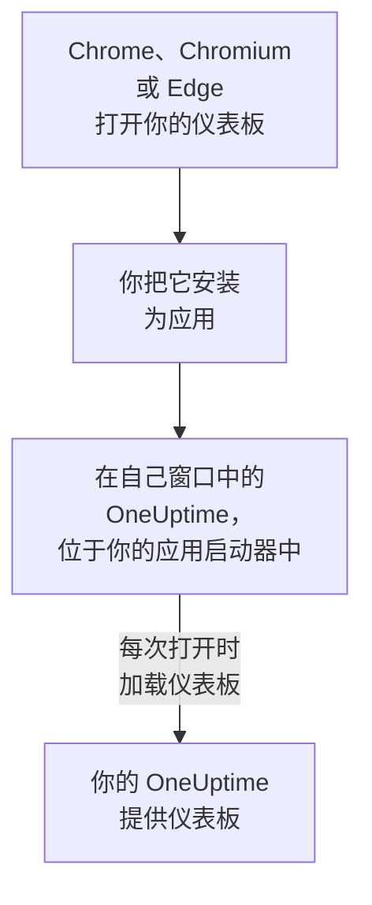

# Linux 安装

OneUptime 仪表板可以从 Google Chrome、Chromium 或 Microsoft Edge 在 Linux 上安装为应用。它在自己的窗口中打开，在桌面的应用启动器中有自己的条目，并且可以显示通知。无需下载任何内容：这个应用就是你的 OneUptime 的仪表板，只要你的 OneUptime 是最新的，它就是最新的。

:::cards
- [安装应用](#安装应用): 从 Chrome、Chromium 或 Edge 安装。
- [从应用启动器打开它](#从应用启动器打开它): 和其他桌面应用一样。
- [在这台电脑上接收通知](#在这台电脑上接收通知): 为推送通知注册浏览器。
- [故障排除](#故障排除): 没有安装图标、没有通知、启动器中没有条目。
:::

## 桌面应用的工作原理

已安装的应用与其浏览器共享登录状态、设置和通知权限。关闭浏览器后，应用仍会在自己的窗口中继续运行。

## 开始之前

- 装有较新版本的 Google Chrome、Chromium 或 Microsoft Edge 的 Linux 桌面。
- 通过 HTTPS 访问的你的 OneUptime 地址：OneUptime Cloud 上是 `https://oneuptime.com`，或你自己的地址，例如 `https://oneuptime.example.com`。
- 一个可以登录仪表板的账号。

## 安装应用

:::tabs
@tab Chrome
1. 在 Chrome 或 Chromium 中打开你的 OneUptime 并登录。
2. 在任意仪表板页面上，点击地址栏右侧的安装图标，然后点击 **安装**。或者打开 **⋮ → 投放、保存和分享 → 将网页安装为应用…**。
3. Chrome 会在自己的窗口中打开 OneUptime，并将其添加到你的应用启动器。
@tab Edge
1. 在 Edge 中打开你的 OneUptime 并登录。
2. 在任意仪表板页面上，点击地址栏右侧的安装图标，然后点击 **安装**。或者打开 **设置及其他 (…) → 更多工具 → 应用 → 将此站点作为应用安装**。
3. Edge 会在自己的窗口中打开 OneUptime，并将其添加到你的应用启动器。
:::

请在登录后从仪表板页面安装：登录页面不是这个应用。

## 从应用启动器打开它

浏览器会为应用添加一个桌面条目，即 `~/.local/share/applications` 中的一个 `.desktop` 文件，因此 OneUptime 会出现在 GNOME、KDE Plasma 和其他启动器中。你可以从那里把它固定到停靠栏或面板上，就像其他应用一样。

## 在这台电脑上接收通知

应用通过其浏览器显示通知，前提是你在每个想接收通知的项目中为推送通知注册了该浏览器。

:::steps
### 打开你的推送设备
在应用中，打开 **用户设置 → 通知方式** 和 **Push Notifications** 选项卡。

### 注册这个浏览器
点击 **注册设备**，保留建议的 **设备名称**（例如 `Chrome on Linux`）或修改它，然后再次点击 **注册设备**。当浏览器询问是否允许 OneUptime 显示通知时，选择 **允许**。

### 发送测试
在 **Browser Registered** 对话框中，点击 **Send Test Notification**。你的桌面会通过其通知服务显示它；如果什么都没有出现，请参见 [故障排除](#故障排除)。
:::

浏览器无法穿透桌面的勿扰模式响起。对于必须叫醒你的呼叫，请使用开启了关键提醒的移动应用：参见 [Android 安装](/docs/mobile-desktop-apps/android-installation#穿透静音模式)。

在自托管的 OneUptime 上，浏览器通知需要服务器的 VAPID 密钥：参见 [推送通知](/docs/self-hosted/push-notifications#自托管设置)。

## 更新

无需更新任何内容。应用每次打开时都会从你的 OneUptime 加载仪表板，因此你的 OneUptime 升级后它也会随之变化。如果某个窗口在升级前就已打开，请按 Ctrl+R 重新加载。

## 卸载

:::tabs
@tab Chrome
在应用窗口中打开 **⋮** 菜单，选择卸载该应用的菜单项，然后选择 **移除**。
@tab Edge
在 Edge 中打开 `edge://apps`，在 OneUptime 上选择 **详细信息**，然后选择 **卸载**。
:::

卸载应用不会取消注册它的浏览器：浏览器仍会收到通知。要停止通知，请在 **用户设置 → 通知方式** 的 **Push Notifications** 选项卡中，用 **删除** 删除该浏览器。

## 故障排除

:::details 地址栏中没有安装图标
请在登录后打开仪表板页面，而不是登录页面，并确认地址以 `https://` 开头：浏览器只会从安全网站安装应用。如果图标仍未出现，请按上文所述使用浏览器的菜单。其他浏览器可能无法将网站安装为应用；请使用 Chrome、Chromium 或 Edge。
:::

:::details 没有显示通知
- 在 **用户设置 → 通知方式** 的 **Push Notifications** 选项卡中，确认这个浏览器已列出，并向它发送一条 **测试通知**。
- 确认桌面的勿扰模式已关闭，并且其通知设置允许该浏览器。
- 如果浏览器阻止了 OneUptime 的通知，请点击地址栏左侧的图标，允许该网站的通知，然后重新注册浏览器。
- 在自托管的 OneUptime 上，如果服务器没有 VAPID 密钥，**注册设备** 对话框会说明这一点。
:::

:::details 启动器中没有这个应用
改为从浏览器打开它：在 Chrome 或 Chromium 中是 `chrome://apps`，在 Edge 中是 `edge://apps`。只在登录时读取桌面条目的启动器，会在你注销并重新登录后显示它。
:::

## 后续步骤

:::cards
- [Android 安装](/docs/mobile-desktop-apps/android-installation): 在手机上接收呼叫，并使用关键提醒。
- [Windows 安装](/docs/mobile-desktop-apps/windows-installation): 在 Windows 上使用同一个应用。
- [常见问题与故障排除](/docs/mobile-desktop-apps/faq-troubleshooting): 关于两个应用的解答。
- [您的账户](/docs/introduction/your-account): OneUptime 如何在每个项目中联系你。
:::
