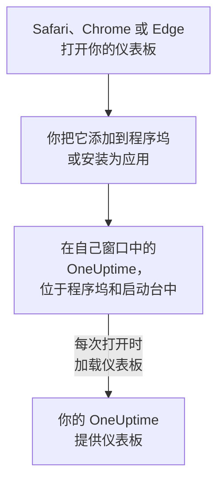

# macOS 安装

OneUptime 仪表板可以作为应用安装在 Mac 上：从 Safari 将它添加到程序坞，或从 Google Chrome 或 Microsoft Edge 安装。它在自己的窗口中打开，在程序坞和启动台中有自己的图标，并且可以显示通知。无需下载任何内容：这个应用就是你的 OneUptime 的仪表板，只要你的 OneUptime 是最新的，它就是最新的。

:::cards
- [安装应用](#安装应用): 从 Safari、Chrome 或 Edge 安装。
- [将它保留在程序坞中](#将它保留在程序坞中): 一键打开，或在登录时打开。
- [在这台 Mac 上接收通知](#在这台-mac-上接收通知): 为推送通知注册应用。
- [故障排除](#故障排除): 没有“添加到程序坞”、没有通知、需要重新登录。
:::

## 桌面应用的工作原理

Safari 网页 App 有自己的登录状态、Cookie 和设置，与 Safari 分开。从 Chrome 或 Edge 安装的应用则与该浏览器共享这些内容。

## 开始之前

- 使用 Safari 需要 macOS Sonoma 14 或更高版本。Chrome 和 Edge 可以在它们能运行的任何 macOS 上安装应用。
- 通过 HTTPS 访问的你的 OneUptime 地址：OneUptime Cloud 上是 `https://oneuptime.com`，或你自己的地址，例如 `https://oneuptime.example.com`。
- 一个可以登录仪表板的账号。

## 安装应用

:::tabs
@tab Safari
1. 在 Safari 中打开你的 OneUptime 并登录。
2. 在任意仪表板页面上，选择 **文件 → 添加到程序坞**，或点按工具栏中的共享按钮，然后点按 **添加到程序坞**。
3. 保留名称或修改它，然后点按 **添加**。
4. 从程序坞打开 OneUptime，并再登录一次：网页 App 不共享 Safari 的登录状态。
@tab Chrome
1. 在 Chrome 中打开你的 OneUptime 并登录。
2. 在任意仪表板页面上，点击地址栏右侧的安装图标，然后点击 **安装**。或者打开 **⋮ → 投放、保存和分享 → 将网页安装为应用…**。
3. Chrome 会在自己的窗口中打开 OneUptime，并将其添加到启动台。
@tab Edge
1. 在 Edge 中打开你的 OneUptime 并登录。
2. 在任意仪表板页面上，点击地址栏右侧的安装图标，然后点击 **安装**。或者打开 **设置及其他 (…) → 更多工具 → 应用 → 将此站点作为应用安装**。
3. Edge 会在自己的窗口中打开 OneUptime，并将其添加到启动台。
:::

请在登录后从仪表板页面安装：登录页面不是这个应用。Safari 会把网页 App 保存在你的个人文件夹中的“应用程序”文件夹里。

## 将它保留在程序坞中

- **程序坞。** 在应用打开时，按住 Control 键点按它在程序坞中的图标，然后选择 **选项 → 在程序坞中保留**。Safari 网页 App 已经在程序坞中。
- **登录时打开。** 按住 Control 键点按程序坞中的图标，然后选择 **选项 → 登录时打开**。
- **聚焦搜索。** 按下 Command-空格键并输入 OneUptime。

## 在这台 Mac 上接收通知

在每个想接收通知的项目中为推送通知注册应用后，应用就会显示通知。请在网页 App 内部注册 Safari 网页 App：它本身就是一个独立的浏览器。从 Chrome 或 Edge 安装的应用会随其浏览器一起注册。

:::steps
### 打开你的推送设备
在应用中，打开 **用户设置 → 通知方式** 和 **Push Notifications** 选项卡。

### 注册这个应用
点按 **注册设备**，保留建议的 **设备名称**（例如 `Safari on macOS`）或修改它，然后再次点按 **注册设备**。当 macOS 或浏览器询问是否允许 OneUptime 发送通知时，选择 **允许**。

### 发送测试
在 **Browser Registered** 对话框中，点按 **Send Test Notification**。如果什么都没有出现，请查看 Mac 的通知设置：参见 [故障排除](#故障排除)。
:::

浏览器无法穿透勿扰模式等专注模式响起。对于必须叫醒你的呼叫，请使用开启了关键提醒的移动应用：参见 [iOS 安装](/docs/mobile-desktop-apps/ios-installation#穿透静音模式)。

在自托管的 OneUptime 上，浏览器通知需要服务器的 VAPID 密钥：参见 [推送通知](/docs/self-hosted/push-notifications#自托管设置)。

## 更新

无需更新任何内容。应用每次打开时都会从你的 OneUptime 加载仪表板，因此你的 OneUptime 升级后它也会随之变化。如果某个窗口在升级前就已打开，请按 Command-R 重新加载。

## 卸载

:::tabs
@tab Safari
在访达中打开你的个人文件夹，再打开其中的“应用程序”文件夹，将 OneUptime 拖到废纸篓。
@tab Chrome
在应用窗口中打开 **⋮** 菜单，选择卸载该应用的菜单项，然后选择 **移除**。
@tab Edge
在 Edge 中打开 `edge://apps`，在 OneUptime 上选择 **详细信息**，然后选择 **卸载**。
:::

卸载应用不会取消它的注册：它的浏览器仍会收到通知。要停止通知，请在 **用户设置 → 通知方式** 的 **Push Notifications** 选项卡中，用 **删除** 删除它。

## 故障排除

:::details Safari 中没有“添加到程序坞”
从 macOS Sonoma 14 开始，Safari 才能把网页 App 添加到程序坞。请更新 macOS，或改为从 Chrome 或 Edge 安装应用。
:::

:::details 没有显示通知
- 在 **用户设置 → 通知方式** 的 **Push Notifications** 选项卡中，确认应用或其浏览器已列出，并发送一条 **测试通知**。
- 在 Mac 上打开 **系统设置 → 通知**，确认 OneUptime（或安装它的浏览器）被允许发送通知，并且没有专注模式在拦下通知。
- 如果浏览器阻止了 OneUptime 的通知，请在浏览器的网站设置中允许通知，然后重新注册。
- 在自托管的 OneUptime 上，如果服务器没有 VAPID 密钥，**注册设备** 对话框会说明这一点。
:::

:::details 应用要求你重新登录
Safari 网页 App 有自己的登录状态：请在应用内登录。从 Chrome 或 Edge 安装的应用共享其浏览器的登录状态，因此在浏览器中退出登录或清除其 Cookie，也会让它退出登录。
:::

## 后续步骤

:::cards
- [iOS 安装](/docs/mobile-desktop-apps/ios-installation): 在 iPhone 上接收呼叫，并使用关键提醒。
- [Windows 安装](/docs/mobile-desktop-apps/windows-installation): 在 Windows 上使用同一个应用。
- [常见问题与故障排除](/docs/mobile-desktop-apps/faq-troubleshooting): 关于两个应用的解答。
- [您的账户](/docs/introduction/your-account): OneUptime 如何在每个项目中联系你。
:::
