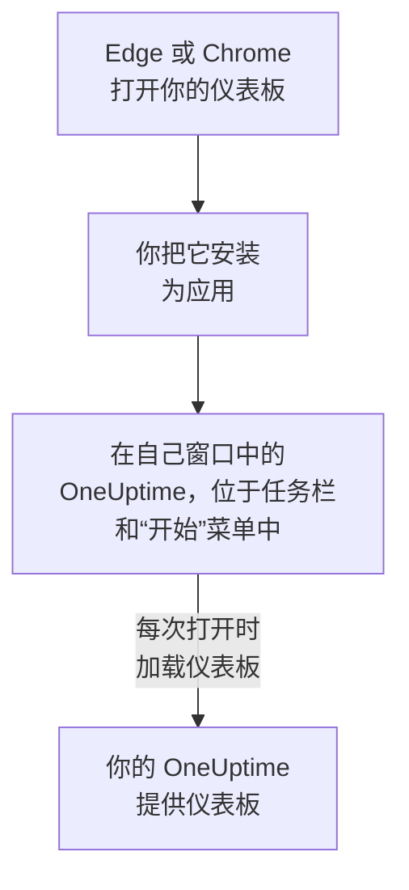

# Windows 安装

OneUptime 仪表板可以从 Microsoft Edge 或 Google Chrome 在 Windows 上安装为应用。它在自己的窗口中打开，在任务栏和“开始”菜单中有自己的图标，并且可以显示通知。无需下载任何内容：这个应用就是你的 OneUptime 的仪表板，只要你的 OneUptime 是最新的，它就是最新的。

:::cards
- [安装应用](#安装应用): 从 Edge 或 Chrome 安装，只需点击几下。
- [固定它并随 Windows 启动](#固定它并随-windows-启动): 让它一键即可打开。
- [在这台电脑上接收通知](#在这台电脑上接收通知): 为推送通知注册浏览器。
- [故障排除](#故障排除): 没有安装图标、没有通知、需要重新登录。
:::

## 桌面应用的工作原理

已安装的应用与其浏览器共享登录状态、设置和通知权限。关闭浏览器后，应用仍会在自己的窗口中继续运行。

## 开始之前

- Windows 10 或 Windows 11，并装有较新版本的 Microsoft Edge 或 Google Chrome。
- 通过 HTTPS 访问的你的 OneUptime 地址：OneUptime Cloud 上是 `https://oneuptime.com`，或你自己的地址，例如 `https://oneuptime.example.com`。
- 一个可以登录仪表板的账号。

## 安装应用

:::tabs
@tab Edge
1. 在 Edge 中打开你的 OneUptime 并登录。
2. 在任意仪表板页面上，点击地址栏右侧的安装图标，然后点击 **安装**。或者打开 **设置及其他 (…) → 更多工具 → 应用 → 将此站点作为应用安装**。
3. Edge 会在自己的窗口中打开 OneUptime，并可能提示你将其固定到任务栏或“开始”菜单。
@tab Chrome
1. 在 Chrome 中打开你的 OneUptime 并登录。
2. 在任意仪表板页面上，点击地址栏右侧的安装图标，然后点击 **安装**。或者打开 **⋮ → 投放、保存和分享 → 将网页安装为应用…**。
3. Chrome 会在自己的窗口中打开 OneUptime，并将其添加到“开始”菜单。
:::

请在登录后从仪表板页面安装：登录页面不是这个应用。之后要打开它，请在“开始”菜单中搜索 OneUptime。

## 固定它并随 Windows 启动

- **任务栏。** 在应用打开时，右键点击它在任务栏上的图标，然后选择 **固定到任务栏**。
- **随 Windows 启动。** 在 Edge 中打开 `edge://apps`，在 OneUptime 上选择 **详细信息**，然后开启 **设备登录时自动启动**。同一页面还可以将应用固定到任务栏或“开始”菜单，或在桌面上创建快捷方式。

## 在这台电脑上接收通知

应用通过其浏览器显示通知，前提是你在每个想接收通知的项目中为推送通知注册了该浏览器。

:::steps
### 打开你的推送设备
在应用中，打开 **用户设置 → 通知方式** 和 **Push Notifications** 选项卡。

### 注册这个浏览器
点击 **注册设备**，保留建议的 **设备名称**（例如 `Edge on Windows`）或修改它，然后再次点击 **注册设备**。当浏览器询问是否允许 OneUptime 显示通知时，选择 **允许**。

### 发送测试
在 **Browser Registered** 对话框中，点击 **Send Test Notification**。如果什么都没有出现，请查看 Windows 自己的通知设置：参见 [故障排除](#故障排除)。
:::

浏览器的提醒不会比 Windows 允许的更响：它无法覆盖请勿打扰。对于必须叫醒你的呼叫，请使用开启了关键提醒的移动应用：参见 [Android 安装](/docs/mobile-desktop-apps/android-installation#穿透静音模式) 或 [iOS 安装](/docs/mobile-desktop-apps/ios-installation#穿透静音模式)。

在自托管的 OneUptime 上，浏览器通知需要服务器的 VAPID 密钥：参见 [推送通知](/docs/self-hosted/push-notifications#自托管设置)。

## 更新

无需更新任何内容。应用每次打开时都会从你的 OneUptime 加载仪表板，因此你的 OneUptime 升级后它也会随之变化。如果某个窗口在升级前就已打开，请按 Ctrl+R 重新加载。

## 卸载

:::tabs
@tab Edge
打开 `edge://apps`，在 OneUptime 上选择 **详细信息**，然后选择 **卸载**。
@tab Chrome
在应用窗口中打开 **⋮** 菜单，选择卸载该应用的菜单项，然后选择 **移除**。
:::

Windows 也会在 **设置 → 应用 → 已安装的应用** 下列出该应用，在那里点击 **卸载** 同样可以移除它。

卸载应用不会取消注册它的浏览器：浏览器仍会收到通知。要停止通知，请在 **用户设置 → 通知方式** 的 **Push Notifications** 选项卡中，用 **删除** 删除该浏览器。

## 故障排除

:::details 地址栏中没有安装图标
请在登录后打开仪表板页面，而不是登录页面，并确认地址以 `https://` 开头：浏览器只会从安全网站安装应用。如果图标仍未出现，请按上文所述使用浏览器的菜单。其他浏览器可能无法将网站安装为应用；请使用 Edge 或 Chrome。
:::

:::details 没有显示通知
- 在 **用户设置 → 通知方式** 的 **Push Notifications** 选项卡中，确认这个浏览器已列出，并向它发送一条 **测试通知**。
- 在 Windows 中打开 **设置 → 系统 → 通知**：通知必须开启（对浏览器也要开启），并且请勿打扰必须关闭。Windows 10 中这个页面名为“通知和操作”。
- 如果浏览器阻止了 OneUptime 的通知，请点击地址栏左侧的图标，允许该网站的通知，然后重新注册浏览器。
- 在自托管的 OneUptime 上，如果服务器没有 VAPID 密钥，**注册设备** 对话框会说明这一点。
:::

:::details 应用要求你重新登录
应用与其浏览器共享登录状态。在浏览器中退出登录或清除其 Cookie，也会让应用退出登录。
:::

## 后续步骤

:::cards
- [macOS 安装](/docs/mobile-desktop-apps/macos-installation): 在 Mac 上使用同一个应用。
- [Android 安装](/docs/mobile-desktop-apps/android-installation): 在手机上接收呼叫。
- [常见问题与故障排除](/docs/mobile-desktop-apps/faq-troubleshooting): 关于两个应用的解答。
- [您的账户](/docs/introduction/your-account): OneUptime 如何在每个项目中联系你。
:::
