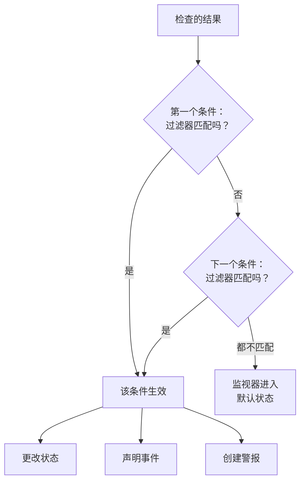
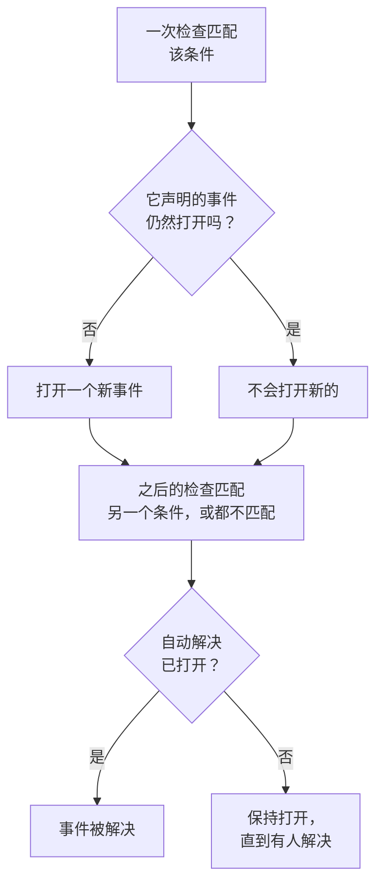

# 条件与状态

监视器的条件决定每次检查意味着什么：监视器是正常还是宕机，以及 OneUptime 是声明事件还是创建警报。状态是您项目中监视器可能处于的状态列表，从 **运行正常** 到 **离线**。本页针对所有监视器类型讲解这两者；每种类型自己的页面会列出它提供的过滤器。

:::cards
- [条件如何决定](#条件如何决定): 从上到下，第一个匹配的胜出。
- [条件包含什么](#条件包含什么): 过滤器、匹配条件、操作和设置。
- [判断一段时间窗口内的检查](#判断一段时间窗口内的检查): 统计失败的检查、发现抖动、读取百分位数。
- [更改监视器的条件](#更改监视器的条件): 编辑、添加、排序和测试条件。
- [监视器状态](#监视器状态): 内置状态和您自己的状态。
:::

## 条件如何决定

每次检查监视器时，它的条件会从列表顶部往下判断结果。第一个过滤器匹配的条件决定发生什么，这次检查不会再看它下面的条件。如果没有任何条件匹配，监视器会进入它的 **默认监视器状态**。不过，只要能让它恢复的条件尚未匹配，它就会保持当前状态：参见 [条件何时恢复](#条件何时恢复)。

顺序是规则的一部分。新监视器按从坏到好的顺序列出条件：先是离线，然后是该类型有的警告（即将过期的证书或域名），最后是在线。像 **是否在线** 设为 **是** 这样宽泛的健康条件几乎匹配每次检查，所以放在最后：如果放在其他条件之上，它每次都会先匹配，其他条件就永远不会生效。

一个匹配但不更改状态的条件仍然决定了这次检查：监视器保持现有状态，它下面的条件等待下一次检查。**默认监视器状态** 只在没有任何条件匹配时才适用。新监视器的默认值是 **运行正常**；可以在条件下方的 **更多字段** 中更改。

> [!NOTE]
> 按主机、容器、磁盘或接口分别打开事件或警报的监视器，每次检查都会判断所有条件，因此两台主机可以同时匹配两个不同的条件。这指的是查询带有 **分组依据** 的监视器，例如指标监视器或日志监视器，或者为每个磁盘或接口指定 `*` 的条件。用 PromQL 编写的查询也是如此。按负载字段对事件分组的入站请求监视器仍然在第一个匹配处停止。
>
> 这样的监视器仍然只有一个状态，由第一个匹配的条件设定。只把监视器恢复到 **默认监视器状态**、不打开任何事件或警报的条件，会等待满足过设定其他状态的条件的主机：无论其他主机情况如何，要等它们每一个都满足后才匹配。在此之前，即使没有任何条件匹配，监视器也会保持其状态，而每台主机的事件和警报仍会各自解决。

## 条件包含什么

打开一个条件，它有一个名称和三个部分，每个部分都可以折叠为一行摘要。

| 部分 | 包含什么 |
| --- | --- |
| **条件名称** | 条件列表中的名称，也会出现在该条件打开的每个事件和警报的根本原因中。**添加条件** 会按新条件的过滤器为它命名，在您输入自己的名称之前，名称会随过滤器变化。 |
| **过滤器** | 检查必须显示的内容，由一个或多个过滤器表示。Kubernetes 和指标监视器称之为 **警报规则**。 |
| **操作** | 过滤器匹配时发生的事：更改状态、创建警报、声明事件，或其中任意组合。 |
| **设置** | **启用此条件**、可选的 **描述**、何时恢复以及何时评估，以及在 Incoming Request 监视器上的 **Group incidents and alerts by a payload field**。 |

### 过滤器

过滤器从检查中读取一个值并进行比较：**过滤器类型**（读取什么，例如 **响应状态码**）、**过滤条件**（如何比较，例如 **大于**）和 **值**。比较指标的监视器，例如 Kubernetes 和指标监视器，改为要求填写 **条件** 和 **阈值**。每种监视器类型都提供自己的过滤器类型，列在各自的页面上，例如 [监控标准](/docs/monitor/website-monitor#监控标准)。

有两个或更多过滤器时，下方会出现 **匹配条件**：**全部** 表示每个过滤器都必须匹配，**任意** 表示一个就够了。新条件从 **全部** 开始。

对每次检查都进行测量的过滤器，例如 **是否在线**、**响应状态码** 和 **响应时间（毫秒）**，提供 **在一段时间内评估此条件**。它判断最近一段时间内的检查，而不只是最新一次，默认是最近 5 分钟并使用 **所有值**，即只有当时间窗口内的每次检查都匹配时才匹配。时间窗口最长可达 24 小时，也可以对检查计数，详见 [判断一段时间窗口内的检查](#判断一段时间窗口内的检查)。请参阅 [在一段时间内评估](/docs/monitor/website-monitor#在一段时间内评估)。

### 操作

每个操作都是 **操作** 下的一个开关：

| 开关 | 作用 |
| --- | --- |
| **当过滤器匹配时，更改监视器状态。** | 将监视器移到 **将监视器状态更改为** 中选择的状态。 |
| **当过滤器匹配时，创建警报。** | 创建在 **创建警报** 下设置的警报。警报只通知您的团队，从不显示在状态页上。 |
| **当过滤器匹配时，声明事件。** | 声明在 **创建事件** 下设置的事件。您的状态页可以显示它们。 |

事件或警报需要填写标题、**严重程度**，以及折叠起来的描述、所有者、标签和值班策略。标题和描述可以包含检查中的值，例如 `{{monitorName}}`：请参阅 [事件与警报模板](/docs/monitor/incident-alert-templating)。要在条件匹配时呼叫某人，请在 **值班** 下选择一个策略：请参阅 [值班策略](/docs/on-call/policies)。

### 设置

每个新条件的 **启用此条件** 都是打开的。关闭它可以保留条件但不使用：它在每次检查中都会被跳过，不更改状态，不打开任何东西，并且标题上显示 **已禁用**。

**Group incidents and alerts by a payload field** 会为入站请求中找到的每个值打开一个事件，因此一个 webhook 地址可以同时保持多个事件处于打开状态。请参阅 [打开事件分组](/docs/monitor/incoming-request-monitor#打开事件分组)。

新条件默认关闭 **仅在满足其自身条件时恢复** 和 **仅在特定的日期和时间评估此条件**。参见 [条件何时恢复](#条件何时恢复) 和 [仅在特定的日期和时间](#仅在特定的日期和时间)。

## 判断一段时间窗口内的检查

勾选 **在一段时间内评估此条件** 后，**评估** 决定如何判断窗口内的检查，**过去** 决定窗口的长度，从 2 分钟到 24 小时。过滤器自身的条件，例如将 **是否在线** 设为 **否**，决定每次检查必须呈现什么。

| 评估 | 何时匹配 |
| --- | --- |
| **所有值** | 窗口内的每次检查都满足了条件。 |
| **任一值** | 窗口内至少有一次检查满足了条件。 |
| **平均值**、**总和**、**最大值**、**最小值** | 窗口内数值的该统计值满足条件，例如平均响应时间超过 300 ms。 |
| **百分位数** | 在 **百分位数** 中选择的百分位数（从 p50 到 p99）满足条件：p95 超过 300 ms 意味着最慢的 5% 检查超过 300 ms。 |
| **计数** | 满足条件的检查数按 **匹配的检查** 中的设置比较，例如 **大于** 30。 |
| **百分比** | 它们在窗口内检查中的占比按 **匹配的检查占比** 中的设置比较，例如 **大于** 10%。 |
| **状态变化** | 检查在满足与不满足条件之间变化的次数按 **变化次数** 中的设置比较。一台宕机后又恢复的设备会变化两次。 |

窗口设置下方的一句话会按当前设置复述过滤器：“检查：过去 8 小时内超过 30 次检查中 "是否在线" 为假”。

- **每个探针各自计数。** **计数**、**百分比** 和 **状态变化** 统计执行该次检查的探针的检查，因此从三个探针检查的监视器不会以三倍速度计数，之后它的探针仍需像任何条件一样达成一致。
- **尚未填满的窗口。** 在检查追溯到窗口起点之前，刚启动的监视器的检查会比之后少。**计数** 和 **状态变化** 若已超过 **大于** 或 **大于或等于** 就会提前匹配，因为更多的检查只会让它们增加；其他情况都会等窗口填满。
- **没有检查的窗口。** 当窗口内没有检查或尚未填满时，由 **如果无数据** 决定：**Ignore** 会等待，**触发器** 会匹配，**Treat As Zero** 则把缺少的检查当作未满足条件来判断。

平均值和百分位数会读取所有探针的检查值，就像 **平均值** 一直以来那样。凡是提供时间窗口的过滤器都提供 **计数**、**百分比** 和 **状态变化**：包括 Website、API、Ping、IP 和 Port 监视器，服务器的 CPU、内存、磁盘和负载，网络设备的 **SNMP 设备是否在线** 和响应时间，以及 DNS、NTP、数据库、外部状态页和探针状态监视器。Server 监视器的 **是否在线** 不计数：它按服务器上次报告以来的时间判断。指标及其他遥测监视器则改为用查询自身的聚合来判断查询的时间范围，该聚合同样可以读取百分位数。

### 示例：一个宕机的接入点和一个不稳定的接入点

一个 Ping 监视器每分钟检查一次办公室的接入点。在时间窗口能统计检查之前，一个频繁掉线的接入点看起来要么像宕机，要么像什么事都没有。按以下顺序排列的这三个条件可以把两者区分开：

| 条件 | 过滤器 | 评估 | 将状态改为 |
| --- | --- | --- | --- |
| 接入点宕机 | **是否在线** 为 **否** | **所有值**、**过去** 5 分钟 | **离线**，并声明宕机事件 |
| 接入点不稳定 | **是否在线** 为 **否** | **状态变化**、**大于** 5、**过去** 1 小时 | **性能下降**，并声明不稳定事件 |
| 接入点在线 | **是否在线** 为 **是** | 不在一段时间内评估 | **运行正常** |

对第二个条件，打开 **仅在满足其自身条件时恢复**，并设置 **状态变化**、**小于或等于** 1、**过去** 1 小时：这样，不稳定事件会一直保持打开，直到接入点稳定一小时，而不是在它恢复的第一分钟就关闭。若要在 8 小时内 ping 失败超过 30 次时告警，可改为把第二个条件设为 **计数**、**大于** 30、**过去** 8 小时。

## 条件何时恢复

过滤器一不再匹配，条件就停止生效：在那次检查中，如果打开了 **自动解决事件** 和 **自动解决警报**，它的事件和告警就会解决，监视器会转到下一个匹配的条件。

**仅在满足其自身条件时恢复** 会在过滤器不再匹配后让条件继续生效，直到 **恢复条件** 下的过滤器匹配。它们一开始是条件过滤器的反面，覆盖最近 10 分钟，并且可以使用过滤器提供的一切，例如对检查计数的时间窗口。只要监视器处于该条件设置的状态，或该条件声明的事件或告警仍处于打开状态，该条件就一直生效。生效期间，它在列表中自己的位置上算作一次匹配：它上方的条件一旦匹配，仍会接管。

没有条件匹配时，被某个条件移出 **默认监视器状态** 的监视器会保持当前状态，只要它还有一个只把它带回该状态、且不打开任何内容的条件。这就是恢复余量：模板在超过 90% 时触发，在 81% 或以下时恢复，所以在 89% 时监视器保持不变。当它们各自的条件不再匹配时，它的事件和告警仍会解决。没有这种条件的监视器会像以往一样进入 **默认监视器状态**。

## 仅在特定的日期和时间

**仅在特定的日期和时间评估此条件** 用于设置日期、**开始时间** 和 **结束时间**，以及 **时区**，时区默认为你的时区。在这些时间之外，条件会像已禁用的条件一样被跳过：它不匹配任何内容，因此它打开的内容会解决，评估日志会说明它不在时段内。时间按该时区的时钟读取，因此时钟调整后 08:00 仍是 08:00，而结束早于开始的时段会延续到第二天早上。

## 事件和警报何时打开和关闭

声明事件的条件在匹配时打开一个事件。监视器恢复后，如果条件这样设置，事件会自动关闭。

- **一次一个。** 当条件声明的事件仍然打开时，同一条件再次匹配不会声明另一个事件。警报也是如此。按主机或负载字段分组的监视器，每个主机或值保持一个打开；开启了 **为每封邮件新建一个事件** 的 传入邮件 条件会为每封邮件打开一个。
- **关闭。** 在之后的某次检查中，如果另一个条件匹配或没有条件匹配，条件开启了 **自动解决事件** 的事件会被解决，开启了 **自动解决警报** 的警报也是如此。这两项都在事件或警报的 **更多字段** 中，新监视器初始的条件都开启了它们。
- **多个探测器。** 由多个探测器检查的监视器，只有在探测器结果一致时才会改变。请参阅 [如何评估条件](/docs/monitor/create-monitor#如何评估条件)。
- **父监视器宕机。** 在监视器的 **配置 → 依赖** 页面上，**依赖的监视器** 指定它所依赖的监视器。当其中一个处于 **当上级状态为以下时抑制** 中列出的状态时（留空则为任何离线状态），该监视器不会打开事件或警报。它的状态仍会改变，已打开的仍会被解决。
- **计划维护。** 处于进行中维护事件的监视器不会被检查，因此其条件不会运行。请参阅 [计划维护概览](/docs/scheduled-maintenance/index)。

要查看一次检查是如何判断的，请打开监视器的 **概览**：**监视器摘要** 卡片显示哪个条件匹配、每个条件做了什么，包括因已有一个打开而跳过的事件。

## 宕机时会通知谁

**宕机时** 用几句话说明监视器失败时会发生什么、会通知谁：它设置的状态、它创建的事件或警报、谁会收到电子邮件、它会呼叫谁，并写出名字。任何会让某人收不到通知的问题都单独占一行，并附有修复它的页面链接。它显示在监视器的 **概览** 中、**标准** 页面的标准下方、**创建监视器** 的标准步骤中（针对您正在设置的监视器），以及网站引导式设置中。

它按照真实事件或警报的方式推算通知链：使用项目的所有者规则、隐私规则、标签规则和值班规则，将警报转为事件的警报事件规则，以及每个值班策略的第一条升级规则当前会联系到谁。按警报所有者匹配的值班规则（**警报所有者**）会与警报将拥有的所有者比对：其标准指定的人员和团队、监视器所监控的网络设备的所有者，以及所有者规则添加的所有者。只有检查才会填入的标题占位符按原样显示。**显示通知链** 会逐行展开：

| 行 | 内容 |
| --- | --- |
| **状态** | 标准设置的状态。 |
| **打开** | 事件或警报、括号中的严重程度及其标题。 |
| **电子邮件** | 创建通知电子邮件会发给谁：其所有者、所有者规则添加的所有者，或在没有所有者时发给项目所有者。值班呼叫先联系到的人不会再以所有者身份收到电子邮件。 |
| **所有者规则** | 添加所有者的所有者规则。 |
| **私有** | 为何是私有的：隐私规则或标准。私有事件不会显示在任何状态页面上，也不会通知订阅者，只有其所有者、项目所有者和项目管理员可以查看。 |
| **标签规则** | 其标签会改变哪些值班规则发出呼叫的标签规则。 |
| **值班规则** | 与之匹配的值班规则。对于按警报所有者匹配的规则，还会说明是哪个所有者使其匹配。 |
| **值班策略** | 这些规则运行的每个策略：其第一条升级规则当前会通过什么方式联系到谁，以及联系不到谁、原因是什么。 |
| **状态页面** | 显示它的状态页面，以及每个页面显示该监视器所通过的监视器组。 |
| **事件规则** | 对于警报：根据它宣布事件的警报事件规则（立即宣布，或在警报保持打开一段时间后宣布），以及该事件，其说明与任何事件相同。 |

### 什么会阻止通知

| 阻止的原因 | 链接 |
| --- | --- |
| 没有任何标准会更改状态或创建事件或警报。 | **打开标准** |
| 不会呼叫任何人：没有匹配的值班规则，或项目还没有值班策略。 | **设置呼叫** |
| 监视器会创建警报，但只有事件有值班规则。 | **设置呼叫** |
| 值班策略没有升级规则。 | **打开值班策略** |
| 值班策略当前联系不到任何人。 | **打开值班策略** |
| 无法联系到策略呼叫的某人：此人已选择退出、没有已验证的方式，或在没有回退方式的项目中没有针对该严重程度的规则。 | **打开就绪情况** |
| 项目中关闭了 SMS、电话、WhatsApp 或 Telegram。 | **打开通知渠道** |
| 项目没有剩余的 SMS 和电话余额（OneUptime Cloud）。 | **打开账单** |
| 服务器还不能发送电子邮件、SMS 或拨打电话。 | **打开管理员仪表板**（供服务器管理员使用） |

如果警报事件规则将警报转为会呼叫某人的事件，该警报不算中断：系统会改为检查事件自身的策略。

收不到电子邮件的所有者列在中断之后，并说明原因和指定位置：不是项目成员的人、没有任何项目成员的团队（**打开团队**），或另一个项目的团队，指定位置可以是标准（**打开标准**）、监视器所监控的网络设备（**打开网络设备**）或所有者规则（**打开所有者规则**）。电子邮件仍会发给能收到的所有者或项目所有者，因此它们不算中断。配置健康也会列出他们，作为值得修复的项目。

### 重新检查，以及您能看到的内容

答案最多是一分钟前的，**重新检查** 会重新推算。重新检查失败时，卡片会保留上一次的答案，并在下方说明原因。

卡片只显示您可以读取的名称。您无法查看的值班策略、规则、状态页面或监视器组会保留位置但不显示名称，您将无法查看的私有事件或警报只会说明它会创建并且是私有的。

## 事件或警报会从检查中保留什么

监视器打开的事件或警报会保留打开它的那次检查，因此在监视器自身的日志消失很久之后，您仍能看到原因。在根本原因下方，**评估详情** 列出匹配的条件，以及检查为每个匹配的过滤器找到了什么。**显示详情** 会补充其余的证据、未匹配的过滤器和检查本身：请求、运行时间、来自哪个探测器以及返回了什么。过滤器找到的内容可能是：

- **字段。** **响应主体** 过滤器在 JSON 正文中匹配的位置（例如 `checks[1].status`），或 **响应标头值** 过滤器匹配的标头。
- **值。** **JavaScript 表达式** 读取的每个值在求值时的内容（例如 `responseBody.status = "down"`）。
- **摘录。** 匹配位置前后的一小段响应，并突出显示匹配内容，绝不保留整个正文。

在保留任何内容之前，密钥和个人数据都会被遮盖：例如 `Authorization`、`Cookie` 和 `Set-Cookie` 等标头，名称表明是 `password`、`token`、`key`、`session` 或 `email` 的字段，以及看起来像 bearer 令牌、JWT、卡号或电子邮件地址的文本。请求的 URL 是监视器配置时使用的那个，因此 `{{monitorSecrets.NAME}}` 仍是名称，而机密的查询值会被遮盖。监视器的 **监视日志**，以及根本原因引用的任何值，也会以同样的方式遮盖。手动打开的事件或警报，以及在开始保留评估详情之前打开的事件或警报，都没有评估详情。

> [!TIP]
> 如果网站监视器或 API 监视器的响应本身就很敏感，请在其 **高级 → 设置** 页面的 **响应内容** 卡片中关闭 **保留响应内容**。之后它的监视日志、事件和警报只保留哪些过滤器已匹配、状态码和响应时间，不保留响应的任何部分。入站请求监视器对它收到的请求有同样的开关：**请求内容** 卡片中的 **保留请求内容**。该开关适用于更改之后运行的检查，以及之后打开的事件和警报。入站请求监视器概览上的最新请求会立即遵循该开关。

## 更改监视器的条件

:::steps
### 打开条件页面

前往 **监视器** 并打开该监视器。在其侧边菜单中展开 **配置**，然后点击 **标准**。**标准** 卡片显示每个条件、它检查什么以及它做什么。

### 点击 Edit Monitoring Criteria

编辑器会展开显示每个条件。点击条件的标题可将其折叠为一行：名称、过滤器数量以及它做什么。

### 添加、更改或重新排序条件

**添加条件** 会在底部添加一个展开的条件，并按其过滤器命名。拖动条件左侧的手柄即可移动它：第一个匹配的胜出，所以把最坏的情况放在最前面。**删除条件** 会删除一个条件；监视器至少保留一个条件。

### 保存条件

点击 **保存更改**。下一次检查将按新的条件判断。

### 测试监视器

对于由探测器检查的监视器，点击卡片上的 **测试监视器**：测试会从检查该监视器的探测器开始。如有需要，可在 **选择探测器** 中选择其他探测器，然后点击 **运行测试**。**监视器测试结果** 显示检查发现了什么。它还会说明回答符合哪一项标准以及接下来会发生什么：状态、事件或警报以及通知谁。
:::

手动监视器没有条件：它的状态由您自己设置。请参阅 [更新状态](/docs/monitor/manual-monitor#更新状态)。

## 监视器状态

监视器总是处于项目的某个状态中。新项目有三个状态，从最健康到最差：

| 状态 | 位置 | 颜色 | OneUptime 如何使用它 |
| --- | --- | --- | --- |
| **运行正常** | 1 | 绿色 | 新监视器从这里开始，它也是新监视器的 **默认监视器状态**。内置。 |
| **性能下降** | 2 | 黄色 | 本身不做任何事：由您的某个条件把监视器移到这里。 |
| **离线** | 3 | 红色 | 新监视器的离线条件会把它移到这里，OneUptime 将处于此状态的监视器视为宕机。内置。 |

这个列表就是一个顺序。在多个监视器一起显示的地方，列表中最靠下的状态胜出：监视器组、状态页分组和状态页的整体状态都显示其监视器中最差的状态。

### 状态在哪里起作用

| 位置 | 状态决定什么 |
| --- | --- |
| **监视器** 列表 | 每个监视器的当前状态。**无法运行** 列出处于运行正常以外任何状态的监视器，旁边有一个红色计数。已关闭监控的监视器不在其中：没有任何东西检查它们，它们列在 **已禁用** 中。**已禁用** 位于侧边菜单的 **所有监视器** 下，计数为灰色：关闭监控是一种选择，而不是故障。在 **无法运行** 旁边、**需要关注** 下，**探测器已断开连接** 列出已启用的探测器全部断开连接的监视器，**没有已启用的探测器** 列出没有任何已启用探测器检查的监视器：它们的探测器全部被禁用，或者根本没有探测器。 |
| 状态页 | 每一行的颜色及其正常运行时间：只有页面 **计为停机时间** 中的状态才会计入。新状态页从除运行正常以外的所有状态开始。请参阅 [选择页面上显示什么](/docs/status-pages/index#选择页面上显示什么)。 |
| 监视器组 | 组的状态：其监视器中最差的一个。请参阅 [监视器组](/docs/monitor/monitor-groups)。 |
| SLO | SLO 计算的停机时间，依据它自己的状态列表。请参阅 [哪些状态计为停机](/docs/slo/introduction#哪些状态计为停机)。 |
| 依赖 | 父监视器是否压住其子监视器的事件和警报：默认情况下，是在它处于离线状态时。 |

之后添加的状态不会加入现有状态页的 **计为停机时间** 列表：请自己把它加进去。

### 添加您自己的状态

:::steps
### 打开监视器状态

前往 **监视器 → 设置 → 监视器状态**。侧边菜单中的 **设置** 默认是折叠的：请先展开它。**监视器状态** 卡片按从最健康到最差的顺序列出状态。

### 创建状态

点击 **创建监视器状态**，填写 **名称**、**描述** 和 **颜色**。新状态会放在离线状态的正上方，因此故障仍然显示为最差。

### 把它放到合适的位置

拖动状态的手柄。列表中越靠下的状态，被视为比它上面的每个状态都更差。

### 在条件中使用它

在有条件把监视器移入之前，状态什么也不做。在应该设置它的条件的 **将监视器状态更改为** 中选择它。
:::

运行正常和离线状态标记为 **内置**：您可以重命名它们并更改颜色，但不能删除它们。在 OneUptime Cloud 上，创建或更改状态需要 Growth 套餐。管理状态需要项目所有者、项目管理员或监视器管理员角色，或拥有相应监视器状态权限的自定义角色。

### 状态时间线

每次状态变化都会保存在监视器的 **状态时间线** 上：何时开始、持续多久，以及设置它的条件的 **查看原因**。**创建监视器状态事件** 可以手动添加一个状态。对于由探测器检查的监视器，下一次匹配带有状态的条件的检查会再次设置该状态。

只有当所有者在通知设置中打开了 **监视器状态已更改** 时，监视器状态的变化才会通知他们：它默认是关闭的。因为没有条件匹配而回到 **默认监视器状态** 的监视器不会通知任何人。请参阅 [新成员默认开启的内容](/docs/notifications/notification-settings#新成员默认开启的内容)。

## 归档监视器状态

对于团队不应再使用的状态，请将其归档而不是删除。归档不会更改任何监视器：处于该状态的监视器会保持该状态直到其状态改变，其状态时间线仍会显示它。

- **归档** 位于该行的 **⋯** 菜单中。它会先请求确认，并列出设置为使用该状态的监视器条件、模板和状态页：在您更改它们之前，它们会继续使用该状态。
- **任何人都无法再选择它。** 条件、监视器的状态菜单、事件或维护事件的监视器状态以及状态页的停机状态都不会提供它。API、Terraform 和 MCP 会拒绝它。
- **已归档的状态会单独列出**，位于表格下方折叠的 **已归档的监视器状态** 部分。**取消归档** 会将其恢复原样。
- **内置状态无法归档。** 新监视器从正常运行状态开始，OneUptime 会将处于离线状态的监视器视为宕机。它们的 **归档** 已锁定，并说明原因。

## 故障排除

:::details 网站宕机了，但监视器仍然是运行正常
列表中更靠上的条件先匹配了。打开 **配置 → 标准** 检查顺序：健康条件应放在最后。还要检查离线条件的 **启用此条件** 是否打开，以及它的操作 **当过滤器匹配时，更改监视器状态。** 是否打开并选择了状态。
:::

:::details 监视器宕机时没有打开事件
检查匹配的条件：**当过滤器匹配时，声明事件。** 必须打开。当同一条件的事件仍然打开、**依赖的监视器** 中的父监视器宕机，或监视器处于计划维护中时，不会声明事件。监视器 **概览** 上的 **监视器摘要** 卡片会说明是哪一种情况。
:::

:::details 监视器恢复后事件仍然打开
打开该事件的条件，并在其事件中展开 **更多字段**：**自动解决事件** 必须打开。来自您后来删除的条件的事件不会由监视器解决：请手动解决它。
:::

:::details 离线的删除按钮被锁定
**运行正常** 和 **离线** 是内置的：OneUptime 会把监视器移入它们，因此它们可以重命名但不能删除。请改为删除您自己的状态，或重命名内置状态。
:::

## 后续步骤

:::cards
- [创建监视器](/docs/monitor/create-monitor): 新监视器的三个步骤。
- [事件与警报模板](/docs/monitor/incident-alert-templating): 把检查中的值放进标题和描述。
- [监视器组](/docs/monitor/monitor-groups): 将多个监视器汇总为一个状态。
- [事件概览](/docs/incidents/index): 条件声明事件之后会发生什么。
:::
