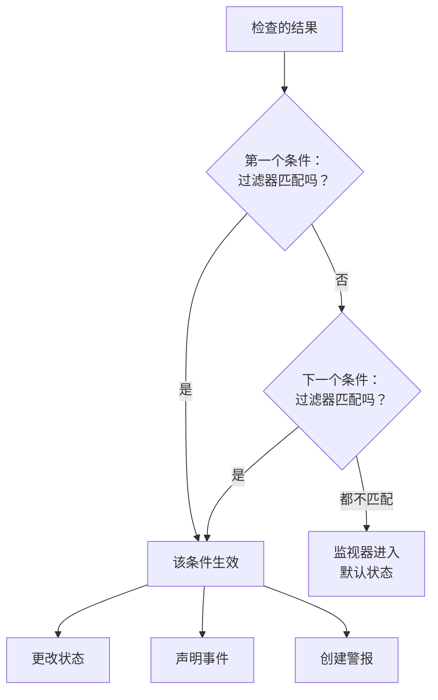
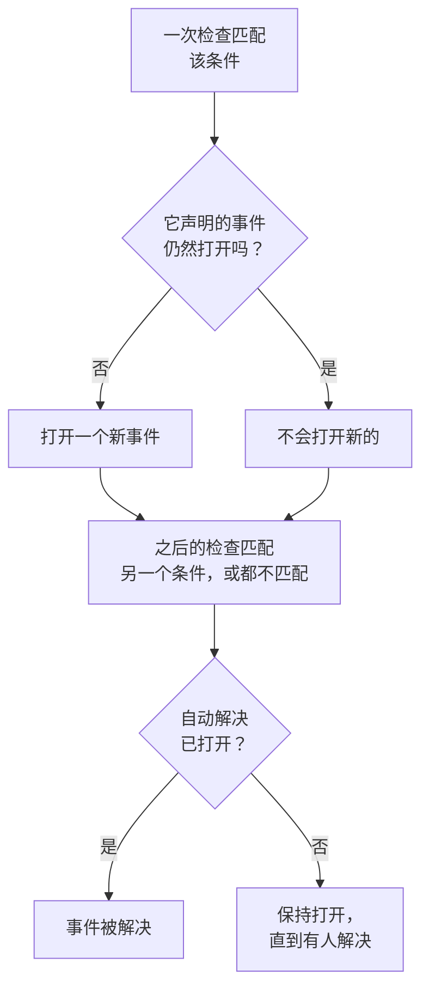

# 监视器条件与状态

监视器的条件决定每次检查意味着什么：监视器是正常还是宕机，以及 OneUptime 是声明事件还是创建警报。状态是您项目中监视器可能处于的状态列表，从 **运行正常** 到 **离线**。本页针对所有监视器类型讲解这两者；每种类型自己的页面会列出它提供的过滤器。

:::cards
- [条件如何决定](#条件如何决定): 从上到下，第一个匹配的胜出。
- [条件包含什么](#条件包含什么): 过滤器、匹配条件、操作和设置。
- [更改监视器的条件](#更改监视器的条件): 编辑、添加、排序和测试条件。
- [监视器状态](#监视器状态): 内置状态和您自己的状态。
:::

## 条件如何决定

每次检查监视器时，它的条件会从列表顶部往下判断结果。第一个过滤器匹配的条件决定发生什么，这次检查不会再看它下面的条件。如果没有任何条件匹配，监视器会进入它的 **默认监视器状态**。

顺序是规则的一部分。新监视器按从坏到好的顺序列出条件：先是离线，然后是该类型有的警告（即将过期的证书或域名），最后是在线。像 **Is Online** 设为 **是** 这样宽泛的健康条件几乎匹配每次检查，所以放在最后：如果放在其他条件之上，它每次都会先匹配，其他条件就永远不会生效。

一个匹配但不更改状态的条件仍然决定了这次检查：监视器保持现有状态，它下面的条件等待下一次检查。**默认监视器状态** 只在没有任何条件匹配时才适用。新监视器的默认值是 **运行正常**；可以在条件下方的 **更多字段** 中更改。

> [!NOTE]
> 按主机、容器、磁盘或接口分别打开事件或警报的监视器，每次检查都会判断所有条件，因此两台主机可以同时匹配两个不同的条件。这指的是查询带有 **分组依据** 的监视器，例如指标监视器或日志监视器，或者为每个磁盘或接口指定 `*` 的条件。按负载字段对事件分组的入站请求监视器仍然在第一个匹配处停止。

## 条件包含什么

打开一个条件，它有一个名称和三个部分，每个部分都可以折叠为一行摘要。

| 部分 | 包含什么 |
| --- | --- |
| **条件名称** | 条件列表中的名称，也会出现在该条件打开的每个事件和警报的根本原因中。**添加条件** 会按新条件的过滤器为它命名，在您输入自己的名称之前，名称会随过滤器变化。 |
| **过滤器** | 检查必须显示的内容，由一个或多个过滤器表示。Kubernetes 和指标监视器称之为 **Alert Rules**。 |
| **操作** | 过滤器匹配时发生的事：更改状态、创建警报、声明事件，或其中任意组合。 |
| **设置** | **启用此条件**、可选的 **描述**，以及入站请求监视器上的 **Group incidents and alerts by a payload field**。 |

### 过滤器

过滤器从检查中读取一个值并进行比较：**过滤器类型**（读取什么，例如 **响应状态码**）、**过滤条件**（如何比较，例如 **大于**）和 **值**。比较指标的监视器，例如 Kubernetes 和指标监视器，改为要求填写 **条件** 和 **阈值**。每种监视器类型都提供自己的过滤器类型，列在各自的页面上，例如 [监控标准](/docs/monitor/website-monitor#监控标准)。

有两个或更多过滤器时，下方会出现 **匹配条件**：**全部** 表示每个过滤器都必须匹配，**任意** 表示一个就够了。新条件从 **全部** 开始。

对每次检查都进行测量的过滤器，例如 **Is Online**、**响应状态码** 和 **响应时间（毫秒）**，提供 **在一段时间内评估此条件**。它判断最近一段时间内的检查，而不只是最新一次，默认是最近 5 分钟并使用 **All Values**，即只有当时间窗口内的每次检查都匹配时才匹配。请参阅 [在一段时间内评估](/docs/monitor/website-monitor#在一段时间内评估)。

### 操作

每个操作都是 **操作** 下的一个开关：

| 开关 | 作用 |
| --- | --- |
| **当过滤器匹配时，更改监视器状态。** | 将监视器移到 **将监视器状态更改为** 中选择的状态。 |
| **当过滤器匹配时，创建警报。** | 创建在 **创建警报** 下设置的警报。警报只通知您的团队，从不显示在状态页上。 |
| **当过滤器匹配时，声明事件。** | 声明在 **创建事件** 下设置的事件。您的状态页可以显示它们。 |

事件或警报需要填写标题、**严重程度**，以及折叠起来的描述、所有者、标签和值班策略。标题和描述可以包含检查中的值，例如 `{{monitorName}}`：请参阅 [事件与告警模板](/docs/monitor/incident-alert-templating)。要在条件匹配时呼叫某人，请在 **值班** 下选择一个策略：请参阅 [值班策略](/docs/on-call/policies)。

### 设置

每个新条件的 **启用此条件** 都是打开的。关闭它可以保留条件但不使用：它在每次检查中都会被跳过，不更改状态，不打开任何东西，并且标题上显示 **已禁用**。

**Group incidents and alerts by a payload field** 会为入站请求中找到的每个值打开一个事件，因此一个 webhook 地址可以同时保持多个事件处于打开状态。请参阅 [打开事件分组](/docs/monitor/incoming-request-monitor#打开事件分组)。

## 事件和警报何时打开和关闭

声明事件的条件在匹配时打开一个事件。监视器恢复后，如果条件这样设置，事件会自动关闭。

- **一次一个。** 当条件声明的事件仍然打开时，同一条件再次匹配不会声明另一个事件。警报也是如此。按主机或负载字段分组的监视器，每个主机或值保持一个打开；开启了 **为每封邮件新建一个事件** 的 Incoming Email 条件会为每封邮件打开一个。
- **关闭。** 在之后的某次检查中，如果另一个条件匹配或没有条件匹配，条件开启了 **自动解决事件** 的事件会被解决，开启了 **自动解决警报** 的警报也是如此。这两项都在事件或警报的 **更多字段** 中，新监视器初始的条件都开启了它们。
- **多个探测器。** 由多个探测器检查的监视器，只有在探测器结果一致时才会改变。请参阅 [如何评估条件](/docs/monitor/create-monitor#如何评估条件)。
- **父监视器宕机。** 在监视器的 **配置 → 依赖** 页面上，**Depends On Monitors** 指定它所依赖的监视器。当其中一个处于 **Suppress When Parent Status Is** 中列出的状态时（留空则为任何离线状态），该监视器不会打开事件或警报。它的状态仍会改变，已打开的仍会被解决。
- **计划维护。** 处于进行中维护事件的监视器不会被检查，因此其条件不会运行。请参阅 [计划维护概览](/docs/scheduled-maintenance/index)。

要查看一次检查是如何判断的，请打开监视器的 **概览**：**监视器摘要** 卡片显示哪个条件匹配、每个条件做了什么，包括因已有一个打开而跳过的事件。

## 更改监视器的条件

:::steps
### 打开条件页面

前往 **监视器** 并打开该监视器。在其侧边菜单中展开 **配置**，然后点击 **标准**。**监控条件** 卡片显示每个条件、它检查什么以及它做什么。

### 点击 Edit Monitoring Criteria

编辑器会展开显示每个条件。点击条件的标题可将其折叠为一行：名称、过滤器数量以及它做什么。

### 添加、更改或重新排序条件

**添加条件** 会在底部添加一个展开的条件，并按其过滤器命名。拖动条件左侧的手柄即可移动它：第一个匹配的胜出，所以把最坏的情况放在最前面。**删除条件** 会删除一个条件；监视器至少保留一个条件。

### 保存条件

点击 **保存更改**。下一次检查将按新的条件判断。

### 测试监视器

对于由探测器检查的监视器，点击卡片上的 **测试监视器**，在 **选择探测器** 中选择一个探测器，然后点击 **运行测试**。**监视器测试结果** 显示检查发现了什么。
:::

手动监视器没有条件：它的状态由您自己设置。请参阅 [更新状态](/docs/monitor/manual-monitor#更新状态)。

## 监视器状态

监视器总是处于项目的某个状态中。新项目有三个状态，从最健康到最差：

| 状态 | 位置 | 颜色 | OneUptime 如何使用它 |
| --- | --- | --- | --- |
| **运行正常** | 1 | 绿色 | 新监视器从这里开始，它也是新监视器的 **默认监视器状态**。内置。 |
| **性能下降** | 2 | 黄色 | 本身不做任何事：由您的某个条件把监视器移到这里。 |
| **离线** | 3 | 红色 | 新监视器的离线条件会把它移到这里，OneUptime 将处于此状态的监视器视为宕机。内置。 |

这个列表就是一个顺序。在多个监视器一起显示的地方，列表中最靠下的状态胜出：监视器组、状态页分组和状态页的整体状态都显示其监视器中最差的状态。

### 状态在哪里起作用

| 位置 | 状态决定什么 |
| --- | --- |
| **监视器** 列表 | 每个监视器的当前状态。**无法运行** 列出处于运行正常以外任何状态的监视器，旁边有一个红色计数。 |
| 状态页 | 每一行的颜色及其正常运行时间：只有页面 **计为停机时间** 中的状态才会计入。新状态页从除运行正常以外的所有状态开始。请参阅 [选择页面上显示什么](/docs/status-pages/index#选择页面上显示什么)。 |
| 监视器组 | 组的状态：其监视器中最差的一个。请参阅 [监视器组](/docs/monitor/monitor-groups)。 |
| SLO | SLO 计算的停机时间，依据它自己的状态列表。请参阅 [哪些状态计为停机](/docs/slo/introduction#哪些状态计为停机)。 |
| 依赖 | 父监视器是否压住其子监视器的事件和警报：默认情况下，是在它处于离线状态时。 |

之后添加的状态不会加入现有状态页的 **计为停机时间** 列表：请自己把它加进去。

### 添加您自己的状态

:::steps
### 打开监视器状态

前往 **监控 → 设置 → 监视器状态**。侧边菜单中的 **设置** 默认是折叠的：请先展开它。**监视器 状态** 卡片按从最健康到最差的顺序列出状态。

### 创建状态

点击 **创建监视器状态**，填写 **名称**、**描述** 和 **颜色**。新状态会放在离线状态的正上方，因此故障仍然显示为最差。

### 把它放到合适的位置

拖动状态的手柄。列表中越靠下的状态，被视为比它上面的每个状态都更差。

### 在条件中使用它

在有条件把监视器移入之前，状态什么也不做。在应该设置它的条件的 **将监视器状态更改为** 中选择它。
:::

运行正常和离线状态标记为 **内置**：您可以重命名它们并更改颜色，但不能删除它们。在 OneUptime Cloud 上，创建或更改状态需要 Growth 套餐。管理状态需要 Project Owner、Project Admin 或 Monitor Admin 角色，或拥有相应监视器状态权限的自定义角色。

### 状态时间线

每次状态变化都会保存在监视器的 **状态时间线** 上：何时开始、持续多久，以及设置它的条件的 **查看原因**。**创建监视器 状态 事件** 可以手动添加一个状态。对于由探测器检查的监视器，下一次匹配带有状态的条件的检查会再次设置该状态。

只有当所有者在通知设置中打开了 **监视器状态已更改** 时，监视器状态的变化才会通知他们：它默认是关闭的。因为没有条件匹配而回到 **默认监视器状态** 的监视器不会通知任何人。请参阅 [新成员默认开启的内容](/docs/notifications/notification-settings#新成员默认开启的内容)。

## 归档监视器状态

对于团队不应再使用的状态，请将其归档而不是删除。归档不会更改任何监视器：处于该状态的监视器会保持该状态直到其状态改变，其状态时间线仍会显示它。

- **归档** 位于该行的 **⋯** 菜单中。它会先请求确认，并列出设置为使用该状态的监视器条件、模板和状态页：在您更改它们之前，它们会继续使用该状态。
- **任何人都无法再选择它。** 条件、监视器的状态菜单、事件或维护事件的监视器状态以及状态页的停机状态都不会提供它。API、Terraform 和 MCP 会拒绝它。
- **已归档的状态会单独列出**，位于表格下方折叠的 **已归档的监视器状态** 部分。**取消归档** 会将其恢复原样。
- **内置状态无法归档。** 新监视器从正常运行状态开始，OneUptime 会将处于离线状态的监视器视为宕机。它们的 **归档** 已锁定，并说明原因。

## 故障排除

:::details 网站宕机了，但监视器仍然是运行正常
列表中更靠上的条件先匹配了。打开 **配置 → 标准** 检查顺序：健康条件应放在最后。还要检查离线条件的 **启用此条件** 是否打开，以及它的操作 **当过滤器匹配时，更改监视器状态。** 是否打开并选择了状态。
:::

:::details 监视器宕机时没有打开事件
检查匹配的条件：**当过滤器匹配时，声明事件。** 必须打开。当同一条件的事件仍然打开、**Depends On Monitors** 中的父监视器宕机，或监视器处于计划维护中时，不会声明事件。监视器 **概览** 上的 **监视器摘要** 卡片会说明是哪一种情况。
:::

:::details 监视器恢复后事件仍然打开
打开该事件的条件，并在其事件中展开 **更多字段**：**自动解决事件** 必须打开。来自您后来删除的条件的事件不会由监视器解决：请手动解决它。
:::

:::details 离线的删除按钮被锁定
**运行正常** 和 **离线** 是内置的：OneUptime 会把监视器移入它们，因此它们可以重命名但不能删除。请改为删除您自己的状态，或重命名内置状态。
:::

## 后续步骤

:::cards
- [创建监视器](/docs/monitor/create-monitor): 新监视器的三个步骤。
- [事件与告警模板](/docs/monitor/incident-alert-templating): 把检查中的值放进标题和描述。
- [监视器组](/docs/monitor/monitor-groups): 将多个监视器汇总为一个状态。
- [事件概览](/docs/incidents/index): 条件声明事件之后会发生什么。
:::
