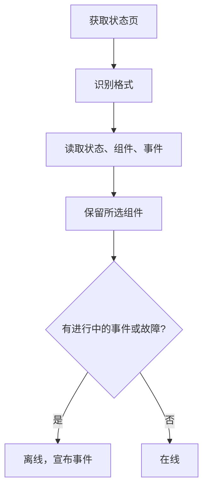

# 外部状态页监控

外部状态页监视器会关注你所依赖的服务（AWS、GCP、Azure、GitHub、OpenAI、Anthropic 等众多服务）的公开状态页，并在该服务商报告故障或性能下降时向你告警。用它在服务商报告上游问题的第一时间得知，并把这些问题与你自己的问题区分开。

它也能逐个资源读取用 OneUptime 制作的状态页，并区分计划维护与故障：监视另一个团队的项目，或状态页运行在 OneUptime 上的服务商。

:::cards
- [创建监视器](#创建外部状态页监视器): 粘贴状态页 URL，并选择要关注的内容。
- [选择组件](#组件): 只关注你依赖的组件。
- [条件](#监控条件): 默认情况下什么算作宕机。
- [OneUptime 状态页](#oneuptime-状态页): 另一个项目的资源及其维护。
- [常用状态页](#常用状态页-url): 大多数团队所依赖服务的 URL。
:::

## 工作原理

每次检查时，探测器会获取状态页，识别它使用的格式，并读取整体状态、组件和进行中的事件。如果你选择了组件或组件组，就只计算这些内容。然后由条件决定监视器是在线还是离线。

可以用它来：

- 监控你的应用所依赖的第三方服务的可用性
- 在上游服务商发生故障时收到告警
- 跟踪各个组件的状态
- 只关注你依赖的组件（例如 GitHub 的 Git Operations 和 Pull Requests，或 OpenAI 的 "APIs" 组），这样页面上其他无关的事件就不会触发你的监视器
- 在性能下降影响用户之前发现它
- 把你自己的事件与上游服务商的问题关联起来

## 支持的服务商

| 服务商 | 说明 |
| ------------------------ | ---------------------------------------------------------------------- |
| **Auto**（默认） | 自动识别状态页格式 |
| **Atlassian Statuspage** | 由 Atlassian Statuspage 提供的状态页（JSON API） |
| **incident.io** | 由 incident.io 提供的状态页（例如 `https://status.openai.com`） |
| **OneUptime Status Page** | 用 OneUptime 制作的状态页：每个资源的状态，以及哪些正在维护 |
| **RSS** | 提供 RSS 订阅源的状态页 |
| **Atom** | 提供 Atom 订阅源的状态页 |

### 自动识别

设置为 **Auto** 时，OneUptime 会按以下顺序自动识别状态页格式：

1. 首先尝试 incident.io 状态页 API（`/proxy/<host>`）。
2. 接着尝试 Atlassian Statuspage JSON API（`/api/v2/status.json`、`/api/v2/components.json` 和 `/api/v2/incidents/unresolved.json`）。
3. 接着请求 OneUptime 状态页的摘要（`/status-page-api/summary/<page>`）。
4. 如果都失败，就尝试把页面解析为 RSS 或 Atom 订阅源。
5. 最后的兜底是一次基本的 HTTP 可达性检查。

> [!NOTE]
> 之所以先检查 incident.io，是因为一些 incident.io 状态页（例如 `https://status.openai.com`）还暴露了一个功能有限、兼容 Atlassian 的端点，其中省略了组件组和进行中的事件。先检查 incident.io 可以确保使用更丰富、包含分组信息的数据。

当你明确选择的服务商失败时，也会退回到可达性检查。它只告诉你页面是否有响应（返回 `2xx` 或 `3xx` 即为在线），不会报告任何组件或事件。

## 创建外部状态页监视器

:::steps
### 开始一个新监视器

进入 **监视器**，点击 **创建监视器**。在 **监视器类型** 下点击 **更多监视器类型**，然后在 **Basic Monitoring** 下选择 **External Status Page**，或在搜索框中输入 `statuspage`。输入 **名称**，然后点击 **下一步**。

### 输入状态页 URL

输入 **状态页 URL**。除非你知道格式，否则请把 **提供商** 保留为 **Auto**。

### 如有需要，选择组件

打开 **组件**，从页面自己的列表中选择你依赖的组件，例如 GitHub 的 `Git Operations` 和 `Pull Requests`；留空则关注整个页面。如果改为只关注一个组，请打开 **更多字段**，输入 **Component Group Filter**（例如 `APIs`）。

### 测试

点击 **测试监视器** 获取一次页面，查看它找到的服务商、组件和事件。

### 检查条件

条件这一步从[默认条件](#默认条件)开始，当服务商报告范围内有进行中的事件或故障时，它们会把监视器标记为离线。如有需要可以修改，然后点击 **下一步**。

### 选择探测器并创建

选择 **探测器** 和 **监控间隔**（初始为 **每 5 分钟**），然后点击 **创建监视器**。
:::

## 配置选项

| 选项 | 填写内容 | 默认值 |
| --- | --- | --- |
| **状态页 URL** | 状态页的 URL。对于由 Atlassian Statuspage 和 incident.io 提供的站点，通常是根 URL（例如 `https://status.example.com`）。对于 RSS/Atom 订阅源，请直接输入订阅源的 URL。 | — |
| **提供商** | **Auto** 表示自动识别格式；如果你知道格式，可选择 **Atlassian Statuspage**、**incident.io**、**OneUptime Status Page**、**RSS** 或 **Atom**。 | **Auto** |
| **组件** | 要关注的组件，从页面自己的列表中选择或直接输入。 | 整个页面 |
| **Component Group Filter** | 监视器限定到的组。位于 **更多字段** 下。 | 所有组 |
| **超时（ms）** | 等待状态页的最长时间。位于 **更多字段** 下。 | `10000`（10 秒） |
| **重试** | 第一次尝试失败后重试的次数，每次间隔一秒；`0` 表示只尝试一次。位于 **更多字段** 下。 | `3`（最多 4 次尝试） |

### 组件

选择你依赖的组件后，监视器只关注它们：**External Status Page Component Status** 只比较它们的状态，整体状态取它们之中最差的那个，**External Status Page Active Incidents** 只计算至少影响其中一个组件的事件。无论选择多少个组件，对页面的检查仍然只有一次。

打开 **组件** 时，你的浏览器会从 Atlassian Statuspage、incident.io 页面或 OneUptime 状态页读取页面自己的列表，并按页面的分组显示；未处于正常运行的组件会注明它当前的状况。你选择的名称只关注与它完全同名的组件，不区分大小写：GitHub 页面上的 `Copilot` 不是 `Copilot AI Model Providers`。

如果无法读取列表（内部页面、不向你的浏览器共享列表的页面、RSS 或 Atom 订阅源），请输入名称并按 Enter。`*` 代表任意文本：`*us-east-1*` 会关注名称中含有 `us-east-1` 的所有组件。对于 RSS 或 Atom 订阅源，标题中含有其中某个名称的条目会被计入。

关注所选组件时，没有指明任何组件的事件不会被计入：没有任何信息表明它影响这些组件。如果什么都没选，监视器会关注整个页面，所有事件都会被计入。

使用旧的组件名称过滤器保存的监视器会继续关注原来关注的内容：该过滤器在 **组件** 中显示为前后加上星号的名称，例如 `*API*`，它会匹配名称中含有该名称的所有组件。

> [!WARNING]
> 什么都匹配不到的名称什么也不关注，看起来却是健康的。**组件** 和 **测试监视器** 都会列出页面上没有的所选组件。

### Component Group Filter

如果状态页把组件分成了组，你可以把监视器限定到单个组。例如，在 `https://status.openai.com` 上输入 `APIs`，就会把监视器限定到 OpenAI 的 API 服务。

设置了组件组后，**进行中的事件数** 和 **整体状态** 只根据该组中的组件计算：影响无关组（例如 ChatGPT）的事件不会触发限定到 "APIs" 组的监视器。如果同时选择了组件，就只计算该组中所选的组件。

**Atlassian Statuspage**、**incident.io** 和 **OneUptime Status Page** 服务商支持按组件组过滤。RSS 和 Atom 订阅源不提供组件组。

## 监控条件

你可以配置条件，根据以下内容决定外部服务何时被视为在线或离线：

| 过滤器类型 | 检查内容 | 过滤条件 |
| --- | --- | --- |
| **External Status Page Is Online** | 状态页是否可访问并返回状态数据 | 是 或 否 |
| **External Status Page Overall Status** | 页面报告的整体状态 | 等于、不等于、包含、不包含、开头是、结尾是 |
| **External Status Page Component Status** | 范围内每个组件的状态（设置后为所选组件或该组的组件）：运行正常、Under Maintenance、Degraded Performance、Partial Outage、Major Outage 或 Full Outage | 等于、不等于、包含、不包含、开头是、结尾是 |
| **External Status Page Active Incidents** | 状态页上当前进行中的事件数（选择了组件或组时，只计算影响范围内组件的事件） | 等于、不等于以及数值比较 |
| **External Status Page Response Time (in ms)** | 获取状态页数据所花的时间 | 大于、小于、大于或等于、小于或等于 |

整体状态就是页面上写的内容，因此其取值因服务商而异：Atlassian Statuspage 报告它自己的描述，例如 `All Systems Operational`；OneUptime 状态页报告范围内组件中最差的状态，例如 `under_maintenance`；订阅源报告 `operational` 或 `degraded_performance`；可达性检查报告 `reachable` 或 `unreachable`。选择了组件或组时，无论是哪种页面，它都是其中最差的状态。这些比较区分大小写。要针对故障告警，**External Status Page Active Incidents** 和 **External Status Page Component Status** 通常更可靠。

对于 RSS 或 Atom 订阅源，最近 24 小时内的条目算作进行中的事件：RSS 条目按发布日期，Atom 条目按更新日期。日期在未来的条目要到该日期才计入。

### 默认条件

默认情况下，OneUptime 会根据状态页真正重要的内容生成条件，即进行中的事件和组件健康状况，而不仅仅是可达性：

| 条件 | 过滤器 | 效果 |
| --- | --- | --- |
| Offline | 以下 **任意** 一项：页面不在线；范围内至少有一个进行中的事件；范围内有组件报告 Degraded Performance、Partial Outage、Major Outage 或 Full Outage | 把监视器标记为离线并宣布一个事件，该事件会在条件不再匹配时自动解决 |
| Online | 以下 **全部** 成立：页面在线；范围内没有进行中的事件 | 把监视器标记为在线 |

由于进行中的事件数和组件状态都遵循所选的组件和组，这些默认条件会自动只针对你关心的组件。

## OneUptime 状态页

要监视用 OneUptime 制作的状态页（另一个团队的项目，或者服务商在 OneUptime Cloud 或自托管 OneUptime 上的页面），把提供商选为 **OneUptime Status Page** ，或保留 **Auto** 。在 **状态页 URL** 中输入页面自己的地址：有域名就输入域名，例如 `https://status.example.com`，没有就输入 `https://oneuptime.com/status-page/<status-page-id>`。

监视器读取页面的摘要 `/status-page-api/summary/<page>`（参见 [读取摘要](/docs/status-pages/public-api#读取摘要)）：只读取页面向访客展示的内容，不读取另一个项目的其他任何内容。页面上的每个资源（一个监视器或一个监视器组）都是一个组件，使用页面为它起的名称，位于页面的分组中；一个分组中的分组写作 `Core / Databases`。在 **组件** 中选择资源，或用 **Component Group Filter** 监视一个分组。

组件的状态是它在页面上的状态所代表的值，因此组件状态条件的用法与任何状态页相同：

| 页面上 | 组件状态 |
| --- | --- |
| 项目的正常运行状态 | `operational` |
| 名为 `Degraded` 的状态 | `degraded_performance` |
| 名为 `Offline`、`Down` 或 `Major Outage` 的状态 | `major_outage` |
| 名为 `Partial Outage` 的状态 | `partial_outage` |
| 名为 `Full Outage` 的状态 | `full_outage` |
| 名为 `Maintenance` 的状态 | `under_maintenance` |
| 其他任何状态 | `degraded_performance` |
| 页面隐藏的状态（**Show current status** 已关闭） | `unknown` |

当进行中的计划维护事件影响某个资源时（事件指定了该资源的某个监视器，或其监视器组中的某个监视器），无论其监视器处于什么状态，该组件都是 `under_maintenance`：事件占用监视器期间，监视器不会被检查。尚未开始或已经结束的事件不会改变任何东西。页面上进行中的事件计入它们影响的资源。

[默认条件](#默认条件) 绝不会把维护当成故障：在另一个项目的计划工作期间，监视器保持在线。

### 在你的监视器上显示上游维护

:::steps
### 添加条件

在监视器的条件中点击 **添加条件** 。为它设置过滤器 **External Status Page Component Status** 、 **等于** 、 **Under Maintenance** ，并在 **将监视器状态更改为** 中选择你的维护状态。

### 把它移到最上面

把新条件拖到其他条件上方：第一个匹配的条件生效。

### 用测试监视器检查

在另一个项目有维护进行时点击 **测试监视器** ：受影响的组件显示 **Under Maintenance**。
:::

### OneUptime 状态页允许监视器读取的内容

任何人都能打开的页面，会按访客看到的样子被读取。要求登录、SSO 或密码的私有页面无法读取：选择了 **OneUptime Status Page** 时，检查会失败并说明原因。设置了 IP 允许列表的页面必须放行探测器的地址：请从该网络内部的探测器进行监视。

## 模板变量

从外部状态页监视器创建事件或告警时，你可以在标题、描述和修复说明中使用这些变量（参见 [事件与告警模板](/docs/monitor/incident-alert-templating)）：

| 变量 | 说明 |
| ------------------------- | ------------------------------------------------------------------------------- |
| `{{isOnline}}`            | 状态页是否在线（true/false） |
| `{{responseTimeInMs}}`    | 响应时间，单位为毫秒 |
| `{{failureCause}}`        | 失败原因（如果有） |
| `{{overallStatus}}`       | 整体状态指示值 |
| `{{activeIncidentCount}}` | 进行中的事件数（如果选择了组件，则只计算所关注组件的事件） |
| `{{componentStatuses}}`   | 组件状态的 JSON 数组（`name`、`status`、`description`、`groupName`） |
| `{{provider}}`            | 识别出的服务商（Atlassian Statuspage、incident.io、OneUptime Status Page、RSS、Atom）；可达性检查之后为空 |
| `{{componentGroup}}`      | 监视器限定到的组件组（如果有） |
| `{{componentName}}`       | 监视器关注的组件，以逗号分隔（如果选择了组件） |

## 常用状态页 URL

下面列出了一些常用服务的状态页。其中许多使用 Atlassian Statuspage 或 incident.io，因此 **Auto** 服务商会自动识别它们。既不基于这两者、也不是订阅源的页面只会进行可达性检查；对于这类页面，如果服务商发布了 RSS 或 Atom 订阅源，请改为监控该订阅源。

| 服务 | 状态页 URL |
| ---------------------------- | --------------------------------------------- |
| AWS                          | `https://health.aws.amazon.com/health/status` |
| Google Cloud Platform        | `https://status.cloud.google.com`             |
| Microsoft Azure              | `https://status.azure.com`                    |
| GitHub                       | `https://www.githubstatus.com`                |
| OpenAI                       | `https://status.openai.com`                   |
| Anthropic                    | `https://status.anthropic.com`                |
| Cloudflare                   | `https://www.cloudflarestatus.com`            |
| Datadog                      | `https://status.datadoghq.com`                |
| PagerDuty                    | `https://status.pagerduty.com`                |
| Twilio                       | `https://status.twilio.com`                   |
| Stripe                       | `https://status.stripe.com`                   |
| Slack                        | `https://status.slack.com`                    |
| Atlassian (Jira, Confluence) | `https://status.atlassian.com`                |
| Vercel                       | `https://www.vercel-status.com`               |
| Netlify                      | `https://www.netlifystatus.com`               |
| DigitalOcean                 | `https://status.digitalocean.com`             |
| Heroku                       | `https://status.heroku.com`                   |
| MongoDB Atlas                | `https://status.cloud.mongodb.com`            |
| Fastly                       | `https://status.fastly.com`                   |
| New Relic                    | `https://status.newrelic.com`                 |
| Sentry                       | `https://status.sentry.io`                    |
| CircleCI                     | `https://status.circleci.com`                 |

## 最佳实践

- **使用 Auto 服务商** —— 除非你知道确切的格式，自动识别适用于大多数状态页。
- **选择你依赖的组件** —— 例如选择 GitHub 的 Git Operations 和 Pull Requests，这样无关的事件就不会产生噪音。
- **关注整个组** —— 如果你依赖整个组（例如 OpenAI 的 "APIs"），之后加入该组的组件也会被关注。
- **与你自己的监视器结合使用** —— 把外部状态页监视器与你自己的 API 和网站监视器搭配使用。两者同时宕机时，上游状态页能更快地指向根本原因。

## 故障排除

:::details 监视器离线了，但事件涉及的是我没有使用的那部分服务
在 **组件** 中选择你依赖的组件，或在 **Component Group Filter** 中指定一个组。这样进行中的事件数和组件状态就只计算这些内容；没有指明任何组件的事件不会被计入。
:::

:::details 即使在故障期间，监视器也从不离线
可能是所选名称在页面上什么都没匹配到（这看起来是健康的），也可能是页面只进行了可达性检查。运行 **测试监视器**：它会显示找到的服务商和组件，并列出页面上没有的所选组件。
:::

:::details Auto 选错了格式，或者找不到任何组件
把 **提供商** 设置为你知道该页面所使用的那一个。对于 RSS 或 Atom 订阅源，请输入订阅源本身的 URL，而不是状态页的 URL。
:::

:::details 组件列表无法加载
列表由你的浏览器直接从状态页读取。浏览器无法访问的内部页面、不向其他网站共享列表的页面，以及 RSS 或 Atom 订阅源，都没有可供选择的列表：请按页面上显示的样子输入每个组件的名称，然后按 Enter。探测器仍会像以前一样读取页面。
:::

:::details OneUptime 状态页不显示任何组件
把 **提供商** 选为 **OneUptime Status Page** ，然后点击 **测试监视器** ：结果会说明页面是否为私有，或其 IP 允许列表是否把探测器挡在外面。很久没有更新的自托管 OneUptime 还不提供摘要：在更新之前，该页面只会得到可达性检查，或被当作订阅源读取。
:::

:::details 无法访问内部状态页
除非允许，否则探测器会拒绝私有网络地址。在你网络内部的探测器上设置 `PROBE_ALLOW_PRIVATE_NETWORK_MONITORS=true`，请参阅 [私有网络访问](/docs/self-hosted/private-network-access)。
:::

## 后续步骤

:::cards
- [事件与告警模板](/docs/monitor/incident-alert-templating): 把服务商的状态放进事件标题。
- [API 监控](/docs/monitor/api-monitor): 在服务商状态之外检查你自己的端点。
- [创建监视器](/docs/monitor/create-monitor): 所有监视器类型共有的步骤。
:::
