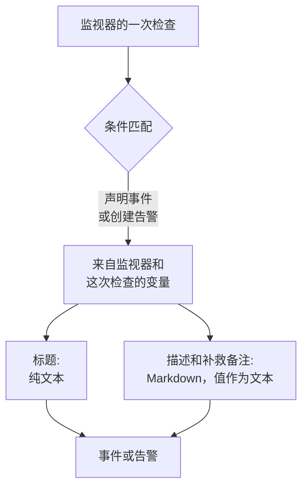

# 事件与告警模板

当监视器的条件声明事件或创建告警时，它会用你编写的模板填写标题、描述和补救备注。在其中放入 `{{variable}}` 占位符(例如 `{{monitorName}}` 或 `{{responseStatusCode}}`)，每个事件就会用打开它的那次检查中的值说明出了什么问题。

:::cards
- [在哪里编写模板](#在哪里编写模板): 条件所创建的事件或告警的标题、描述和补救备注。
- [基本用法](#基本用法): 占位符、进入对象的路径，以及列表。
- [所有监视器都有的变量](#所有监视器都有的变量): 监视器的名称，以及越过阈值的资源。
- [按监视器类型划分的变量](#按监视器类型划分的变量): 每种检查报告的内容。
:::

## 模板的工作方式

模板只在条件创建事件或告警时填写一次。OneUptime 从监视器和匹配的那次检查中收集变量，把每个值放到它的占位符所在的位置，然后保存结果。之后修改模板，只会改变此后创建的事件和告警，不会改变已经打开的那些。



- **标题是纯文本。** 无论在哪里显示，读起来都和模板渲染的结果完全一样。
- **描述和补救备注是 Markdown。** 你编写的 Markdown 会被渲染，而被监控系统发送的每个值都以文本形式放入，因此其中的任何内容都无法添加链接、图片或提及。请参阅 [描述和补救备注中的值](#描述和补救备注中的值)。
- **分组监视器会为每个事件填写它自己的序列。** 按主机、Pod 或设备各打开一个事件的监视器，会用该序列的值填写每个模板；如果你的模板还没有写出序列的名称，就会把它加到标题中。

## 在哪里编写模板

:::steps
### 打开监视器的条件

进入 **监视器**，打开该监视器，然后在其侧边菜单中点击 **标准**。点击 **编辑监控条件**。

### 开启事件或告警

在条件的 **操作** 下，开启 **当过滤器匹配时，声明事件。** 或 **当过滤器匹配时，创建警报。** 其下方会打开事件或告警的表单。

### 编写标题

在 **事件标题** 或 **警报标题** 中输入标题，例如 `{{monitorName}} is down`。旁边的 **Learn about dynamic templates** 会打开 **Dynamic Template Variables**：列出该监视器类型的所有变量及其内容。点击变量即可复制。

### 编写描述和补救备注

打开 **描述** 以编写 **事件描述** 或 **警报描述**，打开 **更多字段** 以编写 **补救备注**。这些编辑器会直接提供变量：**模板变量** 在编辑器下方列出变量，工具栏中的 **插入变量** 会打开同一个列表，输入 `{{` 会在光标处打开它。

### 保存条件

点击 **保存更改**。该条件创建的下一个事件或告警会使用新的模板。
:::

## 基本用法

占位符是用双花括号括起来的变量名。创建事件时，OneUptime 会把它替换为变量的值，周围的文字则保持你写的样子。

```text title="Title template"
{{monitorName}} returned {{responseStatusCode}} in {{responseTimeInMs}} ms
```

如果监视器名为 `Checkout API`，响应状态码为 `502`，响应耗时 `842` 毫秒，那么事件的标题为：

```text title="Title as created"
Checkout API returned 502 in 842 ms
```

### 对象和列表中的路径

保存对象或列表的变量用路径来读取，方式与 [JavaScript 表达式](/docs/monitor/javascript-expression) 相同：

| 写法 | 读取的内容 | 示例 |
| --- | --- | --- |
| `{{object.field}}` | 对象的某个字段，任意深度 | `{{responseBody.error.message}}` |
| `{{list[0]}}` 或 `{{list.0}}` | 列表的某一项，从 0 开始计数 | `{{diskMetrics[0].usagePercent}}` |
| `{{list[last]}}` | 列表的最后一项 | `{{processes[last].name}}` |
| `{{object}}` | 整个对象或列表，以 JSON 形式 | `{{responseBody}}` |

字段名可以包含连字符，例如 `{{responseHeaders.content-type}}`。负数索引(例如 `[-1]`)什么也读不到：请使用 `[last]`。

### 值缺失时

路径无处可达的占位符会按你写的样子连同花括号一起留在文本中：如果响应中没有 `error` 字段，`{{responseBody.error.id}}` 就会原样出现在标题里。这次检查没有报告的变量也是如此，例如未失败的检查中的 `failureCause`。检查报告为空文本的值会被替换为空。

要编写一个无论监视器是否分组都能用的模板，请使用 [受影响的资源](#受影响的资源) 变量：它们始终存在，监视器未分组时为空。

### 描述和补救备注中的值

描述和补救备注是 Markdown：它们显示在事件或告警的页面、电子邮件，以及其 Slack 和 Microsoft Teams 频道中。模板放入其中的值是被监控系统发送的内容——响应正文或标头、入站请求或邮件、设备或序列的标签——因此每个值都以文本形式放入。无论模板把它放在哪里，读起来都和发送时完全一样；其中的链接、图片、HTML 标签或像 `<!channel>` 这样的 Slack 提及都会显示为文本，而不会生效。值中的裸网址仍会变成链接，但会显示它指向哪里。你在模板本身中编写的 Markdown 会按你写的样子渲染。

值可以是任意大小——响应正文或数兆字节的日志——通知仍会带着它发出。每个渠道只承载它能接受的部分，对它来说过长的描述会被截断(有换行时在换行处截断)，并以 "… (truncated — see OneUptime for the full text)" 结尾：

- **电子邮件**：每条描述、备注或根本原因最多承载约 256 KB 的邮件正文，更长时末尾的说明会链接到事件或告警。整封邮件(正文和截图)保持在 3 MB 以下，所有邮件服务器和 Microsoft Graph 都能接受：正文旁放不下的截图会被省略，并在原处留下说明。
- **事件或告警的页面** 会显示全部内容。超过 128 KB 且排版耗时较长的描述会以纯文本逐行显示。
- **Slack** 最多承载 Slack 能显示的消息长度(约 30,000 个字符)。**Microsoft Teams** 通过 OneUptime 应用发送的消息约承载 40,000 个字符，通过传入 Webhook(状态页订阅者、工作流)约承载 12,000 个字符——按消息发送时测量，因此表格按其转换后的 HTML 计算。
- **短信、电话、推送通知、WhatsApp 和 Telegram** 承载各自提供商所接受的内容：请参阅 [各级别如何呼叫人员](/docs/on-call/escalation-rules#各级别如何呼叫人员)。

每个渠道渲染文本所需的时间都随长度增长。会让渲染器耗时长得多的部分——超过 64 KB 的行、由普通行组成的长段落、充满从未闭合的 `*`、`_` 或 `[` 的段落、嵌套超过十六层的引用或列表，以及在事件或告警页面上超过一千行的表格或列表——会在原处以纯文本显示，描述的其余部分照常渲染。

## 高级用法

### 遍历列表

`{{#each path}}` 会把直到 `{{/each}}` 的文本，针对 `path` 处列表中的每一项各重复一次：

```text title="Loop syntax"
{{#each arrayPath}}
  ...text with {{field}} placeholders for each item...
{{/each}}
```

在循环内部：

- `{{field}}` 和 `{{field.nested}}` 读取当前项。当前项没有的名称，会先在外层项中查找，再在整个模板的变量中查找。
- `{{@index}}` 是该项的位置，从 0 开始计数。
- `{{this}}` 是该项本身，用于字符串等普通值组成的列表。
- 对不是列表的路径或空列表进行循环，不会输出任何内容。
- 循环可以嵌套：位于另一个循环内的 `{{#each}}` 会读取每个外层项的内层列表。

例如，一个接收以下告警通知的 [入站请求监视器](/docs/monitor/incoming-request-monitor)：

```json title="Request body"
{
  "receiver": "payments",
  "alerts": [
    { "status": "firing", "labels": { "alertname": "HighLatency" } },
    { "status": "resolved", "labels": { "alertname": "DiskFull" } }
  ]
}
```

如果它的描述模板是：

```text title="Description template"
Alerts for {{requestBody.receiver}}:
{{#each requestBody.alerts}}
- {{@index}}: {{labels.alertname}} ({{status}})
{{/each}}
```

就会创建一个描述如下的事件。每一项都保留其前后的换行，因此各项之间会有一个空行，而描述仍显示为一个列表：

```text title="Description as created"
Alerts for payments:

- 0: HighLatency (firing)

- 1: DiskFull (resolved)
```

### 分组监视器的值

带有 **Group by** 属性的基于指标的监视器会为每个序列打开一个事件，每个属性的值都是以该属性名称命名的变量。按 `host.name` 分组会得到 `{{host.name}}`，按 `resource.k8s.pod.name` 分组会得到 `{{resource.k8s.pod.name}}`。`{{seriesLabels}}` 以对象形式包含它们全部。

分组的 [日志监视器](/docs/monitor/logs-monitor) 也是如此：每个分组属性的值都是以其键命名的变量。

## 所有监视器都有的变量

### 监视器

| 变量 | 内容 | 示例 |
| --- | --- | --- |
| `monitorName` | 监视器的名称。 | `Checkout API` |
| `monitorId` | 监视器的 ID。 | `a0f78958-da0a-4775-9fd9-c9fc63d3456f` |
| `monitorType` | 监视器的类型。 | `Website`、`Synthetic Monitor` |

### 受影响的资源

这些变量描述分组监视器为其打开事件的那个序列：一个 Pod、一个容器、一台主机、一块磁盘。未分组的监视器中它们为空，因此任何监视器的模板都可以使用它们。

| 变量 | 内容 |
| --- | --- |
| `seriesResourceSuffix` | 序列的标识，以分隔符开头，用于放在标题末尾。 |
| `seriesResourceSummary` | 不带分隔符的同一标识，用于放进句子里。 |
| `seriesResourceBlock` | 序列的所有标签，以 Markdown 列表形式。最适合用在描述中。 |
| `seriesDebugCommands` | 针对这一资源的只读命令(例如 `kubectl` 或 `docker`)，以 Markdown 列表形式。 |

## 按监视器类型划分的变量

### 网站和 API 监视器

| 变量 | 内容 | 类型 |
| --- | --- | --- |
| `responseBody` | 响应正文：为 JSON 时是对象，否则是文本。 | `JSON` 或 `string` |
| `responseHeaders` | 响应标头，按小写名称。 | `Dictionary<string>` |
| `responseStatusCode` | HTTP 状态码。 | `number` |
| `responseTimeInMs` | 响应时间，以毫秒为单位。 | `number` |
| `isOnline` | 监视器是否把该响应视为在线。 | `boolean` |

### 入站请求监视器

| 变量 | 内容 | 类型 |
| --- | --- | --- |
| `requestBody` | 请求正文：为 JSON 时是对象。 | `JSON` 或 `string` |
| `requestHeaders` | 请求标头，按小写名称。 | `Dictionary<string>` |
| `requestMethod` | HTTP 方法，例如 `POST`。 | `string` |
| `incomingRequestReceivedAt` | 收到请求的时间，以 ISO 8601 时间戳表示。 | `string` |

当条件开启了 **Group incidents and alerts by a payload field** 时，分组键也会成为变量，以分组路径的 **最后一段** 命名：按 `requestBody.alerts[*].labels.alertname` 分组会得到 `{{alertname}}`，按 `requestBody.alerts[*].fingerprint` 分组会得到 `{{fingerprint}}`。完整的 `requestBody` 仍在旁边可用。

> [!NOTE]
> `[*]` 只在分组路径字段中有效。在模板中它什么也读不到，因此占位符会原样保留。`{{requestBody.alerts[0].annotations.summary}}` 始终读取负载中的第一个告警，而不是事件所针对的那个告警：请使用分组变量和负载的公共字段，例如 `commonLabels` 和 `commonAnnotations`。请参阅 [入站请求监视器](/docs/monitor/incoming-request-monitor)。

### 入站邮件监视器

| 变量 | 内容 | 类型 |
| --- | --- | --- |
| `emailSubject` | 邮件的主题。 | `string` |
| `emailFrom` | 发件人的邮件地址。 | `string` |
| `emailTo` | 邮件的收件人，监视器自身的地址会被遮盖。 | `string` |
| `emailBody` | 邮件的纯文本正文。 | `string` |
| `emailReceivedAt` | 收到邮件的时间，以 UTC 的 ISO 8601 时间戳表示。 | `string` |

在标题中，这些值都会被截成最多 150 个字符的一行。描述和补救备注会得到完整的值。请参阅 [入站邮件监视器](/docs/monitor/incoming-email-monitor#模板变量)。

### Ping、IP 和端口监视器

| 变量 | 内容 | 类型 |
| --- | --- | --- |
| `isOnline` | 目标是否作出了响应。 | `boolean` |
| `responseTimeInMs` | 响应时间，以毫秒为单位。对端口而言，是 DNS 查询和 TCP 连接的总和。 | `number` |
| `failureCause` | 检查失败时的原因。 | `string` |
| `isTimeout` | 检查是否超时。 | `boolean` |

### NTP 监视器

| 变量 | 内容 | 类型 |
| --- | --- | --- |
| `isOnline` | 时间服务器是否响应了探测器的请求。 | `boolean` |
| `isSynchronized` | 它是否以 stratum 1 到 15 作出响应，没有闰秒告警，并带有真实的时间戳。 | `boolean` |
| `stratum` | 服务器报告的 stratum：主服务器为 1，未同步时为 16，kiss-o'-death 为 0。 | `number` |
| `clockOffsetInMs` | 服务器的时钟与探测器的时钟相差多少毫秒。正值表示服务器超前。 | `number` |
| `referenceId` | 服务器同步的对象：在 stratum 1 时是 `GPS` 之类的来源，否则是其上游服务器的地址。 | `string` |
| `leapIndicator` | 一切正常时为 0 到 2，服务器表示其时钟未同步时为 3。 | `number` |
| `kissCode` | stratum 为 0 时，服务器代替时间发送的四字母代码，例如 `RATE`。 | `string` |
| `responseTimeInMs` | 从请求到回复的时间，以毫秒为单位。 | `number` |
| `roundTripDelayInMs` | 这次交换的网络往返时间，不含服务器自身的处理时间。 | `number` |
| `rootDelayInMs` | 从服务器到其参考时钟的往返时间，以毫秒为单位。 | `number` |
| `rootDispersionInMs` | 服务器对自身最大误差的估计，以毫秒为单位。 | `number` |
| `serverTime` | 服务器发送回复时的服务器时钟，以 ISO 8601 时间戳表示。 | `string` |
| `referenceTime` | 服务器时钟最近一次设置或校正的时间，以 ISO 8601 时间戳表示。 | `string` |
| `serverAddress` | 请求发往的地址。 | `string` |
| `port` | 请求发往的 UDP 端口。 | `number` |
| `failureCause` | 服务器为何没有响应，或为何未同步。 | `string` |
| `isTimeout` | 服务器是否没有及时响应。 | `boolean` |

### SSL 证书监视器

| 变量 | 内容 | 类型 |
| --- | --- | --- |
| `isOnline` | 证书检查是否成功。 | `boolean` |
| `isSelfSigned` | 证书是否为自签名。 | `boolean` |
| `createdAt` | 证书的签发时间，以 ISO 8601 时间戳表示。 | `string` |
| `expiresAt` | 证书的过期时间，以 ISO 8601 时间戳表示。 | `string` |
| `commonName` | 证书的通用名称(CN)。 | `string` |
| `organizationalUnit` | 其组织单位(OU)。 | `string` |
| `organization` | 其组织(O)。 | `string` |
| `locality` | 其所在地(L)。 | `string` |
| `state` | 其州或省(ST)。 | `string` |
| `country` | 其国家(C)。 | `string` |
| `serialNumber` | 其序列号。 | `string` |
| `fingerprint` | 其 SHA-1 指纹。 | `string` |
| `fingerprint256` | 其 SHA-256 指纹。 | `string` |
| `failureCause` | 检查失败时的原因。 | `string` |

### DNS 监视器

| 变量 | 内容 | 类型 |
| --- | --- | --- |
| `isOnline` | 查询是否得到了应答。 | `boolean` |
| `responseTimeInMs` | 查询时间，以毫秒为单位。 | `number` |
| `isTimeout` | 查询是否超时。 | `boolean` |
| `isDnssecValid` | DNSSEC 验证结果。 | `boolean` |
| `records` | 返回的记录，每条形如 `{type, value, ttl}`。 | `Array<Object>` |
| `recordValues` | 仅记录的值。 | `Array<string>` |
| `failureCause` | 查询失败时的原因。 | `string` |

### DNSSEC 监视器

| 变量 | 内容 | 类型 |
| --- | --- | --- |
| `isOnline` | 检查是否完成。 | `boolean` |
| `domainName` | 被检查的区域。 | `string` |
| `isZoneSigned` | 该区域是否有 DNSKEY 记录。 | `boolean` |
| `isParentDsPresent` | 父区域中是否有它的 DS 记录。 | `boolean` |
| `isChainValid` | 信任链是否通过验证。 | `boolean` |
| `resolverConsensusAd` | 是否每个解析器都返回了 AD 标志。 | `boolean` |
| `isNameserverConsistent` | 是否每个权威名称服务器都返回了相同的 SOA 序列号。 | `boolean` |
| `earliestSignatureExpiration` | 最早的 RRSIG 签名的过期时间，以 ISO 8601 时间戳表示。 | `string` |
| `daysUntilSignatureExpiry` | 距该签名过期还有多少天。 | `number` |
| `dnskeyCount` | DNSKEY 记录的数量。 | `number` |
| `dsRecordCount` | 父区域中 DS 记录的数量。 | `number` |
| `rrsigCount` | 看到的 RRSIG 记录的数量。 | `number` |
| `responseTimeInMs` | 检查耗时，以毫秒为单位。 | `number` |
| `failureCause` | 检查失败时的原因。 | `string` |

### 域名监视器

| 变量 | 内容 | 类型 |
| --- | --- | --- |
| `isOnline` | 注册信息查询是否成功。 | `boolean` |
| `domainName` | 查询的域名。 | `string` |
| `lookupMethod` | 作出应答的协议：RDAP 或 WHOIS。 | `string` |
| `registrar` | 注册商。 | `string` |
| `createdDate` | 域名的注册时间。 | `string` |
| `updatedDate` | 注册信息最近一次更改的时间。 | `string` |
| `expiresDate` | 注册的过期时间。 | `string` |
| `nameServers` | 域名的名称服务器。 | `Array<string>` |
| `domainStatus` | 注册局的状态代码，例如 `clientTransferProhibited`。 | `Array<string>` |
| `dnssec` | 注册局的 DNSSEC 状态。 | `string` |
| `responseTimeInMs` | 查询耗时，以毫秒为单位。 | `number` |
| `failureCause` | 查询失败时的原因。 | `string` |

### 服务器 / VM 监视器

| 变量 | 内容 | 类型 |
| --- | --- | --- |
| `hostname` | 服务器的主机名。 | `string` |
| `requestReceivedAt` | 收到服务器报告的时间，以 ISO 8601 时间戳表示。 | `string` |
| `cpuUsagePercent` | 正在使用的 CPU，0 到 100。 | `number` |
| `cpuCores` | CPU 核心数。 | `number` |
| `memoryUsagePercent` | 正在使用的内存，0 到 100。 | `number` |
| `memoryFreePercent` | 空闲内存，0 到 100。 | `number` |
| `memoryTotalBytes` | 内存总量，以字节为单位。 | `number` |
| `diskMetrics` | 每块已挂载的磁盘一条记录。 | `Array<Object>` |
| `diskMetrics[].diskPath` | 磁盘的挂载点。 | `string` |
| `diskMetrics[].usagePercent` | 磁盘上已使用的空间，0 到 100。 | `number` |
| `diskMetrics[].freePercent` | 磁盘上的空闲空间，0 到 100。 | `number` |
| `diskMetrics[].totalBytes` | 磁盘的大小，以字节为单位。 | `number` |
| `processes` | 代理报告的正在运行的进程。 | `Array<Object>` |
| `processes[].pid` | 进程 ID。 | `number` |
| `processes[].name` | 进程名称。 | `string` |
| `processes[].command` | 启动该进程所用的命令。 | `string` |
| `failureCause` | 检查失败时的原因。 | `string` |

### 合成监控器

合成监视器会针对它被设置使用的每种浏览器和屏幕尺寸各运行一次脚本，例如桌面屏幕上的 Chromium 和移动屏幕上的 Firefox。`syntheticResponses` 为每次运行保存一条记录：可以按位置读取某一次运行，如 `{{syntheticResponses[0].browserType}}`，也可以用 `{{#each syntheticResponses}}` 读取每一次运行。

| 变量 | 内容 | 类型 |
| --- | --- | --- |
| `failureCause` | 检查失败时的原因。 | `string` |
| `syntheticResponses` | 脚本运行过的每种浏览器和屏幕尺寸各一条记录。 | `Array<Object>` |
| `syntheticResponses[].executionTimeInMs` | 这次运行耗时多少毫秒。 | `number` |
| `syntheticResponses[].result` | 脚本返回的内容。 | `string`、`number`、`boolean` 或 `JSON` |
| `syntheticResponses[].scriptError` | 运行结束时的错误(如果有)。 | `string` |
| `syntheticResponses[].logMessages` | 这次运行记录的日志。 | `Array<string>` |
| `syntheticResponses[].screenshots` | 这次运行截取的截图，按名称，每张都是 base64 文本。请参阅 [显示截图](#显示截图)。 | `Object` |
| `syntheticResponses[].browserType` | 这次运行的浏览器。 | `string` |
| `syntheticResponses[].screenSizeType` | 这次运行的屏幕尺寸。 | `string` |

#### 显示截图

`screenshots` 中的每一项都是脚本截取的一张截图，位于脚本为它起的名称之下(`screenshots["login-page"] = await page.screenshot()`)，以 base64 文本形式保存。要在事件或告警的描述或补救备注中显示它，请把它包在一张图片里：

```text title="Description template"
{{syntheticResponses[0].scriptError}}


```

这样，截图就会出现在事件或告警的页面上、显示该事件的状态页上、有关它的电子邮件通知中，以及有关它的 Slack 和 Microsoft Teams 消息中。在电子邮件中，截图作为附件并显示在正文里，Gmail、Outlook 和 Apple Mail 都能显示，因此值班人员无需打开 OneUptime 就能看到页面当时的样子。

- 会显示 PNG、JPEG、GIF 和 WebP 截图。`image/png` 也适用于 JPEG 截图(`page.screenshot({ type: "jpeg" })`)。
- 一封邮件最多承载 2 MB 的图片，最多 20 张。放不下的图片会被替换为带有其替代文本的说明，所以请为每张图片提供替代文本。JPEG 截图比 PNG 小得多，而失败运行的一张截图通常比每次运行的每张截图更能说明问题。
- 在 Slack 和 Microsoft Teams 中，截图显示在描述中它所在的位置：单独占一行的图片会占据那一行，位于句子、列表或表格中间的图片会在那里留下其替代文本，并在其后显示。Slack 显示 PNG、JPEG 和 GIF 截图，每条消息最多 10 张、10 MB；OneUptime 应用会把每张图片以私有方式上传到你的 Slack 工作区，并在消息中显示。Teams 在消息的卡片中显示每张最大 1 MB 的 PNG、JPEG 和 GIF 截图，每条消息最多 10 张、2 MB。
- 上传到 Slack 需要应用的 `files:write` 权限。如果你的工作区在 OneUptime 请求该权限之前就已连接 Slack，请在 **项目设置 → 工作区 → Slack** 中重新连接 Slack(在自托管服务器上，请先为你的 Slack 应用添加该权限——请参阅 [Slack 集成](/docs/self-hosted/slack-integration#消息中的图片))。
- 聊天无法显示的截图——WebP、超出上述限制的截图、被 Slack 或 Teams 拒绝的截图，或通过传入 Webhook 发送的消息中的任何截图——会显示为其替代文本，没有替代文本时显示为 "[image]"，所以请为每张图片提供替代文本。图片的 base64 永远不会进入聊天。
- 只有你在模板中编写的图片才会显示。被监控的页面或脚本所报告的值(错误消息、日志行)中的图片仍会显示为文本(请参阅 [描述和补救备注中的值](#描述和补救备注中的值))。
- OneUptime AI 读取的是截图周围的文本，而不是截图本身。调查、起草的事后复盘或备注、运行手册的 AI 步骤或工作流的 AI 步骤交给模型的内容中，图片位置会有一个简短的说明，例如 `[image omitted: PNG, 340 KB]`：模型读取的是文本而不是图片，而截图的 base64 每次调用都会占用数十万个令牌。调查的活动记录会说明省略了什么。

要显示每次失败运行的截图，请把图片放进循环中。这里脚本把每张截图保存为 `screenshots["failure"]`：

```text title="Description template"
### What the page looked like
{{#each syntheticResponses}}
**{{browserType}} / {{screenSizeType}}**: {{scriptError}}


{{/each}}
```

### 自定义 JavaScript 代码监视器

| 变量 | 内容 | 类型 |
| --- | --- | --- |
| `result` | 脚本返回的内容。用路径读取字段，例如 `{{result.status}}`。 | `string`、`number`、`boolean` 或 `JSON` |
| `executionTimeInMs` | 脚本运行了多少毫秒。 | `number` |
| `scriptError` | 脚本结束时的错误(如果有)。 | `string` |
| `logMessages` | 脚本用 `console.log` 记录的内容。 | `Array<string>` |
| `failureCause` | 检查失败时的原因。 | `string` |

### 网络设备监视器

| 变量 | 内容 | 类型 |
| --- | --- | --- |
| `isOnline` | 设备能否通过 ping **或** SNMP 访问到。每次轮询都会设置。 | `boolean` |
| `responseTimeInMs` | SNMP **遍历** 的响应时间，以毫秒为单位。绝不是 ping 的往返时间。 | `number` |
| `failureCause` | SNMP 遍历失败时的原因。 | `string` |
| `isTimeout` | SNMP 遍历是否超时。 | `boolean` |
| `oidResponses` | 查询的 OID，每个形如 `{oid, name, value, type}`。 | `Array<Object>` |
| `{{OID_NAME}}` | 命名 OID 的值，按其名称读取，如 `{{sysUpTime}}`。 | `string` 或 `number` |
| `sysName` | 设备的名称，来自 SNMP 系统组。 | `string` |
| `sysDescr` | 设备的描述，来自 SNMP 系统组。 | `string` |
| `sysObjectId` | 厂商注册的企业 OID：设备的指纹。 | `string` |
| `sysLocation` | 设备的位置，来自 SNMP 系统组。 | `string` |
| `downInterfaces` | 管理状态为启用但运行状态为关闭的接口，每个形如 `{name, alias, interfaceIndex}`。需要接口监控。 | `Array<Object>` |
| `interfacesTotal` | 遍历的接口数量。 | `number` |
| `interfacesUp` | 管理状态和运行状态均为启用的接口。 | `number` |
| `interfacesDown` | 管理状态为启用但运行状态为关闭的接口。 | `number` |
| `interfaceWalkFailure` | 接口遍历失败时的错误。 | `string` |
| `tables` | 设备的 SNMP 表，按键：每个表的 `rowCount`、`rows`、`unhealthyRowCount` 和 `unhealthyRows`，如 `{{tables.ipsec_tunnels.unhealthyRowCount}}`。 | `Object` |
| `snmpTable` | 逐行告警所针对的 SNMP 表。 | `string` |
| `snmpTableRow` | 逐行告警所针对的行：一条隧道、一个无线电、一个邻居。 | `string` |
| `trapOid` | 陷阱的 OID。仅在 SNMP 陷阱触发检查时。 | `string` |
| `trapSourceIp` | 陷阱的来源地址。仅在 SNMP 陷阱触发检查时。 | `string` |
| `trapVarbinds` | 陷阱的 varbind，每个形如 `{oid, value}`。仅在 SNMP 陷阱触发检查时。 | `Array<Object>` |

网络设备在每次轮询时都会被 ping，只有在有凭据时才会通过 SNMP 遍历，因此 **在上面的变量中，仅支持 ping 的设备只会填写 `isOnline`**：其他所有变量都来自 SNMP 遍历，没有遍历时会原样保留。在可能用于没有凭据的设备的模板中，请以 `{{isOnline}}` 和设备的名称开头。每种轮询收集哪些内容，请参阅 [网络设备监视器](/docs/monitor/network-device-monitor#一次轮询实际做了什么)。

### 数据库健康监视器

| 变量 | 内容 | 类型 |
| --- | --- | --- |
| `isOnline` | 探测器能否连接并运行基线查询。缺少指标永远不会让它变为 false。 | `boolean` |
| `responseTimeInMs` | 连接并运行基线查询所用的时间，以毫秒为单位。 | `number` |
| `failureCause` | 检查失败时的原因。 | `string` |
| `connectionError` | 连接错误，不含凭据或连接字符串。 | `string` |
| `engineVersion` | 数据库服务器报告的版本。 | `string` |
| `collectedGroups` | 在这次检查中产生了值的指标组。 | `Array<string>` |
| `unavailableGroups` | 无法收集的组，每个形如 `{group, reason, message, remediation}`。 | `Array<Object>` |
| `collectionIssueSummary` | 关于每个不可用组的一行文字，可直接用于标题。全部收集成功时为空。 | `string` |
| `metrics` | 收集到的值，按序列名称。 | `Object` |

`metrics` 中的序列名称包含点号，例如 `oneuptime.monitor.database.connections.used.percent`，而路径会把每个点号当作进入对象的一步，因此模板无法从 `metrics` 中取出单个值。请把 `{{metrics}}` 作为 JSON 整体放入，或使用 `{{collectionIssueSummary}}`。未收集到的指标在 `metrics` 中不存在，而不是零。要针对单个值作出判断，请在条件中用 [JavaScript 表达式](/docs/monitor/javascript-expression) 进行比较。

### 外部状态页监视器

| 变量 | 内容 | 类型 |
| --- | --- | --- |
| `overallStatus` | 状态页的总体状态，例如 `major_outage`。 | `string` |
| `activeIncidentCount` | 状态页上处于打开状态的事件数量。 | `number` |
| `componentStatuses` | 它的组件，每个形如 `{name, status, description, groupName}`。 | `Array<Object>` |
| `provider` | 状态页的类型：Atlassian Statuspage、incident.io、RSS 或 Atom。 | `string` |
| `componentGroup` | 监视器关注的组件组(如果有)。 | `string` |
| `componentName` | 监视器关注的组件(如果有)。 | `string` |
| `isOnline` | 状态页是否作出了响应。 | `boolean` |
| `responseTimeInMs` | 状态页响应所用的时间，以毫秒为单位。 | `number` |
| `failureCause` | 检查失败时的原因。 | `string` |

### 指标和基础设施监视器

Metrics、Kubernetes、Docker、Host、Podman、Docker Swarm、Proxmox、VMware、Ceph 和 Storage Array 监视器各有一个自己的变量：

| 变量 | 内容 | 类型 |
| --- | --- | --- |
| `metricName` | 监视器的第一个查询所读取的指标的名称，例如 `container.cpu.time`。 | `string` |

分组时，它们还有每个 **Group by** 属性的值以及 `seriesLabels`：请参阅 [分组监视器的值](#分组监视器的值)。IoT Device 监视器没有 `metricName`，但分组的 IoT Device 监视器(其模板都是分组的)有 `{{device.id}}`。

### 其他监视器类型

Logs、Traces、Exceptions、Security Events、AI / LLM 和 SQL Query 监视器没有自己的变量。请使用 [所有监视器都有的变量](#所有监视器都有的变量)，在分组的 Logs 监视器上还可以使用 [分组的值](#分组监视器的值)。

## 示例

### 缓慢的 API

```text title="Title"
{{monitorName}} is slow: {{responseTimeInMs}} ms
```

```text title="Description"
### API error
Status: **{{responseStatusCode}}**
Latency: **{{responseTimeInMs}} ms**
Message: `{{responseBody.error.message}}`
```

### 即将过期的证书

```text title="Title"
Certificate for {{commonName}} expires {{expiresAt}}
```

### 空间即将耗尽的服务器

```text title="Description"
### {{hostname}}
CPU: **{{cpuUsagePercent}}%**
Memory: **{{memoryUsagePercent}}%**

**Disks:**
{{#each diskMetrics}}
- {{diskPath}}: {{usagePercent}}% used ({{freePercent}}% free)
{{/each}}

**Processes:**
{{#each processes}}
- [{{pid}}] {{name}}: {{command}}
{{/each}}
```

### 失败的 Ping、IP 或端口检查

```text title="Description"
{{monitorName}} could not be reached: {{failureCause}}
Timed out: {{isTimeout}}
Response time: {{responseTimeInMs}} ms
```

### 合成监控器的每次运行

```text title="Description"
### Synthetic monitor results
{{#each syntheticResponses}}
- **{{browserType}} / {{screenSizeType}}**: {{result}} in {{executionTimeInMs}} ms
  - Script error: {{scriptError}}
  - First log line: {{logMessages[0]}}
{{/each}}
```

### 自定义代码检查

```text title="Description"
The script ran for {{executionTimeInMs}} ms and returned {{result}}.
Last log line: {{logMessages[last]}}
```

### 网络设备

这些示例假定设备有 SNMP 凭据：在仅支持 ping 的设备上，除 `{{isOnline}}` 外的所有内容都会原样保留。

```text title="Title"
{{sysName}}: {{interfacesDown}} interfaces down
```

```text title="Description"
### {{sysName}} ({{sysLocation}})
Online: {{isOnline}}
SNMP walk: {{responseTimeInMs}} ms

{{#each downInterfaces}}
- {{name}} ({{alias}}) is down
{{/each}}
```

### Alertmanager 或 Grafana 告警

```text title="Title"
[{{requestBody.status}}] {{requestBody.receiver}}
```

```text title="Description"
### Alerts from {{requestBody.receiver}}
{{#each requestBody.alerts}}
**Alert {{@index}}**: {{labels.alertname}}
- Status: {{status}}
- Summary: {{annotations.summary}}
- Source: {{generatorURL}}
{{/each}}
```

## 故障排查

:::details 标题中显示了占位符，连同花括号
这次检查中路径没有通向任何值。请对照上面的表格检查变量的名称和大小写，或在条件中打开 **Learn about dynamic templates**：它会列出该监视器类型的变量。进入响应或请求正文的路径必须与发送时的正文相符，而 `[*]` 和 `[-1]` 之类的负数索引什么也读不到：请使用 `[0]` 或 `[last]`。
:::

:::details 某个值显示为 JSON
路径停在了对象或列表上，因此整个对象或列表以 JSON 形式放入。把你需要的字段加到路径上，例如 `{{responseBody.error.message}}`，或用 `{{#each}}` 遍历列表。
:::

:::details 循环没有输出任何内容
`#each` 之后的路径在这次检查中不是列表，或者列表为空。请对照负载检查路径，并确认每个 `{{#each}}` 都有对应的 `{{/each}}`。
:::

:::details 值中的 Markdown 显示为文本
这是有意为之：被监控系统发送的值以文本形式放入，因此它永远无法向描述中添加链接、图片或提及。请改为在值周围的模板中编写格式。请参阅 [描述和补救备注中的值](#描述和补救备注中的值)。
:::

:::details 截图没有显示在 Slack、Microsoft Teams 或电子邮件中
请对照 [显示截图](#显示截图) 检查图片的格式和大小。在 Slack 中，OneUptime 应用需要 `files:write` 权限：如果你的工作区在 OneUptime 请求该权限之前就已连接 Slack，请在 **项目设置 → 工作区 → Slack** 中重新连接 Slack。
:::

## 后续步骤

:::cards
- [JavaScript 表达式](/docs/monitor/javascript-expression): 在条件的判断中使用同样的占位符。
- [声明事件](/docs/incidents/declaring-incidents): 条件声明事件之后会发生什么。
- [合成监控](/docs/monitor/synthetic-monitor): 截取描述可以显示的截图。
- [入站请求监控](/docs/monitor/incoming-request-monitor): 把 Webhook 变成以每个告警命名的事件。
:::
