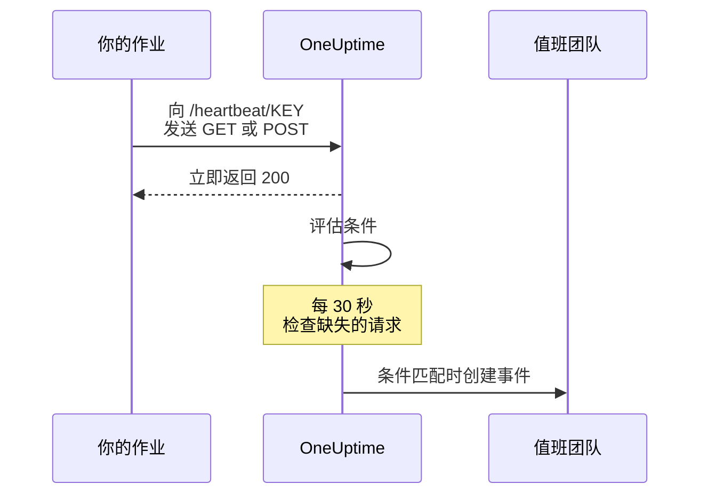
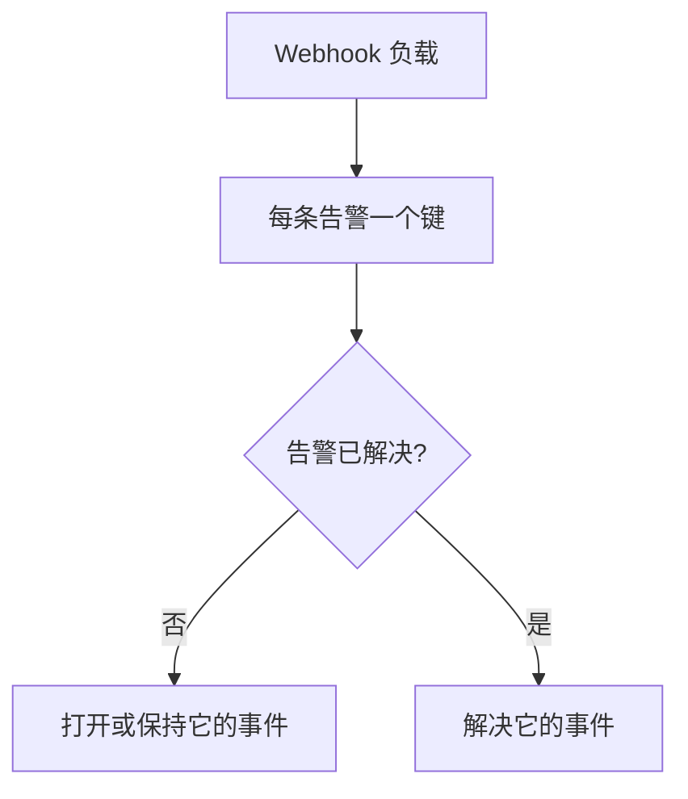

# 入站请求监控

入站请求监视器为你提供一个 URL，其他系统可以向它发送 HTTP 请求。OneUptime 会按你的条件评估每一个请求，并可以更改监视器状态、宣布事件、呼叫值班人员。

它承担两种不同的职责：

- **心跳监控** —— cron 作业、工作进程或设备按计划调用该 URL，当调用不再到达时 OneUptime 创建一个事件。
- **接收来自其他系统的警报** —— Prometheus Alertmanager、Grafana，或任何能够 POST JSON 的系统把警报推送进来，OneUptime 把每一条警报变成一个事件，带值班升级，并在恢复时自动解决。

两者使用同一种监视器类型。区别在于你配置的条件。

:::cards
- [创建监视器](#创建入站请求监视器): 几步就能拿到一个心跳 URL。
- [发送心跳](#发送心跳): 从 curl、cron、Node.js、Python 或 Go 发送。
- [调用停止时警报](#10-分钟内没有心跳则标记为离线死人开关): 把监视器变成一个死人开关。
- [接收警报](#接收来自其他系统的警报): Alertmanager 或 Grafana 的每条警报对应一个事件。
- [订阅 SNS 或 Event Grid](#订阅-amazon-sns-或-azure-event-grid): 一键确认订阅。
:::

## 工作原理

没有任何东西从外部检查你的系统：你的系统调用监视器的 URL，OneUptime 立即应答，然后按监视器的条件评估这个请求。检查请求是否 *不再* 到达的条件还会每 30 秒在后台重新检查一次，因此静默也能触发事件。



可以用它来：

- 监控 cron 作业和计划任务
- 确认后台工作进程正在运行
- 监控防火墙后无法从外部访问的服务
- 接收来自 Prometheus Alertmanager、Grafana 及其他警报系统的警报
- 跟踪任何支持 HTTP 的系统发来的心跳信号

## 创建入站请求监视器

:::steps
### 开始一个新监视器

进入 **监视器**，点击 **创建监视器**。

### 选择传入请求

在 **监视器类型** 下选择 **传入请求**，它是顶部的常用类型之一。输入 **名称**，然后点击 **下一步**。

### 检查条件

**标准** 这一步从[默认条件](#开箱即得的内容)开始。对于心跳，点击 **添加条件**，给新条件设置一个 **传入请求** / **在指定分钟内未收到** 过滤器，让它把状态改为离线并宣布一个事件，同时打开 **自动解决事件**。然后把它拖到列表顶部，原因请参阅[条件示例](#条件示例)。

### 创建监视器

点击 **创建监视器**。监视器会在 **概览** 页面打开，**Send the first heartbeat** 卡片显示带复制按钮的 **Heartbeat URL** 和一条 `curl` 命令示例。

### 发送第一个请求

配置你的服务向该 URL 发送请求（参见[发送心跳](#发送心跳)）。第一个请求到达后，这张卡片会让位给监视器的历史记录，一张 **Heartbeat URL** 卡片会显示 URL 以及最后一个请求到达的时间。
:::

> [!NOTE]
> URL 中包含监视器的密钥，因此只有能编辑监视器的人才能看到它。你随时可以在监视器的 **文档** 页面上再次找到它，该页面位于侧边菜单的 **配置** 部分。

## 请求 URL

你的监视器有一个如下格式的唯一 URL：

```text
https://oneuptime.com/heartbeat/YOUR_SECRET_KEY
```

如果是自托管，请把 `https://oneuptime.com` 替换为你的 OneUptime 实例的 URL。

向这个 URL 发送 **GET** 或 **POST** 请求。HEAD 也会被接受并按 GET 处理；PUT、PATCH 和 DELETE 返回 404。路径中的密钥就是凭据，不需要任何请求头或令牌，除非项目[要求每个请求都携带密钥](#要求每个请求都携带密钥)。查询字符串会被忽略：把条件要读取的内容放在请求体或请求头中发送。

> [!WARNING]
> 任何知道这个 URL 的人都能把监视器标记为健康，因此要把它当作秘密对待。如果它泄露了，请打开监视器的 **设置** 页面，点击 **重置传入请求密钥**，然后更新每一个发送方。监视器的概览按其日志保留的样子显示最新请求：机密和个人数据已被遮盖，关闭 **保留请求内容** 时不显示请求头和请求正文。遮盖只能识别它已知的名称和模式，因此不要向这个端点发送 API 密钥或令牌。

> [!IMPORTANT]
> OneUptime 会立即以一个空 JSON 对象（`{}`）返回 `200`，并通过队列处理请求。这个响应在任何校验之前就已写出，因此 `200` **并不** 表示请求已被接受：错误的密钥、已删除的监视器和已禁用的监视器同样会返回 `200`。请查看监视器自己的时间线，确认请求确实到达。要求每个请求都携带密钥的项目会对未携带密钥的请求返回 `401`；在投递前先检查 URL 的服务会收到它期望的应答：参见 [会先检查 URL 的服务](#会先检查-url-的服务)。

### 发送请求体

如果你想引用请求体中的字段（事件标题中的 `{{requestBody.status}}`、事件分组中的 JSON 路径，或 JavaScript 表达式条件），请发送 `Content-Type: application/json`。本文档通篇都假定使用这种格式。请求体必须是 JSON 对象或数组：格式错误的 JSON，或者像 `"error"` 这样的单个值，会以 `500` 拒绝。

| 内容类型 | 条件和模板看到的内容 |
| --- | --- |
| `application/json` | 解析后的 JSON。 |
| `application/x-www-form-urlencoded` | 解析后的表单。带方括号的键会嵌套（`alerts[0][status]=firing`），每个值都是字符串。 |
| `text/plain` | 文本是 JSON 对象或数组时，为解析后的 JSON：Amazon SNS 就是这样发送消息的。其他任何文本就是文本本身，因此发送 `backup failed: error 42` 会让监视器在默认条件下离线。 |
| `application/cloudevents+json` 或其他 `+json` 类型 | 解析后的 JSON：Azure Event Grid 就是这样投递 CloudEvents 的。 |
| 其他任何类型，或没有 | 空请求体（`{}`），因此对 `requestBody` 的引用都不会被解析，模板会将其原样保留。 |

最多接受 50 MB 的请求体；更大的会以 `413` 拒绝。不要用 `Content-Encoding: gzip` 压缩请求体：那样它不会以 JSON 形式保存，其中的路径也无法解析。

### 发送心跳

每个示例发送一个请求。把 `YOUR_SECRET_KEY` 替换为你的监视器 URL 中的密钥。

:::tabs
@tab curl
```bash
# Simple GET request
curl https://oneuptime.com/heartbeat/YOUR_SECRET_KEY

# POST request with a JSON body
curl -X POST https://oneuptime.com/heartbeat/YOUR_SECRET_KEY \
  -H "Content-Type: application/json" \
  -d '{"status": "healthy", "version": "1.2.3"}'
```
@tab Cron
```bash
# Send a heartbeat every 5 minutes
*/5 * * * * curl -fsS https://oneuptime.com/heartbeat/YOUR_SECRET_KEY > /dev/null

# Or ping only when the job succeeds, so a failed run counts as a missed heartbeat
0 2 * * * /usr/local/bin/backup.sh && curl -fsS https://oneuptime.com/heartbeat/YOUR_SECRET_KEY > /dev/null
```
@tab Node.js
```javascript title="heartbeat.mjs"
// Node.js 18 or later: fetch is built in. Run with `node heartbeat.mjs`.
const response = await fetch(
  "https://oneuptime.com/heartbeat/YOUR_SECRET_KEY",
  {
    method: "POST",
    headers: { "Content-Type": "application/json" },
    body: JSON.stringify({ status: "healthy", version: "1.2.3" }),
  },
);

console.log(response.status); // 200
```
@tab Python
```python title="heartbeat.py"
# Python 3, standard library only. Run with `python3 heartbeat.py`.
import json
import urllib.request

request = urllib.request.Request(
    "https://oneuptime.com/heartbeat/YOUR_SECRET_KEY",
    data=json.dumps({"status": "healthy", "version": "1.2.3"}).encode(),
    headers={"Content-Type": "application/json"},
    method="POST",
)

with urllib.request.urlopen(request, timeout=10) as response:
    print(response.status)  # 200
```
@tab Go
```go title="heartbeat.go"
// Run with `go run heartbeat.go`.
package main

import (
	"bytes"
	"fmt"
	"net/http"
)

func main() {
	body := []byte(`{"status": "healthy", "version": "1.2.3"}`)

	resp, err := http.Post(
		"https://oneuptime.com/heartbeat/YOUR_SECRET_KEY",
		"application/json",
		bytes.NewReader(body),
	)
	if err != nil {
		panic(err)
	}
	defer resp.Body.Close()

	fmt.Println(resp.StatusCode) // 200
}
```
@tab PowerShell
```powershell
# Windows PowerShell 5.1 or PowerShell 7
Invoke-RestMethod -Method Post `
  -Uri "https://oneuptime.com/heartbeat/YOUR_SECRET_KEY" `
  -ContentType "application/json" `
  -Body '{"status": "healthy", "version": "1.2.3"}'
```
:::

## 要求每个请求都携带密钥

任何拥有监视器 URL 的人都可以向它发送请求。项目所有者或项目管理员可以让项目中的每个传入请求监视器额外要求项目自己的某个密钥，无论监视器是由谁设置的：开启 **要求每个请求都携带密钥**。未携带密钥的请求会被以 `401` 拒绝并说明原因，不会计为心跳，不会保存为监视器的最新请求，也不会到达任何条件。携带密钥的请求会像以前一样进入监视器自己的条件。

项目所有者和项目管理员管理这些密钥和开关，拥有 Create、Read、Edit 和 Delete Incoming Request Secret 权限的自定义角色也可以：Read 可查看密钥的值，Edit 还可以开启和关闭开关。

:::steps
### 创建密钥

前往 **监视器 → 设置 → 传入请求密钥** 并创建一个密钥。给它起个名字，OneUptime 会生成值；从列表中复制它。

### 从每个发送方发送它

根据发送方能设置的方式，在 `X-OneUptime-Secret` 请求头中发送密钥，或在 `Authorization` 请求头中作为 Bearer 令牌发送。无法自行设置请求头的发送方，可以改为用密钥为每个请求签名：参见[用密钥为请求签名](#用密钥为请求签名)。

### 找出遗漏的发送方

项目一有密钥，OneUptime 就会检查每个请求是否携带密钥，但暂不拒绝任何请求。同一页面上的 **未携带密钥的请求** 列出过去 24 小时内收到过未携带有效密钥的请求的每个传入请求监视器及其原因：未发送密钥，或发送了错误的密钥。请修复这些发送方。发送方已修复的监视器，其 **最近一次有密钥** 会晚于 **最近一次无密钥**，并会在 24 小时内从列表中消失。

### 开启要求

开启 **要求每个请求都携带密钥**。项目没有任何密钥时无法开启，因此不会误拒任何发送方。开启之前，如果有传入请求监视器在过去 24 小时内收到过未携带有效密钥的请求，它会说明有多少个：从那时起，它们的发送方都会被拒绝。
:::

```bash
curl -X POST https://oneuptime.com/heartbeat/YOUR_SECRET_KEY \
  -H "X-OneUptime-Secret: YOUR_PROJECT_SECRET"

# Or as a bearer token
curl -X POST https://oneuptime.com/heartbeat/YOUR_SECRET_KEY \
  -H "Authorization: Bearer YOUR_PROJECT_SECRET"
```

OneUptime 从不存储密钥：在保存任何内容之前，它会从请求中移除该请求头，并屏蔽属于项目密钥的 Bearer 令牌。

在 15 分钟内向同一监视器发送超过 10 个不同错误密钥的地址，此后无论发送的密钥是否正确，都会被以 `429` 拒绝，直到其 `Retry-After` 响应头给出的时间，最长 15 分钟。其他地址上的发送方不受影响，而一直发送同一个旧密钥的发送方会继续收到说明问题所在的 `401`。

> [!TIP]
> 要在不拒绝任何人的情况下替换密钥，请创建第二个密钥，将发送方切换到它，等旧密钥的 **上次使用** 不再变化后再删除旧密钥。项目的任一密钥只要未限定于其他监视器都会被接受，而在要求开启期间无法删除最后一个覆盖某个监视器的密钥。

### 用密钥为请求签名

发送方可以用密钥为每个请求签名，而不是发送密钥本身，这样更安全：不会传输任何机密，别人截获的请求以后也无法再次发送。只要发送方能够签名，就优先使用这种方式。OneUptime 会检查以下签名，每个签名都是以密钥为键的十六进制 HMAC-SHA256：

| 发送方 | 请求头 | 签名的内容 |
| --- | --- | --- |
| 你自己的代码 | `X-OneUptime-Signature: t=<time>,v1=<signature>` | `<time>.<body>` |
| GitHub webhook | `X-Hub-Signature-256` | 请求正文 |
| Slack | `X-Slack-Signature`，以及 `X-Slack-Request-Timestamp` | `v0:<time>:<body>` |
| Stripe | `Stripe-Signature` | `<time>.<body>` |

`<time>` 是请求签名的时间，以 1970 年以来的秒数表示。与 OneUptime 时钟相差超过 5 分钟的签名会被拒绝，第二次发送的同一个已签名请求也会被拒绝；GitHub 的签名不含时间，因此 OneUptime 会把每个签名记住一天。对于 GitHub，请把项目的某个密钥设为 webhook 的密钥。Slack 和 Stripe 会生成自己的签名密钥：请在 **更多字段** 中用该值创建项目的密钥。

```bash
body='{"status":"healthy"}'
t=$(date +%s)
sig=$(printf '%s.%s' "$t" "$body" | openssl dgst -sha256 -hmac "YOUR_PROJECT_SECRET" | sed 's/^.* //')

curl -X POST https://oneuptime.com/heartbeat/YOUR_SECRET_KEY \
  -H "Content-Type: application/json" \
  -H "X-OneUptime-Signature: t=$t,v1=$sig" \
  -d "$body"
```

不接受放在 URL 查询字符串中的密钥：代理和访问日志会保存完整的 URL，与监视器自己的密钥放在一起。探测器的入站请求 Ingress 会按原样转发已签名请求的正文，因此经由探测器发送时签名同样有效。

### 将密钥限定于部分监视器

除非你加以限制，项目的每个传入请求监视器都会接受某个密钥；若项目的每个租户各自发送自己的密钥，就应加以限制：在 **更多字段** 中选择 **特定监视器** 或 **带标签的监视器**。其他监视器会以 `401` 拒绝它，就像拒绝错误的密钥一样，而 **未携带密钥的请求** 会将原因显示为 **密钥不适用于此监视器**。在要求开启期间，项目至少保留一个覆盖某个监视器的密钥。

## 监控条件

你可以配置条件，决定何时把服务视为在线、性能下降或离线。每个条件过滤器都有一个 **过滤器类型**（看什么）、一个 **过滤条件**（怎么比较）和一个 **值**。

### 开箱即得的内容

新的入站请求监视器创建时带有两个读取请求体的条件：

| 条件 | 过滤器类型 | 过滤条件 | 值 | 效果 |
| -------- | ------------ | ---------------- | ------- | -------------------------------------------- |
| Offline  | 请求主体 | 包含 | `error` | 把监视器标记为离线，打开一个事件 |
| Online   | 请求主体 | 不包含 | `error` | 把监视器标记为在线 |

这适合发送方在负载中报告自身健康状况的常见情况：请求体中提到 `error` 的请求会让监视器下线，下一个不含该词的请求会让监视器恢复在线并解决事件。完全没有请求体的请求算作"不包含 `error`"，因此单纯的心跳调用会让监视器保持在线。

请把值改成你的发送方实际发出的内容（`"status":"firing"`、`FAILED` 等）：匹配是对整个请求体（包括键）进行区分大小写的子串查找，因此 `{"error":null}` 也会匹配 `error`。

> [!NOTE]
> 这些默认条件 **不是** 死人开关：请求不再到达时，这里的任何条件都不会触发。如果你希望在静默时收到警报，请按下文所述添加一个 **传入请求** / **在指定分钟内未收到** 条件。

### 可用的过滤器类型

| 过滤器类型 | 检查内容 | 说明 |
| --------------------- | ------------------------------------------------------ | -------------------------------------------------------------------------------------------- |
| 传入请求 | 是否在某个时间窗口内收到了请求 | 唯一一个在什么都没到达时也能触发的检查 |
| 请求主体 | 请求的主体 | 子串匹配。对象请求体按紧凑的 JSON 比较 |
| 请求标头 | 请求头的名称 | 与完整的请求头名称精确匹配，不区分大小写 |
| 请求标头值 | 请求头的值 | 与完整的请求头值精确匹配，不区分大小写 |
| JavaScript 表达式 | 任何基于 `requestBody` 和 `requestHeaders` 的表达式 | 最灵活的选项，请参阅 [JavaScript 表达式](/docs/monitor/javascript-expression) |

### 过滤条件

每种过滤器类型都有自己的一组条件：

| 过滤器类型 | 条件 |
| --- | --- |
| **传入请求** | **在指定分钟内收到** —— 在指定的分钟数内收到了请求。**在指定分钟内未收到** —— 在指定的分钟数内没有收到请求。 |
| **请求主体**、**请求标头**、**请求标头值** | **包含** 和 **不包含** |
| **JavaScript 表达式** | **计算结果为真** |

> [!NOTE]
> 请求头的名称和值会转为小写后，与完整的名称或值比较，而不是子串匹配：`application/json` 不匹配 `application/json; charset=utf-8`。只有 **请求主体** 做子串匹配。你的代理或 OneUptime 自己的负载均衡器添加的请求头（`x-forwarded-for`、`x-real-ip`）也会被保存。

对象请求体按不含空格的紧凑 JSON 比较，因此 **请求主体** / **包含** 过滤器必须写成 `"status":"firing"`：从格式化过的负载中复制 `"status": "firing"` 永远不会匹配。

### 条件示例

#### 10 分钟内没有心跳则标记为离线（死人开关）

| 字段 | 值 |
| --- | --- |
| **过滤器类型** | 传入请求 |
| **过滤条件** | 在指定分钟内未收到 |
| **值** | `10` |

#### 根据请求体内容标记为性能下降

| 字段 | 值 |
| --- | --- |
| **过滤器类型** | 请求主体 |
| **过滤条件** | 包含 |
| **值** | `"status":"degraded"` |

> [!IMPORTANT]
> 把死人开关放在默认条件 **之上**。条件从上往下检查，第一个匹配的条件说了算。后台检查会重新读取最后一个请求，因此默认的在线条件（"请求主体 不包含 `error`"）会一直匹配它，排在它下面的条件永远轮不到。**添加条件** 会把条件加到底部：请把它拖上去。

> [!WARNING]
> 只有当监视器至少有一个条件检查 **传入请求** 时，它才会在后台被重新评估。条件只检查请求主体、请求标头或 JavaScript 表达式的监视器，只在请求到达时评估，其他时候都不会，因此它永远不会自行下线。如果你需要心跳缺失的告警，就需要一个 **传入请求** 条件。

后台检查按整分钟计数，在经过的时间 *超过* 该值时触发："在指定分钟内未收到: 10" 大约在最后一个请求之后 11 分钟触发（检查每 30 秒运行一次）。从未收到过请求的监视器会把创建时间当作最后一个请求，因此同样的条件放在一个全新的监视器上，即使发送方从未接入，也会在创建后大约 11 分钟触发。只有 OneUptime 正在接收数据的分钟才计入该值：OneUptime 自身重启、升级或追赶积压期间的分钟不计入，详见 [OneUptime 未接收数据时](/docs/monitor/when-oneuptime-is-not-receiving)。

## 接收来自其他系统的警报

Alertmanager、Grafana 和类似的工具会 POST 一份描述一条或多条警报的 JSON 文档。默认情况下，一个条件只打开 **一个** 事件，因此一个携带五条警报的负载只会产生一个事件。事件分组改变了这一点：它从负载中提取一个值，并 **为每个不同的值打开一个单独的事件**，这些事件可以同时处于打开状态。



### 打开事件分组

:::steps
1. 打开条件并展开 **设置**。
2. 打开 **Group incidents and alerts by a payload field**。
3. 填写 **Open a separate incident for each…**。如果希望每个事件自动解决，还要填写 **Auto-resolve each incident when…** 下的字段和值（见下文）。然后保存监视器。
:::

| 字段 | 示例 | 作用 |
| ---------------------------------- | ---------------------------------------- | ---------------------------------------------------------------------- |
| Open a separate incident for each… | `requestBody.alerts[*].labels.alertname` | 用其不同的值把事件分开的路径 |
| Field that signals recovery | `requestBody.alerts[*].status` | 用于判断某条警报已恢复所检查的路径 |
| Value that means recovered | `resolved` | 表示已恢复的确切值 |
| Max incidents per request | `100`（默认） | 安全上限，避免取值很多的字段打开无数个事件 |

分组只属于开启它的那个条件。监视器的其他条件不分组：当其中一个与请求匹配时，它会像在没有任何条件分组的监视器上一样，打开自己的事件和警报。

### 路径语法

路径必须以字面前缀 `requestBody.` 开头。没有这个前缀的路径（如 `alerts[*].labels.alertname`）在任何请求中都找不到值。`{{ }}` 包裹是可选的：`requestBody.status` 和 `{{requestBody.status}}` 行为相同。

- `[*]` 会展开一个数组：每个 **不同** 的值一个事件。产生相同值的两个元素会合并为一个事件，该事件的状态（触发中/已解决）取自 **第一个** 匹配的元素。**一个路径中只有第一个 `[*]` 是通配符**；`requestBody.groups[*].alerts[*].name` 什么都匹配不到。
- `[0]` 和 `[last]` 选择单个元素，并且可以跟在 `[*]` 后面。
- 对象和数组值、空字符串以及 null 会被跳过。`0` 和 `false` 是有效的键。
- 请求体必须是 JSON 对象；顶层是数组的负载不会被分组。

### 没有该字段的请求

与分组条件匹配、但在其路径上没有值的请求（字段缺失或为空、包含对象或列表，或者请求体不是 JSON 对象）仍会打开该条件的事件和警报：整个监视器一个，就像该条件不分组时一样。因请求停止到达而匹配的分组条件也是如此。引用分组变量的标题（如 `{{alertname}}`）会按原样显示该变量，因为没有可填入的值。

如果 **自动解决事件** 已打开，那么当之后没有该字段的请求报告已恢复，或之后的请求匹配另一个条件时，该事件会被解决。这样的恢复不会打开任何新内容。

当数组中有些元素有值、有些没有时，每个值打开自己的事件，没有值的元素自身不会打开任何内容。

监视器 **概览** 上的 **监视器摘要** 卡片会显示每个请求做了什么，包括某个条件将其作为整个监视器处理或没有打开任何新内容的情况。

### 解决由事件驱动

一个 Webhook 只描述该负载中的内容，因此 OneUptime 绝不会因为某个键不再出现就解决它的事件。只有当负载明确表示该键已恢复时，事件才会被解决。以下两点必须同时成立：

1. **Field that signals recovery** 和 **Value that means recovered** 已设置并与负载匹配。比较是精确且区分大小写的：`Resolved` 不匹配 `resolved`。
2. 条件的事件打开了 **自动解决事件**，该选项位于事件表单的 **更多字段** 下。没有它，匹配的恢复事件会被忽略，事件保持打开。（警报和 **自动解决警报** 同理。）默认的离线条件一开始就打开了它；你自己添加到条件中的事件一开始是关闭的。

你自己添加到条件中的警报，一开始也关闭了 **自动解决警报**，因此在打开它之前，恢复会让警报保持打开。**Auto-resolve each incident when…** 会显示恢复会解决该条件的哪些事件和警报，并列出它会保持打开的每一项，附带一个打开相应开关的按钮。监视器 **概览** 上的 **监视器摘要** 卡片会列出恢复保持打开的每个事件和警报，以及原因。

**Max incidents per request** 限制的是提取，而不仅是创建。超出上限的键对恢复判断同样不可见，因此在一个不同键数量超过上限的负载中，超出上限部分报告 `resolved` 的警报不会关闭它的事件。

> [!NOTE]
> 某个条件按负载字段分组的监视器，会按到达顺序逐个评估它收到的每一个请求，因此一波突发的警报和恢复会为每个值打开并解决各自的事件和警报。最多有 1,000 个请求（或 16 MB）可以等待评估；超出后，等待中最早的请求会被跳过， **监视器摘要** 卡片会显示跳过了多少个。没有分组的监视器只评估等待中的最新请求。

> [!NOTE]
> 如果 **Field that signals recovery** 包含 `[*]`，而 **Open a separate incident for each…** 不包含，那么只有当该数组的每个元素都表示已恢复时，请求才算已恢复。使用 `requestBody.alerts[*].status` 和 `resolved` 时，按 `requestBody.groupLabels.alertname` 分组的事件会在请求的所有警报都已解决时解决，只要还有一个仍在触发就保持打开。

> [!WARNING]
> 不带 `[*]` 的恢复路径会针对整个负载求值，因此负载层级的 `status: resolved` 会解决该负载中的每一个键，包括自身状态仍在触发中的警报。

### 为事件命名

分组键会以 **路径最后一段** 命名的变量形式提供给事件和警报模板：

| 路径 | 变量 |
| ---------------------------------------- | ----------------- |
| `requestBody.alerts[*].labels.alertname` | `{{alertname}}`   |
| `requestBody.alerts[*].fingerprint`      | `{{fingerprint}}` |
| `requestBody.commonLabels.severity`      | `{{severity}}`    |

完整的负载也同时可用，因此事件标题用 `{{alertname}}`、描述引用 `{{requestBody.commonAnnotations.summary}}`，两者都可行。请参阅 [事件与警报模板](/docs/monitor/incident-alert-templating)。

> [!WARNING]
> 变量名是 OneUptime 用来把恢复事件匹配到已打开事件的身份的一部分。把分组路径改成最后一段不同的路径后，所有在旧路径下仍然打开的事件都会成为孤儿：它们无法再自动解决，必须手动关闭。

`[*]` **只** 在这两个分组路径字段中有效。在其他地方它不会被解析，而未解析的占位符会被 **原样** 输出，而不是置空：标题 `{{requestBody.alerts[*].labels.alertname}}` 显示时仍带着花括号。标题 `{{requestBody.alerts[0].annotations.summary}}` 能解析，但始终读取负载中的第一条警报，而不是为其打开该事件的那一条。请优先使用分组变量加上负载中共享的 `commonAnnotations` 字段。

### 完整示例

完整的 Alertmanager 配置请参阅 [Prometheus Alertmanager](/docs/integrations/prometheus-alertmanager)。Grafana 请参阅 [Grafana](/docs/integrations/grafana)。

## 会先检查 URL 的服务

有些服务在向新端点投递任何内容之前，会先检查这个端点：它们向端点发送一个请求，只有端点按预期应答后才开始投递。OneUptime 会自行应答这些检查，因此只需把监视器的 **Heartbeat URL** 粘贴到服务中。

| 服务 | 检查请求 | OneUptime 的应答 |
| --- | --- | --- |
| Azure Event Grid，Event Grid 架构 | 一个 `SubscriptionValidationEvent` | 它的 `validationCode`，作为 `validationResponse` |
| Azure Event Grid，CloudEvents 架构 | 一个说明来源的 `OPTIONS` 请求 | `WebHook-Allowed-Origin`，带上该来源 |
| Slack Events API | 一个 `url_verification` 请求 | 它的 `challenge` |
| Microsoft Graph 变更通知 | 带 `validationToken` 的 `POST` | 该令牌，以 `text/plain` 返回 |
| Okta 事件钩子 | 带 `X-Okta-Verification-Challenge` 的 `GET` | 该请求头的值，作为 `verification` |

只有监视器自己的 URL 才会应答检查，而且只在请求有效时应答：在要求每个请求都携带密钥的项目中，未携带密钥的检查会像其他请求一样被拒绝并返回 `401`，因此服务必须在请求头中发送密钥。应答只包含服务为取回而发送的值，不含请求的其他任何内容，并且只在该值符合服务给出的格式时才包含。

检查和其他请求一样会到达监视器，因此监视器的条件会评估它，它也会显示在监视器的 **概览** 上；CloudEvents 检查只会得到应答，仅此而已。探测器的入站请求 Ingress 对检查的应答与对其他请求一样，都是 `{}`，因此请把这些服务指向 OneUptime 自己的 URL。

## 订阅 Amazon SNS 或 Azure Event Grid

在有人打开 Amazon SNS 发来的链接、确认订阅之前，Amazon SNS 不会向新端点发送任何内容。对于不应答其检查的端点，Azure Event Grid 也会发送这样的链接，而 OneUptime 会应答该检查。当一个仍待打开的链接到达时，监视器 **概览** 上的 **监视器摘要** 卡片会显示服务在等待什么、主题，以及一个在新标签页中打开该链接的按钮。

| 服务 | 请求 | 按钮 | 链接有效期 |
| --- | --- | --- | --- |
| Amazon SNS | `SubscriptionConfirmation`，用于新的 HTTPS 订阅 | **确认订阅** | 2 天 |
| Amazon SNS | `UnsubscribeConfirmation`，在订阅被删除时发送 | **恢复订阅** | 2 天 |
| Azure Event Grid | `SubscriptionValidationEvent`，用于新的 Webhook 事件订阅 | **验证订阅** | 10 分钟 |

即使你打开了链接，按钮也会一直保留，直到监视器收到下一个请求。链接过期后，卡片会改为说明如何获取新链接。如果之后又有新的请求到达，请打开 **监视日志**，在该请求所在的行上点击 **查看摘要**。

链接及其中的令牌在请求被保留的所有地方都不会被遮盖：请求详情、日志，以及它打开的事件和警报。这个链接唯一能做的，就是开始向此监视器投递消息。只有指向服务自身地址的链接才算数：其他链接照常被遮盖，也不会显示按钮。

### Amazon SNS

:::steps
1. 在 Amazon SNS 控制台中打开主题，选择 **Create subscription**。协议选择 `HTTPS`，端点填入监视器的 **Heartbeat URL**。
2. 打开监视器的 **概览**，在 **监视器摘要** 卡片中点击 **确认订阅**。在 SNS 控制台中，该订阅的状态会从 **Pending confirmation** 变为已确认。
:::

SNS 以标记为 `text/plain` 的 JSON 发送消息，监视器会把它们当作 JSON 读取，因此条件、模板和事件分组都可以使用其中的字段，例如 `{{requestBody.Subject}}` 和 `{{requestBody.Message}}`。通知自身的 JSON（例如 CloudWatch 警报的 JSON）会以文本形式出现在 `Message` 中。

如果卡片显示链接已无法打开，请在 SNS 控制台中选中该订阅并选择 **Request confirmation**。SNS 会删除 48 小时内未确认的订阅；如果发生这种情况，请重新创建订阅。

### Azure Event Grid

:::steps
1. 在 Azure 门户中打开你想获取其事件的资源，添加一个事件订阅。事件架构选择 **Event Grid Schema** 或 **Cloud Event Schema v1.0**，端点类型选择 **Web Hook**，端点填入监视器的 **Heartbeat URL**。
2. 创建事件订阅。OneUptime 会应答 Event Grid 的检查，因此订阅在创建时即通过验证，其事件也开始到达。
:::

Event Grid 会验证这样的端点：它把验证码原样回传，或者它的所有者打开了 Event Grid 发送的链接。OneUptime 会回传验证码，因此只有对 OneUptime 未应答的验证，**监视器摘要** 卡片才会提供 **验证订阅**：请在 10 分钟内打开它。该链接指向端口 553 上的 Event Grid，你浏览器前面的防火墙必须放行该端口。如果先过了 10 分钟，事件订阅就会失败：请重新创建它。

## 最佳实践

1. **合理设置时间窗口** —— 如果你的 cron 作业每 5 分钟运行一次，就把 "在指定分钟内未收到" 阈值设为 10–15 分钟，以容忍偶尔的延迟，并把这个条件放在第一位。
2. **携带有意义的数据** —— 在请求体中发送状态信息，以便设置更细粒度的条件。
3. **使用带 `Content-Type: application/json` 的 POST** —— 所有读取请求体内容的功能都依赖于它。
4. **不要在一个监视器上混用两种职责** —— 接收事件驱动警报的监视器没有固定的节奏，因此在它上面设置 "在指定分钟内未收到" 条件会来回抖动。请为死人开关使用单独的监视器。
5. **监控监控本身** —— 确保发送请求的服务妥善处理错误，不让失败的请求悄无声息。

## 故障排除

:::details 我的发送方收到了 200，但监视器上什么都没有
`200` 是在校验请求之前发出的，因此它不能证明请求已被接受。确认 URL 中的密钥与监视器的 **Heartbeat URL** 一致，并且监视器没有被禁用。然后查看监视器的时间线，看请求是否到达。
:::

:::details 发送方收到 401
项目要求每个请求都携带密钥，而请求没有发送密钥，或发送的密钥不属于该项目：响应会说明是哪种情况。请按照[要求每个请求都携带密钥](#要求每个请求都携带密钥)中的说明，在 `X-OneUptime-Secret` 请求头中或作为 Bearer 令牌发送项目的某个密钥。被拒绝的请求永远不会到达监视器。如果发送的是限定于其他监视器的项目密钥，或者已签名请求的签名超过 5 分钟、之前已发送过，或是用其他密钥或基于途中被改动的正文生成的，也会收到 `401`。
:::

:::details 发送方收到 429
其地址在 15 分钟内向同一监视器发送了超过 10 个不同的错误密钥或签名，因此在其 `Retry-After` 响应头给出的时间之前，它发往该监视器的每个携带密钥的请求都会被拒绝。用错误密钥签名的发送方每次都会生成新的错误签名，很快就会到这一步：请按照[要求每个请求都携带密钥](#要求每个请求都携带密钥)中的说明，给它一个该监视器接受的密钥，时间一过，它的请求就会被接受。
:::

:::details 要求密钥后，监视器不再收到请求
它的发送方没有发送密钥，或发送了错误的密钥，因此它们发送的每个请求都会被拒绝。监视器的 **Heartbeat URL** 下方有一行说明最近一次被拒绝的请求何时到达，**未携带密钥的请求** 则列出过去 24 小时内收到过此类请求的每个监视器及其原因。请按照[要求每个请求都携带密钥](#要求每个请求都携带密钥)中的说明，从这些发送方发送项目的某个密钥。
:::

:::details 心跳停止后监视器从不下线
只有 **传入请求**（**在指定分钟内未收到**）条件能察觉静默。如果没有就添加一个，并把它拖到默认条件之上：默认的在线条件在每次后台检查时都会匹配最后一个请求，而第一个匹配的条件说了算。
:::

:::details 请求主体过滤器从不匹配
发送 `Content-Type: application/json`，并把值写成紧凑的 JSON：`"status":"firing"`，冒号后面没有空格。没有 JSON、表单或 `text/plain` 内容类型时，请求体为空，针对它的过滤器永远不会匹配。
:::

:::details 服务提示 URL 没有应答它的检查
把监视器在 OneUptime 本身（而不是探测器）上的 **Heartbeat URL** 提供给服务。如果项目要求每个请求都携带密钥，除非服务发送了密钥，否则检查会被拒绝并返回 `401`。然后让服务再次检查该 URL：它会立即得到应答。
:::

:::details “请求标头”过滤器从不匹配
请求头的名称和值是整体比较的。请给出完整的值，例如 `application/json; charset=utf-8`，而不是其中一部分。
:::

:::details Amazon SNS 显示订阅正在等待确认
在监视器 **概览** 上的 **监视器摘要** 卡片中点击 **确认订阅**。如果之后又有新的请求到达，请打开 **监视日志**，在该确认请求所在的行上点击 **查看摘要**。关闭 **保留请求内容** 时，监视器不保留请求体，因此也不会保留链接：在监视器的 **设置** 中打开它，最新的请求就会连同链接再次显示。
:::

:::details 发送方收到 500
请求声明了 `Content-Type: application/json`，但请求体不是 JSON 对象或数组。请发送有效的 JSON，或使用其他内容类型。
:::

## 后续步骤

:::cards
- [Prometheus Alertmanager](/docs/integrations/prometheus-alertmanager): 完整的入站警报配置。
- [Grafana](/docs/integrations/grafana): 同样的配置，用于 Grafana 警报。
- [事件与警报模板](/docs/monitor/incident-alert-templating): 标题和描述中可用的所有变量。
- [JavaScript 表达式](/docs/monitor/javascript-expression): 表达式语法和引号规则。
:::
