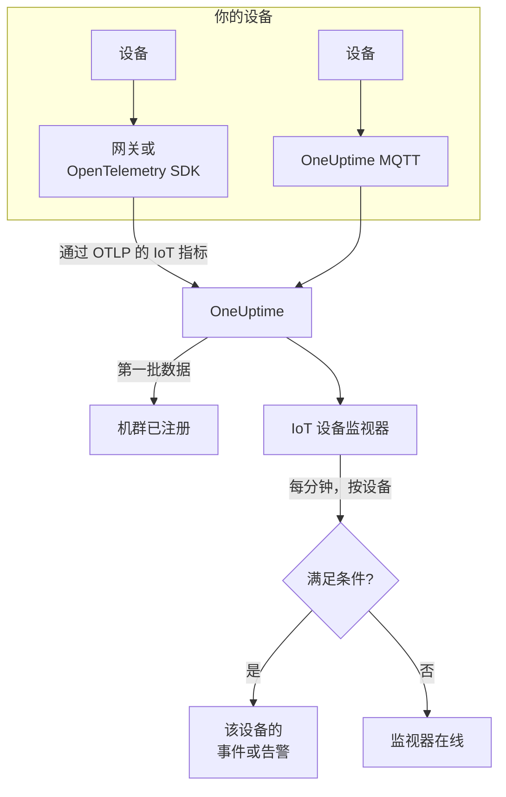

# IoT 设备监控

IoT 设备监视器监视一个设备机群，并在设备离线、电池电量低、信号变弱、过热或 CPU 持续繁忙时通知你。它读取你的设备通过 OpenTelemetry 或 MQTT 发送到 OneUptime 的 `iot_*` 指标，因此不会从外部进行任何检查，也不涉及探测器。

:::cards
- [创建监视器](#创建-iot-设备监视器): 在仪表板中的六个步骤。
- [模板](#预置告警模板): 五个现成的告警，每个设备一个事件。
- [离线检测](#离线检测): 如何发现死机或静默的设备。
- [指标](#采集的指标): 监视器读取的 `iot_*` 序列。
:::

## 工作原理

你的设备(或与它们通信的网关)把读数发送到 OneUptime：通过 OpenTelemetry，或直接发送到 OneUptime 的 MQTT 端点。每个读数都带有机群的名称 `iot.fleet.name` 和设备自己的 ID `device.id`。第一批数据到达时会注册该机群。

IoT 设备监视器绑定到一个机群。它每分钟对该机群的指标运行一次查询，并将结果与其条件进行比较。模板按 `device.id` 分组，因此 30 个离线的传感器会打开 30 个事件，每个事件都写出它的设备，并在该设备恢复时自行解决。



## 开始之前

- **让你的设备开始上报。** [IoT 设备指南](/docs/telemetry/iot-devices) 介绍了如何用 OpenTelemetry SDK 或 Collector，或通过 MQTT 发送指标。
- **确认机群已注册。** 它会以设备发送的 `iot.fleet.name` 命名，出现在 **产品 → 基础设施 → IoT → All Fleets** 下。
- **注册你预期的设备**，在机群的 **Device Registry** 下注册，这样设备静默时你会收到通知：请参阅 [离线检测](#离线检测)。

## 创建 IoT 设备监视器

:::steps
### 新建监视器

进入 **监视器**，点击 **创建监视器**。

### 选择 IoT Device

在 **监视器类型** 下点击 **更多监视器类型**，然后在 **基础设施** 下选择 **IoT Device**，或在搜索框中输入 `iot`。输入 **名称**(它会用在事件和告警标题中)，然后点击 **下一步**。

### 选择机群

在 **IoT Monitor Configuration** 下，从 **IoT Fleet** 中选择机群。每个发送过数据的机群都在列表中。

### 选择要监视的内容

选择三个选项卡之一：

- **Quick Setup**：点击一个 [模板](#预置告警模板)。它会设置指标、聚合、时间范围、按 `device.id` 的分组和阈值，并用自己的条件替换下面的条件。你仍然可以修改 **时间范围**。
- **Custom Metric**：从 **IoT Metric** 中选择一个指标，然后设置 **聚合** 和 **时间范围**。[过滤器](#监视器设置) 可以把它缩小到一个设备或一种设备类型。自定义指标不分组：它把整个机群作为一个整体来判断。
- **高级**：在 **选择指标** 下自己构建查询和公式，也可以使用你自己的指标名称，例如已用内存占设备内存大小的百分比。用 `device.id` 进行 **Group by**，即可分别判断每个设备。

### 检查条件

打开 **监视器条件** 下的每个条件，检查其 **Select Metric Variable**、**聚合**、**条件** 和 **Threshold**。模板会填写这些内容。使用 **Custom Metric** 或 **高级** 时，监视器从 [默认条件](#默认条件) 开始，它只会注意到指标降为零，所以请设置你自己的阈值。

### 创建监视器

点击 **创建监视器**。OneUptime 会打开监视器的页面，并每分钟评估一次。它发出的事件和告警会像其他任何监视器一样，送达你的值班策略、Slack、Microsoft Teams、电子邮件、短信和 Webhook。
:::

> [!TIP]
> 要一次设置多个模板，请从 **产品 → 基础设施 → IoT** 打开机群，然后进入 **Recommendations**。选择你需要的模板和要呼叫的人员，OneUptime 会为每个模板创建一个监视器。

## 监视器设置

| 字段 | 选项卡 | 作用 |
| --- | --- | --- |
| **IoT Fleet** | 全部 | 必填。把每个查询限定到 `resource.iot.fleet.name`。 |
| **资源范围** | Custom Metric、高级 | 可选。**设备** 或 **Fleet**：对 `iot.scope` 属性的精确匹配。选择指标后会设置为 **设备**。 |
| **Device ID** | Custom Metric、高级 | 可选。一个设备，按其 `device.id`，例如 `sensor-001`。 |
| **Device Type** | Custom Metric、高级 | 可选。上报该 `iot.device.type` 的设备，例如 `sensor` 或 `gateway`。 |
| **IoT Metric** | Custom Metric | [目录](#采集的指标) 中的一个指标。 |
| **聚合** | Custom Metric | 如何合并样本：**平均值**、**最大值**、**最小值**、**总和** 或 **计数**。从该指标的常用聚合开始。 |
| **时间范围** | 全部 | 查询读取的滚动窗口，从 **Past 1 Minute** 到 **Past 365 Days**。新监视器从 **Past 1 Minute** 开始；模板会设置自己的值。 |
| **选择指标** | 高级 | 查询构建器：**指标**、**Aggregate by**、**Filter by attributes**、**Group by**，以及用于合并查询的 **添加指标** 和 **添加公式**。 |

过滤器会同时生效：同时设置了 **Device ID** 和 **Device Type** 时，其他类型的设备什么也匹配不到。

## 预置告警模板

**Quick Setup** 提供 5 个模板。每个模板都会构建一个完整的监视器：指标查询、按 `device.id` 的分组、一个触发条件和一个恢复条件。阈值是可以编辑的起点。

只有当条件在窗口的每一分钟都成立时，条件才会触发——**Device Offline** 除外，它在第一次读数低于 1 时就会触发。阈值条件会在越过阈值 10% 后恢复，因此在这条线附近徘徊的值不会来回切换。

| 模板 | 类别 | 严重程度 | 监视内容 | 触发条件 | 恢复条件 |
| --- | --- | --- | --- | --- | --- |
| Device Offline | 可用性 | 严重 | `iot_device_up`，按 `device.id` 取 Min，过去 30 分钟 | 任一读数低于 1，或某个已注册的设备在整个窗口内什么也没发送 | 恢复为 1 |
| Low Battery | Power | Warning | `iot_battery_percent`，按 `device.id` 取 Avg，过去 5 分钟 | 低于 20% | 达到或高于 22% |
| Weak Signal | Connectivity | Warning | `iot_signal_strength_dbm`，按 `device.id` 取 Avg，过去 5 分钟 | 低于 -100 dBm | 达到或高于 -90 dBm |
| High Temperature | 环境 | 严重 | `iot_temperature_celsius`，按 `device.id` 取 Max，过去 5 分钟 | 高于 70 °C | 达到或低于 63 °C |
| High CPU Usage | System | Warning | `iot_cpu_usage_ratio`，按 `device.id` 取 Avg，过去 5 分钟 | 高于 0.9(其 CPU 的 90%) | 达到或低于 0.81 |

**严重程度** 是选择器显示的标签。模板创建的事件和告警以项目中最严重的事件和告警严重程度开始；可以在条件中修改。

- **Device Offline 读取 30 分钟**，这样每隔几分钟上报一次的设备不会在两次上报之间被判定为离线。上报频率低于大约每 15 分钟一次的设备需要更长的窗口。
- **High Temperature 在每一分钟内使用 Max**，这样一次高温读数不会被同一分钟内较低的读数掩盖。它仍然必须在窗口的每一分钟都保持高温。
- **High CPU Usage 比较的是比率：** `iot_cpu_usage_ratio` 的范围是 0 到 1，因此 0.9 就是 90%。

## 离线检测

当设备上报 `iot_device_up = 0` 时，**Device Offline** 会触发。死机或静默的设备会通过三种方式触发它：

| 方式 | 会发生什么 |
| --- | --- |
| **网关上报** | 网关或采集器为它无法再访问的设备发送 `iot_device_up = 0`。 |
| **MQTT Last Will** | 连接到 OneUptime MQTT 端点的设备会在其 `status` 主题上注册一个 Last Will。设备死机时，代理服务器会在会话断开的那一刻为它发送 `iot_device_up = 0`：无需轮询，也无需等待错过的上报。请参阅 [通过 MQTT 发送指标](/docs/telemetry/iot-devices#通过-mqtt-发送指标)。 |
| **设备已注册** | 机群 **Device Registry** 中的设备是预期会上报的。它在整个窗口内什么也没发送时，监视器会把它当作上报了 `0`，因此它会得到自己的事件，并在设备再次上报时自行解决。 |

已注册的设备还会以离线状态保留在机群的清单中，而未注册的设备在静默 15 分钟后会被移除。静默检测需要在 `iot_device_up` 的条件上使用 **Treat As Zero** 无数据策略，从模板创建的 Device Offline 监视器已经带有该策略。在设备注册功能出现之前创建的 Device Offline 监视器，需要手动设置该策略，或从模板重新创建。

> [!NOTE]
> 没有 Last Will 也没有网关上报就静默的未注册设备，只是停止发送数据，而按设备分组的监视器无法把它单独找出来。请注册你的设备，或者为关键设备单独设置一个监视器(使用其 **Device ID** 的 **Custom Metric**)，并把 **如果无数据** 设置为 **触发器**。静默检测还需要机群中至少还有一个其他设备在上报：一个完全失联的机群(例如在网关故障期间)只会为该监视器发出一个事件，而不是每个设备一个。

## 采集的指标

每个序列都带有设备的 `device.id` 标签，以及 `iot.scope`、`iot.device.type` 和 `iot.device.kind` 属性。

| 指标 | 单位 | 描述 |
| --- | --- | --- |
| `iot_device_up` | — | 设备运行时为 1，宕机或离线时为 0。 |
| `iot_battery_percent` | `%` | 剩余电量，0 到 100。电量下降意味着设备很快会停止上报。 |
| `iot_signal_strength_dbm` | `dBm` | 无线信号强度。越接近 0 越强；信号变弱通常发生在连接中断之前。 |
| `iot_temperature_celsius` | `°C` | 设备的温度。读数过高可能意味着硬件过热，或其周围存在问题。 |
| `iot_cpu_usage_ratio` | `ratio` | 正在使用的 CPU，从 0 到 1，1 表示满载。 |
| `iot_memory_usage_bytes` | `bytes` | 正在使用的内存。与设备的内存大小比较，即可看出内存压力。 |
| `iot_uptime_seconds` | `s` | 设备已运行的时长。重启时会降为零。 |

## 监控条件

条件把监视器的某个查询或公式与阈值进行比较。IoT 设备监视器的条件只提供一种 **过滤器类型**，即 **Metric Value**：每条规则都用以下字段检查指标值。

| 字段 | 作用 |
| --- | --- |
| **过滤器类型** | 始终为 **Metric Value**，这是该监视器提供的唯一检查。 |
| **Select Metric Variable** | 要检查的查询或公式，按其变量名。 |
| **聚合** | 窗口中的值如何变成一个答案：**平均值**、**总和**、**Maximum Value**、**Minimum Value**、**All Values**(每个值都必须匹配)或 **Any Value**(一个就够)。 |
| **条件** | **Greater Than**、**Less Than**、**Greater Than Or Equal To**、**Less Than Or Equal To** 或 **Equal To**——或者一个异常条件：**Anomalously High**、**Anomalously Low** 或 **Anomalous**。 |
| **Threshold** | 用于比较的值。指标有单位时，旁边会有一个单位列表。异常条件不显示此字段。 |
| **灵敏度** | 仅限异常条件。**低**(4σ)、**中**(3σ，默认)或 **高**(2σ)。 |
| **基线窗口** | 仅限异常条件。14 天(默认)、28、60 或 90 天的历史。 |
| **如果无数据** | 位于 **更多字段** 下。某个序列在窗口中没有样本时会发生什么：**Ignore**(默认)跳过它，**Treat As Zero** 把它读作 `0`，**触发器** 让条件匹配。 |

异常条件会把每个值与基线中一周内相同时段的值进行比较。在基线窗口积累足够的历史之前，它们会一直处于 "Learning" 状态，不会发出任何告警。

### 默认条件

不是从模板构建的监视器以两个条件开始：

| 顺序 | 条件 | 匹配时机 | 然后 |
| --- | --- | --- | --- |
| 1 | Check if _monitor name_ is offline | 第一个查询的任意值为 `0` | 把监视器标记为 **离线**，并声明事件 "_monitor name_ is offline"，监视器恢复时该事件会自行解决。 |
| 2 | Check if _monitor name_ is online | 任意值大于 `0` | 把监视器标记为 **运行正常**。 |

> [!IMPORTANT]
> 静默不会匹配任何一个条件：停止发送数据的机群会让监视器保持原样。要在数据停止时收到通知，请在某个条件上把 **如果无数据** 设置为 **触发器**。OneUptime 自身未接收数据的时间永远不算作没有数据：窗口包含这段时间的检查会改为等待，正如 [OneUptime 未接收数据时](/docs/monitor/when-oneuptime-is-not-receiving) 所解释的那样。

## Terraform

[OneUptime Terraform 提供程序](/docs/terraform/monitor-steps) 在 `iot_monitor` 属性中承载 IoT 设备监视器步骤的配置：即 `iotMonitor` 配置(`fleetIdentifier`、`resourceFilters`、`metricViewConfig`、`rollingTime`)的原始 JSON，用 `jsonencode()` 编写：

```hcl title="main.tf"
monitor_steps = [{
  iot_monitor = jsonencode({
    fleetIdentifier = "building-a-sensors"
    resourceFilters = {}
    rollingTime     = "Past 5 Minutes"
    metricViewConfig = {
      queryConfigs = [{
        metricAliasData = { metricVariable = "battery_percent", title = "Battery", description = "", legend = "" }
        metricQueryData = {
          filterData = {
            metricName     = "iot_battery_percent"
            attributes     = {}
            aggegationType = "Avg"
            aggregateBy    = {}
          }
          groupByAttributeKeys = ["device.id"]
        }
      }]
      formulaConfigs = []
    }
  })
  criteria = [ /* ... */ ]
}]
```

`fleetIdentifier` 是机群的 `iot.fleet.name`，而不是它的 OneUptime ID。

## 故障排查

:::details 机群不在 IoT Fleet 列表中
机群会根据设备的数据自行注册。请检查设备是否发送了 `iot.fleet.name`，并按照 [IoT 设备指南](/docs/telemetry/iot-devices) 确认数据已经到达。
:::

:::details 整个机群只触发一个事件，而不是每个设备一个
查询没有分组。使用 **Custom Metric** 的监视器把机群作为一个整体来判断；请使用模板，或在 **高级** 中用 `device.id` 进行 **Group by**。
:::

:::details 设备死机了，但 Device Offline 没有触发
设备没有发送 Last Will，也没有网关上报它，因此它只是静默了。请在机群的 **Device Registry** 中注册它，并检查 `iot_device_up` 条件的 **如果无数据** 是否为 **Treat As Zero**。请参阅 [离线检测](#离线检测)。
:::

:::details Device Offline 对正常的设备触发
它们的上报频率低于 30 分钟窗口所能覆盖的频率，因此有些窗口中没有它们的任何数据。请延长 **时间范围**，或让设备更频繁地上报。在 WebSocket MQTT 端点上，请把 MQTT keepalive 保持在 5 分钟以下：OneUptime 会在 300 秒后关闭空闲的 WebSocket 连接，这会发送 Last Will。
:::

:::details 模板没有显示数据
模板会精确读取 `iot_*` 指标名称，并按 `device.id` 标签分组。请在机群的 **指标** 页面上，把你的设备发送的内容与 [指标约定](/docs/telemetry/iot-devices#指标约定) 进行比较。
:::

## 后续步骤

:::cards
- [IoT 设备](/docs/telemetry/iot-devices): 通过 OpenTelemetry 或 MQTT 发送设备指标。
- [指标监控](/docs/monitor/metrics-monitor): 对任何指标发出告警，而不仅仅是 IoT 指标。
- [事件与告警模板](/docs/monitor/incident-alert-templating): 把设备的 ID 放进事件标题。
:::
